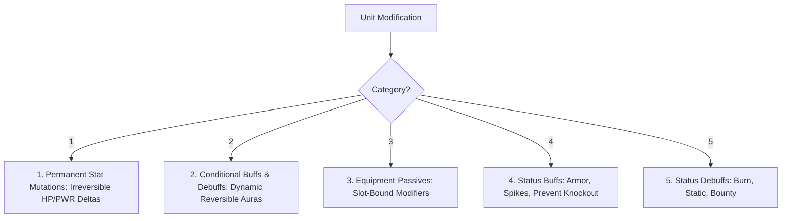
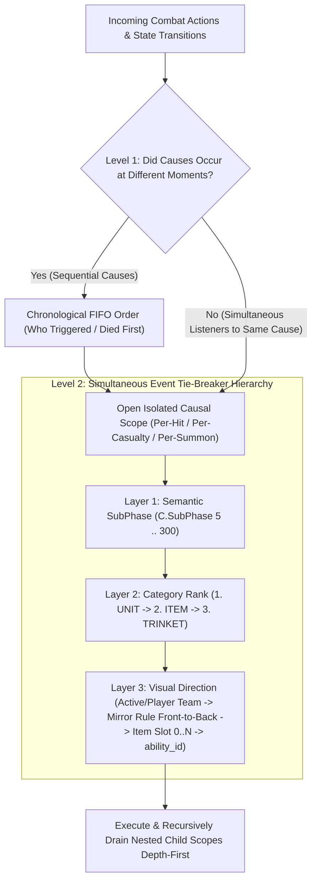
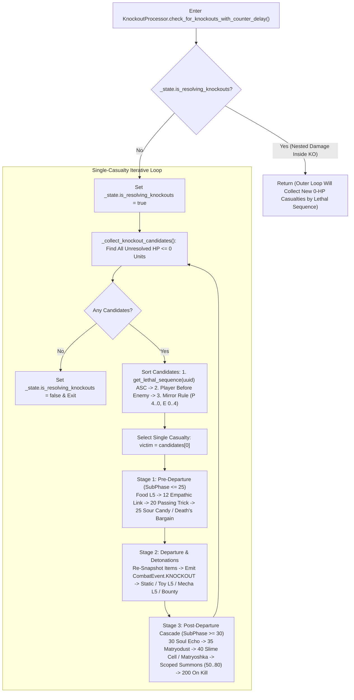

# Action Constitution v1 — Flashcard Heroes Resolution Architecture

**Status:** Authoritative Architectural Design & Migration Specification  
**Reference Research:** [Action_Constitution_v1_Monster_Train_Research.md](file:///Users/danhh/Desktop/Flashcard%20Heroes/docs/Action_Constitution_v1_Monster_Train_Research.md)  
**Future Ideas Catalog:** [new_trigger_and_mechanic_ideas.md](file:///Users/danhh/Desktop/Flashcard%20Heroes/docs/new_trigger_and_mechanic_ideas.md)  
**Primary Systems Impacted:** [`CombatSimulator`](file:///Users/danhh/Desktop/Flashcard%20Heroes/scripts/battle/CombatSimulator.gd), [`CausalReactionResolver`](file:///Users/danhh/Desktop/Flashcard%20Heroes/scripts/battle/CausalReactionResolver.gd), [`KnockoutProcessor`](file:///Users/danhh/Desktop/Flashcard%20Heroes/scripts/battle/KnockoutProcessor.gd), [`BattleState`](file:///Users/danhh/Desktop/Flashcard%20Heroes/scripts/battle/BattleState.gd), [`AbilityResolver`](file:///Users/danhh/Desktop/Flashcard%20Heroes/scripts/AbilityResolver.gd), [`CombatEvent`](file:///Users/danhh/Desktop/Flashcard%20Heroes/scripts/CombatEvent.gd), [`ActionQueue`](file:///Users/danhh/Desktop/Flashcard%20Heroes/scripts/engine/ActionQueue.gd), [`ReplayController`](file:///Users/danhh/Desktop/Flashcard%20Heroes/scripts/engine/replay/ReplayController.gd)

---

## 1. Executive Summary & Purpose

Flashcard Heroes is an arcade gacha auto-battler featuring rich reactive combat, equipment, trait synergies, and a deterministic record/replay pipeline. As content complexity grows (counter-attacks, damage mitigation, chain detonations, on-knockout stat inheritances), treating action execution as a flat priority queue or an ad-hoc callback loop causes subtle bugs:
- **Priority Arms Race:** Using magic priority integers (`300`, `210`, `100`, `50`, `-50`, `-100`) to artificially force interception or counter-attacks before or after damage.
- **Unresolved 0-HP & Timing Glitches:** Units reaching 0 HP mid-turn while collateral damage or buffs continue to target or bypass them.
- **Untyped Dictionaries:** Fragile string lookups (`victim_uuid` vs. `dying_uuid` vs. `knocked_out_ally_uuid`) leading to fallback code and silent failures.
- **Dual Pipeline Fragmentation:** Non-combat actions pass through [`ActionQueue`](file:///Users/danhh/Desktop/Flashcard%20Heroes/scripts/engine/ActionQueue.gd) via [`GameAction`](file:///Users/danhh/Desktop/Flashcard%20Heroes/scripts/engine/actions/GameAction.gd), whereas combat actions execute through an independent `_actor_queue` in [`CombatSimulator`](file:///Users/danhh/Desktop/Flashcard%20Heroes/scripts/battle/CombatSimulator.gd).

This document adapts the architectural lessons of Monster Train (layered resolution, causal trees, eligibility vs. execution separation, granular semantic sub-phases) into **Flashcard Heroes**. 

Crucially, **we do not use Monster Train’s grimdark jargon (Death, Kill, Slay, Extinguish, Harvest, Revenge)** nor vague, cute metaphors (Parting Gift, Witness, Cheer, Snack, Settle). Instead, we establish a **descriptive, unambiguous, multi-word "Action-Condition" vocabulary** that satisfies the **Zero-Tooltip Standard**:
> A player reading an ability card must immediately understand who, when, and what condition triggers the effect without needing an explanatory tooltip.

This vocabulary is strictly unified across:
1. **Engine Implementation:** GDScript classes, constants, enums, signal payloads, and log events.
2. **Player-Facing Presentation:** Ability card badges, descriptions, combat floating text, and the combat log.
3. **Deterministic Replay Guarantee:** Full preservation of deterministic seeding and state digests for [`ReplayController`](file:///Users/danhh/Desktop/Flashcard%20Heroes/scripts/engine/replay/ReplayController.gd) and headless automated testing.

---

## 2. Terminology & Semantic Dictionary (Implemented Game Mechanics)

Every entry in this section corresponds strictly to an **actively implemented mechanic** in the Flashcard Heroes codebase. (Novel/prospective triggers are cataloged separately in [new_trigger_and_mechanic_ideas.md](file:///Users/danhh/Desktop/Flashcard%20Heroes/docs/new_trigger_and_mechanic_ideas.md)).

### 2.1 The "From Existing Code to Clear Semantics" Migration Mapping

This table provides a 1-to-1 dictionary showing how every existing trigger in [`Constants.gd`](file:///Users/danhh/Desktop/Flashcard%20Heroes/scripts/Constants.gd) and the codebase maps to the new descriptive vocabulary:

| Current Code Term in Engine | New Canonical Engine Constant | Player-Facing Card Tag | Player-Facing Sentence Syntax | Concrete Game Example |
| :--- | :--- | :--- | :--- | :--- |
| `&"on_death"` | `TRIGGER_WHEN_KNOCKED_OUT` | **`[When Knocked Out]`** | *"When this unit is knocked out..."* | `Empathic Link`, `Mimic Pop` |
| `&"on_ally_death"` | `TRIGGER_WHEN_ALLY_KNOCKED_OUT` | **`[When Ally Knocked Out]`** | *"When an ally is knocked out..."* | `Ally Death Buff`, `Standard Bearer` |
| `&"on_kill"` | `TRIGGER_ON_KNOCKOUT_BLOW` | **`[On Knockout Blow]`** | *"When knocking out an enemy..."* | `Hero Timekeeper` (Gold on Kill) |
| `&"on_unit_death"` | `TRIGGER_WHEN_ANY_UNIT_KNOCKED_OUT`| **`[When Any Unit Knocked Out]`**| *"Whenever any unit is knocked out..."*| Observer passives |
| `execute_on_lethal` (flag) | `TRIGGER_BEFORE_BEING_KNOCKED_OUT`| **`[Before Being Knocked Out]`** | *"When receiving lethal damage, before being knocked out..."* | `Tier 1B Counter-Attack`, `Death's Bargain` |
| `LETHAL_SAVE` (legacy event) | `TRIGGER_PREVENT_KNOCKOUT` / `PREVENT_KNOCKOUT` | **`[Prevent Knockout]`** | *"Once per turn: When an ally would be knocked out, prevent the knockout and leave them with 1 HP instead."* | `Aegis Charm` |
| `&"on_attack"` | `TRIGGER_WHEN_ATTACKING` | **`[When Attacking]`** | *"When attacking..."* | `Tiger's Spirit`, Basic Attack |
| `&"on_before_damage"` | `TRIGGER_BEFORE_TAKING_DAMAGE` | **`[Before Taking Damage]`** | *"Before taking damage..."* | `Defensive Stance` (Shield before impact) |
| `&"on_hurt"` | `TRIGGER_WHEN_TAKING_DAMAGE` | **`[When Taking Damage]`** | *"When hurt by an attack..."* | `Passive Heal`, `Phoenix Elixir`, Spikes |
| `&"on_damage_dealt"` | `TRIGGER_WHEN_DEALING_DAMAGE` | **`[When Dealing Damage]`** | *"When dealing damage..."* | `Lifesteal` |
| `&"on_ally_hurt"` | `TRIGGER_WHEN_ALLY_TAKES_DAMAGE` | **`[When Ally Takes Damage]`** | *"When an ally takes damage..."* | `Ally Shield` |
| `&"passive_intercept"` | `TRIGGER_ON_INTERCEPT_ATTACK` | **`[Intercept Attack]`** | *"Intercepts attacks targeting allies..."* | `Guardian` |
| `&"on_battle_start"` / `pre_combat`| `TRIGGER_AT_BATTLE_START` | **`[At Battle Start]`** | *"At the start of battle..."* | `Insignia Battle Start`, Toy trait |
| `&"on_turn_start"` | `TRIGGER_AT_START_OF_TURN` | **`[At Start of Turn]`** | *"At the start of this unit's turn..."* | `Koi's Blessing`, `Polished Plate` |
| `&"on_turn_end"` | `TRIGGER_AT_END_OF_TURN` | **`[At End of Turn]`** | *"At the end of the turn..."* | Burn status damage, `Banner Reinforce Summon` |
| `&"on_ally_summon"` | `TRIGGER_WHEN_ALLY_SUMMONED` | **`[When Ally Summoned]`** | *"When an ally is summoned..."* | `Mecha`, `Fire`, `Water Insignias` |
| `&"on_enemy_summon"` | `TRIGGER_WHEN_ENEMY_SUMMONED` | **`[When Enemy Summoned]`** | *"When an enemy is summoned..."* | Anti-summon abilities |
| `&"on_board_enter"` | `TRIGGER_ON_BOARD_ENTER` (Engine) | **`[When Entering Board]`** | *(Internal engine mounting event)* | `Merchant` initial PWR snapshot |
| `&"on_draw"` | `TRIGGER_WHEN_DRAWN` | **`[When Drawn]`** | *"When drawn from the gacha..."* | `Support Insignia`, `Merchant` |
| `&"on_merge"` | `TRIGGER_WHEN_MERGED` | **`[When Merged]`** | *"When merged..."* | `Merge Growth`, `Royal Insignia` |
| `&"on_token_spent"` | `TRIGGER_WHEN_SPENDING_TOKENS` | **`[When Spending Tokens]`** | *"When spending a token..."* | `Boss Token Drain` |
| `&"on_gold_earned"` | `TRIGGER_WHEN_GAINING_GOLD` | **`[When Gaining Gold]`** | *"When gaining Gold..."* | `Merchant` dynamic scaling |
| `&"on_bounty_rewarded"` | `TRIGGER_WHEN_CLAIMING_BOUNTY` | **`[When Claiming Bounty]`** | *"When claiming a bounty..."* | `Bounty Hunter` Gold reward |
| `&"on_healed"` | `TRIGGER_WHEN_HEALED` | **`[When Healed]`** | *"When healed..."* | Unit HP restoration |
| `&"on_stat_increased"` | `TRIGGER_WHEN_GAINING_STATS` | **`[When Gaining Stats]`** | *"When gaining PWR or HP..."* | Dynamic stat buff actions |
| `&"on_stat_decreased"` | `TRIGGER_WHEN_LOSING_STATS` | **`[When Losing Stats]`** | *"When losing PWR or HP..."* | Debuff stat reduction actions |
| `&"on_board_changed"` (Buff) | `TRIGGER_ON_BOARD_CHANGED` (Engine)| **`[Conditional Buff]`** | *"While [Condition], gain +X..."* | `Rusty Ring` (unequipped), `Twin Charm` |
| `&"on_board_changed"` (Debuff) | `TRIGGER_ON_BOARD_CHANGED` (Engine)| **`[Conditional Debuff]`** | *"While [Condition], lose -X..."* | Continuous negative auras / burdens |

---

### 2.2 Deep Semantic Clarifications: Lethal Pre-Knockout & Aegis

#### 1. What does `[Before Being Knocked Out]` Mean?
In the codebase, `execute_on_lethal` (found on [`AbilityDefinition.gd:62`](file:///Users/danhh/Desktop/Flashcard%20Heroes/scripts/AbilityDefinition.gd#L62), [`CausalReactionResolver.gd:233`](file:///Users/danhh/Desktop/Flashcard%20Heroes/scripts/battle/CausalReactionResolver.gd#L233), and [`DeathProcessor.gd:100`](file:///Users/danhh/Desktop/Flashcard%20Heroes/scripts/battle/DeathProcessor.gd#L100)) governs units that take fatal damage reducing HP to $\le 0$, but **are permitted to perform a final action before being removed from the board**:
- **Example 1 (`Unit Tier 1B Counter-Attack`):** Takes lethal damage from an enemy attack. Before being knocked out, it fires its counter-attack projectile back at the attacker.
- **Example 2 (`Death's Bargain` item / `KamikazeCommand`):** Takes fatal damage. Before being knocked out, it lunges across the board to strike the highest-HP enemy.
- **Player-Facing Phrasing:** Rather than confusing phrases like *"Triggers even if lethal"* or *"Lethal Counter"*, abilities use:
  **`[Before Being Knocked Out]`**: *"When receiving lethal damage, before being knocked out, shoot a projectile at the attacker dealing PWR damage."*

#### 2. Aegis Trinket Ability: Descriptive Effect Naming — "Prevent Knockout"
The current description in `localization/game.csv:97` reads: *"Once per turn: When an ally would die, they survive with 1 HP instead."*  
We do not clutter the ability title or card badge with "1 HP". The cleanest, most descriptive term is **Prevent Knockout**:
- **Canonical Ability & Effect Name:** **Prevent Knockout**
- **Player-Facing Tag:** **`[Prevent Knockout]`**
- **Engine Constant:** `TRIGGER_PREVENT_KNOCKOUT = &"prevent_knockout"`
- **Combat Event Enum:** `CombatEvent.Type.PREVENT_KNOCKOUT`
- **Canonical Ability Description:** *"Once per turn: When an ally would be knocked out, prevent the knockout and leave them with 1 HP instead."*

---

### 2.3 Battle Lifecycle & Turn Consistency

Battle progression follows an invariant lifecycle:
$$\text{Battle Start} \longrightarrow \text{Turn Start} \longrightarrow \text{Turn End} \longrightarrow \text{Battle Over}$$

- **`[At Battle Start]` (`TRIGGER_AT_BATTLE_START`)**: Fires once per combat encounter before any unit acts (pre-combat setup, trait triggers).
- **`[At Start of Turn]` (`TRIGGER_AT_START_OF_TURN`)**: Fires when an individual unit receives its turn opportunity before declaring an attack.
- **`[At End of Turn]` (`TRIGGER_AT_END_OF_TURN`)**: End-of-turn maintenance window where Burn damage resolves, Regeneration heals, and status durations tick.
- **`Battle Over` (`PHASE_BATTLE_OVER`)**: Lifecycle boundary where combat simulation terminates, the Victory/Defeat popup triggers, and the board resets for management. There are no in-combat ability triggers after battle ends.

---

### 2.4 Monster Train Alignment: Stats vs. Conditional Buffs/Debuffs vs. Status Effects

Following Monster Train's architectural model, we strictly decouple **five distinct categories** of unit modifications:



#### 1. Permanent Numeric Stat Mutations (HP / PWR)
Irreversible additions or subtractions to the unit's numeric combat pools:
- **`[When Healed]` / `[When Gaining HP]` (`TRIGGER_WHEN_HEALED`)**: Direct permanent HP pool additions (Flashcard Heroes has no Max HP cap).
- **`[When Gaining PWR]` (`TRIGGER_WHEN_GAINING_PWR`)**: Direct permanent PWR additions (e.g. `Empathic Link` transferring PWR on knockout).
- **`[When Losing PWR]` (`TRIGGER_WHEN_LOSING_PWR`)**: Direct permanent PWR reductions.

#### 2. Conditional Buffs & Conditional Debuffs (Dynamic Auras & Trinkets)
Reversible stat modifiers granted by trinkets or board passives that remain active **strictly while a condition is satisfied**:
- **`[Conditional Buff]` Examples:**
  - **`Rusty Ring`**: Grants $+1$ HP and $+1$ PWR to all units with no equipment. *Equipping an item immediately cancels this buff.*
  - **`Twin Charm`**: Units gain $+1$ PWR for every 2 copies of that same unit in the battle pool. Dynamically increases or decreases as copies are deployed, merged, or knocked out.
  - **`Resilient Aura / Insignia Auras`**: Team-wide stat boosts active while the aura provider remains in the lineup.
- **`[Conditional Debuff]` Examples:**
  - Dynamic negative modifiers from boss trinkets, hexes, or enemy passives (e.g. *"Units in the front slot suffer -2 PWR"* or *"While opposing 3+ enemies, lose -1 PWR"*).
- **Invariants for Conditional Buffs & Debuffs:**
  1. **Dynamic Recalculation:** Handled via `TRIGGER_ON_BOARD_CHANGED`. Whenever units are deployed, merged, equipped, or knocked out, the bonus delta is recalculated.
  2. **Automatic Revocation:** The moment the condition is broken (e.g. unit equips an item), the bonus is stripped cleanly.
  3. **Zero Merge-Baking:** On unit merges, conditional buffs are **never baked into the merged base stats**. The merge calculates base stats exclusively from core unit definitions, and conditional auras re-evaluate on top of the newly formed board.
  4. **Not a Heal:** Receiving a conditional $+1$ HP buff from Rusty Ring is **not a heal** and does not trigger `[When Healed]`.

#### 3. Equipment Passives (`While Equipped`)
A physical sub-case of conditional buffs bound directly to an equipped item slot:
- **`[While Equipped]`**: Passive stats granted while an item resides in a unit's inventory slot (e.g. `+1 HP`, `+2 PWR`).
- Reversible upon unequip; preserved on the item instance during unit merges rather than merged into base stats.

#### 4. Status Buffs (Positive Status Effects)
Discrete stacked beneficial counters with unique mechanical rules:
- **Armor (`effect_armor`)**: Absorbs incoming attack damage before HP loss.
- **Spikes (`effect_spikes`)**: Deals unmitigated reactive damage to attackers when hurt.
- **Prevent Knockout (`effect_aegis`)**: Consumed to save a unit from fatal damage, preserving them at 1 HP.
- *(Status Buffs do not trigger from raw numeric HP heals or equipped item passive stats).*

#### 5. Status Debuffs (Negative Status Effects)
Discrete stacked harmful counters with unique mechanical rules:
- **Burn (`effect_burn`)**: Deals damage at `[At End of Turn]`.
- **Static (`effect_static`)**: Discharges bonus damage upon the unit's next attack.
- **Bounty (`bounty_marked`)**: Awards Gold when the bearer is knocked out.
- *(Status Debuffs do not trigger from unequipping an item or taking standard attack damage).*

---

## 3. Current Architecture Audit & Identified Deficiencies

An audit of the existing codebase reveals five structural challenges that Action Constitution v1 resolves:

### 3.1 The Priority Arms Race
* **Current State:** In [`AbilityDefinition.gd`](file:///Users/danhh/Desktop/Flashcard%20Heroes/scripts/AbilityDefinition.gd#L27-L40), priorities are integers (`300`, `210`, `100`, `50`, `0`, `-50`, `-100`).
* **Deficiency:** When two abilities interact at the same timing window, developers invent arbitrary numbers (e.g. `310`, `45`, `12`). This masks causality under numeric sorting.
* **Solution:** Replace numeric priorities with **Granular Semantic Sub-Phases** and deterministic spatial tie-breakers.

### 3.2 Coupling of Trigger Eligibility and Execution
* **Current State:** [`AbilityResolver.process_trigger`](file:///Users/danhh/Desktop/Flashcard%20Heroes/scripts/AbilityResolver.gd#L316) immediately evaluates targets and enqueues an [`EffectRequest`](file:///Users/danhh/Desktop/Flashcard%20Heroes/scripts/EffectRequest.gd). If targets are knocked out before the request executes, [`CombatSimulator.resolve_effect_request`](file:///Users/danhh/Desktop/Flashcard%20Heroes/scripts/battle/CombatSimulator.gd#L445) performs runtime "lazy retargeting" or aborts.
* **Deficiency:** Decoupled timing leads to ghost targeting and inconsistent ability execution.
* **Solution:** Implement the MT2 two-stage pattern:
  1. `TestTrigger`: Validates condition against the triggering event and captures a snapshot into a `TriggerInstance`.
  2. `OnTriggered`: Re-evaluates target and caster invariants at the exact moment of execution before applying mutations.

### 3.3 Untyped Trigger Context
* **Current State:** Triggers pass untyped dictionaries:
  ```gdscript
  # AbilityResolver.gd
  context["knocked_out_ally_uuid"] = ...
  context["victim_uuid"] = ...
  context["attacker_uuid"] = ...
  ```
  Lookups routinely rely on fallbacks: `context.get("healed_uuid", context.get("unit_uuid", ""))`.
* **Deficiency:** Violates the project's Fail-Fast Law. Typos or missing keys fail silently instead of raising actionable stack traces.
* **Solution:** Introduce a strongly typed [`TriggerContext`](#52-strongly-typed-triggercontext) class.

### 3.4 Conflated Knockout & Detonation Pipeline
* **Legacy State:** Earlier knockout processing batched all dying units into a single wave, iterated internal lineup arrays in storage order (`PLAYER_LINEUP` slots `0 -> 4` Back-to-Front), and resolved all `[When Knocked Out]` reactions across all dying units before emitting any `KNOCKOUT` visual fade or resolving any `[When Ally Knocked Out]` reactions (`Soul Echo`, `Slime Cell`).
* **Deficiencies:**
  1. **Inverted Chronological Causality:** If a front-to-back cascade attack (`Shockwave`) struck Slot 4 (Front) first and Slot 3 second, iterating `PLAYER_LINEUP` in `0 -> 4` order processed Slot 3 before Slot 4—causing `Soul Echo` ("The first time an ally is knocked out each battle, summon a 1/1 copy") to resurrect the second victim instead of the first.
  2. **Interleaved Visual Scrambling:** Batching multiple casualties into shared sub-phase passes interleaved Unit A and Unit B's death effects in the [`CombatEvent`](file:///Users/danhh/Desktop/Flashcard%20Heroes/scripts/CombatEvent.gd) stream, making it difficult for the player to read which death caused which buff, summon, or explosion during VCR playback.
  3. **Premature Collateral Detonations:** Collateral damage could reduce a neighboring unit to 0 HP *before* the primary unit's on-knockout stat inheritance (`Empathic Link`) could pass stats to that neighbor.
* **Solution:** The **Single-Casualty 3-Stage Atomic Knockout Pipeline** (Section 6): casualties are sorted strictly by **chronological lethal transition order (`_lethal_sequence_by_uuid`) first**, with Team Precedence and the Mirror Rule (`Player 4 -> 0`, `Enemy 0 -> 4`) strictly as tie-breakers. Each casualty resolves its entire 3-stage death story (`Pre-Departure <= 25` $\to$ `Departure KNOCKOUT Event & Environmental Detonations` $\to$ `Post-Departure Cascade >= 30 & Scoped Summons`) **atomically and depth-first** before the next casualty's knockout begins.

### 3.5 Disconnected Non-Combat Actions
* **Current State:** Player actions (Shop, Inventory, Gacha Draw, Merge) pass through [`ActionQueue`](file:///Users/danhh/Desktop/Flashcard%20Heroes/scripts/engine/ActionQueue.gd). Combat, however, executes within [`CombatSimulator.execute_combat_turn`](file:///Users/danhh/Desktop/Flashcard%20Heroes/scripts/battle/CombatSimulator.gd#L255) using raw loops.
* **Deficiency:** Items or Trinkets that react to non-combat actions (e.g. `[When Drawn]`, `[When Merged]`) require special ad-hoc triggers hardcoded across UI classes.
* **Solution:** All gameplay operations originate as an **Authoritative Action** that follows the uniform lifecycle: $\text{Action} \to \text{Events} \to \text{Reactions} \to \text{Settlement}$.

---

## 4. The Action Constitution Resolution Hierarchy & Causal Philosophy

### 4.1 Core Design Philosophy: Causal Integrity & Player Readability
In a reactive auto-battler where simulation and presentation are strictly decoupled ([`CombatSimulator`](file:///Users/danhh/Desktop/Flashcard%20Heroes/scripts/battle/CombatSimulator.gd) emits an immutable stream of [`CombatEvent`](file:///Users/danhh/Desktop/Flashcard%20Heroes/scripts/CombatEvent.gd) records that [`BattleAnimator`](file:///Users/danhh/Desktop/Flashcard%20Heroes/scripts/BattleAnimator.gd) plays back sequentially like a VCR tape), **simulation execution order IS presentation playback order**.

To make every combat chain intuitive and readable moment-to-moment without requiring the player to mentally untangle interleaved animations, the Action Constitution enforces three foundational principles:
1. **Chronological Causality First (FIFO Across Distinct Causes):** If Cause A happens before Cause B (for example, Hit 1 of a multi-target `Shockwave` strikes the front unit before Hit 2 strikes the unit behind it, or Unit A drops to $\le 0$ HP before Unit B), **Cause A and its immediate causal consequences must resolve before Cause B**. Spatial board position (Slot Number) never overrides the chronological order in which events actually happened.
2. **Depth-First Causal Closure (One Complete Story at a Time):** When a unit triggers a reaction scope (such as a per-hit reaction window, a summon, or a knockout), the engine opens an isolated causal scope in [`CausalReactionResolver`](file:///Users/danhh/Desktop/Flashcard%20Heroes/scripts/battle/CausalReactionResolver.gd) and drains that scope completely—including nested child scopes such as `[When Ally Summoned]` reactions—before advancing to the next sibling event in the parent queue. On screen, the player sees **Cause A $\to$ Reaction A1 $\to$ Sub-Reaction A1a** finish completely before **Cause B** begins.
3. **1:1 State-to-Visual Parity:** Every state mutation (`apply_damage`, `apply_stat_delta`, item transfer, knockout removal, unit summon) immediately emits its corresponding [`CombatEvent`](file:///Users/danhh/Desktop/Flashcard%20Heroes/scripts/CombatEvent.gd) at the exact moment the state changes. A dying unit's pre-departure effects (`Empathic Link`, `Passing Trick`, `Death's Bargain`) execute and emit events **before** its `CombatEvent.Type.KNOCKOUT` fade event is emitted, and post-departure reactions (`Soul Echo`, `Slime Cell`, `Matryoshka`) execute and emit events **after** the `KNOCKOUT` fade event.

---

### 4.2 The Two-Level Causal Ordering Law

All combat actions, triggers, and knockouts are governed by a strict **Two-Level Causal Ordering Law** that separates **sequential events** (Level 1) from **simultaneous reactions to the same event** (Level 2):



#### Level 1: Across Sequential Causes — Chronological FIFO (Who Happened First)
Whenever two events or lethal transitions happen at different moments in time, **chronological order is absolute**:
- **Per-Hit Scopes in Multi-Hit / Cascade Attacks (`Shockwave`, `Repeater`, `Twin Strike`):** Each hit opens its own reaction scope (`begin_reaction_scope()`), enqueues `[When Dealing Damage]` and `[When Taking Damage]` reactions for that specific impact, and drains that scope before the next hit is applied (while deferring knockout sweeps on multi-target cascades until all hits of the single attack animation have landed so one attack does not visually split around a full death animation).
- **Monotonic Lethal Sequence Counter (`_lethal_sequence_by_uuid`):** In [`BattleState.gd`](file:///Users/danhh/Desktop/Flashcard%20Heroes/scripts/battle/BattleState.gd), the exact moment any unit's `current_hp` transitions to $\le 0$ inside [`BattleManager.apply_damage`](file:///Users/danhh/Desktop/Flashcard%20Heroes/scripts/BattleManager.gd), `_state.record_lethal_transition(instance.ball_uuid)` assigns a strictly increasing integer timestamp (`1, 2, 3...`).
  - If the unit remains at $\le 0$ HP and takes overkill damage, its original timestamp is preserved (first fatal blow wins).
  - If the unit is saved before its knockout resolves (e.g. `Aegis Charm` / [`EffectPreventLethal.gd`](file:///Users/danhh/Desktop/Flashcard%20Heroes/scripts/EffectPreventLethal.gd) restoring it to `1 HP`, or an earlier casualty's `Empathic Link` healing it above `0 HP` via [`BattleManager.apply_stat_delta`](file:///Users/danhh/Desktop/Flashcard%20Heroes/scripts/BattleManager.gd)), `_state.clear_lethal_transition(instance.ball_uuid)` erases its lethal timestamp and removes it from knockout eligibility.

#### Level 2: Within a Single Simultaneous Cause — The 3-Layer Priority Tie-Breaker
When a **single event** occurs (e.g., `AT_BATTLE_START`, `AT_END_OF_TURN`, a single attack impact, or a single unit's knockout) and **multiple abilities are eligible to react to that same event simultaneously**, [`CausalReactionResolver._compare_requests`](file:///Users/danhh/Desktop/Flashcard%20Heroes/scripts/battle/CausalReactionResolver.gd) orders those simultaneous reactions using three deterministic layers:

1. **Layer 1 — Semantic `SubPhase` (`C.SubPhase`, ascending `5 -> 300`):**
   Determines *what kind of mechanical step* happens first within the current event (e.g., `PRE_DAMAGE_MITIGATION (5)` before `DAMAGE_REACTION (15)`, or `KNOCKOUT_STAT_PASS (12)` before `ITEM_TRANSFER (20)` before `KNOCKOUT_REVIVE (30)`).
2. **Layer 2 — Source Category Rank (`UNIT -> ITEM -> TRINKET`):**
   Within the same `SubPhase`, inherent `UNIT` abilities resolve first (`0`), followed by equipped `ITEM` abilities (`1`), followed by global `TRINKET` passives (`2`).
3. **Layer 3 — Visual Direction (Team Precedence & The Mirror Rule):**
   Within the same `SubPhase` and `Category`, ties are broken by board position so the player's eye can scan naturally from the center of combat outward (**Front-to-Back**):
   - **Team Precedence:** The active team (or Player team on neutral phase boundaries) resolves before the opposing team.
   - **Spatial Order (The Mirror Rule — Front-to-Back from the Battle Line):**
     - **Player Team:** Slot 4 (Front) $\to$ Slot 3 $\to$ Slot 2 $\to$ Slot 1 $\to$ Slot 0 (Back).
     - **Enemy Team:** Slot 0 (Front) $\to$ Slot 1 $\to$ Slot 2 $\to$ Slot 3 $\to$ Slot 4 (Back).
   - **Intra-Unit Tie-Breaker:** Equipped item slot index (`0 -> N`), followed by lexical `ability_id`.

> [!IMPORTANT]
> **Why Slot Number is Strictly a Tie-Breaker (Level 2) and Never Overrides Chronology (Level 1):**
> If Unit B (Slot 2) takes fatal damage before Unit A (Slot 4)—for instance, from a backline sniper followed by a Spikes reflection on the frontline—Unit B died first (`lethal_seq = 1 < lethal_seq = 2`) and MUST resolve its knockout first. The Mirror Rule (`Slot 4 -> 0`) is consulted for knockout order **only** if two units somehow received identical lethal sequence timestamps.

---

## 5. Structural Core Specifications

### 5.1 Authoritative Semantic Sub-Phases (`C.SubPhase`)

Rather than arbitrary magic numbers, [`Constants.gd`](file:///Users/danhh/Desktop/Flashcard%20Heroes/scripts/Constants.gd) defines 16 explicit semantic sub-phases (`C.SubPhase`) used by [`CausalReactionResolver`](file:///Users/danhh/Desktop/Flashcard%20Heroes/scripts/battle/CausalReactionResolver.gd) and [`KnockoutProcessor`](file:///Users/danhh/Desktop/Flashcard%20Heroes/scripts/battle/KnockoutProcessor.gd):

```gdscript
# res://scripts/Constants.gd
enum SubPhase {
	PRE_DAMAGE_MITIGATION = 5,   # [Before Taking Damage] shields (Defensive Stance)
	LETHAL_SAVE = 10,            # [Prevent Knockout] saves (Aegis Charm -> 1 HP)
	KNOCKOUT_STAT_PASS = 12,     # [When Knocked Out] stat inheritance while unit is still on board (Empathic Link)
	DAMAGE_REACTION = 15,        # [When Taking Damage] & [Before Being Knocked Out] counters (Vulcannon, Rubber Ball, Passive Heal, Phoenix Elixir)
	ITEM_TRANSFER = 20,          # [When Knocked Out] item handoffs before unit leaves slot (Passing Trick)
	PRE_KNOCKOUT = 25,           # [When Knocked Out] final attacks/debuffs before visual fade (Sour Candy, Death's Bargain, BubbleGunger)
	KNOCKOUT_REVIVE = 30,        # [When Ally Knocked Out] revives into vacated slot (Soul Echo)
	KNOCKOUT_SUMMON_PREP = 35,   # [When Knocked Out] / [When Ally Knocked Out] pre-summon modifiers (Matryodust)
	KNOCKOUT_SUMMON = 40,        # [When Knocked Out] / [When Ally Knocked Out] token & unit spawns (Slime Cell, Matryoshka, Heavy Anvil)
	SUMMON_TRAIT_PASSIVE = 50,   # [When Ally Summoned] trait/insignia scaling (Mecha, Fire, Water Insignias)
	SUMMON_BUFF = 60,            # [When Ally Summoned] stat buffs on the newborn unit (Summon Blessing)
	SUMMON_AMBUSH = 80,          # [When Ally Summoned] immediate attacks after all summon buffs apply (Ambush)
	INTENT_LOCK = 90,            # [At Start of Turn] / [Before Attacking] setup & transforms (Mimic, Guardian)
	ON_ATTACK_BUFF = 100,        # [When Attacking] pre-hit self-buffs
	STANDARD = 200,              # Standard reactions ([When Dealing Damage] Lifesteal, [On Knockout Blow] Gold, general buffs)
	GRANT_EXTRA_ACTION = 300,    # Post-action extra attack queueing (Tiger's Spirit, Bloodlust)
}
```

#### Why the Sub-Phases Are Ordered This Way
- **Mitigation & Save (`5..10`) before Retaliation (`15`):** `Defensive Stance (5)` must grant Armor before damage is finalized, and `Aegis Charm (10)` must prevent lethal knockout and clear `_lethal_sequence_by_uuid` before the unit is considered dead.
- **Pre-Departure (`12..25`) before Departure (`KNOCKOUT` event) before Post-Departure (`30..40`):**
  - While the dying unit is still physically on the board (Stage 1), it first passes its stats (`12 KNOCKOUT_STAT_PASS`: `Empathic Link`), then transfers its items (`20 ITEM_TRANSFER`: `Passing Trick`), and finally executes any parting attack or debuff (`25 PRE_KNOCKOUT`: `Sour Candy`, `Death's Bargain`, `BubbleGunger`).
  - Only after Stage 1 completes does the unit emit `CombatEvent.Type.KNOCKOUT` and vacate its slot (Stage 2).
  - Once the slot is vacated (Stage 3), revives and summons (`30 KNOCKOUT_REVIVE`: `Soul Echo`, `35 KNOCKOUT_SUMMON_PREP`: `Matryodust`, `40 KNOCKOUT_SUMMON`: `Slime Cell`, `Matryoshka`) can safely claim the empty slot without overwriting the dying unit prematurely.
- **Scoped Summon Ordering (`50 -> 60 -> 80`):** Whenever a unit is summoned (including inside Stage 3 of a knockout), [`SummonCommand`](file:///Users/danhh/Desktop/Flashcard%20Heroes/scripts/battle/commands/SummonCommand.gd), [`SummonUnitsCommand`](file:///Users/danhh/Desktop/Flashcard%20Heroes/scripts/battle/commands/SummonUnitsCommand.gd), and [`TransformCommand`](file:///Users/danhh/Desktop/Flashcard%20Heroes/scripts/battle/commands/TransformCommand.gd) open a dedicated `summon_scope` and per-unit `unit_summon_scope`. Trait passives (`50`) and summon buffs (`60 Summon Blessing`) always boost the summoned unit's stats *before* `80 SUMMON_AMBUSH` (`Ambush`) fires its immediate attack, so the ambush strike uses the fully buffed PWR.

### 5.2 Strongly Typed `TriggerContext`

All trigger evaluations and [`EffectRequest`](file:///Users/danhh/Desktop/Flashcard%20Heroes/scripts/EffectRequest.gd) dispatches carry a strongly typed [`TriggerContext`](file:///Users/danhh/Desktop/Flashcard%20Heroes/scripts/battle/TriggerContext.gd) reference (`scripts/battle/TriggerContext.gd`) rather than loose dictionaries:
- Preserves causal linkage (`cause_event_id`, `trigger_name`, `source_uuid`, `attacker_uuid`, `victim_uuid`, `knocked_out_uuid`, `knocked_out_team`, `knocked_out_slot_index`, `summoned_uuid`).
- Snapshot preservation for overwritten slots: If an item on a knocked-out unit triggers in `SubPhase >= 30` (e.g. `Matryoshka` at `40`) after `Soul Echo` (`30`) has already placed a revived unit into `knocked_out_slot_index`, [`CombatSimulator.resolve_effect_request`](file:///Users/danhh/Desktop/Flashcard%20Heroes/scripts/battle/CombatSimulator.gd) restores `source_holder_uuid = request.trigger_context.knocked_out_uuid` and `source_pwr` from the death snapshot rather than attributing the effect to the newly summoned unit occupying that slot.

### 5.3 Two-Stage Trigger Lifecycle: Eligibility (`process_trigger`) and Scoped Execution (`resolve_effect_request`)

1. **Stage 1 — Eligibility & Snapshot (`AbilityResolver.process_trigger`):** Validates conditions against the live board state at the moment the trigger fires, snapshots causal metadata into `TriggerContext`, and enqueues an [`EffectRequest`](file:///Users/danhh/Desktop/Flashcard%20Heroes/scripts/EffectRequest.gd) into the active scope of [`CausalReactionResolver`](file:///Users/danhh/Desktop/Flashcard%20Heroes/scripts/battle/CausalReactionResolver.gd).
2. **Stage 2 — Re-Validated Execution (`CombatSimulator.resolve_effect_request`):** When popped from the active reaction scope, re-verifies source and target liveness (`current_hp > 0` unless `execute_before_knockout` is active) and executes the [`EffectDefinition`](file:///Users/danhh/Desktop/Flashcard%20Heroes/scripts/EffectDefinition.gd).

---

## 6. The Single-Casualty 3-Stage Atomic Knockout Pipeline

The most critical causality and readability challenge in auto-battlers occurs when multiple units drop to $\le 0$ HP during an action queue (such as a `Shockwave` cascade killing two units while the player holds `Soul Echo`, `Empathic Link`, or `Slime Cell`). [`KnockoutProcessor.gd`](file:///Users/danhh/Desktop/Flashcard%20Heroes/scripts/battle/KnockoutProcessor.gd) resolves this through the **Single-Casualty 3-Stage Atomic Knockout Pipeline**:



### 6.1 Candidate Selection & Deferred Pre-Knockout Counters
Before entering the knockout loop, [`KnockoutProcessor._has_pending_before_knockout_reactions`](file:///Users/danhh/Desktop/Flashcard%20Heroes/scripts/battle/KnockoutProcessor.gd) checks whether a $0$-HP unit still has an unexecuted `[Before Being Knocked Out]` reaction (`execute_before_knockout`, such as `Vulcannon` or `Rubber Ball` counter-attacks at `SubPhase.DAMAGE_REACTION = 15`) waiting in [`CausalReactionResolver`](file:///Users/danhh/Desktop/Flashcard%20Heroes/scripts/battle/CausalReactionResolver.gd):
- If a pre-knockout counter-attack is still pending in the reaction queue, that unit is deferred until its counter-attack finishes firing.
- Once its counter-attack has been drained, the unit is immediately eligible for knockout resolution in the same sweep.

All eligible casualties (`current_hp <= 0` and not yet in `_state.deaths_processed_this_turn`) are collected by `_collect_knockout_candidates(bm)` and sorted by:
1. **Primary Key — Chronological Lethal Order (`_state.get_lethal_sequence(uuid)` ascending):** The unit that reached $\le 0$ HP first is always `candidates[0]`.
2. **Secondary Tie-Breaker — Team Precedence:** Player casualties before Enemy casualties.
3. **Tertiary Tie-Breaker — Mirror Rule (Front-to-Back):** Player `Slot 4 -> 0`, Enemy `Slot 0 -> 4`.

### 6.2 Atomic 3-Stage Lifecycle for `candidates[0]` (`_resolve_single_casualty_knockout`)
The loop picks **only `candidates[0]`**, opens an isolated `ko_scope = bm.begin_reaction_scope()`, and resolves that single unit's death across three chronological stages before re-evaluating the board for the next casualty:

1. **Stage 1 — Pre-Departure (`SubPhase <= 25`, Unit Visually Present on Board):**
   - Marks `victim.ball_uuid` in `_state.deaths_processed_this_turn` and records `first_killed_player_unit` / `first_killed_enemy_unit` (so the chronologically first casualty is guaranteed to claim `Soul Echo`).
   - Resolves `Food` L5 stat transfer and queues `TRIGGER_WHEN_KNOCKED_OUT` reactions for `victim` into `ko_scope`.
   - Partially drains `ko_scope` for **`SubPhase <= 25` only** via `bm.drain_reaction_scope_matching(ko_scope, sub_phase <= PRE_KNOCKOUT)`:
     - `12 KNOCKOUT_STAT_PASS` (`Empathic Link`): Transfers HP/PWR while `victim` is still visually on the board. **Crucial Invariant:** If a behind ally (`Unit B`) was also sitting at $\le 0$ HP from earlier collateral damage and `Empathic Link` heals `Unit B` above $0$ HP, `apply_stat_delta` calls `_state.clear_lethal_transition(unit_b.ball_uuid)`. When the outer loop re-runs `_collect_knockout_candidates()`, `Unit B` is now alive (`current_hp > 0`) and its knockout is cleanly averted!
     - `20 ITEM_TRANSFER` (`Passing Trick`): Hands off equipped items to an ally before `victim` leaves its slot.
     - `25 PRE_KNOCKOUT` (`Sour Candy`, `Death's Bargain`, `BubbleGunger`): Fires final parting attacks or debuffs before the unit fades out.
2. **Stage 2 — Departure & Environmental Detonations (The Visual `KNOCKOUT` Boundary):**
   - Re-snapshots `victim`'s remaining equipped items (excluding any item transferred away in Stage 1 by `Passing Trick`).
   - Emits `CombatEvent.Type.KNOCKOUT` (unless already visually faded by a `PRE_KNOCKOUT_ATTACK` lunge such as `Death's Bargain` / `BubbleGunger`).
   - Immediately resolves status/trait collateral detonations on `victim` (`Static` collateral discharge, `Toy` L5 explosion, `Mecha` L5 death proc, and `Bounty` gold claim) **before** Stage 3 summons can overwrite `victim`'s slot and strip its status stacks.
3. **Stage 3 — Post-Departure Cascade & Scoped Summon Resolution (`SubPhase >= 30`):**
   - Evaluates `[When Ally Knocked Out]` (`TRIGGER_WHEN_ALLY_KNOCKED_OUT`) and `[When Any Unit Knocked Out]` (`TRIGGER_WHEN_ANY_UNIT_KNOCKED_OUT`) for this single casualty, plus adopts any pending `[On Knockout Blow]` (`TRIGGER_ON_KNOCKOUT_BLOW`) reactions caused by this knockout into `ko_scope` via `bm.adopt_into_reaction_scope`.
   - Drains the remainder of `ko_scope` (`SubPhase >= 30`):
     - `30 KNOCKOUT_REVIVE` (`Soul Echo`): Resurrects a 1/1 copy of this first casualty into its vacated slot.
     - `35 KNOCKOUT_SUMMON_PREP` (`Matryodust`) $\to$ `40 KNOCKOUT_SUMMON` (`Slime Cell`, `Matryoshka`, `Heavy Anvil`).
     - Any summon executed during `30..40` opens its own child `summon_scope` and drains `[When Ally Summoned]` (`50 SUMMON_TRAIT_PASSIVE` $\to$ `60 SUMMON_BUFF` $\to$ `80 SUMMON_AMBUSH`) immediately and depth-first before `ko_scope` continues to `200 STANDARD` (`Hero Timekeeper` on-kill gold) and `300 GRANT_EXTRA_ACTION`.
   - Closes `ko_scope`, refreshes conditional board auras (`_recalculate_board_auras`), and loops back to `_collect_knockout_candidates(bm)` to process the next casualty in chronological lethal order.

### 6.3 Re-Entrancy Invariant (`_state.is_resolving_knockouts`)
If an effect inside Stage 1, 2, or 3 deals damage that drops another unit to $\le 0$ HP (for example, `Death's Bargain`, `Toy` L5 detonation, or a summoned unit's `Ambush` attack), `apply_damage` records the new victim's `_lethal_sequence_by_uuid` timestamp. Because `_state.is_resolving_knockouts` is `true`, any nested call to `check_for_knockouts_with_counter_delay` returns immediately rather than interrupting the current casualty's death sequence; the outer `while true` loop in `KnockoutProcessor` automatically picks up the newly killed unit on a subsequent iteration in exact chronological order.

---

## 7. Determinism & Record/Replay Preservation

Flashcard Heroes features an authoritative record and replay system via [`GameplayRecorder`](file:///Users/danhh/Desktop/Flashcard%20Heroes/scripts/engine/recorder/GameplayRecorder.gd) and [`ReplayController`](file:///Users/danhh/Desktop/Flashcard%20Heroes/scripts/engine/replay/ReplayController.gd). The Action Constitution strictly guarantees 100% replay fidelity:

### 7.1 Preserved Replay Contracts
1. **PRNG Isolation Unchanged:** All combat random selection continues to route strictly through `RNGManager.combat_rng` ([`SeededRNG`](file:///Users/danhh/Desktop/Flashcard%20Heroes/scripts/systems/SeededRNG.gd)). Visual RNG remains isolated in `RNGManager.cosmetic_rng`.
2. **State Digest Points:** Replay digests are captured at `ActionQueue.action_completed`. Because combat turn resolution is deterministic and synchronous within simulation time, the resulting board state snapshot matches the replay recording frame-for-frame.
3. **Container Order Stability:** When sorting or filtering candidates (allies, enemies, items), iteration never relies on dictionary key sets. Collections are sorted deterministically by `_lethal_sequence_by_uuid`, `SubPhase`, `Category`, `slot_index` (Mirror Rule), and `ability_id`.

---

## 8. Presentation Decoupling & VCR Playback

The simulation produces an authoritative sequence of [`CombatEvent`](file:///Users/danhh/Desktop/Flashcard%20Heroes/scripts/CombatEvent.gd) records. [`BattleAnimator`](file:///Users/danhh/Desktop/Flashcard%20Heroes/scripts/BattleAnimator.gd) serves strictly as a **VCR playback engine**:

1. **Causal Transparency & Depth-First Visual Storytelling:** Every reactive event stamps `event.cause_event_id`. Because [`CausalReactionResolver`](file:///Users/danhh/Desktop/Flashcard%20Heroes/scripts/battle/CausalReactionResolver.gd) and [`KnockoutProcessor`](file:///Users/danhh/Desktop/Flashcard%20Heroes/scripts/battle/KnockoutProcessor.gd) resolve each hit scope, casualty scope, and summon scope depth-first, the emitted [`CombatEvent`](file:///Users/danhh/Desktop/Flashcard%20Heroes/scripts/CombatEvent.gd) array is naturally grouped by causal story. When two units die to a `Shockwave` attack, the player watches Victim 1's entire death sequence, `KNOCKOUT` fade, and `Soul Echo` resurrection complete on screen before Victim 2's death sequence begins.
2. **No Visual Re-Ordering:** [`BattleAnimator`](file:///Users/danhh/Desktop/Flashcard%20Heroes/scripts/BattleAnimator.gd) plays events in the exact sequence emitted by the simulation without needing presentation-side heuristics or event re-sorting.
3. **Currency & Meta Sync:** Visual counters (Gold, Tokens) animate their increments via keyframe events rather than preemptively mutating global state before animations begin.

---

## 9. Implementation Status & Verification Architecture

All phases of Action Constitution v1 are actively implemented and enforced in the codebase:

1. **Canonical Terminology & Localization (`Phase 1` — Implemented):**
   - [`Constants.gd`](file:///Users/danhh/Desktop/Flashcard%20Heroes/scripts/Constants.gd) defines the canonical trigger StringNames (`TRIGGER_WHEN_KNOCKED_OUT`, `TRIGGER_ON_KNOCKOUT_BLOW`, `TRIGGER_WHEN_ALLY_KNOCKED_OUT`, `TRIGGER_WHEN_ANY_UNIT_KNOCKED_OUT`, `TRIGGER_BEFORE_BEING_KNOCKED_OUT`, `TRIGGER_PREVENT_KNOCKOUT`, `TRIGGER_WHEN_TAKING_DAMAGE`, `TRIGGER_WHEN_DEALING_DAMAGE`, `TRIGGER_AT_START_OF_TURN`, `TRIGGER_AT_END_OF_TURN`).
   - [`DescriptionParser.gd`](file:///Users/danhh/Desktop/Flashcard%20Heroes/scripts/utils/DescriptionParser.gd) and `localization/game.csv` enforce the Zero-Tooltip Action-Condition vocabulary.
2. **Strongly Typed `TriggerContext` (`Phase 2` — Implemented):**
   - [`TriggerContext.gd`](file:///Users/danhh/Desktop/Flashcard%20Heroes/scripts/battle/TriggerContext.gd) carries strongly typed causal and spatial fields across [`AbilityResolver.gd`](file:///Users/danhh/Desktop/Flashcard%20Heroes/scripts/AbilityResolver.gd), [`EffectRequest.gd`](file:///Users/danhh/Desktop/Flashcard%20Heroes/scripts/EffectRequest.gd), and [`CombatSimulator.gd`](file:///Users/danhh/Desktop/Flashcard%20Heroes/scripts/battle/CombatSimulator.gd).
3. **16-Tier Semantic `SubPhase` & Scoped Reaction Resolver (`Phase 3` — Implemented):**
   - [`CausalReactionResolver.gd`](file:///Users/danhh/Desktop/Flashcard%20Heroes/scripts/battle/CausalReactionResolver.gd) enforces scoped reaction queues (`begin_scope`, `drain_scope`, `drain_scope_matching`, `adopt_into_scope`) sorted by the 3-Layer Priority Tie-Breaker (`C.SubPhase` $\to$ `Category` $\to$ `Visual Direction / Mirror Rule`).
4. **Chronological Lethal Tracking & Single-Casualty 3-Stage `KnockoutProcessor` (`Phase 4` — Implemented):**
   - [`BattleState.gd`](file:///Users/danhh/Desktop/Flashcard%20Heroes/scripts/battle/BattleState.gd) tracks `_lethal_sequence_by_uuid` and `is_resolving_knockouts`.
   - [`KnockoutProcessor.gd`](file:///Users/danhh/Desktop/Flashcard%20Heroes/scripts/battle/KnockoutProcessor.gd) resolves one casualty at a time in chronological lethal order across Stage 1 (`SubPhase <= 25`), Stage 2 (`CombatEvent.Type.KNOCKOUT` & environmental detonations), and Stage 3 (`SubPhase >= 30` & scoped summons).
5. **Constitutional Invariant Test Suite (`Phase 5` — Implemented):**
   - Verified headlessly in [`tests/run_fast_suite.gd`](file:///Users/danhh/Desktop/Flashcard%20Heroes/tests/run_fast_suite.gd) (`Suite 5: Action Constitution Invariants`), including multi-casualty `Shockwave` + `Soul Echo` + `Slime Cell` chronological ordering and atomic event stream verification (`_test_multi_casualty_shockwave_soul_echo_causality`).

---

## 10. Summary Rule Matrix for Developers

When writing new units, items, trinkets, or mechanics:

| Do | Don't |
| :--- | :--- |
| Use **[When Knocked Out]**, **[On Knockout Blow]**, **[When Ally Knocked Out]**, and **[Before Being Knocked Out]**. | Use "Death", "Kill", "Slay", "Parting Gift", "Cheer", or "Witness". |
| Assign every ability its exact **`C.SubPhase`** (`PRE_DAMAGE_MITIGATION`, `KNOCKOUT_STAT_PASS`, `KNOCKOUT_REVIVE`, `SUMMON_BUFF`, etc.). | Invent arbitrary integer priority numbers (`priority = 175`). |
| Preserve **Level 1 Chronological Causality (FIFO)** across distinct hits, summons, and knockouts using reaction scopes and `_lethal_sequence_by_uuid`. | Allow container storage order (`0 -> 4`) or spatial slot numbers to override which unit was hit or knocked out first. |
| Use the **3-Layer Priority Hierarchy** (`SubPhase -> Category -> Mirror Rule`) strictly to break ties among simultaneous reactions to the **same cause**. | Batch reactions from unrelated or sequential casualties into a single unsorted global queue. |
| Distinguish permanent stat gains from **[While Equipped]** items, **[Conditional Buffs]** (Rusty Ring, Twin Charm), and **Status Buffs** (Armor, Spikes, Prevent Knockout). | Call equipping a +1 HP item a "Heal" or bake conditional trinket buffs permanently into unit merges. |
| Refer to positive status effects as **Buffs** and negative status effects as **Debuffs**. | Conflate numeric stat changes with status effect stacks. |
| Place speculative or future triggers in [new_trigger_and_mechanic_ideas.md](file:///Users/danhh/Desktop/Flashcard%20Heroes/docs/new_trigger_and_mechanic_ideas.md). | Add un-implemented hypothetical triggers into the core Action Constitution. |
| Pass strongly typed [`TriggerContext`](file:///Users/danhh/Desktop/Flashcard%20Heroes/scripts/battle/TriggerContext.gd) with explicit fields. | Pass an untyped dictionary with variable keys (`victim_uuid`, `dying_uuid`). |
| Re-verify target and caster validity at execution time (`resolve_effect_request`). | Assume targets evaluated at trigger time will still be valid when the effect resolves. |
| Use `RNGManager.combat_rng` for gameplay rolls, `cosmetic_rng` for visuals. | Call Godot's built-in global `randi()`, `randf()`, or `Array.pick_random()`. |
