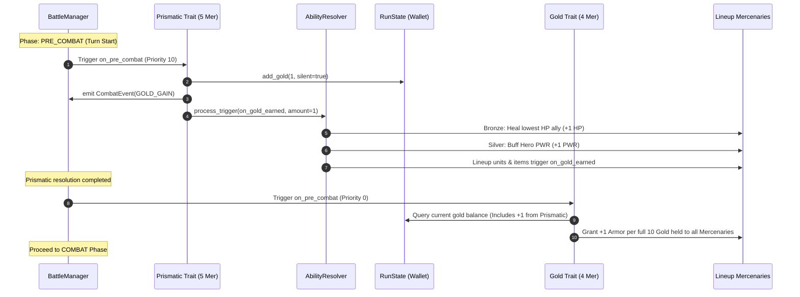

# Bounty Hunter Set Implementation Plan

**Source:** [Bounty Hunter.md](file:///Users/danhh/Desktop/Flashcard%20Heroes/docs/Bounty%20Hunter.md)  
**Governance:** [CODE_GUIDELINES.md](file:///Users/danhh/Desktop/Flashcard%20Heroes/docs/CODE_GUIDELINES.md) | [CombatSystem.md](file:///Users/danhh/Desktop/Flashcard%20Heroes/docs/CombatSystem.md) | [implement_new_content.md](file:///Users/danhh/Desktop/Flashcard%20Heroes/.agent/workflows/implement_new_content.md)  
**Status:** Comprehensive Technical Implementation Plan

--- teste

## 1. Executive Summary & Design Scope

The **Bounty Hunter Set** introduces a closed hero pack centered on the **Mercenary** trait, unit and item lineages, the standalone **Mercenary Emblem**, and supporting trinkets. Its central mechanical goal is to establish **Gold as both a real-time combat trigger and a spendable tactical resource**, without arbitrary per-turn or per-battle caps, while adhering strictly to Flashcard Heroes' deterministic hybrid architecture.

### Content Deliverables Overview
1. **Hero Update (`hero_bounty_hunter`)**:
   - Retain 10 HP / 2 PWR baseline.
   - Fixed `Mercenary` trait (+1 Mercenary counter).
   - Run-rolled Elemental trait (1 soul) + run-rolled Class or Visual trait (1 unit counter), persisted deterministically in `run_metadata` and `RunState`.
   - Ability **Bounty**: On defeating an enemy, earn 1 Gold.
   - Remove legacy ally-defeat stat gain ability (`HeroBountyHunter_AllyDeathBuff.tres`).
2. **Mercenary Trait (`MERCENARY`) & Sigil (`trinket_trait_mercenary`)**:
   - Cumulative thresholds: **Bronze (2)**, **Silver (3)**, **Gold (4)**, **Prismatic (5)**.
   - Pre-combat deterministic sequencing: Prismatic generates 1 Gold first, triggering Bronze/Silver and on-Gold listeners, followed by Gold-tier Armor calculation against the updated wallet.
3. **Status Effect (`bounty`)**:
   - New status effect resource in `resources/status_effects/bounty.tres`.
   - Defeat trigger: When a Bounty-marked unit dies by any means, awards 1 Gold.
4. **Unique Unit Lineage (11 Units)**:
   - 1 Tier 1 starter: `?MerSpe` (Air, Mercenary, Specialist; recipe shorthand: `?Mer`).
   - 4 Tier 2 crossbreeds: `?ASpeMerFodToy`, `E?TnkMerPlaToy`, `F?FigMerMecApp`, `W?SupMerAniCos`.
   - 6 Tier 3 crossbreed capstones: all 6 unique pairings of the 4 Tier 2 units.
5. **Item Lineage & Emblem (5 Items)**:
   - Tier 1: `Claim Ticket` (on holder death, earn 1 Gold).
   - Tier 2: `Interest Ledger` (Claim Ticket + `item_t1_a`) and `Loaded Contract` (Claim Ticket + `item_t1_b`).
   - Tier 3: `Golden Seal` (Interest Ledger + Loaded Contract; dynamic wallet scaling).
   - Standalone Tier 3: `Mercenary Emblem` (+1 Mercenary counter; Gold-to-stat buff on lineup or bench).
6. **Supporting Trinkets (3 Trinkets)**:
   - `Mercenary Sigil`: Trait tracker and enabler for `MERCENARY`.
   - `Recruiting Charm`: Turn start, spend 1 Gold to hire a Level 1 `?MerSpe` to an open bench slot.
   - `Wanted Poster`: Turn start, mark a random unmarked enemy with Bounty.
7. **Merge Recipes (13 Recipes)**:
   - 4 Tier 1 → Tier 2 unit recipes using neutral parents (`ASpeFodToy`, `ETnkPlaToy`, `FFigMecApp`, `WSupAniCos`).
   - 6 Tier 2 → Tier 3 unit recipes (closed pairing graph).
   - 2 Tier 1 → Tier 2 item recipes using neutral items (`item_t1_a`, `item_t1_b`).
   - 1 Tier 2 → Tier 3 item recipe.

### PixelArt Asset Manifest

The following artwork has been created. Unit, item, and trinket sprites are transparent 64×64 PNGs. The Bounty status icon is 32×32 to match the existing PixelArt Burn icon.

**Units — `res://assets/PixelArt/sprites/units/` (11 assets)**

- `MerSpe.png` — `res://assets/PixelArt/sprites/units/MerSpe.png`
- `ASpeMerFodToy.png` — `res://assets/PixelArt/sprites/units/ASpeMerFodToy.png`
- `ETnkMerPlaToy.png` — `res://assets/PixelArt/sprites/units/ETnkMerPlaToy.png`
- `FFigMerMecApp.png` — `res://assets/PixelArt/sprites/units/FFigMerMecApp.png`
- `WSupMerAniCos.png` — `res://assets/PixelArt/sprites/units/WSupMerAniCos.png`
- `EATnkSpeMerFodPlaToy.png` — `res://assets/PixelArt/sprites/units/EATnkSpeMerFodPlaToy.png`
- `FWFigSupMerAniMecAppCos.png` — `res://assets/PixelArt/sprites/units/FWFigSupMerAniMecAppCos.png`
- `WASupSpeMerFodAniToyCos.png` — `res://assets/PixelArt/sprites/units/WASupSpeMerFodAniToyCos.png`
- `FAFigSpeMerFodMecToyApp.png` — `res://assets/PixelArt/sprites/units/FAFigSpeMerFodMecToyApp.png`
- `EFTnkFigMerMecPlaToyApp.png` — `res://assets/PixelArt/sprites/units/EFTnkFigMerMecPlaToyApp.png`
- `EWTnkSupMerAniPlaToyCos.png` — `res://assets/PixelArt/sprites/units/EWTnkSupMerAniPlaToyCos.png`

**Items — `res://assets/PixelArt/sprites/items/` (5 assets)**

- `ClaimTicket.png` — `res://assets/PixelArt/sprites/items/ClaimTicket.png`
- `InterestLedger.png` — `res://assets/PixelArt/sprites/items/InterestLedger.png`
- `LoadedContract.png` — `res://assets/PixelArt/sprites/items/LoadedContract.png`
- `GoldenSeal.png` — `res://assets/PixelArt/sprites/items/GoldenSeal.png`
- `MercenaryEmblem.png` — `res://assets/PixelArt/sprites/items/MercenaryEmblem.png`

**Trinkets — `res://assets/PixelArt/sprites/trinkets/` (3 assets)**

- `MercenarySigil.png` — `res://assets/PixelArt/sprites/trinkets/MercenarySigil.png`
- `RecruitingCharm.png` — `res://assets/PixelArt/sprites/trinkets/RecruitingCharm.png`
- `WantedPoster.png` — `res://assets/PixelArt/sprites/trinkets/WantedPoster.png`

**Status effect — Bounty mark**

- `icon_bounty_pixel.png` — `res://assets/PixelArt/ui/textures/icon_bounty_pixel.png`

---

## 2. Core Architectural Principles & Invariants

To avoid the anti-patterns of previous iterations, all implementation work must adhere to the project's foundational laws:

### 2.1 The "Blind God" Simulation Rule ([CODE_GUIDELINES.md: Section 2](file:///Users/danhh/Desktop/Flashcard%20Heroes/docs/CODE_GUIDELINES.md#L54-L77))
- Simulation code in [BattleManager.gd](file:///Users/danhh/Desktop/Flashcard%20Heroes/scripts/BattleManager.gd), [CombatSimulator.gd](file:///Users/danhh/Desktop/Flashcard%20Heroes/scripts/battle/CombatSimulator.gd), and `scripts/effects/` is completely **blind** to the SceneTree, view nodes, and animations.
- Simulation functions **NEVER** call `get_tree()`, `get_node()`, instantiate `.tscn` visual scenes, or directly await tweens.
- Every ability effect `execute()` returns an [EffectResult](file:///Users/danhh/Desktop/Flashcard%20Heroes/scripts/battle/EffectResult.gd) containing structured DTOs and [CombatEvent](file:///Users/danhh/Desktop/Flashcard%20Heroes/scripts/battle/CombatEvent.gd) records.
- In-simulation state mutations (e.g., Gold additions, HP/PWR buffs, status stacks) are applied **silently** during zero-time simulation. The visual counterpart is dispatched as an event in the `TurnLog` for sequential VCR playback by [BattleAnimator.gd](file:///Users/danhh/Desktop/Flashcard%20Heroes/scripts/BattleAnimator.gd).

### 2.2 Discrete Gold Event Architecture
- **Central Trigger Constant**: Define `const TRIGGER_ON_GOLD_EARNED = &"on_gold_earned"` in [Constants.gd](file:///Users/danhh/Desktop/Flashcard%20Heroes/scripts/Constants.gd#L73-L101).
- **The 1-Gold Event Invariant**: Every 1 Gold added to the run wallet is a discrete, individual trigger event. If an effect awards 2 Gold, it must dispatch 2 separate `TRIGGER_ON_GOLD_EARNED` cycles.
- **Spending vs. Earning**: Spending Gold (`RunState.spend_gold`) strictly mutates the wallet without dispatching `TRIGGER_ON_GOLD_EARNED`.
- **Pre-Spend Scaling Rule**: Spend abilities require a minimum wallet balance of 10 Gold. Abilities that spend 1 Gold calculate their magnitude based on the wallet balance **before** paying the 1 Gold cost.
- **VCR Coin Layering & Directionality**: Gold events in combat must package `CombatPayload` with `origin_uuid` (the defeated marked unit or ability holder) and `target_gold_amount` so coins fly visually from the source unit to the HUD on CanvasLayer 150 ([CombatSystem.md: Section 1](file:///Users/danhh/Desktop/Flashcard%20Heroes/docs/CombatSystem.md#L70-L76)).

### 2.3 Deterministic RNG & Replay Integrity ([CODE_GUIDELINES.md: Section 1.4 & 1.6](file:///Users/danhh/Desktop/Flashcard%20Heroes/docs/CODE_GUIDELINES.md#L32-L52))
- Direct calls to `randi()`, `randf()`, or unseeded random methods are banned.
- Hero run-trait assignment at run start must use `RNGManager.map_rng`.
- Mid-combat random targeting (e.g., `W?SupMerAniCos` random heal target, `Wanted Poster` random unmarked enemy) must strictly query `RNGManager.combat_rng`.
- The Hero's rolled traits must be written to `run_metadata` and serialized in [RunState.gd](file:///Users/danhh/Desktop/Flashcard%20Heroes/scripts/RunState.gd) to guarantee 100% deterministic replay reconstruction.

### 2.4 Fail-Fast & No Defensive Code
- Do not use silent early returns like `if not is_instance_valid(x): return` to mask missing logic. Use `assert()` to catch lifecycle or schema discrepancies immediately during simulation.
- Never modify core dispatch engines ([BattleManager.gd](file:///Users/danhh/Desktop/Flashcard%20Heroes/scripts/BattleManager.gd)) for single-ability exceptions; use the standard trigger and component pipeline.

---

## 3. Detailed Component & Mechanics Specifications

### 3.1 Hero: Bounty Hunter
- **Resource File**: `res://resources/units/hero.tres` (or `HeroBountyHunter.tres`)
- **ID**: `&"hero_bounty_hunter"`
- **Base Stats**: 10 HP / 2 PWR
- **Fixed Trait**: `tags = [&"Mercenary"]`
- **Dynamic Traits**:
  - Rolled in `RunState.initialize_run()`:
    1. One random Elemental soul from `[&"SOUL_FIRE", &"SOUL_EARTH", &"SOUL_WATER", &"SOUL_AIR"]`.
    2. One random Class or Visual trait from `[&"Tank", &"Fighter", &"Support", &"Specialist", &"Food", &"Mecha", &"Animal", &"Plant", &"Toy", &"Appliance", &"Costume"]`.
  - Injected as persistent [TagComponent](file:///Users/danhh/Desktop/Flashcard%20Heroes/scripts/resources/TagComponent.gd)s on `hero_instance`.
  - Serialized in `RunState` and saved into `run_metadata["hero_run_traits"]`.
- **Abilities**:
  - Keep `res://resources/abilities/HeroTimekeeper_GoldOnKill.tres` (or create `HeroBountyHunter_Bounty.tres`). Trigger: `&"on_kill"`. Effect: earn 1 Gold.
  - Remove `res://resources/abilities/HeroBountyHunter_AllyDeathBuff.tres`.

### 3.2 The Mercenary Trait (`MERCENARY`)
- **Registration**:
  - Add `"MERCENARY"` to `C.TRAIT_SORT_ORDER` in [Constants.gd](file:///Users/danhh/Desktop/Flashcard%20Heroes/scripts/Constants.gd#L205-L209) and [BattleView.gd](file:///Users/danhh/Desktop/Flashcard%20Heroes/scripts/BattleView.gd#L26-L30).
  - Add `&"Mercenary"` to `C.CLASS_TRAITS` in [Constants.gd](file:///Users/danhh/Desktop/Flashcard%20Heroes/scripts/Constants.gd#L211).
  - Register definition in `C.TRAIT_DEFINITIONS`:
    ```gdscript
    "MERCENARY": {
        "display_name_key": "trait.mercenary.name",
        "trinket_id": &"trinket_trait_mercenary",
        "icon_path": "res://assets/PixelArt/sprites/trinkets/MercenarySigil.png",
        "levels": [
            {"min": 2, "desc_key": "trait.mercenary.2"},
            {"min": 3, "desc_key": "trait.mercenary.3"},
            {"min": 4, "desc_key": "trait.mercenary.4"},
            {"min": 5, "desc_key": "trait.mercenary.5"}
        ]
    }
    ```
  - Register trait theme color in `UnitInspectionWindow.TRAIT_COLORS`: `Color(0.85, 0.65, 0.15, 1.0)`.
- **Activation & Counting**:
  - Active only when `trinket_trait_mercenary` is equipped on the player team.
  - Sums all units in the active lineup carrying the `Mercenary` tag (Hero counts as 1).
  - Plus 1 for each `Mercenary Emblem` equipped on any unit in the active lineup.
- **Level Scaling**:
  - **Bronze (2 Mercenaries)**: Triggered by `TRIGGER_ON_GOLD_EARNED`. Targets the allied unit with the lowest current HP on the team and grants +1 HP via `apply_stat_delta(target, "hp", 1, source, C.ACTION_BUFF)`.
  - **Silver (3 Mercenaries)**: In addition to Bronze, triggered by `TRIGGER_ON_GOLD_EARNED`. Hero gains +1 PWR via `apply_stat_delta(hero, "pwr", 1, source, C.ACTION_BUFF)`.
  - **Gold (4 Mercenaries)**: Triggered at `TRIGGER_ON_PRE_COMBAT`. Each Mercenary unit in the active lineup gains `int(gold / 10)` Armor stacks (`armor_stacks`).
  - **Prismatic (5 Mercenaries)**: Triggered at `TRIGGER_ON_PRE_COMBAT`. Earns 1 Gold once per turn.
  - **Deterministic Pre-Combat Order**: Prismatic executes at a higher priority (`priority = 10`) than Gold Armor (`priority = 0`). The 1 Gold is added to the wallet first, triggering Bronze and Silver, after which Gold checks the newly incremented wallet to calculate Armor.

### 3.3 Status Effect: Bounty Mark (`bounty`)
- **Resource**: `res://resources/status_effects/bounty.tres`
- **PixelArt Icon**: `res://assets/PixelArt/ui/textures/icon_bounty_pixel.png` (32×32, matching the existing PixelArt Burn icon size)
- **Definition**:
  - `id = &"bounty"`
  - `display_name_key = "STATUS_BOUNTY"`
  - `description_key = "STATUS_BOUNTY_DESC"`
  - `color = Color(1.0, 0.84, 0.0, 1.0)`
  - `turn_phase = "START_OF_TURN"`
  - `turn_effect = "NONE"`
  - `decay_mode = "CLEAR"`
  - `decay_amount = 1`
  - `is_negative = true`
- **Decay & Stacking Rules (Confirmed by User)**:
  - *Decay Rule*: Bounty marks decay completely at the start of each turn (`turn_phase = "START_OF_TURN"`, `decay_mode = "CLEAR"`). Units must be defeated within the round they are marked in order to collect the bounty.
  - *Stacking Rule*: Non-stacking (maximum 1 Bounty mark per unit). Abilities check if the target is already marked before applying (`F?FigMerMecApp` and `Wanted Poster` filter for unmarked targets).
  - *Defeat Handling*: In [DeathProcessor.gd](file:///Users/danhh/Desktop/Flashcard%20Heroes/scripts/battle/DeathProcessor.gd) / death reaction pipeline, if a unit dies by any means while carrying a `bounty` mark, it clears the mark and awards 1 Gold to the player's run wallet via `BattleManager.earn_gold(1, dying_uuid)`, which in turn dispatches `TRIGGER_ON_GOLD_EARNED`.

### 3.4 Unit Lineage Breakdown

| ID | Tier | Recipe | Base HP / PWR | Tags | Ability Trigger & Mechanics |
|---|---|---|---|---|---|
| `?MerSpe` | 1 | Starter | 1/1 (L1), 2/2 (L2), 3/3 (L3) | Air, Mercenary, Specialist | `TRIGGER_ON_GOLD_EARNED`: If on active lineup, gain +1 HP and +1 PWR (`ACTION_BUFF`). |
| `?ASpeMerFodToy` | 2 | `?Mer` + `ASpeFodToy` | 2 / 3 | 2 Air, Specialist, Mercenary, Food, Toy | `TRIGGER_ON_PRE_COMBAT`: Gain `int(gold / 10) * (1 / 2 / 3)` PWR at pre-combat. |
| `E?TnkMerPlaToy` | 2 | `?Mer` + `ETnkPlaToy` | 3 / 1 | Earth, Air, Tank, Mercenary, Plant, Toy | `TRIGGER_ON_GOLD_EARNED`: Gain +1 / +2 / +3 Armor and +1 / +2 / +3 Spikes. |
| `F?FigMerMecApp` | 2 | `?Mer` + `FFigMecApp` | 2 / 3 | Fire, Air, Fighter, Mercenary, Mecha, Appliance | `TRIGGER_ON_ATTACK` (Ranged): Mark target with Bounty if unmarked. L1: Target only. L2: Target + 1 random unmarked unit. L3: Target + adjacent units. |
| `W?SupMerAniCos` | 2 | `?Mer` + `WSupAniCos` | 3 / 2 | Water, Air, Support, Mercenary, Animal, Costume | `TRIGGER_ON_GOLD_EARNED`: Heal a random allied unit for 1 / 2 / 3 HP (`ACTION_HEAL`). |
| `E??ATnkSpeMerFodPlaToy` | 3 | `?ASpeMerFodToy` + `E?TnkMerPlaToy` | 5 / 5 | 1 Earth, 3 Air, Tank, Specialist, Mercenary, Food, Plant, Toy | `TRIGGER_ON_PRE_COMBAT`: If Gold >= 10, spend 1 Gold to gain `int(pre_spend_gold / 10) * (1 / 2 / 3)` Armor and Spikes. |
| `FW??FigSupMerAniMecAppCos` | 3 | `F?FigMerMecApp` + `W?SupMerAniCos` | 5 / 5 | 1 Fire, 1 Water, 2 Air, Fighter, Support, Mercenary, Animal, Mecha, Appliance, Costume | `TRIGGER_ON_ATTACK` (Ranged): If Gold >= 10, spend 1 Gold to deal `int(pre_spend_gold / 10) * (1 / 2 / 3)` bonus damage. |
| `W??ASupSpeMerFodAniToyCos` | 3 | `?ASpeMerFodToy` + `W?SupMerAniCos` | 5 / 5 | 1 Water, 3 Air, Support, Specialist, Mercenary, Food, Animal, Toy, Costume | `TRIGGER_ON_GOLD_EARNED`: Heal a random allied unit (including Hero) for 1 / 2 / 3 HP per 1 Gold earned. |
| `F??AFigSpeMerFodMecToyApp` | 3 | `?ASpeMerFodToy` + `F?FigMerMecApp` | 5 / 5 | 1 Fire, 3 Air, Fighter, Specialist, Mercenary, Food, Mecha, Toy, Appliance | `TRIGGER_ON_ATTACK`: If Gold >= 10, spend 1 Gold and apply `int(pre_spend_gold / 10) * (1 / 2 / 3)` Burn stacks to target. |
| `EF??TnkFigMerMecPlaToyApp` | 3 | `E?TnkMerPlaToy` + `F?FigMerMecApp` | 5 / 5 | 1 Earth, 1 Fire, 2 Air, Tank, Fighter, Mercenary, Mecha, Plant, Toy, Appliance | `TRIGGER_ON_BEFORE_DAMAGE`: If Gold >= 10, spend 1 Gold and reduce incoming damage by `int(pre_spend_gold / 10) * (1 / 2 / 3)` (min 0 damage). |
| `EW??TnkSupMerAniPlaToyCos` | 3 | `E?TnkMerPlaToy` + `W?SupMerAniCos` | 5 / 5 | 1 Earth, 1 Water, 2 Air, Tank, Support, Mercenary, Animal, Plant, Toy, Costume | `TRIGGER_ON_TURN_START`: If Gold >= 10, spend 1 Gold and gain `int(pre_spend_gold / 10) * (1 / 2 / 3)` HP and PWR (`ACTION_BUFF`). |

### 3.5 Unique Item Lineage & Mercenary Emblem

| ID | Name | Tier | Recipe | Stats | Ability & Mechanics |
|---|---|---|---|---|---|
| `item_t1_claim_ticket` | **Claim Ticket** | 1 | Unique Starter | +1 HP | `TRIGGER_ON_DEATH`: When holder dies, earn 1 Gold. |
| `item_t2_interest_ledger` | **Interest Ledger** | 2 | Claim Ticket + `item_t1_a` | +2 HP | `TRIGGER_ON_GOLD_EARNED`: Heal holder for 1 HP (`ACTION_HEAL`). |
| `item_t2_loaded_contract` | **Loaded Contract** | 2 | Claim Ticket + `item_t1_b` | +2 PWR | `TRIGGER_ON_GOLD_EARNED`: Holder gains +1 PWR (`ACTION_BUFF`). |
| `item_t3_golden_seal` | **Golden Seal** | 3 | Interest Ledger + Loaded Contract | +2 HP / +2 PWR | **Dynamic Wallet Scaling**: Grants `int(gold / 10)` HP and `int(gold / 10)` PWR. Recalculates dynamically via `StatComponent` whenever `RunState.gold` changes. |
| `item_emblem_mercenary` | **Mercenary Emblem** | 3 | Standalone (No recipe) | +2 PWR | Adds `&"Mercenary"` tag to holder (+1 Mercenary counter if on active lineup). `TRIGGER_ON_GOLD_EARNED`: Holder gains +1 HP and +1 PWR, **whether on lineup or bench**. |

### 3.6 Supporting Trinkets

| ID | Name | Category | Mechanics |
|---|---|---|---|
| `trinket_trait_mercenary` | **Mercenary Sigil** | TRINKET | Enables and displays the cumulative Mercenary trait levels (Bronze 2, Silver 3, Gold 4, Prismatic 5). |
| `trinket_recruiting_charm` | **Recruiting Charm** | TRINKET | `TRIGGER_ON_TURN_START`: If player has >= 1 Gold and an open bench slot, spend 1 Gold to summon a Level 1 `?MerSpe` to the bench. Does NOT trigger `TRIGGER_ON_GOLD_EARNED`. |
| `trinket_wanted_poster` | **Wanted Poster** | TRINKET | `TRIGGER_ON_TURN_START`: Applies `bounty` status to one random unmarked enemy unit on the board. |

---

## 4. Atomic Task Decomposition (Execution Checklist)

Following [.agent/workflows/implement_new_content.md](file:///Users/danhh/Desktop/Flashcard%20Heroes/.agent/workflows/implement_new_content.md), all implementation steps are decomposed atomically:

### Phase 1: Core Logic (Scripts)
- [ ] **1.1 Register Constants in [Constants.gd](file:///Users/danhh/Desktop/Flashcard%20Heroes/scripts/Constants.gd)**:
  - Add `const TRIGGER_ON_GOLD_EARNED = &"on_gold_earned"` to combat triggers.
  - Add `"MERCENARY"` to `TRAIT_SORT_ORDER` and `&"Mercenary"` to `CLASS_TRAITS`.
  - Add `"MERCENARY"` block to `TRAIT_DEFINITIONS` with thresholds 2, 3, 4, 5 and matching description keys.
  - Add `"MERCENARY"` to [BattleView.gd](file:///Users/danhh/Desktop/Flashcard%20Heroes/scripts/BattleView.gd#L26-L30) `TRAIT_SORT_ORDER`.
  - Add Mercenary color to `TRAIT_COLORS` in [UnitInspectionWindow.gd](file:///Users/danhh/Desktop/Flashcard%20Heroes/scripts/UnitInspectionWindow.gd#L21-L37).
- [ ] **1.2 Gold Event & Economy Dispatch in [BattleManager.gd](file:///Users/danhh/Desktop/Flashcard%20Heroes/scripts/BattleManager.gd)**:
  - Add atomic helper `earn_gold(amount: int, origin_uuid: String = "") -> void`:
    - Loops `amount` times to dispatch discrete 1-Gold events.
    - Mutates `GameManager.run_state.add_gold(1, true)`.
    - Creates and appends `CombatEvent.new(CombatEvent.Type.GOLD_GAIN, ...)`.
    - Dispatches `AbilityResolver.process_trigger(C.TRIGGER_ON_GOLD_EARNED, {"amount": 1, "origin_uuid": origin_uuid})`.
  - Add atomic helper `spend_gold(amount: int) -> bool`:
    - Checks `RunState.gold >= amount`.
    - Mutates `GameManager.run_state.spend_gold(amount, true)`.
    - Does NOT dispatch `TRIGGER_ON_GOLD_EARNED`.
- [ ] **1.3 Trigger Filtering in [AbilityResolver.gd](file:///Users/danhh/Desktop/Flashcard%20Heroes/scripts/AbilityResolver.gd)**:
  - In `_should_unit_respond()`: Living units respond to `&"on_gold_earned"` if on the active lineup (`_is_in_lineup(unit)`).
  - In `_should_item_respond()`: Equipped items respond to `&"on_gold_earned"` if holder is alive. For `Mercenary Emblem`, allow response whether holder is in lineup OR bench.
  - In `_should_trinket_respond()`: Player trinkets respond to `&"on_gold_earned"`.
- [ ] **1.4 Status Effect Plumbing in [DeathProcessor.gd](file:///Users/danhh/Desktop/Flashcard%20Heroes/scripts/battle/DeathProcessor.gd)**:
  - During unit death finalization: Check `dying_unit.get_status_effect_amount(&"bounty") > 0`.
  - If marked with Bounty: Invoke `battle_manager.earn_gold(1, dying_unit.ball_uuid)`.
- [ ] **1.5 Mercenary Trait Effects (`scripts/effects/`)**:
  - `EffectTraitMercenaryPreCombat.gd`: Handles Prismatic (1 Gold gain, priority 10) and Gold (Armor per 10 Gold held, priority 0).
  - `EffectTraitMercenaryOnGold.gd`: Handles Bronze (+1 HP to lowest HP ally) and Silver (+1 PWR to Hero).
- [ ] **1.6 Lineage Ability Effects (`scripts/effects/`)**:
  - `EffectModifyStatsByGold.gd`: `?ASpeMerFodToy` pre-combat PWR scaling.
  - `EffectUnitGoldArmorSpikes.gd`: `E?TnkMerPlaToy` on-gold Armor/Spikes.
  - `EffectUnitAttackBountyMark.gd`: `F?FigMerMecApp` attack mark applicator (L1: target, L2: target + random, L3: target + adjacent).
  - `EffectUnitGoldHealRandomAlly.gd`: `W?SupMerAniCos` and `W??ASupSpeMerFodAniToyCos` on-gold heals.
  - `EffectSpendGoldArmorSpikes.gd`: `E??ATnkSpeMerFodPlaToy` pre-combat spend.
  - `EffectSpendGoldBonusDamage.gd`: `FW??FigSupMerAniMecAppCos` on-attack spend.
  - `EffectSpendGoldBurn.gd`: `F??AFigSpeMerFodMecToyApp` on-attack Burn spend.
  - `EffectSpendGoldDamageReduction.gd`: `EF??TnkFigMerMecPlaToyApp` on-hurt spend.
  - `EffectSpendGoldTurnStartBuff.gd`: `EW??TnkSupMerAniPlaToyCos` turn-start buff spend.
- [ ] **1.7 Item & Trinket Effects (`scripts/effects/`)**:
  - `EffectClaimTicketDeath.gd`: Claim Ticket 1-Gold grant on death.
  - `EffectDynamicWalletBuff.gd`: Golden Seal dynamic recalculation via `StatComponent` on gold change.
  - `EffectRecruitingCharm.gd`: Turn start bench hire for 1 Gold.
  - `EffectWantedPoster.gd`: Turn start random enemy Bounty mark.
- [ ] **1.8 Dynamic Hero Trait Generation in [RunState.gd](file:///Users/danhh/Desktop/Flashcard%20Heroes/scripts/RunState.gd)**:
  - In `initialize_run()`, if `hero_def_id == &"hero_bounty_hunter"`:
    - Use `RNGManager.map_rng` to roll 1 elemental soul and 1 class/visual trait.
    - Attach traits via `hero_instance.persistent_components` using [TagComponent](file:///Users/danhh/Desktop/Flashcard%20Heroes/scripts/resources/TagComponent.gd).
    - Save rolled trait IDs in `run_metadata` and `RunState` save dictionary.

---

### Phase 2: Resources (Data Definitions)

- [x] **2.1 Status Effect Resource**:
  - `resources/status_effects/bounty.tres` created using `StatusEffectDefinition.gd` referencing `icon_bounty_pixel.png`, configured for `START_OF_TURN` decay with `CLEAR` mode, localized in `localization/game.csv`, and registered in `docs/status_effects.csv`.
- [ ] **2.2 Ability Resources (`resources/abilities/`)**:
  - Hero: `resources/abilities/HeroBountyHunter_Bounty.tres`.
  - Trait: `resources/abilities/ability_trait_mercenary_pre_combat.tres`, `ability_trait_mercenary_on_gold.tres`.
  - Units:
    - `Unit_MerSpe_OnGold.tres`
    - `Unit_AASpeMerFodToy_OnEntry_L1.tres`, `_L2.tres`, `_L3.tres`
    - `Unit_EATnkMerPlaToy_OnGold_L1.tres`, `_L2.tres`, `_L3.tres`
    - `Unit_FAFigMerMecApp_OnAttack_L1.tres`, `_L2.tres`, `_L3.tres`
    - `Unit_WASupMerAniCos_OnGold_L1.tres`, `_L2.tres`, `_L3.tres`
    - `Unit_EAAATnkSpeMerFodPlaToy_PreCombat_L1.tres`, `_L2.tres`, `_L3.tres`
    - `Unit_FWAAFigSupMerAniMecAppCos_OnAttack_L1.tres`, `_L2.tres`, `_L3.tres`
    - `Unit_WAAASupSpeMerFodAniToyCos_OnGold_L1.tres`, `_L2.tres`, `_L3.tres`
    - `Unit_FAAAFigSpeMerFodMecToyApp_OnAttack_L1.tres`, `_L2.tres`, `_L3.tres`
    - `Unit_EFAATnkFigMerMecPlaToyApp_BeforeDamage_L1.tres`, `_L2.tres`, `_L3.tres`
    - `Unit_EWAATnkSupMerAniPlaToyCos_TurnStart_L1.tres`, `_L2.tres`, `_L3.tres`
  - Items & Trinkets:
    - `Item_ClaimTicket_Death.tres`
    - `Item_InterestLedger_OnGold.tres`
    - `Item_LoadedContract_OnGold.tres`
    - `Item_GoldenSeal_Passive.tres`
    - `Item_MercenaryEmblem_Passive.tres`
    - `Trinket_RecruitingCharm_TurnStart.tres`
    - `Trinket_WantedPoster_TurnStart.tres`
- [ ] **2.3 Unit Resources (`resources/units/`)**:
  - `MerSpe.tres` (Tier 1 starter)
  - `ASpeMerFodToy.tres`, `ETnkMerPlaToy.tres`, `FFigMerMecApp.tres`, `WSupMerAniCos.tres` (Tier 2)
  - `EATnkSpeMerFodPlaToy.tres`, `FWFigSupMerAniMecAppCos.tres`, `WASupSpeMerFodAniToyCos.tres`, `FAFigSpeMerFodMecToyApp.tres`, `EFTnkFigMerMecPlaToyApp.tres`, `EWTnkSupMerAniPlaToyCos.tres` (Tier 3)
- [ ] **2.4 Item Resources (`resources/items/`)**:
  - `item_t1_claim_ticket.tres`
  - `item_t2_interest_ledger.tres`
  - `item_t2_loaded_contract.tres`
  - `item_t3_golden_seal.tres`
  - `item_emblem_mercenary.tres`
- [ ] **2.5 Trinket Resources (`resources/trinkets/`)**:
  - `trinket_trait_mercenary.tres`
  - `trinket_recruiting_charm.tres`
  - `trinket_wanted_poster.tres`
- [ ] **2.6 Merge Recipes (`resources/recipes/`)**:
  - *Rule: Use `MergeRecipe.gd` exclusively!*
  - 4 Tier 1 → Tier 2 Unit Recipes:
    - `Merge_MerSpe_ASpeFodToy_to_ASpeMerFodToy.tres`
    - `Merge_MerSpe_ETnkPlaToy_to_ETnkMerPlaToy.tres`
    - `Merge_MerSpe_FFigMecApp_to_FFigMerMecApp.tres`
    - `Merge_MerSpe_WSupAniCos_to_WSupMerAniCos.tres`
  - 6 Tier 2 → Tier 3 Unit Recipes:
    - `Merge_ASpeMerFodToy_ETnkMerPlaToy_to_EATnkSpeMerFodPlaToy.tres`
    - `Merge_FFigMerMecApp_WASupMerAniCos_to_FWFigSupMerAniMecAppCos.tres`
    - `Merge_ASpeMerFodToy_WASupMerAniCos_to_WASupSpeMerFodAniToyCos.tres`
    - `Merge_ASpeMerFodToy_FFigMerMecApp_to_FAFigSpeMerFodMecToyApp.tres`
    - `Merge_ETnkMerPlaToy_FFigMerMecApp_to_EFTnkFigMerMecPlaToyApp.tres`
    - `Merge_ETnkMerPlaToy_WSupMerAniCos_to_EWTnkSupMerAniPlaToyCos.tres`
  - 2 Tier 1 → Tier 2 Item Recipes:
    - `Merge_Item_ClaimTicket_ItemT1A_to_InterestLedger.tres`
    - `Merge_Item_ClaimTicket_ItemT1B_to_LoadedContract.tres`
  - 1 Tier 2 → Tier 3 Item Recipe:
    - `Merge_Item_InterestLedger_LoadedContract_to_GoldenSeal.tres`

---

### Phase 3: Registration & Integration ("The Missing Link")

- [ ] **3.1 Starter Loadout in [RunState.gd](file:///Users/danhh/Desktop/Flashcard%20Heroes/scripts/RunState.gd)**:
  - Update `_get_starters_for_hero(hero_id: StringName)`:
    - When `hero_id == &"hero_bounty_hunter"`, supply 3 `?MerSpe` starter units, neutral recipe parents, 2 `item_t1_claim_ticket`, and neutral items.
    - Grant starting `trinket_trait_mercenary` into `RUN_CONTAINER_TAGS.PLAYER_TRINKETS` so Mercenary tracking is live.
- [ ] **3.2 Database Verification in [Database.gd](file:///Users/danhh/Desktop/Flashcard%20Heroes/scripts/Database.gd)**:
  - Confirm automatic indexing of all new units, items, trinkets, recipes, and status effects.
- [ ] **3.3 Hero Unit Definition Update**:
  - Update `resources/units/hero.tres`: Set tags to `[&"Mercenary"]`, swap ability array to Bounty-only (remove ally death buff).

---

### Phase 4: Localization (`localization/game.csv`)

Add complete English and Portuguese localization keys:
- **Hero**: `hero.name`, `hero.desc`
- **Mercenary Trait**: `trait.mercenary.name`, `trait.mercenary.2`, `trait.mercenary.3`, `trait.mercenary.4`, `trait.mercenary.5`
- **Status Effect**: `status.bounty.name`, `status.bounty.desc`
- **Units**: Display names and ability descriptions for `?MerSpe`, all 4 Tier 2 crossbreeds, and all 6 Tier 3 crossbreeds across Levels 1, 2, and 3.
- **Items**: `item_t1_claim_ticket.name`/`.desc`, `item_t2_interest_ledger.name`/`.desc`, `item_t2_loaded_contract.name`/`.desc`, `item_t3_golden_seal.name`/`.desc`, `item_emblem_mercenary.name`/`.desc`.
- **Trinkets**: `trinket.trait_mercenary.name`/`.desc`, `trinket.recruiting_charm.name`/`.desc`, `trinket.wanted_poster.name`/`.desc`.

---

### Phase 5: Documentation Synchronization

- [ ] Update [docs/GameContentDocument.md](file:///Users/danhh/Desktop/Flashcard%20Heroes/docs/GameContentDocument.md) with complete Mercenary unit, item, trinket, and recipe entries.
- [ ] Append entries to [docs/units.csv](file:///Users/danhh/Desktop/Flashcard%20Heroes/docs/units.csv), [docs/items.csv](file:///Users/danhh/Desktop/Flashcard%20Heroes/docs/items.csv), [docs/trinkets.csv](file:///Users/danhh/Desktop/Flashcard%20Heroes/docs/trinkets.csv), and [docs/status_effects.csv](file:///Users/danhh/Desktop/Flashcard%20Heroes/docs/status_effects.csv).

---

## 5. Verification, Safety Audits & Test Automation

Before submitting code, execute the mandatory safety audit checklist:

### 5.1 The Safety Audit Matrix ([implement_new_content.md](file:///Users/danhh/Desktop/Flashcard%20Heroes/.agent/workflows/implement_new_content.md#L49-L68))
1. **Infinite Recursion Check**:
   - `?MerSpe`, `Loaded Contract`, `Silver Mercenary`, and `E?TnkMerPlaToy` trigger on `on_gold_earned` and call `apply_stat_delta(..., ACTION_BUFF)`.
   - *Verification*: Confirm that `apply_stat_delta` dispatches `TRIGGER_ON_STAT_INCREASED`, and that NO Mercenary ability reacts to `TRIGGER_ON_STAT_INCREASED` by generating Gold. This eliminates cyclic infinite loops.
2. **Zombie Instance Check**:
   - `Recruiting Charm` summons a unit to the bench via `SummonRequest` and `EffectHandlers.handle_summon_effect()`.
   - *Verification*: All bench additions route through atomic `BattleManager` container APIs. If a unit is removed/transformed, use `bm_remove_instance`.
3. **Discrete Event Flow Check**:
   - Multi-gold gains must never emit a single `amount = N` event that bypasses single-gold listeners.
   - *Verification*: Verify `earn_gold(N)` dispatches N discrete `TRIGGER_ON_GOLD_EARNED` cycles.
4. **Pre-Spend Scaling Check**:
   - Capstones spend 1 Gold and scale from pre-spend balance.
   - *Verification*: If wallet = 10, bonus is calculated from 10 Gold (1 stack), then 1 Gold is spent, leaving 9 Gold. If wallet = 9, 0 Gold is spent and 0 bonus is applied.
5. **Asset & API Validation**:
   - Run tests to confirm zero `null` script references, valid `.tres` properties matching `@export` variables, and all sound IDs registered in `SoundRegistry.gd`.

### 5.2 Automated Godot Test Suite (Temporary Script in `scratch/`)
Create a temporary headless verification script in `scratch/test_bounty_hunter_suite.gd` to test:
- Trait activation and cumulative Bronze, Silver, Gold, and Prismatic triggers.
- Bounty mark application, death-gold payout, and `DeathProcessor` routing.
- All 13 merge recipe resolutions and output definitions.
- Dynamic wallet recalculation on `Golden Seal`.
- Clean up the `scratch/` script immediately after validation passes.

---

## 6. Deterministic Resolution Matrix


