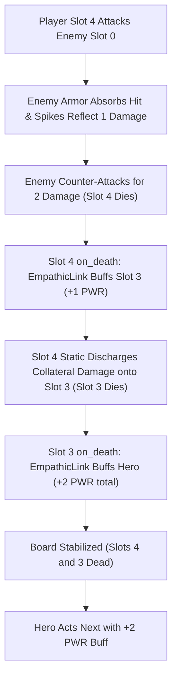
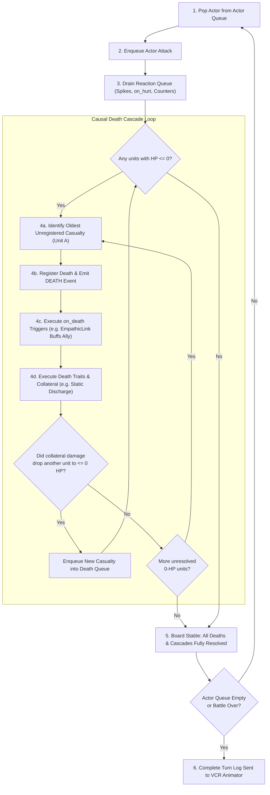

# Causal Event Chains and Death Resolution Architecture

## 1. Executive Summary

In a turn-based combat system with reactive triggers (*Spikes, On-Hurt, Counter-Attacks*), on-death abilities (*Empathic Link, Last Wish*), and collateral trait detonations (*Mecha Armor Static, Static Collateral Discharge*), maintaining strict **causal coherence** is essential.

Flashcard Heroes operates on a **Strict State-Event Decoupling** model ("*Simulate First, Present Later*"):
1. **Simulation (The Black Box)**: `BattleManager` and `CombatSimulator` calculate the turn instantly, producing an ordered linear `TurnLog` of `CombatEvent`s.
2. **Presentation (The VCR Player)**: `BattleAnimator` consumes this `TurnLog` and plays back the battle sequentially for the player.

When an actor initiates an action, that action spawns a causal tree of reactions and consequences. If the simulation engine fails to fully resolve deaths and their cascading consequences before advancing to the next actor, severe anomalies occur:
- **Death Buff Invalidation**: Units die from collateral effects before an on-death buff can reach them, causing buffs to target dead units or abort.
- **Zombie State Units**: Units reach 0 HP mid-turn without being formally registered as dead, causing the actor queue to skip them silently.
- **VCR Causal Inversion**: Surviving units attack and take damage in the presentation *before* a preceding friendly unit even animates its death or passes its buffs.

This document details the incident analyzed in run `run_run_1792854912_20_71607`, compares how industry-leading games (*Super Auto Pets, Hearthstone, Magic: The Gathering*) solve event ordering and cascading deaths, and specifies the authoritative architecture for Flashcard Heroes.

---

## 2. Problem Statement: Analysis of Incident (Replay Audit)

### 2.1 The Setup
On Turn 1 of combat in run `run_run_1792854912_20_71607`:
- **Player Lineup**:
  - **Slot 4 (Front)**: `ASpeFodToy` (2 HP, 1 PWR) with `BasicAttackRangedMirror` and `EmpathicLink` (L1: *On Death: Buff PWR to ally behind*).
  - **Slot 3**: `ASpeFodToy` (1 HP, 1 PWR) with `BasicAttackRangedMirror` and `EmpathicLink` (L1).
  - **Slot 2**: `hero_bounty_hunter` (10 HP, 2 PWR).
- **Enemy Lineup**:
  - **Slot 0 (Mirror of Player Slot 4)**: `FFigMecApp` (1 HP, 2 PWR) with `CounterOnHurt` (L1) and Mecha Trait (1 Armor, 1 Spikes).
  - **Slot 1 (Mirror of Player Slot 3)**: `FFigMecApp` (1 HP, 2 PWR).

### 2.2 Expected Causal Flow


### 2.3 The Actual Failure Sequence
The recorded turn log revealed what actually occurred in the simulation:
1. **Slot 4 Attacks**: Deals 1 damage to Enemy Slot 0 (absorbed by Enemy Mecha Armor).
2. **Mecha L2 Trait Silent Infliction**: Because Mecha Armor absorbed damage, `BattleManager.apply_damage()` called `apply_stat_delta(attacker, "static_stacks", 1)`. Slot 4 was silently tagged with 1 Static stack.
3. **Enemy Spikes**: Deals 1 damage back to Slot 4 (Slot 4 HP: 2 → 1).
4. **Enemy Counter-Attack**: Level 1 `CounterOnHurt` deals 2 damage to Slot 4 (Slot 4 HP: 1 → -1, lethal).
5. **DeathProcessor Premature Collateral**: In `check_for_deaths_with_counter_delay()`, the static collateral loop executed **before** `on_death` triggers:
   ```gdscript
   # DeathProcessor.gd lines 495-500
   for data in dying_units_data:
       _process_static_collateral_damage(bm, data.unit, data.death_location, data.team, out_events)
   ```
   Slot 4 detonated its 1 Static stack onto its adjacent neighbor, Slot 3.
   Slot 3 took 1 damage, reducing its 1 HP to 0 HP.
6. **EmpathicLink Target Invalidation**:
   Slot 4's `on_death` trigger finally fired, querying `TargetResolver` for `ALLY_BEHIND`.
   `BattleHelpers.get_ally_behind()` inspected Slot 3:
   ```gdscript
   var inst := state.get_instance(behind_uuid)
   if is_instance_valid(inst) and inst.current_hp > 0:
       return inst
   return null
   ```
   Because Slot 3's HP was already reduced to 0 by the Static collateral damage in step 5, `inst.current_hp > 0` failed! The helper returned `null`, `TargetResolver` returned `[]`, and Slot 4's buff **silently aborted with zero targets**.
7. **The Zombie Unit Bug**:
   `_process_static_collateral_damage()` called `apply_damage()`, but never invoked a death check. Slot 3 had 0 HP, but was **never registered as dead**. No `DEATH` event was generated, and no `on_death` trigger was scheduled.
8. **Actor Queue Leapfrogging**:
   `CombatSimulator.execute_combat_turn()` popped the next actor from `_actor_queue` (Slot 3).
   ```gdscript
   if current_actor.current_hp <= 0:
       continue
   ```
   Seeing Slot 3 at 0 HP, it silently skipped Slot 3's attack turn.
   It then immediately popped **Slot 2 (the Hero)**!
   The Hero attacked and took counter-damage.
   Only when the Hero's attack concluded did the system run its regular death check, finally emitting Slot 3's `DEATH` event and buffing the Hero—**long after the Hero had already attacked**.

---

## 3. Comparative Analysis: How Other Games Solve Event Ordering

| Game System | Architecture Model | How Deaths Are Handled | How Cascading Casualties Resolve |
| :--- | :--- | :--- | :--- |
| **Super Auto Pets** | Sequential Action Phases with Faint Stacks | Faint Phase immediately halts round progression until all deaths and reactions are drained. | Depth-first causal chain: Pet A faints → buffs Pet B → Pet B faints from collateral → buffs Pet C. Pet B possesses Pet A's buff at the moment of death. |
| **Hearthstone** | Action Phases with nested "Death Creation Steps" | When an action drops minions to $\le 0$ HP, game enters the Death Creation Step before completing the action phase. | Nested Death Steps: If Deathrattle A kills Minion B, Minion B's Deathrattle executes inside a nested Death Step before the outer attack completes. |
| **Magic: The Gathering** | State-Based Actions (SBAs) & The Stack | SBAs check continuously before players get priority or triggers resolve. Any creature with $\le 0$ toughness dies. | Repeated SBA loops: Deaths happen, triggers enter the stack. If a trigger kills another creature, SBAs clean it up immediately before the next trigger resolves. |
| **Monster Train** | Rigid Sequential Causal Trees | Extinguish (death) triggers fire synchronously at the point of death. | Casualties resolve strictly in FIFO or positional order. Power transfer to adjacent allies resolves before secondary death explosions. |

### Universal Laws of Auto-Battler Event Resolution
1. **The Law of Atomic Action Closure**: An individual actor's turn (Attack + Reactions + Deaths + Collateral) forms an indivisible phase. The combat engine must never advance to the next queued actor while any unit on the board is at $\le 0$ HP and unresolved.
2. **The Law of Causal Precedence**: If Casualty A causes Damage to Unit B which results in Casualty B, Casualty A must finish its primary direct consequences (such as transferring stats to Unit B) *before* Casualty B's death consequences begin.
3. **The Law of Stable Observation**: Ability targeting rules (such as `ALLY_BEHIND`) must evaluate valid recipients based on causal order rather than aborting due to simultaneous or un-sequenced damage.

---

## 4. Flashcard Heroes Solution Architecture

To align with these industry standards while preserving our strict **State-Event Decoupling** and **Puppet Mode VCR**, the combat engine must implement an **Iterative Death Cascade Gate**.



---

## 5. Detailed Component Specifications

### 5.1 `DeathProcessor`: Iterative Death Resolution
`DeathProcessor.check_for_deaths_with_counter_delay()` must replace its monolithic array pass with an **iterative casualty drain**:
1. **Loop Condition**: While any living unit in `PlayerLineup` or `EnemyLineup` has `current_hp <= 0`:
2. **Ordered Processing**:
   - Pick the casualty that took lethal damage earliest in the event stream.
   - Register the death via `register_death()`.
   - Fire primary `on_death` triggers (item summons, stat transfers like `EmpathicLink`).
   - Fire death traits and collateral damage (`_process_static_collateral_damage`, `_process_toy_death_detonation`, `_process_food_death_pass`, `_process_mecha_ally_death`).
   - Fire `on_ally_death` and `on_unit_death` triggers.
   - Drain generated reactions into the event stream.
3. **Immediate Visibility**: If a death trait (e.g. Static discharge) damages an adjacent unit and drops its HP to $\le 0$, that unit is picked up on the **very next iteration** of the death loop, ensuring no unit is ever left in a zombie state.

### 5.2 `TargetResolver`: Causal Targeting for Death Transfers
For `C.TARGET_ALLY_BEHIND`:
- In `BattleHelpers.get_ally_behind(state, source_instance)`:
  - If the ally directly behind has `current_hp > 0`, it is the target.
  - If the ally directly behind has `current_hp <= 0` but was killed in the **same atomic chain** and has not yet completed its own death resolution, it should **still receive the buff**.
  - When that ally subsequently resolves its own death on the next loop iteration, its `EmpathicLink` will pass its newly buffed PWR onward to the Hero behind it, preserving the player's intended synergy chain.

### 5.3 `CombatSimulator`: The Actor Queue Stability Gate
In `CombatSimulator.execute_combat_turn()`:
- Before popping the next actor from `_actor_queue`, an assertion and flush gate must enforce that **zero units with `current_hp <= 0` exist without a registered death**:
  ```gdscript
  # Ensure all casualties from the previous actor have fully resolved into turn_log
  battle_manager._check_for_deaths_with_counter_delay(true, turn_log, death_tracking)
  ```
- This guarantees that when the VCR plays the `turn_log`, the dying animations and buff transfers of all casualties play **before** the next actor steps forward to attack.

---

## 6. Verification and Test Scenarios

The following automated test scenarios must be verified against this specification:
1. **Sequential Chain Buff Transfer**:
   - Setup: Lineup `[Hero, Unit B (Empath), Unit A (Empath)]`.
   - Action: Unit A attacks enemy with Spikes + Counter-Attack + Static.
   - Expected: Unit A dies → buffs Unit B (+1 PWR) → Unit B dies from Static → buffs Hero (+2 PWR) → Hero attacks with +2 PWR.
2. **Simultaneous AOE Death**:
   - Setup: Enemy casts AOE dealing lethal damage to Unit A and Unit B simultaneously.
   - Expected: Both units die in the same death step. Deaths resolve in front-to-back or discovery order without crashes or dropped events.
3. **Collateral Damage Zombie Prevention**:
   - Setup: Unit A dies with Static stack next to a 1-HP Unit B.
   - Expected: Unit B dies during Unit A's death cascade. Unit B is fully removed and processed before the enemy takes their turn.
