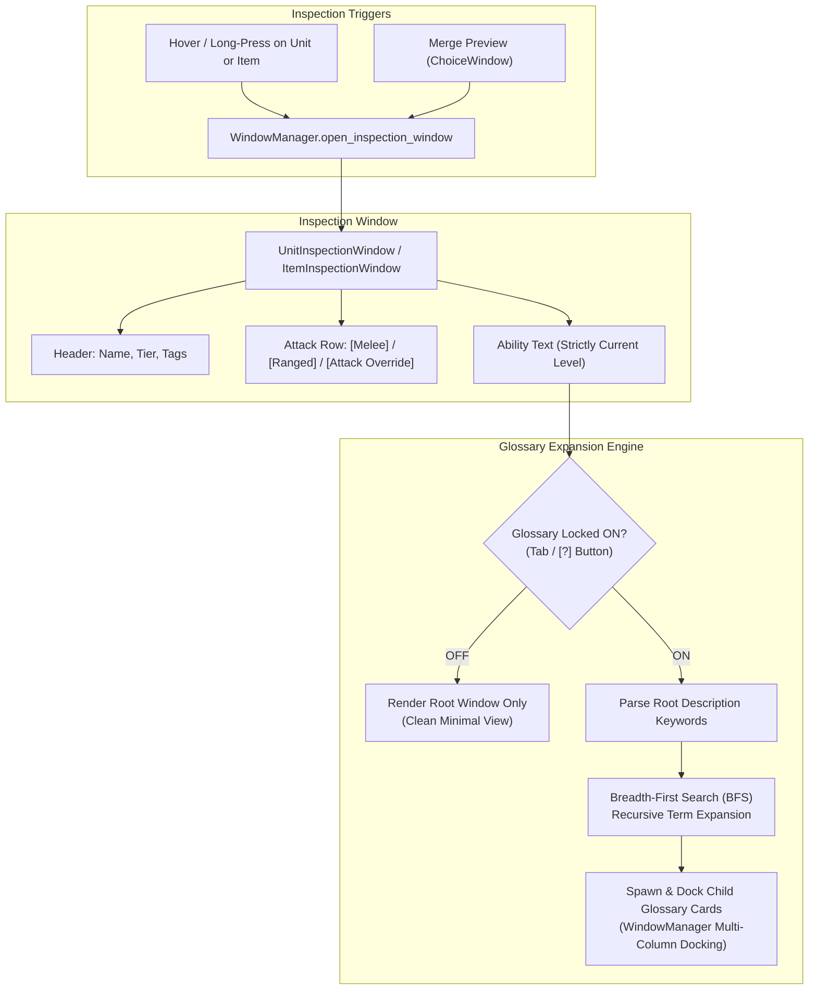

# Flashcard Heroes — Description & Tooltip Architecture Plan (V2)

> **Document Type:** Master Architectural Specification & Modernization Plan  
> **Status:** Approved Direction — Incorporating User Architectural Decisions  
> **Target Systems:** `UnitInspectionWindow`, `ItemInspectionWindow`, `EffectInspectionWindow` (Glossary), `DescriptionParser`, `WindowManager`, `ChoiceWindow`, `Database`, `CombatEffectRegistry`, `localization/game.csv`, `docs/Game_Terminology_Glossary.md`

---

## 1. Executive Summary & User Directives

Following architectural review, the description and inspection systems are being restructured to provide absolute clarity, zero mathematical clutter, and full mechanical transparency.

### Core User Directives Incorporated:
1. **Purge Errant Static Triggers from Melee Attack:** Clarify that Melee Attack does *not* trigger Static. The Toy trait synergy is what reacts to Melee attacks to inflict Static; Static itself is strictly a knockout-detonation effect.
2. **Rename `Cascade` $\to$ `Shockwave` Everywhere:** Update code (`EffectCascadeAOE.gd` $\to$ `EffectShockwave.gd`), resources, documentation, and localization keys to use `Shockwave`.
3. **Retire "Status Effect" Across Documentation, File Names, and Code:** Standardize on **Effects** (specifically `CombatEffectDefinition` and `CombatEffectRegistry`) to prevent legacy confusion.
4. **Current-Level Ability Display (The Merge Preview Paradigm):** All active inspection windows display strictly the **current level** ability numbers. All upgrade progression is evaluated directly in the **Merge Modal Preview** (`ChoiceWindow`) before confirming or canceling.
5. **Interactive Glossary Details Toggle (Tab / Mobile Tap) with State Lock:**
   - Toggleable and lockable (state persists across inspection windows).
   - When locked ON: any inspection window with glossary terms automatically opens child glossary cards around it.
   - When locked OFF: child cards are suppressed for an ultra-clean, minimal inspection.
6. **Recursive Glossary Term Expansion:** If opened glossary cards themselves contain glossary terms (e.g., `Shockwave` references `Melee Attack`, which references `Spikes` and `Armor`), those referenced term cards are recursively opened as well (with visited tracking to prevent duplicates and cycles).

---

## 2. Updated Canonical Terminology Specifications

### 2.1 Attack Delivery Types & Overrides

| Term | Domain | Delivery & Targeting Rule | Combat & Mitigation Interactions |
| :--- | :---: | :--- | :--- |
| **Melee Attack** | Baseline Attack | Strikes the **Frontmost Enemy** closest to the clash line. | Mitigated by Armor; **triggers defender Spikes**. *(Does NOT trigger Static natively; Toy trait is a specific reactive ability).* |
| **Ranged Attack** | Baseline Attack | Strikes the **Mirror Slot Enemy** (`Lineup Size - 1 - Source Index`). If empty or knocked out, **falls back to the backmost living enemy**. | Mitigated by Armor; **bypasses defender Spikes**. |
| **Attack Override** | Attack Modification | Replaces the unit's baseline attack action with an ability (e.g., Shockwave, Hero Pyro Fireball). Declared via `replaces_basic_attack = true`. | Still fires `when_attacking` triggers, but skips standard basic attack enqueuing. Explicitly states attack delivery type (Melee or Ranged). |
| **Extra Attack** | Action Chaining | An additional attack executed immediately during this turn action (max once per turn). | **Not restricted to Melee.** Inherits the unit's attack type or declares a specific attack type (Melee, Ranged, or Special). |
| **Extra Action** | Turn Queue | Inserts the unit back into the turn queue for an entire additional turn action (max once per turn). | Re-runs full turn action logic, stronger than an Extra Attack. |
| **Empowered Attack** | Attack Priming | An enhanced attack action that expends upon execution to deal Bonus Damage or apply Effects (e.g. Burn, Static). | Replaces deprecated "Charge" concept. Expended immediately upon execution. |

### 2.2 AoE & Targeting Mechanics

| Term | Mechanics & Formulas | Edge Cases & Fallbacks |
| :--- | :--- | :--- |
| **Shockwave** *(formerly Cascade)* | 1. Hits the primary target (frontmost enemy).<br/>2. Spills backward into up to **2 consecutive slots behind** (Depth = 2).<br/>3. Deals **50% falloff per slot behind** (100% $\to$ 50% $\to$ 25%). | If an intermediate slot behind is empty or knocked out, the damage decays as normal and checks the next slot. Defaults to Melee damage type unless specified. |
| **Bounce** | Strikes a primary target, then ricochets to $N$ random living enemy targets. | Damage or effect stacks halve on each bounce (minimum 1). Bypasses Spikes. |
| **Intercept** | An allied unit leaps in front of a single-target Melee, Ranged, or Ability strike to absorb the blow in the target's place. | Redirects hit before damage calculation; cannot intercept Burn, Static, or Spikes. *(Replaces legacy "Guardian Sacrifice").* |

### 2.3 Stack-Based Combat Effects (Formerly "Status Effects")

| Effect | Polarity | Decay & Turn Timing Rule | Functional Behavior |
| :--- | :---: | :--- | :--- |
| **Armor** | Positive | Clears to `0` at **Turn Start** unless preserved by **Reinforce**. | Absorbs all damage point-for-point. Bypassed only by **Burn**. |
| **Reinforce** | Positive | Loses `1` stack at **Turn Start**. Stackable. | While active, protects Armor from clearing at Turn Start. |
| **Spikes** | Positive | **No turn-end decay.** Loses `1` stack per retaliatory hit. | Deals damage equal to stacks back to **Melee attackers** upon impact. Bypassed by **Ranged Attacks**. |
| **Burn** | Negative | Deals damage equal to stacks at **Turn End**, then **halves** (rounded down). | **Completely ignores Armor.** Does not halve on Burn Slots. |
| **Static** | Negative | Decrements by `1` stack at **Turn End**. | **When Knocked Out**, deals damage equal to active stacks to living adjacent Lineup allies (**mitigated by Armor**), then clears. |
| **Bounty** | Negative | Decays by `1` stack at **Turn Start**. Stackable. | When knocked out, awards `1 Gold` per stack to the opposing team. |

---

## 3. UI/UX Architecture: The Inspection & Glossary System



### 3.1 Dedicated Attack Row in UnitInspectionWindow
The Unit Inspection window features a dedicated **Attack Row** located between the Trait Tags and the Ability block:
- **Melee Unit:** `Attack: [Melee] (Frontmost Enemy)`
- **Ranged Unit:** `Attack: [Ranged] (Mirror Slot Enemy; fallback: Backmost)`
- **Override Unit:** `Attack Override: [Melee] [Shockwave] (Frontmost & up to 2 behind)`

This eliminates attack-explaining sentences from ability descriptions entirely.

### 3.2 Current-Level-Only Ability Descriptions
- Every unit description reflects **only the numbers for its current level**.
- No `[ 1 / 2 / 3 ]` brackets, no `at Levels 1 / 2 / 3` text.
- Example:
  - Level 1: `When hurt by an attack, heal 1 HP.`
  - Level 2: `When hurt by an attack, heal 2 HP.`
  - Level 3: `When hurt by an attack, heal 3 HP.`

### 3.3 Merge Modal Preview (`ChoiceWindow`)
When a player merges two identical units (Level Up) or merges recipe units (Tier Up):
1. `ChoiceWindow` instantiates the resulting unit instance (`is_preview = true`).
2. It displays the **resulting unit's full inspection window**, showing its upgraded stats and its next-level ability text.
3. If Glossary details are locked ON, the child glossary windows dock around the merge preview just like any standard inspection window.

### 3.4 Locked Toggle & Recursive Glossary Expansion Engine
- **State Persistence:** `WindowManager.is_glossary_locked: bool` (default: false, persisted in player preferences).
- **Toggle Controls:**
  - **PC:** `Tab` key toggles and locks the state (with audio clack).
  - **Mobile:** `[?] Glossary` pill button in inspection header or double-tap toggles and locks the state.
- **Recursive Expansion (BFS):**
  When an inspection window opens with Glossary locked ON:
  ```gdscript
  var queue: Array[String] = [root_description_text]
  var seen_terms: Dictionary = {}
  
  while not queue.is_empty():
      var text = queue.pop_front()
      var keywords = DescriptionParser.find_keywords(text)
      for kw in keywords:
          if not seen_terms.has(kw):
              seen_terms[kw] = true
              var term_def = GlossaryRegistry.get_definition(kw)
              child_specs.append(term_def.to_spec())
              queue.push_back(term_def.description_text)
  ```
  *Example:* Unit has `Shockwave` $\to$ spawns `Shockwave` card $\to$ card mentions `Melee Attack` $\to$ spawns `Melee Attack` card $\to$ card mentions `Spikes` and `Armor` $\to$ spawns `Spikes` and `Armor` cards. All cycles and duplicates are strictly prevented by `seen_terms`.

### 3.5 Tiny Rogues-Style Edge-to-Edge Adaptive Tooltip Stacking
In games like *Tiny Rogues*, inspecting an item with multiple keywords doesn't open giant full-width windows; it opens **compact, lightweight keyword cards** that stack edge-to-edge around the primary window:
1. **Lightweight Card Dimensions:**
   - Instead of the rigid 480px width used by entity inspections, glossary cards use a compact width (**240px–260px**) with wrappable text and tight padding.
   - Each card contains only a colored title (e.g. `Shockwave`, `Spikes`, `Burn`) and 1–2 sentences of definition (~60px to 90px tall).
2. **Vertical Column Stacking:**
   - When glossary details are toggled on, all resolved keywords stack vertically in a clean column attached to the outer edge of the inspection window.
   - On a 1080p viewport, a single 250px-wide column can easily fit **7 to 9 stacked keyword tooltips vertically** without any wrapping or overlap!
3. **Adaptive Multi-Column Overflow:**
   - If a cluster exceeds the vertical screen height, `WindowManager`'s existing column-wrap logic simply starts a second 250px column immediately beside the first (or on the opposite edge of the inspection window).
   - The entire cluster dynamically scales to fit available screen bounds and dismisses in unison.

---

## 4. Code & Architecture Refactoring Plan

### 4.1 Naming Architecture: Stackable Effects vs. Ability Execution Steps
In Godot, class names in `class_name` must be globally unique:
- **`EffectDefinition.gd`** is currently the engine base class for 76+ ability execution scripts (`EffectModifyStat.gd`, `EffectShockwave.gd`, etc.).
- **`StatusEffectDefinition.gd`** is currently the definition for the 6 stack-based combat tokens (`Armor`, `Spikes`, `Burn`, `Static`, `Bounty`, `Reinforce`).

To scrub the word "Status" while keeping the codebase clean and robust:
- **Recommended Architecture (Targeted & Safe):**
  - **Player & Documentation Domain:** Universally called **Effects** (Positive Effects / Negative Effects: Armor, Spikes, Burn, Static, Bounty, Reinforce). Zero mention of "status effect".
  - **Code Class Name:** Rename `StatusEffectDefinition` $\to$ **`CombatEffectDefinition`** (or `StackEffectDefinition`) and `StatusEffectRegistry` $\to$ **`CombatEffectRegistry`**.
  - **Why not rename all 76 `Effect*` ability scripts?** Stripping `Effect` from all 76 ability scripts (`EffectModifyStat` $\to$ `ModifyStat`) would require updating over 100 `.tres` resource files and external script references across the entire combat engine for no functional gain. Using `CombatEffectDefinition` provides instant clarity between an ability execution step and a stackable combat effect.

### 4.2 Renaming Cascade $\to$ Shockwave
- Script: `scripts/EffectCascadeAOE.gd` $\to$ `scripts/effects/EffectShockwave.gd`
- Ability Resources: `UnitTier3Berserker_Shockwave_L*.tres` updated to reference `EffectShockwave.gd`.
- CSV Keys: All keys referencing cascade updated to `shockwave`.

---

## 5. Execution Roadmap

1. **Step 1: Canonical Glossary Update**
   - Update [`docs/Game_Terminology_Glossary.md`](file:///Users/danhh/Desktop/Flashcard%20Heroes/docs/Game_Terminology_Glossary.md) with exact formulas, targeting rules, and purged legacy terms.
2. **Step 2: Engine & Codebase Renames**
   - Execute `Cascade` $\to$ `Shockwave` refactor.
   - Refactor `StatusEffect*` $\to$ `CombatEffect*`.
3. **Step 3: DescriptionParser & Recursive Glossary Expansion**
   - Implement expanded keyword catalog in `DescriptionParser.gd`.
   - Implement BFS recursive term resolution in `WindowManager.gd`.
   - Add `Tab` / `[?]` toggle lock mechanism.
4. **Step 4: Inspection Window Layout & Attack Row**
   - Add Attack Row to `UnitInspectionWindow.gd`.
   - Update `ChoiceWindow.gd` to ensure merge previews support full glossary docking.
5. **Step 5: Content & Localization CSV Migration**
   - Convert all multi-level descriptions to current-level-only text across `localization/game.csv` (both EN and PT-BR).

---

## 6. Completed Implementation & Verification Summary

### 6.1 Master Authority & Codebase Refactoring
- Updated [`docs/Game_Terminology_Glossary.md`](file:///Users/danhh/Desktop/Flashcard%20Heroes/docs/Game_Terminology_Glossary.md) with canonical mechanics (Melee, Ranged, Shockwave, Bounce, Extra Attack, Extra Action, Empowered Attack, Intercept, Lifesteal, Attack Override), strictly Current-Level Law, and retired standalone Charge / purged Static-from-Melee error.
- Renamed class [`EffectShockwave.gd`](file:///Users/danhh/Desktop/Flashcard%20Heroes/scripts/EffectShockwave.gd), updated resources (`UnitTier2B_Shockwave.tres`, `UnitTier3Berserker_Shockwave_L1/L2/L3.tres`), purged legacy cascade files.
- Renamed class [`CombatEffectDefinition.gd`](file:///Users/danhh/Desktop/Flashcard%20Heroes/scripts/CombatEffectDefinition.gd), [`CombatEffectRegistry.gd`](file:///Users/danhh/Desktop/Flashcard%20Heroes/scripts/CombatEffectRegistry.gd), moved directory `resources/combat_effects/`, updated Autoload in `project.godot`, updated animation handler [`CombatEffectAnimation.gd`](file:///Users/danhh/Desktop/Flashcard%20Heroes/scripts/animations/CombatEffectAnimation.gd).

### 6.2 Tiny Rogues-Style Dynamic Tooltip Engine
- **Recursive BFS Keyword Expansion**: Implemented in [`WindowManager.gd`](file:///Users/danhh/Desktop/Flashcard%20Heroes/scripts/WindowManager.gd) with `_collect_recursive_glossary_specs`. Automatically recurses into nested terms found inside glossary card descriptions using cycle-safe canonical visited tracking.
- **Micro-Card Compact Layout**: Standardized [`EffectInspectionWindow`](file:///Users/danhh/Desktop/Flashcard%20Heroes/scripts/EffectInspectionWindow.gd) and scene to 260px width with 24px/22px typography. Fits 7–8 cards vertically before cleanly wrapping to multi-column packing.
- **Lockable Glossary Details (Tab & Touch Pill)**:
  - Added global input routing via `GlobalInteractionRouter.gd` (`KEY_TAB`).
  - Added interactive header pill button (`[?]` / `[?] ON`) to [`UnitInspectionWindow`](file:///Users/danhh/Desktop/Flashcard%20Heroes/scenes/UnitInspectionWindow.tscn).
  - Wired signal `SignalBus.glossary_lock_changed(is_locked)`.
- **Merge Preview Support**: Added `setup_child_windows_for_modal` in [`WindowManager.gd`](file:///Users/danhh/Desktop/Flashcard%20Heroes/scripts/WindowManager.gd) and wired [`ChoiceWindow.gd`](file:///Users/danhh/Desktop/Flashcard%20Heroes/scripts/ChoiceWindow.gd) merge preview to display side glossary tooltips when locked ON.

### 6.3 Dedicated Attack Row & Level-Scaling Runtime
- **Dedicated Attack Row**: Added `%AttackRow` in `UnitInspectionWindow.tscn` displaying attack category (`Attack: [Melee] (Frontmost)`, `Attack: [Ranged] (Mirror Slot)`, or `Attack Override: [Melee] [Shockwave]`).
- **Current-Level-Only Parser**: Implemented `DescriptionParser.resolve_level_scaling(text, level)` supporting `[L1 / L2 / L3]`, `[100% / 150% / 200%]`, `[+0 / +2 / +4]`, and `1 / 2 / 3` numeric slash sequences. Automatically evaluates to the unit's exact level (or next level during merge preview).
- **Localization Migration**: Purged `at Levels 1 / 2 / 3` and `nos Níveis 1 / 2 / 3` across [`localization/game.csv`](file:///Users/danhh/Desktop/Flashcard%20Heroes/localization/game.csv), compiled with `sync_translations.py`.
- **Headless Verification**: Ran test runner (`res://tests/run_fast_suite.tscn`). All 8 test suites passed with 0 errors.
