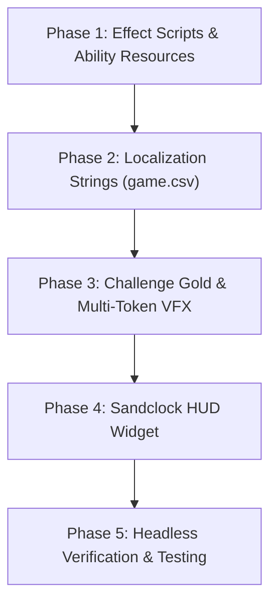

# Implementation Plan: Novice Lineage & Challenge Mechanics Refactor

**Status:** Historical proposal. Current Crest and Challenge behavior is documented in [Novice.md](Novice.md#4-novice-trait-ladder) and [FlashcardSystem.md](FlashcardSystem.md).

**Target Scope:** Novice Hero Set (Dan), 5 Units, 3 Items, Silver Trait Gold Pop VFX, Gold Trait Multi-Token Verification, Sandclock Bonus Timer UI  
**Companion Documents:**  
- [GameContentDocument.md](file:///Users/danhh/Desktop/Flashcard%20Heroes/docs/GameContentDocument.md)
- [Novice.md](file:///Users/danhh/Desktop/Flashcard%20Heroes/docs/Novice.md)

---

## 1. Problem Statement & Design Objectives

1. **Elimination of `at_minigame_end` Triggers:**  
   Abilities triggering `at_minigame_end` required units or items to be fielded before the turn 1 challenge. Deploying units from the shelf, summoning, or merging mid-battle permanently locked them out of their abilities. All 8 affected abilities are refactored to standard combat triggers (`pre_combat`, `when_attacking`, `when_hurt`).
2. **Elimination of Invisible Answer-Tracking:**  
   Abilities scaling with correct challenge answers, streak counts, or Mastery Level 1 cards lacked any visible in-combat UI tracking. Power scaling is now redirected to **Current Tokens Held / Spent**, which are permanently displayed in the top HUD.
3. **Multi-Currency VFX Feedback (Silver & Gold Trait):**  
   Novice Silver (3-streak) will pop a Gold coin simultaneously from the answered button alongside the Token, flying toward the Gold counter. Novice Gold (Mastery 1) and Beginner's Charm multi-token generation will be verified and enhanced with fan-out trajectory separation so multiple tokens are distinctly visible.
4. **Sandclock Bonus Timer Indicator:**  
   Extra starting time banked for future challenges (from `?NovPla` and `W??ANovCos` death or `item_novice_emblem` kill) will be visually communicated to the player via a sandclock icon and bonus label next to the Tokens counter on the HUD, visible only when bonus time exists.

---

## 2. Clarification on `EF??NovApp` (Magmarange)

* **Unit ID:** `EF??NovApp`
* **Localized Name:** **Magmarange** (`EF??NovApp.name`)
* **Recipe:** `E?NovPla` (Rootguard - Earth/Plant) + `F?NovApp` (Ignikettle - Fire/Appliance)
* **Tier & Role:** Tier 3 Ranged (5 HP / 5 PWR)
* **Tags:** EARTH, FIRE, 2x `?`, Novice, Appliance
* **Element & Status:**  
  Because its recipe merges Earth (`E?NovPla`) and Fire (`F?NovApp`), it possesses **FIRE**, which applies **Burn** (not Static). The unit in the Novice pack that inflicts **Static** is `?ANovFod` (**Gustpuff**, Air/Food, Tier 2 Ranged) and its crossbreed `F??ANovFod` (**Zephyrcrisp**, Fire/Air/Food, Tier 3 Melee).
* **New Tier 3 Standardized Ability:**  
  `Pre-Battle, spend 1 Token to Charge an Empowered Attack that applies 1 / 2 / 3 Burn to the target per Current Token held before the spend.`

---

## 3. Unit Ability Changes (All 11 Novice Units)

All Tier 2 units scale 1:1 with tokens held (except Spikes, which scale per 2 tokens).  
All Tier 3 units spend 1 Token to activate their ability (except `W??ANovCos` death trigger).  
All "if holding at least X tokens" restrictions are eliminated.  
All abilities feature strict `1 / 2 / 3` per-level scaling.

| Unit | Name | Tags & Role | Trigger | Standardized Ability Specification |
|---|---|---|:---:|---|
| `?NovPla` | **Novisprout** | `?`, Novice, Plant (T1 Ranged) | `when_knocked_out` | When knocked out, add 1 / 2 / 3 seconds to the starting time of the next battle challenge. This effect stacks. |
| `?ANovFod` | **Gustpuff** | `?`, AIR, Novice, Food (T2 Ranged) | `pre_combat` | Pre-Battle, Charge an Empowered Attack that inflicts 1 / 2 / 3 Static on the target for each Current Token held. |
| `E?NovPla` | **Rootguard** | EARTH, `?`, Novice, Plant (T2 Melee) | `pre_combat` | Pre-Battle, gain 1 / 2 / 3 Armor for each Current Token held, and 1 Spike for every 2 Current Tokens held. |
| `F?NovApp` | **Ignikettle** | FIRE, `?`, Novice, Appliance (T2 Melee) | `pre_combat` | Pre-Battle, Charge an Empowered Attack that applies 1 / 2 / 3 Burn to the target for each Current Token held. |
| `W?NovCos` | **Tidecloak** | WATER, `?`, Novice, Costume (T2 Melee) | `when_hurt` | When hurt by an attack, heal self for 1 / 2 / 3 HP for each Current Token held. |
| `E??ANovPla` | **Galebloom** | EARTH, 2x `?`, AIR, Novice, Plant (T3 Melee) | `at_turn_start` | At Turn Start, spend 1 Token to gain 1 / 2 / 3 Spikes for every 2 Current Tokens held before the spend. |
| `F??ANovFod` | **Zephyrcrisp** | FIRE, 2x `?`, AIR, Novice, Food (T3 Melee) | `when_attacking` | When attacking, spend 1 Token to inflict 1 / 2 / 3 Static on the target per Current Token held before the spend. |
| `W??ANovCos` | **Stormshroud** | WATER, 2x `?`, AIR, Novice, Costume (T3 Melee) | `when_knocked_out` | When knocked out, add 1 / 2 / 3 seconds to the starting time of the next battle challenge and gain Tokens equal to this unit's level (1 / 2 / 3 Tokens). |
| `EF??NovApp` | **Magmarange** | EARTH, FIRE, 2x `?`, Novice, Appliance (T3 Ranged) | `pre_combat` | Pre-Battle, spend 1 Token to Charge an Empowered Attack that applies 1 / 2 / 3 Burn to the target per Current Token held before the spend. |
| `EW??NovPla` | **Mirethicket** | EARTH, WATER, 2x `?`, Novice, Plant (T3 Ranged) | `when_attacking` | When attacking, spend 1 Token to deal 1 / 2 / 3 Bonus Damage per Current Token held before the spend. |
| `FW??NovAni` | **Steampaw** | FIRE, WATER, 2x `?`, Novice, Animal (T3 Ranged) | `when_attacking` | When attacking, spend 1 Token to apply 1 / 2 / 3 Burn to the target per Current Token held before the spend. |

---

## 4. Item Ability Changes (Novice Items)

| Item | Name | Recipe & Stats | Trigger | Standardized Ability Specification |
|---|---|---|:---:|---|
| `item_study_pouch` | **Token** | Tier 1 (Unique) +1 HP | `when_knocked_out` | When holder is knocked out, gain Tokens equal to holder's Tier (1 / 2 / 3 Tokens). |
| `item_review_ledger` | **Nail** | Tier 2 (`item_study_pouch` + `item_t1_a`) +2 HP | `pre_combat` | Pre-Battle, while equipped in the active lineup, holder gains 1 / 2 / 3 Spikes for each Current Token held. |
| `item_answer_key` | **Burnout** | Tier 2 (`item_study_pouch` + `item_t1_b`) +2 PWR | `when_attacking` | When attacking, while equipped in the active lineup, apply 1 / 2 / 3 Burn to the target for each Current Token held. |
| `item_novice_archive` | **Novice's Archive** | Tier 3 (Nail + Burnout) +2 HP / +2 PWR | `when_attacking` | When attacking, spend 1 Token to deal 1 / 2 / 3 Bonus Damage for each Current Token held before the spend. |
| `item_novice_emblem` | **Novice Emblem** | Tier 3 (Standalone) | `when_enemy_knocked_out` | Contributes +1 Novice trait counter while in active lineup. For each enemy unit knocked out by holder in battle, add 1 second to the starting time of the next battle challenge. |

---

## 5. Challenge VFX & Audio Enhancements

### 5.1 Novice Trait Silver: Simultaneous Gold Coin Pop
* **Mechanism:** When `current_streak == 3` and player fields >= 3 Novices in battle:
  1. `FlashcardManager.submit_answer()` records `gold_to_give = 1` into the committed result dictionary.
  2. `FlashcardMinigame._flash_button_correct()` receives `gold_to_give`.
  3. From the exact center of the tapped answer button (`spawn_pos`), both animations trigger simultaneously:
     * `CurrencyAnimator.animate_token_gain(token_count, spawn_pos, Callable(), streak)` -> flies toward HUD Token counter.
     * `CurrencyAnimator.animate_gold_gain(1, spawn_pos)` -> flies toward HUD Gold counter.
  4. Both HUD counters pop and increment upon their respective coin landings.

### 5.2 Novice Trait Gold & Beginner's Charm: Multi-Token Spread
* When `tokens_to_give` is 2 (Gold Novice) or 3 (Gold Novice + Beginner's Charm):
  * Enhance `CurrencyAnimator.animate_token_gain()` to apply a slight horizontal spread offset (`offset_x = (i - (tokens_to_spawn - 1) * 0.5) * 24.0`) to the pop arc.
  * This creates an arc fan so the 2 or 3 tokens launch cleanly apart rather than stacking on top of each other.

---

## 6. Sandclock Bonus Timer UI

### 6.1 HUD Layout (`scenes/Main.tscn`)
* Located under `HUDLayer/HUDContainer/TopArea/TopRows/StatsRow/LeftStats` to the right of `TokenGroup`:
  * `BonusTimerGroup` (`HBoxContainer`, default `visible = false`)
    * `SandclockIcon` (`TextureRect`, 64x64, pixel art sandclock)
    * `BonusTimerLabel` (`Label`, HUDLabel style, displays `+Xs`)

### 6.2 Data Binding (`scripts/Main.gd`)
* `Main.gd` observes `RunState.next_battle_minigame_bonus_time` (and `BattleManager.add_next_minigame_bonus_time`).
* When bonus time > 0:
  * `BonusTimerGroup.visible = true`
  * `BonusTimerLabel.text = "+%ds" % int(round(bonus_time))`
* When bonus time is 0 (or consumed at challenge start by `consume_next_minigame_bonus_time()`):
  * `BonusTimerGroup.visible = false`

---

## 7. Execution Roadmap

### Phase 1: Effect Scripts & Ability Resources
1. Implement/update effect scripts in `scripts/effects/`:
   * `EffectRootguardPreBattle.gd` (Armor + Spikes per tokens)
   * `EffectChargeEmpoweredAttack.gd` (add `BURN_PER_TOKEN` mode for Ignikettle)
   * `EffectTidecloakHealOnHurt.gd` (Heal per token on hurt)
   * `EffectSpendTokenInflictStatic.gd` (Spend 1 token to inflict Static equal to tokens held before spend)
   * `EffectSpendTokenInflictBurn.gd` (Spend 1 token to apply Burn equal to tokens held before spend)
   * `EffectNailPreBattle.gd` (Gain 1 Spike per token)
   * `EffectBurnoutOnAttack.gd` (Apply 1 Burn per token on attack)
   * `EffectNoviceArchiveOnAttack.gd` (Spend 1 token to deal extra damage per token held)
2. Update `.tres` ability files in `resources/abilities/`:
   * `ability_e_nov_pla.tres`
   * `ability_f_nov_app.tres`
   * `ability_w_nov_cos.tres`
   * `ability_fa_nov_fod.tres`
   * `ability_fw_nov_ani.tres`
   * `ability_item_review_ledger.tres`
   * `ability_item_answer_key.tres`
   * `ability_item_novice_archive.tres`

### Phase 2: Localization Updates
* Update `localization/game.csv` for:
  * `E?NovPla.desc`
  * `F?NovApp.desc`
  * `W?NovCos.desc`
  * `F??ANovFod.desc`
  * `FW??NovAni.desc`
  * `item.review_ledger.desc`
  * `item.answer_key.desc`
  * `item.novice_archive.desc`
* Compile `.po` / `.mo` translation catalogs.

### Phase 3: Challenge Gold & Multi-Token VFX
* Update `FlashcardManager.gd` to include `gold_to_give: 1` in answer submission output when Silver Novice triggers.
* Update `FlashcardMinigame.gd` to trigger `CurrencyAnimator.animate_gold_gain()` alongside `animate_token_gain()`.
* Add fan-out trajectory offset to `CurrencyAnimator.animate_token_gain()` for multi-token events.

### Phase 4: Sandclock HUD Widget
* Design and add the sandclock texture asset.
* Add `BonusTimerGroup` to `scenes/Main.tscn` in `LeftStats` next to `TokenGroup`.
* Connect visibility and text updates in `scripts/Main.gd` to `RunState.next_battle_minigame_bonus_time`.

### Phase 5: Verification
* Run compilation checks via Godot CLI / headless verification test suite.
* Verify abilities activate during combat (`pre_combat`, `when_attacking`, `when_hurt`) rather than `at_minigame_end`.
* Verify unit/item abilities function correctly when deployed mid-battle or summoned from the shelf.
