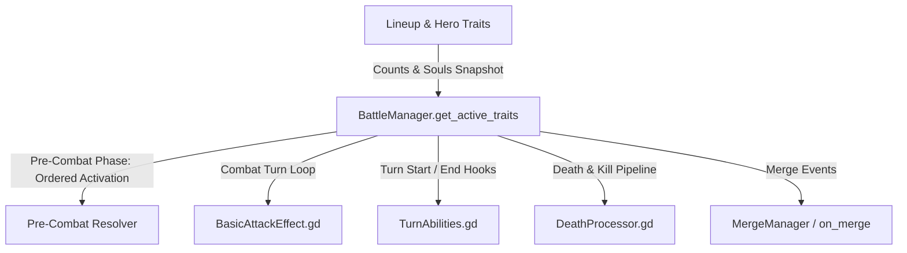

# TRAIT ABILITIES IMPLEMENTATION PLAN & ARCHITECTURAL SPECIFICATION

> **Status**: Final Technical Specification & Implementation Guide  
> **Source Design**: [TraitAbilitiesProposal.md](file:///Users/danhh/Desktop/Flashcard%20Heroes/docs/TraitAbilitiesProposal.md)  
> **Core Principle**: Maximum reuse of existing combat engine hooks, triggers, and effect handlers with zero defensive code. Complete decoupling between combat simulation (`BattleState`, `BattleManager`) and presentation (`BattleView`, `BattleAnimator`). Strict compliance with the Game Action Pipeline and 100% deterministic replay fidelity.

---

## 1. System Architecture & Execution Lifecycle

The trait abilities system integrates directly into existing engine hooks across the combat lifecycle:



### 1.1 Deterministic Pre-Combat Execution Order
As confirmed in design review, the `on_pre_combat` phase resolves with strict, deterministic ordering to prevent race conditions (especially for directional buffs, shield creation, and Costume thefts):
1. **Team Order**: **Player team first**, then **Enemy team**.
2. **Unit Order**: **Back to front** (highest slot index down to slot 0).
3. **Trinket Order**:
   - **Player Trinkets**: **Left to right** (container index 0 to max).
   - **Enemy Trinkets**: **Right to left** (container index max down to 0).
4. **Resulting Timing Synergies**:
   - Directional buffs (Support front/back) and Armor/Spikes generation (Earth, Tank, Plant) resolve in order.
   - Costume theft activates according to trinket/unit timing, allowing it to steal fresh Armor/Spikes generated earlier in the sequence.

### 1.2 Cumulative Progression vs. Numerical Upgrades
- **Cumulative Trait Carrying**: All trait levels carry their previous level abilities forward, except where explicitly specified. (e.g. Appliance L4 stat conversion happens *in addition* to L3 reflection; Fire L4/L5 carries forward L1/L2 burn application and L3 spread; Mecha L4 death barrage carries forward L1 spikes, L2 armor/static, L3 merge spark).
- **Numerical Upgrades**: When a higher level modifies the numerical amount of the *same* baseline mechanic, the higher tier value replaces the lower tier value (e.g. Toy melee reflection deals 2 $\to$ 3 $\to$ 4 Static; Animal heals 1 $\to$ 2 $\to$ 3 $\to$ 3 + 25% PWR; Food heals 1 $\to$ 2 $\to$ 3 $\to$ 4 HP; Earth pre-combat grants 1A $\to$ 1A+1S $\to$ 2A+2S $\to$ 3A+3S; Costume mirror theft steals 1 stack $\to$ entire highest $\to$ all Armor & Spikes).

---

## 2. Game Action Pipeline, Replay Integrity & PRNG Isolation

### 2.1 The Universal Action Pipeline Contract
Under the pure event-driven architecture modeled after Slay the Spire 2, all state transitions and player commands MUST pass through `ActionQueue.request()` as discrete `GameAction` instances:
- **`EndTurnAction`**: Triggered when the player clicks "Battle!".
  - Owns the root transaction transitioning from `MANAGEMENT` through `PRE_COMBAT`, `COMBAT`, and `END_OF_TURN`.
  - Drives all pre-combat trait triggers, attacks, death resolutions, and turn-end ticks.
  - Generates an ordered causal stream of `CombatEvent`s in the `TurnLog`.
  - Yields until `BattleAnimator` finishes all sequence playback, calling `finish_visuals()` to unlock the `ActionQueue`.
- **`ConfirmMergeAction`**: Triggered when merging units or items during Management.
  - Owns the root transaction for board merges.
  - Invokes `BattleManager.bm_merge_instances()`, broadcasting `TRIGGER_ON_MERGE`.
  - Resolves Mecha L3 ranged reaction attacks immediately as inline/reaction events.
  - Yields for merge and reaction animation playback before returning control to the player.
- **`DrawGachaAction`**: Triggered when pulling from gacha machines.
  - Checks discounted cost from Specialist L2 via `BattleManager.get_gacha_draw_cost()`.
  - Deducts tokens atomically during validation/execution without pipeline bypass.

### 2.2 Replay Determinism & Seeded PRNG Isolation
- **PRNG Isolation**: All randomized logic—including tie-breaking, targeting random enemies/allies, picking random Animals, and Mecha ranged shots—MUST strictly use `RNGManager.combat_rng`.
- **Zero Presentation Pollution**: Replays record only logical `GameAction`s. Trait effects must never query UI nodes, screen positions, or viewport transforms to make logical decisions.
- **Unified State Mutations**: Every HP, PWR, and Status Effect modification must execute via `BattleManager.apply_stat_delta()` or `BattleManager.apply_damage()`. Never mutate instance properties (`current_hp`, `status_effects`) directly.

---

## 3. Existing Engine Components & Reusability Matrix

| Trait | Core Mechanics | Existing Engine Component Reused | Modification / Extension Needed |
| :--- | :--- | :--- | :--- |
| **Fire** | Attack burn, burn damage boost, turn-end spread, kill dispersion | [BasicAttackEffect.gd](file:///Users/danhh/Desktop/Flashcard%20Heroes/scripts/BasicAttackEffect.gd), [TurnAbilities.gd](file:///Users/danhh/Desktop/Flashcard%20Heroes/scripts/battle/TurnAbilities.gd) | Spread 1 Burn to each adjacent ally on turn-end damage; transfer remaining Burn on kill to adjacent enemies (odd remainder to frontmost). |
| **Earth** | Pre-combat Armor/Spikes, Spikes attack damage boost | [EffectTraitEarth.gd](file:///Users/danhh/Desktop/Flashcard%20Heroes/scripts/effects/EffectTraitEarth.gd), [BasicAttackEffect.gd](file:///Users/danhh/Desktop/Flashcard%20Heroes/scripts/BasicAttackEffect.gd) | Update soul thresholds (3, 6, 12, 20, 32); add Spikes-to-attack-damage in `BasicAttackEffect.gd` (decays 1 stack per attack instance). |
| **Water** | Pre-combat heal/cleanse, turn start lowest-HP heal, status inversion | [EffectTraitWater.gd](file:///Users/danhh/Desktop/Flashcard%20Heroes/scripts/effects/EffectTraitWater.gd), [TurnAbilities.gd](file:///Users/danhh/Desktop/Flashcard%20Heroes/scripts/battle/TurnAbilities.gd) | Add turn-start lowest-HP heal; add turn-start negative status consumption and heal conversion. |
| **Air** | Attack static, splash static, pre-combat static, PWR scaling | [BasicAttackEffect.gd](file:///Users/danhh/Desktop/Flashcard%20Heroes/scripts/BasicAttackEffect.gd), [EffectTraitAir.gd](file:///Users/danhh/Desktop/Flashcard%20Heroes/scripts/effects/EffectTraitAir.gd) | Add Static application and adjacent splash on attack; scale attack Static with PWR at L5. |
| **Tank** | Front armor, armor-absorb pass behind, intercept, spikes-on-armor | [BattleHelpers.resolve_guardian_intercept](file:///Users/danhh/Desktop/Flashcard%20Heroes/scripts/battle/BattleHelpers.gd), [BattleManager.apply_damage](file:///Users/danhh/Desktop/Flashcard%20Heroes/scripts/BattleManager.gd) | Pass 1 Armor behind on armor absorption; intercept ANY physical attack aimed at ally behind; grant Spikes when Armor gained. |
| **Fighter** | Higher-HP bonus damage, retaliation, cleave, kill extra action | [BasicAttackEffect.gd](file:///Users/danhh/Desktop/Flashcard%20Heroes/scripts/BasicAttackEffect.gd), [EffectCounterAttack.gd](file:///Users/danhh/Desktop/Flashcard%20Heroes/scripts/effects/EffectCounterAttack.gd), [BattleManager.grant_extra_action](file:///Users/danhh/Desktop/Flashcard%20Heroes/scripts/BattleManager.gd) | Retaliation on attack damage (1/turn per Fighter); cleave damage behind target; +1 PWR and extra action on kill (1/turn per Fighter). |
| **Support** | Directional HP/PWR buff, triage buff, hero empowerment | [EffectTraitPowerBuff.gd](file:///Users/danhh/Desktop/Flashcard%20Heroes/scripts/effects/EffectTraitPowerBuff.gd), [BattleSetup.is_hero_definition](file:///Users/danhh/Desktop/Flashcard%20Heroes/scripts/battle/BattleSetup.gd) | Front HP / rear PWR pre-combat distribution; turn start +1 HP/PWR per Support unit; target Hero unit directly (cumulatively stacks). |
| **Specialist** | Emergency token, gacha discount, gold on kill, bench clone | `_bargain_charm_uses` in [BattleManager.gd](file:///Users/danhh/Desktop/Flashcard%20Heroes/scripts/BattleManager.gd), [EffectGainGold.gd](file:///Users/danhh/Desktop/Flashcard%20Heroes/scripts/EffectGainGold.gd) | Pre-combat token grant from trinket; gacha draw cost discount; gold on kill; summon bench clone from trinket (overflow to discard). |
| **Food** | Hurt heal ally behind, hurt PWR buff, death pass PWR | `Constants.TARGET_ALLY_BEHIND`, [DeathProcessor.gd](file:///Users/danhh/Desktop/Flashcard%20Heroes/scripts/battle/DeathProcessor.gd) | Hook `on_hurt` to heal/buff ally behind; pass current PWR on death to ally behind. |
| **Mecha** | Pre-combat spikes/armor, static on hit/absorb, merge spark, death barrage | `resources/effects/effect_merge_damage.tres`, [BasicAttackEffect.gd](file:///Users/danhh/Desktop/Flashcard%20Heroes/scripts/BasicAttackEffect.gd) | Trigger ranged static shot on merge (`on_merge`); trigger death barrage (+2 Armor/Spikes, 2 dmg + 2 Static shot) on Mecha death. |
| **Animal** | Random pre-combat PWR, heal on attack | [BasicAttackEffect.gd](file:///Users/danhh/Desktop/Flashcard%20Heroes/scripts/BasicAttackEffect.gd) | Heal attacker on attack resolution based on Animal tier: 1 $\to$ 2 $\to$ 3 $\to$ 3 + 25% PWR. |
| **Plant** | Front spikes, turn start lowest heal, round spikes/HP, heal-to-spikes | [Constants.TRIGGER_ON_HEALED](file:///Users/danhh/Desktop/Flashcard%20Heroes/scripts/Constants.gd), [TurnAbilities.trigger_on_healed](file:///Users/danhh/Desktop/Flashcard%20Heroes/scripts/battle/TurnAbilities.gd) | Turn-start recovery (+1 HP) triggers `on_healed` hook to grant 1 Spikes; turn start growth (+1 Spikes / +1 HP). |
| **Toy** | Melee static reflection, death detonation | [BasicAttackEffect.gd](file:///Users/danhh/Desktop/Flashcard%20Heroes/scripts/BasicAttackEffect.gd), [DeathProcessor.gd](file:///Users/danhh/Desktop/Flashcard%20Heroes/scripts/battle/DeathProcessor.gd) | Apply 2/3/4 Static to melee attackers; detonate highest Static stack enemy on Toy death. |
| **Appliance**| Status immunity, pre-combat static/burn, reflect back, convert to stats | [BattleManager.apply_stat_delta](file:///Users/danhh/Desktop/Flashcard%20Heroes/scripts/BattleManager.gd) | Intercept status applications: reflect to sender/holder/negate; L4 converts attempted Static to PWR and Burn to HP in addition to reflect. |
| **Costume** | Pre-combat status/stat theft from mirror or highest enemy | [BattleManager.gd](file:///Users/danhh/Desktop/Flashcard%20Heroes/scripts/BattleManager.gd), `apply_stat_delta` | Pre-combat theft from mirror enemy (do nothing if empty); L4 executes once per team stealing to Hero. |

---

## 4. Trait-by-Trait Technical Specification

### 4.1 Fire Trait (`FIRE`)
- **Trinket Resource**: [trinket_trait_fire.tres](file:///Users/danhh/Desktop/Flashcard%20Heroes/resources/trinkets/trinket_trait_fire.tres)
- **Engine Resolution**:
  - **L1 (3 Souls)**: In any attack (basic, mirror, shockwave, ranged, etc.), if attacker has Fire trait: apply 1 Burn stack to the target or targets.
  - **L2 (6 Souls)**: If target already holds Burn stacks > 0, apply +1 additional Burn (total 2).
  - **L3 (12 Souls)**: In `TurnAbilities.process_burn_damage`, after Burn damages a unit, spread 1 Burn to each living adjacent ally (both adjacent units receive 1 Burn if 2 exist).
  - **L4 (20 Souls)**: In `BasicAttackEffect.gd`, Fire units deal bonus attack damage equal to target's current Burn stacks (updates existing engine logic from threshold 9 to 20).
  - **L5 (32 Souls)**: In `DeathProcessor.gd`, when an enemy holding Burn is killed by a Fire unit:
    - If 2 adjacent enemies exist: split remaining Burn stacks evenly. The frontmost adjacent ally (lower slot index) receives the extra stack if odd.
    - If 1 adjacent enemy exists: all remaining stacks transfer to that unit.

### 4.2 Earth Trait (`EARTH`)
- **Trinket Resource**: [trinket_trait_earth.tres](file:///Users/danhh/Desktop/Flashcard%20Heroes/resources/trinkets/trinket_trait_earth.tres)
- **Engine Resolution**:
  - **L1–L4 (3, 6, 12, 20 Souls)**: Handled in [EffectTraitEarth.gd](file:///Users/danhh/Desktop/Flashcard%20Heroes/scripts/effects/EffectTraitEarth.gd) (`on_pre_combat`):
    - L1 (3 Souls): Frontmost Earth unit (first Earth unit from slot 0) gains 1 Armor.
    - L2 (6 Souls): Frontmost Earth unit gains 1 Armor and 1 Spikes.
    - L3 (12 Souls): All Earth units gain 2 Armor and 2 Spikes.
    - L4 (20 Souls): All Earth units gain 3 Armor and 3 Spikes; all non-Earth allies gain 1 Armor and 1 Spikes.
  - **L5 (32 Souls)**: In `BasicAttackEffect.gd`, Earth units deal bonus attack damage equal to their current Spikes stacks (`damage += source_instance.get_status_effect_amount(&"spikes")`).
    - *Spikes Attack Decay*: Decays 1 stack of Spikes per attack damage instance, matching the standard Spikes behavior when hit.

### 4.3 Water Trait (`WATER`)
- **Trinket Resource**: [trinket_trait_water.tres](file:///Users/danhh/Desktop/Flashcard%20Heroes/resources/trinkets/trinket_trait_water.tres)
- **Engine Resolution**:
  - **L1 (3 Souls)**: In [EffectTraitWater.gd](file:///Users/danhh/Desktop/Flashcard%20Heroes/scripts/effects/EffectTraitWater.gd) (`on_pre_combat`), each Water unit heals the ally in the slot directly ahead (slot index - 1) by 1 HP (does nothing if Water unit is in slot 0).
  - **L2 (6 Souls)**: The pre-combat heal also cleanses 1 stack of negative status effects (Burn/Static) from that ally.
  - **L3 (12 Souls)**: In `TurnAbilities.gd` (`on_turn_start`), heals the ally with lowest current HP by 1 HP (tie-breaker: frontmost unit).
  - **L4 (20 Souls)**: In `EffectTraitWater.gd` (`on_pre_combat`), all allies cleanse 1 stack of negative status effects.
  - **L5 (32 Souls)**: In `TurnAbilities.gd` (`on_turn_start`), all allies consume all their Burn and Static stacks, healing 1 HP per stack consumed.

### 4.4 Air Trait (`AIR`)
- **Trinket Resource**: [trinket_trait_air.tres](file:///Users/danhh/Desktop/Flashcard%20Heroes/resources/trinkets/trinket_trait_air.tres)
- **Engine Resolution**:
  - **L1 (3 Souls)**: In any attack (basic, mirror, shockwave, ranged, etc.), if attacker has Air trait, Air units' attacks inflict 1 Static stack to the target or targets.
  - **L2 (6 Souls)**: Inflicts 2 Static stacks per attack instead of 1.
  - **L3 (12 Souls)**: Attacks splash half of applied Static (minimum 1) to adjacent enemies (slot - 1 and slot + 1).
  - **L4 (20 Souls)**: In `EffectTraitAir.gd` (`on_pre_combat`), inflicts 1 Static stack to all enemy units.
  - **L5 (32 Souls)**: In `BasicAttackEffect.gd`, Static applied on attack equals the Air unit's current PWR (and splashes half to adjacent enemies).

### 4.5 Tank Trait (`TANK`)
- **Trinket Resource**: [trinket_trait_tank.tres](file:///Users/danhh/Desktop/Flashcard%20Heroes/resources/trinkets/trinket_trait_tank.tres)
- **Engine Resolution**:
  - **L1 (2 Units)**: `on_pre_combat`: Frontmost Tank gains 1 Armor.
  - **L2 (3 Units)**: `on_pre_combat`: All Tanks gain 1 Armor. In `BattleManager.apply_damage`: when a Tank absorbs damage with Armor (`armor_consumed > 0`), the ally directly behind (slot + 1) gains 1 Armor.
  - **L3 (4 Units)**: `on_turn_start`: Frontmost Tank gains 1 additional Armor. In `BattleHelpers.resolve_guardian_intercept`: if the unit directly ahead of the target is a Tank, it intercepts **any physical attack** aimed at that ally (not restricted to lethal damage).
  - **L4 (5 Units)**: In `BattleManager.apply_stat_delta`: whenever a Tank gains Armor (`stat == "armor_stacks"` and delta > 0), it gains an equal amount of Spikes (`spikes_stacks`).

### 4.6 Fighter Trait (`FIGHTER`)
- **Trinket Resource**: [trinket_trait_fighter.tres](file:///Users/danhh/Desktop/Flashcard%20Heroes/resources/trinkets/trinket_trait_fighter.tres)
- **Engine Resolution**:
  - **L1 (2 Units)**: In `BasicAttackEffect.gd`, if target HP > Fighter HP, fighter gains +1 PWR before the attack.
  - **L2 (3 Units)**: In `EffectCounterAttack.gd`, when a Fighter receives attack damage, retaliates with 1 ranged damage to attacker (once per turn per Fighter unit).
  - **L3 (4 Units)**: In `BasicAttackEffect.gd`, Fighter's single target attacks (including retaliate ranged/mirror attacks) deal half PWR splash damage (min 1) to the enemy directly behind target (slot + 1).
  - **L4 (5 Units)**: In `DeathProcessor.gd` / `on_kill`, when a Fighter defeats an enemy, grants +1 PWR and calls `battle_manager.grant_extra_action` (once per turn per Fighter unit).

### 4.7 Support Trait (`SUPPORT`)
- **Trinket Resource**: [trinket_trait_support.tres](file:///Users/danhh/Desktop/Flashcard%20Heroes/resources/trinkets/trinket_trait_support.tres)
- **Engine Resolution**:
  - **L1 (2 Units)**: `on_pre_combat`: Support units grant +1 HP to the ally directly in front (slot - 1).
  - **L2 (3 Units)**: `on_pre_combat`: Support units also grant +1 PWR to the ally directly behind (slot + 1).
  - **L3 (4 Units)**: `on_turn_start`: **Each living Support unit deployed in the lineup** grants +1 HP to the lowest-HP ally and +1 PWR to the lowest-PWR ally (tie-breaker: frontmost unit).
  - **L4 (5 Units)**: `on_pre_combat`: Grants +1 HP and +1 PWR to the Hero unit.
    - *Positional Stacking Rule*: Heroes are always deployed in the lineup. If the Hero is in front of or behind a Support unit, the Hero gains the L1 (+1 HP ahead) or L2 (+1 PWR behind) positional buffs **cumulatively** alongside the L4 Hero buff.

### 4.8 Specialist Trait (`SPECIALIST`)
- **Trinket Resource**: [trinket_trait_specialist.tres](file:///Users/danhh/Desktop/Flashcard%20Heroes/resources/trinkets/trinket_trait_specialist.tres)
- **Engine Resolution**:
  - **L1 (2 Units)**: `on_pre_combat`: If player tokens == 0, grants 1 Token. The token projectile animates directly from the **Specialist trait trinket** to the Token HUD.
  - **L2 (3 Units)**: First Gacha draw of battle costs 1 less Token (min 1), integrating into `get_gacha_draw_cost()` in `BattleManager.gd`.
  - **L3 (4 Units)**: Defeating an enemy with a Specialist awards +1 Gold (tracked with `_specialist_gold_awarded`, max 1/turn, 5/battle), animating gold from the killed unit via `EffectGainGold.gd`.
  - **L4 (5 Units)**: `on_pre_combat`: Summons an instance of lowest tier/level unit to bench (tie-breaker: lowest tier first, lowest level second, `RNGManager.combat_rng` if tied). Projectile (capsule with unit) animates from the **Specialist trait trinket**.
    - *Bench Overflow Rule*: If the bench is full, the copy instance is sent directly to the **discard pile** as overflow (consistent with gacha draws).
    - *Lifecycle*: Unit is scoped to `_battle_instances` and discarded on scene exit.
    - `on_turn_start`: Frontmost Specialist gains +1 PWR per 5 Gold currently held.

### 4.9 Food Trait (`FOOD`)
- **Trinket Resource**: [trinket_trait_food.tres](file:///Users/danhh/Desktop/Flashcard%20Heroes/resources/trinkets/trinket_trait_food.tres)
- **Engine Resolution**:
  - **L1–L4 (2, 3, 4, 5 Units)**: Hooked into `on_hurt` targeting `TARGET_ALLY_BEHIND` (fizzles if rearmost unit):
    - L1: Heals ally behind by 1 HP.
    - L2: Heals ally behind by 2 HP.
    - L3: Heals ally behind by 3 HP and grants +1 PWR.
    - L4: Heals ally behind by 4 HP and grants +2 PWR.
  - **L4 Death Pass**: In `DeathProcessor.gd` (`on_death`), dying Food unit passes its full current PWR to the ally directly behind (slot + 1).

### 4.10 Mecha Trait (`MECHA`)
- **Trinket Resource**: [trinket_trait_mecha.tres](file:///Users/danhh/Desktop/Flashcard%20Heroes/resources/trinkets/trinket_trait_mecha.tres)
- **Engine Resolution**:
  - **L1 (2 Units)**: `on_pre_combat`: All Mechas gain 1 Spikes.
  - **L2 (3 Units)**: `on_pre_combat`: ...and all Mechas also gain 1 Armor. Additionally, attacks inflict 1 Static. When Mecha Armor absorbs damage (`armor_consumed > 0`), inflicts 1 Static on attacker.
  - **L3 (4 Units)**: `on_merge`: Triggers when a merge occurs on the board (reusing `TRIGGER_ON_MERGE` inside `ConfirmMergeAction` -> `bm_merge_instances`); each Mecha fires a ranged attack dealing 1 damage and 1 Static to a random enemy (`RNGManager.combat_rng`) using the board order of activation.
  - **L4 (5 Units)**: `on_ally_death`: When a Mecha dies, surviving Mechas gain 2 Armor and 2 Spikes, and each fires a ranged attack dealing 2 damage and 2 Static to a random enemy (`RNGManager.combat_rng`) using the board order of activation.

### 4.11 Animal Trait (`ANIMAL`)
- **Trinket Resource**: [trinket_trait_animal.tres](file:///Users/danhh/Desktop/Flashcard%20Heroes/resources/trinkets/trinket_trait_animal.tres)
- **Engine Resolution**:
  - **L1 (2 Units)**: `on_pre_combat`: Random Animal (`RNGManager.combat_rng`) gains +1 PWR. On attack: Animals heal 1 HP.
  - **L2 (3 Units)**: On attack: Animals heal 2 HP instead.
  - **L3 (4 Units)**: On attack: Animals heal 3 HP instead.
  - **L4 (5 Units)**: On attack: Animals heal `3 + max(1, int(floor(pwr * 0.25)))` HP instead.

### 4.12 Plant Trait (`PLANT`)
- **Trinket Resource**: [trinket_trait_plant.tres](file:///Users/danhh/Desktop/Flashcard%20Heroes/resources/trinkets/trinket_trait_plant.tres)
- **Engine Resolution**:
  - **L1 (2 Units)**: `on_pre_combat`: Frontmost Plant gains 1 Spikes.
  - **L2 (3 Units)**: `on_turn_start`: Lowest-HP Plant recovers 1 HP (`ACTION_HEAL`).
  - **L3 (4 Units)**: `on_pre_combat`: All Plants gain 1 Spikes and +1 HP (frontmost has 2 Spikes total).
  - **L4 (5 Units)**: `on_turn_start`: All Plants gain 1 Spikes and +1 HP. In `on_healed` hook (`TurnAbilities.trigger_on_healed`): whenever a Plant receives a heal (`ACTION_HEAL`), it gains 1 Spikes.
    - *Turn-Start Synergy*: The turn-start HP recovery from L2/L4 is an `ACTION_HEAL`, successfully triggering this +1 Spikes gain!

### 4.13 Toy Trait (`TOY`)
- **Trinket Resource**: [trinket_trait_toy.tres](file:///Users/danhh/Desktop/Flashcard%20Heroes/resources/trinkets/trinket_trait_toy.tres)
- **Engine Resolution**:
  - **L1–L3 (2, 3, 4 Units)**: In `BasicAttackEffect.gd`, when a Toy is hit by a melee attack (`DamageType.MELEE`):
    - L1: Attacker receives 2 Static.
    - L2: Attacker receives 3 Static.
    - L3: Attacker receives 4 Static.
    - *Visual Timing*: Attacker gets afflicted with Static at the point of contact at the same time as melee damage without sending a projectile. A slight stagger delay displays a yellow floating damage-style number on top of the damage number.
  - **L4 (5 Units)**: In `DeathProcessor.gd` (`on_death`), when a Toy dies: finds the enemy holding the highest Static stacks (tie-breaker: frontmost enemy), deals direct damage equal to those stacks.

### 4.14 Appliance Trait (`APPLIANCE`)
- **Trinket Resource**: [trinket_trait_appliance.tres](file:///Users/danhh/Desktop/Flashcard%20Heroes/resources/trinkets/trinket_trait_appliance.tres)
- **Engine Resolution**:
  - **L1 (2 Units)**: Appliance Units inflict 1 Static on attack target enemies. Appliances become completely immune to Static and remove previously held static stacks on pre combat.
  - **L2 (3 Units)**: ...and they also inflict 1 Burn and become imune to burn and clease burn stack they held.
  - **L3 (4 Units)**: In `apply_stat_delta`, when Burn or Static is targeted at an Appliance:
    - If sender is an enemy unit: reflect stacks to sender.
    - If sender is an item: reflect stacks to item holder.
    - If sender is a trinket or consumable: negate stacks.
    - If target is also an Appliance: cancels out due to mutual immunity.
  - **L4 (5 Units)**: **In addition to L3 reflection**: In `apply_stat_delta`, each attempted Static stack grants +1 PWR to the Appliance, and each attempted Burn stack grants +1 HP.

### 4.15 Costume Trait (`COSTUME`)
- **Trinket Resource**: [trinket_trait_costume.tres](file:///Users/danhh/Desktop/Flashcard%20Heroes/resources/trinkets/trinket_trait_costume.tres)
- **Engine Resolution**:
  - **L1 (2 Units)**: `on_pre_combat`: Each Costume unit steals 1 stack of mirror enemy's highest beneficial status effect (`armor` or `spikes`). If none exist, steals 1 point of highest stat (`hp` or `pwr`, `RNGManager.combat_rng` if tied). Target loses 1 point/stack, Costume gains 1 point/stack. (Does nothing if mirror slot is empty).
  - **L2 (3 Units)**: `on_pre_combat`: Each Costume unit steals entire highest beneficial status effect (`armor` or `spikes`) from mirror enemy. If none exist, steals 1 HP and 1 PWR. (Does nothing if mirror slot is empty).
  - **L3 (4 Units)**: `on_pre_combat`: Each Costume unit steals all Armor and all Spikes from mirror enemy. If none exist, steals 2 HP and 2 PWR. (Does nothing if mirror slot is empty).
  - **L4 (5 Units)**: `on_pre_combat`: **Executed once per team**. Finds enemy unit on opposing team with the highest total `armor + spikes`. Steals all Armor and Spikes from that unit, plus steals 3 HP and 3 PWR.
    - *Buff Target & Origin*: The targeted enemy is the origin of the buff projectiles, and the **Hero** is the target receiving the stolen Armor, Spikes, and +3 HP / +3 PWR.

---

## 5. Static Status Effect Redesign Implementation

The new Static mechanic replaces the old damage-on-stat-change behavior:
1. **Status Effect Definition**:
   - Status tag: `&"static"` / `&"static_stacks"`.
   - **Decay Rule**: At turn end in `TurnAbilities.process_static_decay`, every unit holding Static loses 1 Static stack.
   - **Death Collateral Rule**: In `DeathProcessor.gd`, when a unit with Static dies:
     - Identifies adjacent living units (slot index - 1 and slot index + 1 in that team's lineup).
     - Deals collateral damage equal to Static stacks to each adjacent unit.
     - **Mitigated by Armor**: Uses standard `battle_manager.apply_damage` with `DamageType.STATIC`, consuming Armor before HP.
     - Clears the dying unit's Static stacks.

---

## 6. Architectural Edge Cases & Confirmed Behaviors Summary

```
┌─────────────────────────────────┬─────────────────────────────────────────────────────────────┬──────────────────────────────────────────────────────────────┐
│ Interaction Area                │ Detailed Mechanics                                          │ Confirmed Engine Handling                                    │
├─────────────────────────────────┼─────────────────────────────────────────────────────────────┼──────────────────────────────────────────────────────────────┤
│ 1. Fire L3 Burn Spread Target   │ Turn-end Burn tick spreads 1 Burn to adjacent allies.       │ Spreads to EACH living adjacent ally (both receive 1 Burn).  │
├─────────────────────────────────┼─────────────────────────────────────────────────────────────┼──────────────────────────────────────────────────────────────┤
│ 2. Fire L5 Burn Remainder Split │ Enemy with Burn dies; stacks split between 2 adjacent.     │ Frontmost adjacent ally (lower slot) gets extra stack if odd.│
├─────────────────────────────────┼─────────────────────────────────────────────────────────────┼──────────────────────────────────────────────────────────────┤
│ 3. Earth L5 Attack Boost        │ Earth attacks gain bonus damage equal to Spikes.            │ Spikes decay 1 stack per attack damage instance.             │
├─────────────────────────────────┼─────────────────────────────────────────────────────────────┼──────────────────────────────────────────────────────────────┤
│ 4. Support L3 Turn Start Buff   │ Turn start +1 HP to lowest-HP, +1 PWR to lowest-PWR.        │ Triggered PER LIVING SUPPORT UNIT deployed in lineup.        │
├─────────────────────────────────┼─────────────────────────────────────────────────────────────┼──────────────────────────────────────────────────────────────┤
│ 5. Tank L3 Intercept Scope      │ Tank intercepts attacks aimed at ally behind.               │ Intercepts ANY physical attack (not restricted to lethal).   │
├─────────────────────────────────┼─────────────────────────────────────────────────────────────┼──────────────────────────────────────────────────────────────┤
│ 6. Specialist L1 Token Timing   │ Emergency token granted if tokens == 0.                     │ Granted at Pre-Combat; projectile animates from trinket.     │
├─────────────────────────────────┼─────────────────────────────────────────────────────────────┼──────────────────────────────────────────────────────────────┤
│ 7. Specialist L4 Bench Copy     │ Summons temporary copy to bench; overflows if full.         │ Overflows to Discard Pile; scoped to battle inventory.       │
├─────────────────────────────────┼─────────────────────────────────────────────────────────────┼──────────────────────────────────────────────────────────────┤
│ 8. Appliance L4 Stat Conversion │ Static converted to +1 PWR, Burn converted to +1 HP.        │ Occurs IN ADDITION to Level 3 status reflection.             │
├─────────────────────────────────┼─────────────────────────────────────────────────────────────┼──────────────────────────────────────────────────────────────┤
│ 9. Costume Mirror & L4 Scope    │ Mirror theft (L1-L3) and highest enemy theft (L4).          │ L1-L3 do nothing if empty slot; L4 is 1/team targeting Hero. │
├─────────────────────────────────┼─────────────────────────────────────────────────────────────┼──────────────────────────────────────────────────────────────┤
│ 10. Plant L4 Heal-to-Spikes     │ When a Plant is healed, it gains 1 Spikes.                  │ Turn-start recovery counts as ACTION_HEAL and triggers this. │
├─────────────────────────────────┼─────────────────────────────────────────────────────────────┼──────────────────────────────────────────────────────────────┤
│ 11. Pre-Combat Ordered Phase    │ Pre-combat resolution order.                                │ Player first, Enemy second. Back-to-front. Trinkets L-to-R   │
│                                 │                                                             │ (Player) and R-to-L (Enemy).                                 │
└─────────────────────────────────┴─────────────────────────────────────────────────────────────┴──────────────────────────────────────────────────────────────┘
```
