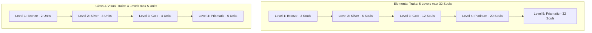

# FLASHCARD HEROES: TRAIT TRINKET ABILITIES SPECIFICATION (MASTER FINAL)

> **Scope**: Balanced design specification for all 15 Trait Trinkets (4 Elemental, 4 Class, and 7 Visual Archetypes).  
> **Inspection & Tooltip Architecture**:
> - **Single Concise Description**: Every trait level features exactly one description text, matching the in-game inspection tooltip of that trinket level.
> - **Cumulative Inheritance (TFT-Style)**: Traits inherit lower tiers unless explicitly an upgrade/replacement of a previous value. Phrasing seamlessly links tiers (`...and it also gains...`, `Increases to...`, `Additionally, ...`).
>
> **Core Balance & Engine Rules**:
> - **Subtle Numbers**: Baseline numbers use single points (1-point values, single status stacks).
> - **No "Max HP" Concept**: HP is an uncapped scalar resource; there are no "wounded" or "full HP" checks.
> - **Static Status Effect**: When a unit with Static dies, it deals collateral damage equal to its Static stacks to adjacent units, then clears all stacks. This damage is **mitigated by Armor**, and Static stacks **decay by 1 each turn**.
> - **Anti-Stall Combat**: Minimal summons (combat-only bench clone), single-use death defiance, and offensive momentum to guarantee turns resolve.
> - **Thematic Purity**: Fire = Burn only; Earth = Armor & Spikes; Water = Healing & Cleanse; Air = Static only.
>
> **Related Documents**:
> - [Refactor of Game Content, traits, names, level art and abilities.md](file:///Users/danhh/Desktop/Flashcard%20Heroes/docs/Refactor%20of%20Game%20Content,%20traits,%20names,%20level%20art%20and%20abilities.md)
> - [CombatSystem.md](file:///Users/danhh/Desktop/Flashcard%20Heroes/docs/CombatSystem.md)
> - [Game Rules & Expected Behaviors.md](file:///Users/danhh/Desktop/Flashcard%20Heroes/docs/Game%20Rules%20&%20Expected%20Behaviors.md)
> - [Constants.gd](file:///Users/danhh/Desktop/Flashcard%20Heroes/scripts/Constants.gd)
> - [status_effects.csv](file:///Users/danhh/Desktop/Flashcard%20Heroes/docs/status_effects.csv)

---

## 1. Progression Curves & Activation Thresholds



- **Elemental Traits (5 Levels, capped at 32 Souls)**:
  - **Level 1 (Bronze)**: **3 Souls** (Accessible splash: e.g. 3 Tier 1s or 1 Tier 2 + 1 Tier 1)
  - **Level 2 (Silver)**: **6 Souls** (Early commitment: e.g. 1 Tier 3 [4 souls] + 1 Tier 2 [2 souls])
  - **Level 3 (Gold)**: **12 Souls** (Focused archetype: e.g. three Tier 3 units [4 souls each])
  - **Level 4 (Platinum)**: **20 Souls** (Deep endgame investment: e.g. two 8-soul merged units + one 4-soul unit)
  - **Level 5 (Prismatic)**: **32 Souls** (Capstone mastery: requires four maxed 8-soul units)
- **Regular Traits (Class & Visual - 4 Levels, 2 to 5 Units)**:
  - **Level 1 (Bronze)**: **2 Units**
  - **Level 2 (Silver)**: **3 Units**
  - **Level 3 (Gold)**: **4 Units**
  - **Level 4 (Prismatic)**: **5 Units** (Mono-trait lineup, or 4 units + Hero trait)

---

## 2. Elemental Trait Trinkets (Souls: 3 to 32)

---

### 2.1 Fire Trait (`FIRE`) — [trinket_trait_fire](file:///Users/danhh/Desktop/Flashcard%20Heroes/resources/trinkets/trinket_trait_fire.tres)
- **Thematic Domain**: Burn only. Zero PWR buffs.

| Level | Souls | Description |
| :---: | :---: | :--- |
| **1 (Bronze)** | **3** | Fire units' attacks inflict **1 Burn** stack on target. |
| **2 (Silver)** | **6** | ...and inflicts **+1 additional Burn** if the target already has Burn. |
| **3 (Gold)** | **12** | Additionally, when an enemy takes Burn damage at turn end, they spread **1 Burn** to each adjacent ally. |
| **4 (Platinum)** | **20** | ...and Fire units deal bonus attack damage equal to the target's current Burn stacks. |
| **5 (Prismatic)** | **32** | Additionally, when an enemy holding Burn is defeated by a Fire unit, their remaining Burn stacks are distributed between adjacent enemies. |

---

### 2.2 Earth Trait (`EARTH`) — [trinket_trait_earth](file:///Users/danhh/Desktop/Flashcard%20Heroes/resources/trinkets/trinket_trait_earth.tres)
- **Thematic Domain**: Armor and Spikes only.

| Level | Souls | Description |
| :---: | :---: | :--- |
| **1 (Bronze)** | **3** | **Pre-Combat**: The frontmost Earth unit gains **1 Armor**. |
| **2 (Silver)** | **6** | ...and it also gains **1 Spikes**. |
| **3 (Gold)** | **12** | Adds **+1 Armor** and **+1 Spikes** to the effect, and all other Earth units also gain this. |
| **4 (Platinum)** | **20** | Adds **+1 Armor** and **+1 Spikes** to Earth units, and all other allies gain **1 Armor** and **1 Spikes**. |
| **5 (Prismatic)** | **32** | ...and Earth units deal bonus attack damage equal to their current Spikes. |

---

### 2.3 Water Trait (`WATER`) — [trinket_trait_water](file:///Users/danhh/Desktop/Flashcard%20Heroes/resources/trinkets/trinket_trait_water.tres)
- **Thematic Domain**: Healing only. Status cleansing and inversion. (No "Max HP" concept).

| Level | Souls | Description |
| :---: | :---: | :--- |
| **1 (Bronze)** | **3** | **Pre-Combat**: Water units heal the ally directly in front of them by **1 HP**. |
| **2 (Silver)** | **6** | ...and also cleanse **1 negative status stack** (*Burn* / *Static*) from that ally. |
| **3 (Gold)** | **12** | Additionally, at turn start, heals the ally with the lowest HP by **1 HP**. |
| **4 (Platinum)** | **20** | Additionally, **Pre-Combat**: All allies across the team cleanse **1 negative status stack**. |
| **5 (Prismatic)** | **32** | Additionally, at turn start, allies consume all their negative status stacks to heal **1 HP per stack consumed**. |

---

### 2.4 Air Trait (`AIR`) — [trinket_trait_air](file:///Users/danhh/Desktop/Flashcard%20Heroes/resources/trinkets/trinket_trait_air.tres)
- **Thematic Domain**: Static stacks. *(Static mechanic: When a unit with Static dies, it deals collateral damage equal to Static stacks to adjacent units, mitigated by Armor, and decays by 1 each turn)*.

| Level | Souls | Description |
| :---: | :---: | :--- |
| **1 (Bronze)** | **3** | Air units' attacks inflict **1 Static** stack on target. |
| **2 (Silver)** | **6** | Increases to **2 Static** stacks per attack. |
| **3 (Gold)** | **12** | ...and attacks splash half of the inflicted Static (minimum 1) to adjacent enemies. |
| **4 (Platinum)** | **20** | Additionally, **Pre-Combat**: Inflicts **1 Static** to all enemies. |
| **5 (Prismatic)** | **32** | Static inflicted on attack scales to **equal the Air unit's PWR** (splashes half to adjacent enemies). |

---

## 3. Class Trait Trinkets (Units: 2 to 5)

---

### 3.1 Tank Trait (`TANK`) — [trinket_trait_tank](file:///Users/danhh/Desktop/Flashcard%20Heroes/resources/trinkets/trinket_trait_tank.tres)
- **Role**: Frontline protection and damage interception.

| Level | Units | Description |
| :---: | :---: | :--- |
| **1 (Bronze)** | **2** | **Pre-Combat**: The frontmost Tank gains **1 Armor**. |
| **2 (Silver)** | **3** | All Tanks now gain this **1 Armor**. Whenever a Tank's Armor absorbs damage, the ally directly behind gains **1 Armor**. |
| **3 (Gold)** | **4** | Additionally, at turn start, the frontmost Tank gains **1 additional Armor**, and Tanks intercept attacks targeting the ally directly behind them. |
| **4 (Prismatic)** | **5** | ...and whenever a Tank gains Armor from any source, it gains an equal amount of **Spikes**. |

---

### 3.2 Fighter Trait (`FIGHTER`) — [trinket_trait_fighter](file:///Users/danhh/Desktop/Flashcard%20Heroes/resources/trinkets/trinket_trait_fighter.tres)
- **Role**: Melee brawling, retaliation, and cleave.

| Level | Units | Description |
| :---: | :---: | :--- |
| **1 (Bronze)** | **2** | Fighters deal **+1 damage** on their attacks if the target has more HP than them. |
| **2 (Silver)** | **3** | Additionally, when a Fighter receives attack damage, they retaliate for **1 ranged damage** (once per turn). |
| **3 (Gold)** | **4** | Additionally, Fighters' attacks deal **half PWR splash damage** (minimum 1) to the enemy directly behind their target. |
| **4 (Prismatic)** | **5** | ...and when a Fighter defeats an enemy, they gain **+1 PWR** and immediately attack the next enemy (once per turn). |

---

### 3.3 Support Trait (`SUPPORT`) — [trinket_trait_support](file:///Users/danhh/Desktop/Flashcard%20Heroes/resources/trinkets/trinket_trait_support.tres)
- **Role**: Positional stat distribution and hero empowerment.

| Level | Units | Description |
| :---: | :---: | :--- |
| **1 (Bronze)** | **2** | **Pre-Combat**: Support units grant **+1 HP** to the ally directly in front of them. |
| **2 (Silver)** | **3** | ...and also grant **+1 PWR** to the ally directly behind them. |
| **3 (Gold)** | **4** | Additionally, at turn start, grants **+1 HP** to the lowest-HP ally and **+1 PWR** to the lowest-PWR ally. |
| **4 (Prismatic)** | **5** | Additionally, **Pre-Combat**: Grants **+1 HP and +1 PWR** to the Hero unit. |

---

### 3.4 Specialist Trait (`SPECIALIST`) — [trinket_trait_specialist](file:///Users/danhh/Desktop/Flashcard%20Heroes/resources/trinkets/trinket_trait_specialist.tres)
- **Role**: Gacha manipulation, economy scaling, and board summons.

| Level | Units | Description |
| :---: | :---: | :--- |
| **1 (Bronze)** | **2** | **Combat Start**: If you have 0 tokens remaining, gain **1 Token**. |
| **2 (Silver)** | **3** | ...and the first Gacha draw of each battle costs **1 less Token** (minimum 1). |
| **3 (Gold)** | **4** | Additionally, defeating an enemy with a Specialist awards **+1 Gold** (max 1/turn, 5/battle). |
| **4 (Prismatic)** | **5** | Additionally, summons a **combat-only copy** of your lowest level/tier unit to the bench pre-combat, and at turn start, the frontmost Specialist gains **+1 PWR per 5 Gold**. *(Tie-breaker for clone: lowest tier first, lowest level second; random if tied)*. |

---

## 4. Visual Archetype Trait Trinkets (Units: 2 to 5)

---

### 4.1 Food Trait (`FOOD`) — [trinket_trait_food](file:///Users/danhh/Desktop/Flashcard%20Heroes/resources/trinkets/trinket_trait_food.tres)
- **Theme**: Feeding allies behind when damaged, passing stats on death.

| Level | Units | Description |
| :---: | :---: | :--- |
| **1 (Bronze)** | **2** | When a Food unit is hurt by an attack, it heals the ally directly behind it by **1 HP**. |
| **2 (Silver)** | **3** | Increases healing to **2 HP**. |
| **3 (Gold)** | **4** | Increases healing to **3 HP**, and also grants **+1 PWR** to that ally. |
| **4 (Prismatic)** | **5** | Increases healing to **4 HP** and **+2 PWR**. Additionally, on death, passes all of its current PWR to the ally directly behind it. |

---

### 4.2 Mecha Trait (`MECHA`) — [trinket_trait_mecha](file:///Users/danhh/Desktop/Flashcard%20Heroes/resources/trinkets/trinket_trait_mecha.tres)
- **Theme**: Spikes, static discharge, merge laser strikes, capacitor overload.

| Level | Units | Description |
| :---: | :---: | :--- |
| **1 (Bronze)** | **2** | **Pre-Combat**: Mecha units gain **1 Spikes**. |
| **2 (Silver)** | **3** | ...and also gain **1 Armor**. Additionally, Mechas inflict **1 Static** on attack and when their Armor absorbs damage. |
| **3 (Gold)** | **4** | Additionally, whenever a merge occurs on the board, each Mecha fires a ranged attack dealing **1 damage** and inflicting **1 Static** to a random enemy. |
| **4 (Prismatic)** | **5** | Additionally, when a Mecha dies, surviving Mechas gain **2 Armor** and **2 Spikes**, and fire a ranged attack dealing **2 damage** and **2 Static** to a random enemy. |

---

### 4.3 Animal Trait (`ANIMAL`) — [trinket_trait_animal](file:///Users/danhh/Desktop/Flashcard%20Heroes/resources/trinkets/trinket_trait_animal.tres)
- **Theme**: Pack healing on attack and alpha buff.

| Level | Units | Description |
| :---: | :---: | :--- |
| **1 (Bronze)** | **2** | **Pre-Combat**: A random Animal gains **+1 PWR**. Animals heal **1 HP** per attack. |
| **2 (Silver)** | **3** | Healing per attack increases to **2 HP**. |
| **3 (Gold)** | **4** | Healing per attack increases to **3 HP**. |
| **4 (Prismatic)** | **5** | Healing per attack increases to **3 HP + 25% PWR** (minimum +1). |

---

### 4.4 Plant Trait (`PLANT`) — [trinket_trait_plant](file:///Users/danhh/Desktop/Flashcard%20Heroes/resources/trinkets/trinket_trait_plant.tres)
- **Theme**: Thorns, steady round growth, converting healing into spikes.

| Level | Units | Description |
| :---: | :---: | :--- |
| **1 (Bronze)** | **2** | **Pre-Combat**: The frontmost Plant unit gains **1 Spikes**. |
| **2 (Silver)** | **3** | Additionally, at turn start, the lowest-HP Plant recovers **1 HP**. |
| **3 (Gold)** | **4** | Additionally, **Pre-Combat**: All Plants gain **1 Spikes** and **+1 HP** *(frontmost now has 2 Spikes)*. |
| **4 (Prismatic)** | **5** | Additionally, at turn start, all Plants gain **1 Spikes** and **+1 HP**. Whenever a Plant receives a heal, it gains **1 Spikes**. |

---

### 4.5 Toy Trait (`TOY`) — [trinket_trait_toy](file:///Users/danhh/Desktop/Flashcard%20Heroes/resources/trinkets/trinket_trait_toy.tres)
- **Theme**: Static friction on attackers, static detonation on death.

| Level | Units | Description |
| :---: | :---: | :--- |
| **1 (Bronze)** | **2** | Enemies hitting a Toy with a melee attack receive **2 Static** stacks. |
| **2 (Silver)** | **3** | Increases to **3 Static** stacks. |
| **3 (Gold)** | **4** | Increases to **4 Static** stacks. |
| **4 (Prismatic)** | **5** | Additionally, on death, detonates all Static on the enemy holding the highest Static stacks, dealing damage equal to those stacks to it and clearing them. |

---

### 4.6 Appliance Trait (`APPLIANCE`) — [trinket_trait_appliance](file:///Users/danhh/Desktop/Flashcard%20Heroes/resources/trinkets/trinket_trait_appliance.tres)
- **Theme**: Status insulation, reflection, and converting incoming negative effects into stats.

| Level | Units | Description |
| :---: | :---: | :--- |
| **1 (Bronze)** | **2** | **Pre-Combat**: Inflicts **1 Static** on target. Appliances are completely **immune to Static**. |
| **2 (Silver)** | **3** | ...and also inflicts **1 Burn** on target. |
| **3 (Gold)** | **4** | Additionally, when an enemy attempts to apply Static or Burn to an Appliance, it is **reflected back to the sender** (amount is preserved). *(If applied by a trinket or consumable, negate it. If applied by an item, reflect to item holder. Appliances cancel out due to mutual immunity)*. |
| **4 (Prismatic)** | **5** | Additionally, incoming negative status attempts grant stats: each attempted Static grants **+1 PWR**, and each attempted Burn grants **+1 HP**. |

---

### 4.7 Costume Trait (`COSTUME`) — [trinket_trait_costume](file:///Users/danhh/Desktop/Flashcard%20Heroes/resources/trinkets/trinket_trait_costume.tres)
- **Theme**: Pre-combat stat and beneficial status theft.

| Level | Units | Description |
| :---: | :---: | :--- |
| **1 (Bronze)** | **2** | **Pre-Combat**: Steals **1 stack** of the mirror unit's highest beneficial status effect. If no status effects exist, steals **1 point** of their highest stat (random if tied). |
| **2 (Silver)** | **3** | Instead of above, **Pre-Combat**: Steals the entire highest beneficial status effect from the mirror enemy. If no status effects exist, steals **1 HP and 1 PWR**. |
| **3 (Gold)** | **4** | Upgrades to steal all beneficial status effects from the mirror enemy. If no status effects exist, steals **2 HP and 2 PWR**. |
| **4 (Prismatic)** | **5** | Upgrades to steal all beneficial status effects from the enemy unit with the most total beneficial status effects, and steals **3 HP and 3 PWR**. |

---

## 5. Architectural Edge Cases & Confirmed Engine Rules

```
┌─────────────────────────────────┬─────────────────────────────────────────────────────────────┬──────────────────────────────────────────────────────────────┐
│ Edge Case Scenario              │ Underlying Interaction                                      │ Confirmed Engine Rule                                        │
├─────────────────────────────────┼─────────────────────────────────────────────────────────────┼──────────────────────────────────────────────────────────────┤
│ 1. Static Status Effect Model   │ Old model consumed on stat change; new model triggers on   │ **Death Collateral Damage**: Static deals collateral damage  │
│    (Mechanic Redesign)          │ death, dealing damage equal to stacks to adjacent units.    │ equal to stacks to adjacent units on death, mitigated by     │
│                                 │ Stacks decay each turn; armor mitigates collateral damage.  │ Armor. Stacks decay by 1 each turn. Cleared on explosion.   │
├─────────────────────────────────┼─────────────────────────────────────────────────────────────┼──────────────────────────────────────────────────────────────┤
│ 2. Appliance Status Reflection  │ Enemy attempts to inflict Burn or Static on an Appliance.   │ **Reflection Priority**: Reflected back to the sender. If     │
│    (Reflect & Cancellation)     │ How are items, trinkets, or mirror matches handled?         │ applied by an item, reflected to item holder. If from        │
│                                 │                                                             │ consumable/trinket, negated. Appliances cancel out naturally.│
├─────────────────────────────────┼─────────────────────────────────────────────────────────────┼──────────────────────────────────────────────────────────────┤
│ 3. Specialist Bench Duplication │ Specialist Prismatic summons a copy of lowest unit to bench.│ **Combat-Only Lifecycle**: Summons copy to bench for combat  │
│    (Bench Lifecycle & Tiebreak) │ How does it pick the unit and handle save persistence?      │ only (removed post-combat). Tie-breaker: lowest tier first,  │
│                                 │                                                             │ lowest level second; random if equal.                        │
├─────────────────────────────────┼─────────────────────────────────────────────────────────────┼──────────────────────────────────────────────────────────────┤
│ 4. Toy Static Detonation        │ Toy Level 4 detonates Static on the enemy with highest      │ **Single-Target Detonate & Clear**: Deals damage equal to   │
│    (Stack Consumption)          │ Static stacks upon Toy death.                               │ stacks directly to that enemy and clears all its stacks.     │
├─────────────────────────────────┼─────────────────────────────────────────────────────────────┼──────────────────────────────────────────────────────────────┤
│ 5. Costume Pre-Combat Theft     │ Costume steals beneficial status effects or base stats.     │ **True Theft**: Target loses the stolen status stacks/stats, │
│    (Theft Resolution)           │ When is it snapshot, and does the enemy lose them?          │ and Costume gains them. Snapshot pre-combat before turn 1.   │
├─────────────────────────────────┼─────────────────────────────────────────────────────────────┼──────────────────────────────────────────────────────────────┤
│ 6. Tank Intercept Chain         │ Tank intercepts attacks on ally behind. What if Tank is     │ **Single Intercept Rule**: Front Tank intercepts;            │
│    (Double Tank Lineup)         │ behind another Tank that also has intercept?                │ only one interception occurs per attack event.               │
├─────────────────────────────────┼─────────────────────────────────────────────────────────────┼──────────────────────────────────────────────────────────────┤
│ 7. Pre-Combat Execution Order   │ Many traits trigger pre-combat (Costume, Earth, Water, etc).│ **Deterministic Order**: Player team first, then Enemy team. │
│    (Phased Activation Order)    │ In what order do units and trinkets resolve?                │ Units resolve back-to-front. Trinkets resolve left-to-right  │
│                                 │                                                             │ (Player) and right-to-left (Enemy).                          │
├─────────────────────────────────┼─────────────────────────────────────────────────────────────┼──────────────────────────────────────────────────────────────┤
│ 8. Hero Support Positional Buff │ Support L4 gives +1 HP and +1 PWR to the Hero unit.         │ **Cumulative Positional Stacking**: Heroes are always in the │
│    (Hero Lineup & Synergy)      │ How does this interact if Hero is adjacent to Support?      │ lineup. If Hero is in front/behind Support, they also gain   │
│                                 │                                                             │ the L1 (+1 HP) or L2 (+1 PWR) positional buffs cumulatively. │
└─────────────────────────────────┴─────────────────────────────────────────────────────────────┴──────────────────────────────────────────────────────────────┘
```

---

## 6. Hero Trait Equipping & Team Combination Analysis

In *Flashcard Heroes*, playable Heroes will be able to equip **up to 3 traits** (e.g., 1 Elemental Soul, 1 Class Trait, and 1 Visual Archetype, or any combination of 3). This introduces profound flexibility without allowing any single degenerate build to dominate:

```
┌───────────────────────────────┬────────────────────────────┬─────────────────────────────────────────────────────────────┐
│ Team Build Concept            │ Trait Composition          │ Balance Analysis & Antidote                                 │
├───────────────────────────────┼────────────────────────────┼─────────────────────────────────────────────────────────────┤
│ 1. Tectonic Brambles (Turtle) │ 12 Earth + 4 Tank +        │ High Armor and Spikes; struggles against Air Static true    │
│                               │ 4 Plant (Hero: Earth/Tank) │ damage and Fire Burn DOT that bypass Armor.                 │
├───────────────────────────────┼────────────────────────────┼─────────────────────────────────────────────────────────────┤
│ 2. Scorch & Spark (DOT Burn)  │ 20 Fire + 4 Appliance +    │ Relentless Burn and Static damage; fragile frontline;       │
│                               │ 2 Fighter (Hero: Fire/App) │ vulnerable to fast burst cleave and Animal pack healing.    │
├───────────────────────────────┼────────────────────────────┼─────────────────────────────────────────────────────────────┤
│ 3. Pack Frenzy (Rush)         │ 4 Animal + 4 Fighter +     │ High melee counter and sustain; weak to Earth Spikes        │
│                               │ 6 Earth (Hero: Animal/Fig) │ and Tank damage redirection.                                │
├───────────────────────────────┼────────────────────────────┼─────────────────────────────────────────────────────────────┤
│ 4. Tidal Battery (Disruption) │ 12 Water + 12 Air +        │ Cleanses DOT and retaliates with Static; lacks burst;       │
│                               │ 3 Support (Hero: Air/Sup)  │ susceptible to focused Fighter cleave focus on frontline.   │
├───────────────────────────────┼────────────────────────────┼─────────────────────────────────────────────────────────────┤
│ 5. Gacha Tycoon (Economic)    │ 4 Specialist + 4 Toy +     │ Generates tokens and items; slow early combat starts;       │
│                               │ 6 Water (Hero: Spe/Toy)    │ pressured heavily by aggressive opening Animal / Air teams. │
└───────────────────────────────┴────────────────────────────┴─────────────────────────────────────────────────────────────┘
```
