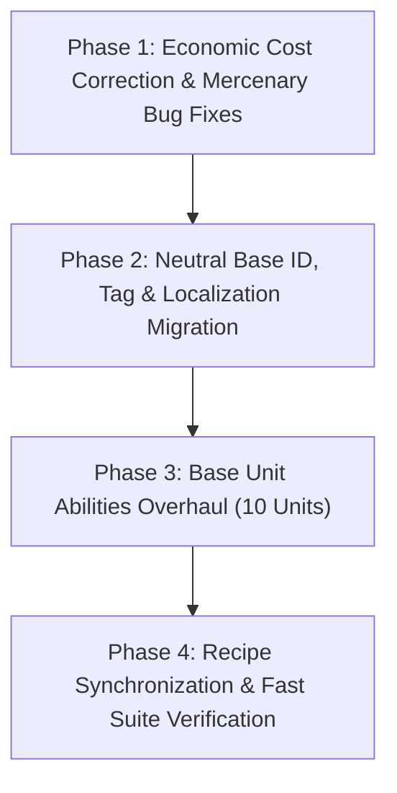

# Game Content and Mercenary Update Plan

**Document Status:** Canonical Implementation Specification & Content Gap Audit  
**Source Master References:** [`docs/GameContentDocument.md`](file:///Users/danhh/Desktop/Flashcard%20Heroes/docs/GameContentDocument.md), [`docs/archive of old already used documentation/Mercenary.md`](file:///Users/danhh/Desktop/Flashcard%20Heroes/docs/archive%20of%20old%20already%20used%20documentation/Mercenary.md), [`docs/Novice.md`](file:///Users/danhh/Desktop/Flashcard%20Heroes/docs/Novice.md)  
**Target Codebase:** Godot 4.6.1 GDScript Engine (`resources/`, `scripts/`, `localization/`, `tests/`)  

---

## 1. Executive Summary & Economy Corrections

A comprehensive audit was performed comparing the updated content in [**`GameContentDocument.md`**](file:///Users/danhh/Desktop/Flashcard%20Heroes/docs/GameContentDocument.md) and [**`Mercenary.md`** (archived)](file:///Users/danhh/Desktop/Flashcard%20Heroes/docs/archive%20of%20old%20already%20used%20documentation/Mercenary.md) against the executable codebase.

### 1.1 The 1 / 2 / 4 Economic Model & Gold Cost Correction
The game's economy operates on the strict, universal **1 / 2 / 4 Merge Valuation Model** documented in `GameManager.gd:698-713`:
$$\text{Base Gold Cost} = 2^{\text{Tier} - 1}$$
$$\text{Final Gold Valuation} = \text{Base Gold Cost} \times 2^{\text{Level} - 1}$$

* **Tier 1 (Base):** Merged from 1 base unit $\to$ **Base Cost = 1 Gold** (Level 1 = 1g, Level 2 = 2g, Level 3 = 4g).
* **Tier 2 (Evolved):** Merged from two Tier 1 units ($1 + 1$) $\to$ **Base Cost = 2 Gold** (Level 1 = 2g, Level 2 = 4g, Level 3 = 8g).
* **Tier 3 (Apex):** Merged from two Tier 2 units ($2 + 2$) $\to$ **Base Cost = 4 Gold** (Level 1 = 4g, Level 2 = 8g, Level 3 = 16g).

> [!NOTE]
> **Architectural Resolution — Pure Dynamic Economic Valuation (Completed):**  
> Rather than manually maintaining `cost` values on individual `.tres` resource files (which caused the hardcoding errors in commit `04768bda1`), the redundant `@export var cost` field was removed from `GachaBallDefinition` and `TrinketDefinition`.  
> * **Units & Items (`GachaBallDefinition`):** `cost` is now a read-only computed property deriving directly from `tier` and `level`: `(1 << (tier - 1)) * (1 << (level - 1))`.  
> * **Trinkets (`TrinketDefinition`):** `cost` is now a read-only computed property returning `DEFAULT_TRINKET_COST` (10).  
> * **GameManager (`GameManager.get_item_cost`):** Centrally derives gold costs from definition `tier` and `level`.  
> * **Resource Cleanup:** All 84 redundant `cost = ...` lines were removed from `resources/**/*.tres`. It is now structurally impossible for any unit, item, or trinket to have an incorrect cost.

* **Token Cost (Gacha Pulls):** Gacha machine draws cost Tokens strictly determined by machine tier via `GameManager.get_gacha_token_cost(tier)`: **Tier 1 = 1 Token, Tier 2 = 2 Tokens, Tier 3 = 3 Tokens**.

---

### 1.2 Deprecation of Obsolete Hero & Unit Names
* Heroes are now identified strictly by their individual character names: **Shiken**, **Dan**, **Han**, **Kon**, **Hiko**, and **Deko**.
* All references to "Bounty Hunter" across resource definitions, scripts, abilities, and localization must be migrated to **Shiken**.
* All 25 Universal Neutral Base Units must be updated to their canonical names and stripped IDs.

---

## 2. Audit of Obsolete Names Across the Codebase

### 2.1 Hero Names Audit

| Canonical Hero Name | Current Code ID | Obsolete Term Found in Codebase | Locations in Codebase | Migration Plan |
|---|---|---|---|---|
| **Shiken** | `hero_bounty_hunter` / `hero` | "Bounty Hunter" | • `resources/units/hero.tres` • `resources/abilities/HeroBountyHunter_AllyDeathBuff.tres` • `resources/abilities/HeroTimekeeper_GoldOnKill.tres` • `scripts/RunState.gd:1179, 1293, 1327` • `scripts/FlashcardMinigame.gd:973-985` (`_is_bounty_hunter`) • `scripts/AbilitiesRegistry.gd:124-125` • `localization/game.csv:52` • `tests/run_fast_suite.gd:141, 279, 394, 764` | Migrate ID to `hero_shiken` (or keep `hero_bounty_hunter` as internal ID aliased to `hero_shiken`). Update method `_is_bounty_hunter()` to `_is_shiken()`. Re-link ability to `HeroShiken_GoldOnKill.tres`. |
| **Dan** | `hero_starter` | "Starter Hero" / "Starting Hero" | • `resources/units/HeroStarter.tres` • `resources/abilities/HeroStarter_AllyDeathAbsorb.tres` • `scripts/RunState.gd:1188, 1320` • `scripts/FlashcardMinigame.gd:1011` | Update display and internal references to Dan. |
| **Han** | `hero_avenger` | "Avenger" | • `resources/units/HeroAvenger.tres` • `resources/abilities/HeroAvenger_AllyDeathAttack.tres` • `scripts/RunState.gd:1173, 1314` | Localized as "Han". Code ID is `hero_avenger`. |
| **Kon** | `hero_bastion` | "Bastion" | • `resources/units/HeroBastion.tres` • `resources/abilities/HeroBastion_*.tres` • `scripts/RunState.gd:1176, 1316` | Localized as "Kon". Code ID is `hero_bastion`. |
| **Hiko** | `hero_pyro` | "Pyro" | • `resources/units/HeroPyro.tres` • `resources/abilities/HeroPyro_AttackBurn.tres` • `scripts/RunState.gd:1184, 1318` | Localized as "Hiko". Code ID is `hero_pyro`. |
| **Deko** | `hero_timekeeper` | "Timekeeper" | • `resources/units/HeroTimekeeper.tres` • `resources/abilities/HeroTimekeeper_*.tres` • `scripts/RunState.gd:1192, 1322` • `scripts/FlashcardManager.gd:215, 242` | Localized as "Deko". Code ID is `hero_timekeeper`. |

---

### 2.2 Obsolete Unit Names Audit (25 Base Units)

Currently, the codebase uses tag-acronym IDs containing redundant multi-class and multi-thematic tags. Below is the mapping from the obsolete codebase IDs to the canonical IDs and official names:

| Tier | Obsolete Codebase ID | Canonical ID | Official Character Name | File Path in `resources/units/` |
|:---:|---|---|---|---|
| **T1** | `ETnkPlaToy` | `ETnkPla` | **Stumpling** | `resources/units/ETnkPlaToy.tres` |
| **T1** | `FFigMecApp` | `FFigMec` | **Vulcannon** | `resources/units/FFigMecApp.tres` |
| **T1** | `WSupAniCos` | `WSupAni` | **Ripplepup** | `resources/units/WSupAniCos.tres` |
| **T1** | `ASpeFodToy` | `ASpeFod` | **Puffcorn** | `resources/units/ASpeFodToy.tres` |
| **T2** | `EWFigCosToy` | `EWFigCos` | **Bogmantle** | `resources/units/EWFigCosToy.tres` |
| **T2** | `FASpeMecApp` | `FASpeApp` | **Furnair** | `resources/units/FASpeMecApp.tres` |
| **T2** | `EASpeFodToy` | `EASupToy` | **Matryodust** | `resources/units/EASpeFodToy.tres` |
| **T2** | `WATnkPlaAni` | `WATnkAni` | **Soliwhale** | `resources/units/WATnkPlaAni.tres` |
| **T2** | `EFTnkAniCos` | `EFTnkMec` | **Branblee** | `resources/units/EFTnkAniCos.tres` |
| **T2** | `FWSpeAppFod` | `FWFigFod` | **Pepspray** | `resources/units/FWSpeAppFod.tres` |
| **T3** | `EEFASpeFodCos` | `EEFASpeCos` | **Mimicloak** | `resources/units/EEFASpeFodCos.tres` |
| **T3** | `EEFWFigTnkPlaToy` | `EEFWSupPla` | **Oakbark** | `resources/units/EEFWFigTnkPlaToy.tres` |
| **T3** | `EEWAFigFodAniCos` | `EEWAFigAni` | **Griffoam** | `resources/units/EEWAFigFodAniCos.tres` |
| **T3** | `EFAASupToy` | `EFAASupToy` | **Matryoshkan** | `resources/units/EFAASupToy.tres` |
| **T3** | `EFFASupPlaToy` | `EFFASupMec` | **Mechamom** | `resources/units/EFFASupPlaToy.tres` |
| **T3** | `EFFWSupMecApp` | `EFFWSpeApp` | **Blendroid** | `resources/units/EFFWSupMecApp.tres` |
| **T3** | `EFWAFigSpeAniMec` | `EFWAFigMec` | **Pachinkannon** | `resources/units/EFWAFigSpeAniMec.tres` |
| **T3** | `EFWASupFodToy` | `EFWASpeFod` | **BubbleGunger** (*was Bubblegum Slime*) | `resources/units/EFWASupFodToy.tres` |
| **T3** | `EFWATnkCosMec` | `EFWATnkApp` | **Reizokun** | `resources/units/EFWATnkCosMec.tres` |
| **T3** | `EFWWFigSpeAniFodMecCos` | `EFWWFigCos` | **Tsunamantle** | `resources/units/EFWWFigSpeAniFodMecCos.tres` |
| **T3** | `EWAASpePlaApp` | `EWAASpeApp` | **Sojikun** | `resources/units/EWAASpePlaApp.tres` |
| **T3** | `EWWATnkMecApp` | `EWWATnkToy` | **Komatop** | `resources/units/EWWATnkMecApp.tres` |
| **T3** | `FFWASpeSupMecAniApp` | `FFWASupMec` | **Relaytron** | `resources/units/FFWASpeSupMecAniApp.tres` |
| **T3** | `FWAASupToy` | `FWAASpeToy` | **Wind-up-kun** | `resources/units/FWAASupToy.tres` |
| **T3** | `FWWASupAniToy` | `FWWATnkFod` | **Nuton** | `resources/units/FWWASupAniToy.tres` |

---

### 2.3 Is it Hard to Replace These in Code?
**No, it is not hard.** Here is the architectural reason:
1. **Clear Encapsulation:** All unit IDs in Godot are evaluated either as `GachaBallDefinition.id` (StringName) or dictionary keys in `Database.units`.
2. **Deterministic Lookup:** Lookups are centralized through `Database.get_definition(id)`.
3. **No Dynamic String Construction:** Scripts do not dynamically concatenate unit IDs; they use static StringName literals (`&"..."`).
4. **Fast Headless Verification:** Godot's CLI test runner (`run_headless.sh`) compiles and runs all test suites in $<4$ seconds, providing immediate verification if any ID is missing or broken.

**The replacement protocol follows 4 straightforward steps:**
1. Update `id = &"..."` in the 25 `.tres` unit resource files.
2. Update the 21 recipe `.tres` files in `resources/recipes/` (ingredients and results).
3. Update static references in `RunState.gd:1306-1309` (the starter pool) and `tests/run_fast_suite.gd`.
4. Update `localization/game.csv` to map the canonical names (*Stumpling*, *Vulcannon*, etc.) to their respective `id.name` keys.

---

## 3. Trait Balance Analysis: Single Class Trait vs. Multi-Class Mercenaries

> **Key Design Question:** *What happens to the trait balance of this set + the base set if Mercenary units carry ONLY `Mercenary`, versus keeping their secondary class tags?*

### 3.1 The Baseline Pool (25 Neutral Base Units)
The 25 Neutral Base Units are distributed across classes as follows:
* **Tank:** 6 units (*Stumpling, Soliwhale, Branblee, Reizokun, Komatop, Nuton*)
* **Fighter:** 6 units (*Vulcannon, Bogmantle, Pepspray, Griffoam, Pachinkannon, Tsunamantle*)
* **Support:** 6 units (*Ripplepup, Matryodust, Oakbark, Matryoshkan, Mechamom, Relaytron*)
* **Specialist:** 7 units (*Puffcorn, Furnair, Mimicloak, Blendroid, BubbleGunger, Sojikun, Wind-up-kun*)
* **Mercenary:** 0 units

---

### 3.2 Mathematical Comparison: Active 36-Unit Run Pool (25 Base + 11 Mercenary)

The table below contrasts the two scenarios across the active 36-unit pool when playing as Shiken:

| Class Trait | Class Thresholds | Scenario A: Mercenaries Retain Parent Classes (Current Table) | Scenario B: Mercenaries Carry ONLY `Mercenary` (Strict Single Class Law) |
|---|:---:|:---:|:---:|
| **Tank** | 2 / 3 / 4 / 5 Units | **10 Units** (+4: `E?Tnk...`, `E??ATnk...`, `EF??Tnk...`, `EW??Tnk...`) | **6 Units** (0 added from Mercenary) |
| **Fighter** | 2 / 3 / 4 / 5 Units | **10 Units** (+4: `F?Fig...`, `FW??Fig...`, `F??AFig...`, `EF??TnkFig...`) | **6 Units** (0 added from Mercenary) |
| **Support** | 2 / 3 / 4 / 5 Units | **10 Units** (+4: `W?Sup...`, `FW??FigSup...`, `W??ASup...`, `EW??TnkSup...`) | **6 Units** (0 added from Mercenary) |
| **Specialist** | 2 / 3 / 4 / 5 Units | **12 Units** (+5: `?MerSpe`, `?ASpe...`, `E??ATnkSpe...`, `W??ASupSpe...`, `F??AFigSpe...`) | **7 Units** (0 added from Mercenary) |
| **Mercenary** | 2 / 3 / 4 / 5 Units | **11 Units** (All 11 lineage units) | **11 Units** (All 11 lineage units) |

---

### 3.3 Gameplay & Balance Implications

#### Scenario A: Mercenaries Retain Secondary Classes (Current Table in `Mercenary.md`)
* **Synergy Double-Dipping:** A player running Mercenary units simultaneously progresses both the Mercenary ladder *and* a traditional class ladder. For example, fielding `E?TnkMerPlaToy` and `EF??TnkFigMerMecPlaToyApp` gives 2 Mercenaries AND 2 Tanks from just 2 board slots.
* **Ease of High-Tier Thresholds:** With 10 Tanks, 10 Fighters, 10 Supports, and 12 Specialists in the pool, hitting 4-unit and 5-unit class thresholds (Gold and Prismatic) is very accessible even while heavily investing in Mercenary units.
* **Tag Bloat & Complexity:** Units carry 2 or 3 class tags plus multiple thematic tags (Tier 3 units end up with 6 to 7 total tags), which dilutes unit visual clarity and makes tooltips cluttered.

#### Scenario B: Mercenaries Carry ONLY `Mercenary` (Strict Single Class Trait Law)
* **High-Threshold Scarcity for Base Classes:** Because there are only 6 Tanks, 6 Fighters, 6 Supports, and 7 Specialists in the entire 36-unit pool:
  * To hit **Tank 4**, a player must draft and field 4 out of the 6 available Tanks in the entire game (66.7% of all tanks).
  * To hit **Tank 5**, a player must draft and field 5 out of the 6 available Tanks (83.3% of all tanks).
  * Hybridizing between high-tier Mercenary (e.g. Mercenary 4) and high-tier traditional classes (e.g. Tank 4) becomes practically impossible without dedicated Insignias/Emblems, because line-up slots are shared and units no longer double-count.
* **Distinct Engine Identity:** Mercenary becomes a dedicated, self-contained engine. Players face a meaningful drafting dilemma: *"Do I commit my lineup to the Gold-scaling Mercenary engine, or do I draft neutral base units for traditional Tank/Fighter synergies?"*
* **Architectural Consistency:** Aligns 100% with the rule stated in `Mercenary.md` §2: *"Every unit in the lineage carries the Hero's Class Trait as its sole class trait (no two-class units)"*.

---

## 4. Mercenary Set Discrepancies & Actions Required

### 4.1 Hero: Shiken (`hero_bounty_hunter`)
* **File Cleanup:** Point `hero.tres` to dedicated `HeroShiken_GoldOnKill.tres` (ID: `hero_shiken_gold_on_kill`) instead of `HeroTimekeeper_GoldOnKill.tres`.
* **Stats & Starter Trinket:** 10 HP / 2 PWR; starts with `trinket_trait_mercenary` (Mercenary Sigil).

### 4.2 The 11 Mercenary Units Audit

| ID | Recipe | Base Stats | Tags | Attack | Ability Specification | Implementation Status & Required Fixes |
|---|---|:---:|---|:---:|---|---|
| `?MerSpe` | Starter | 1 HP / 1 PWR | `?`, `Mercenary`, `Specialist` | Melee | Whenever 1 Gold is earned in active lineup, gain +1 HP and +1 PWR. | **Aligned.** Implemented in `MerSpe.tres`. Base cost = 1. |
| `?ASpeMerFodToy` | `?MerSpe` + `ASpeFod` | 2 HP / 3 PWR | `?`, `SOUL_AIR`, `Specialist`, `Mercenary`, `Food`, `Toy` | Melee | **Pre-Battle, gain +1 / +2 / +3 HP for every full 10 Gold currently held.** | **CRITICAL BUG IN CODEBASE:** 1. Correct `cost` from 3 to **2 Gold**. 2. Replace incorrect `on_bounty_claimed` ability with Pre-Battle Gold HP scaling effect (`EffectMercenaryGoldHpBuff`). |
| `E?TnkMerPlaToy` | `?MerSpe` + `ETnkPla` | 3 HP / 1 PWR | `EARTH`, `?`, `Tank`, `Mercenary`, `Plant`, `Toy` | Melee | Whenever Gold is earned, gain 1 / 2 / 3 Armor and 1 / 2 / 3 Spikes. | **Fix cost:** Correct `cost` from 3 to **2 Gold**. Abilities aligned. |
| `F?FigMerMecApp` | `?MerSpe` + `FFigMec` | 2 HP / 3 PWR | `FIRE`, `?`, `Fighter`, `Mercenary`, `Mecha`, `Appliance` | **Ranged** | When attacking, apply 1 Bounty stack (L1: target; L2: target + 1 adj; L3: target + all adj). On knockout, awards 1 Gold per stack. | **Fix cost:** Correct `cost` from 3 to **2 Gold**. Ranged attack and Bounty application aligned. |
| `W?SupMerAniCos` | `?MerSpe` + `WSupAni` | 3 HP / 2 PWR | `WATER`, `?`, `Support`, `Mercenary`, `Animal`, `Costume` | Melee | **Whenever Gold is earned, heal the ally directly in front for 1 / 2 / 3 HP.** | **Fix cost:** Correct `cost` from 3 to **2 Gold**. **Document Fix Applied:** Documents corrected to state `ALLY_DIRECTLY_IN_FRONT` matching codebase. |
| `E??ATnkSpeMerFodPlaToy` | `?ASpeMer...` + `E?TnkMer...` | 5 HP / 5 PWR | `EARTH`, 2x `?`, `AIR`, `Tank`, `Specialist`, `Mercenary`, `Food`, `Plant`, `Toy` | Melee | Pre-Battle, if holding $\ge 10$ Gold, spend 1 / 2 / 3 Gold to gain 1 / 2 / 3 Armor and Spikes per full 10 Gold held before spend. | **Fix cost:** Correct `cost` from 6 to **4 Gold**. Spend & buff effects aligned. |
| `FW??FigSupMerAniMecAppCos` | `F?FigMer...` + `W?SupMer...` | 5 HP / 5 PWR | `FIRE`, `WATER`, 2x `?`, `Fighter`, `Support`, `Mercenary`, `Animal`, `Mecha`, `Appliance`, `Costume` | **Ranged** | When attacking, if holding $\ge 10$ Gold, spend 1 / 2 / 3 Gold to deal +1 / +2 / +3 Bonus Damage per full 10 Gold held before spend. | **Fix cost:** Correct `cost` from 6 to **4 Gold**. Ranged spend attack aligned. |
| `W??ASupSpeMerFodAniToyCos` | `?ASpeMer...` + `W?SupMer...` | 5 HP / 5 PWR | `WATER`, 2x `?`, `AIR`, `Support`, `Specialist`, `Mercenary`, `Food`, `Animal`, `Toy`, `Costume` | Melee | Whenever Gold is earned, heal a random allied unit (including the Hero) for 1 / 2 / 3 HP per 1 Gold earned. | **Fix cost:** Correct `cost` from 6 to **4 Gold**. Random ally heal on gold earned aligned. |
| `F??AFigSpeMerFodMecToyApp` | `?ASpeMer...` + `F?FigMer...` | 5 HP / 5 PWR | `FIRE`, 2x `?`, `AIR`, `Fighter`, `Specialist`, `Mercenary`, `Food`, `Mecha`, `Toy`, `Appliance` | **Ranged** | When attacking, if holding $\ge 10$ Gold, spend 1 / 2 / 3 Gold to apply 1 / 2 / 3 Burn to target per full 10 Gold held before spend. | **Fix cost:** Correct `cost` from 6 to **4 Gold**. Ranged spend Burn application aligned. |
| `EF??TnkFigMerMecPlaToyApp` | `E?TnkMer...` + `F?FigMer...` | 5 HP / 5 PWR | `EARTH`, `FIRE`, 2x `?`, `Tank`, `Fighter`, `Mercenary`, `Mecha`, `Plant`, `Toy`, `Appliance` | Melee | Before taking damage, if holding $\ge 10$ Gold, spend 1 Gold to reduce incoming damage by 1 / 2 / 3 per full 10 Gold held before spend (min 0). | **Fix cost:** Correct `cost` from 6 to **4 Gold**. Spend damage reduction aligned. |
| `EW??TnkSupMerAniPlaToyCos` | `E?TnkMer...` + `W?SupMer...` | 5 HP / 5 PWR | `EARTH`, `WATER`, 2x `?`, `Tank`, `Support`, `Mercenary`, `Animal`, `Plant`, `Toy`, `Costume` | Melee | At turn start, if holding $\ge 10$ Gold, spend 1 / 2 / 3 Gold to gain +1 / +2 / +3 HP and +1 / +2 / +3 PWR per full 10 Gold held before spend. | **Fix cost:** Correct `cost` from 6 to **4 Gold**. Turn start spend buff aligned. |

---

### 4.3 Mercenary Items & Golden Seal Refactor
* `item_claim_ticket` (Gold Coin, T1, 1 Gold): When holder knocked out, earn 1 Gold (+1 HP).
* `item_interest_ledger` (Piggy Bank, T2, 2 Gold): When 1 Gold earned, heal holder 1 HP (+2 HP).
* `item_loaded_contract` (Coin Laundry, T2, 2 Gold): When 1 Gold earned, holder gains +1 PWR (+2 PWR).
* `item_golden_seal` (Golden Seal, T3, 4 Gold): +2 HP / +2 PWR.
  * **Critical Bug Fix:** In [`EffectGoldenSealScaling.gd`](file:///Users/danhh/Desktop/Flashcard%20Heroes/scripts/effects/EffectGoldenSealScaling.gd), remove `item.set_meta(...)` (violating Architectural Law 1 & 2). Listen to both `on_gold_earned` and `on_gold_spent` so the stat bonus updates downwards when Mercenaries spend Gold.
* `item_mercenary_emblem` (Mercenary Emblem, T3 Standalone, 4 Gold): +1 Mercenary trait counter. +1/+1 when 1 Gold earned (lineup or shelf).

---

## 5. Universal Neutral Base Units Audit (25 Units)

### 5.1 Tier 1 Units (Base Cost: 1 Gold)
* `ETnkPla` (**Stumpling**): Remove `Toy`. Update ID to `ETnkPla`. Name: "Stumpling".
* `FFigMec` (**Vulcannon**): Remove `Appliance`. Update ID to `FFigMec`. Name: "Vulcannon". Ranged.
* `WSupAni` (**Ripplepup**): Remove `Costume`. Update ID to `WSupAni`. Name: "Ripplepup".
* `ASpeFod` (**Puffcorn**): Remove `Toy`. Update ID to `ASpeFod`. Name: "Puffcorn". Ranged.

### 5.2 Tier 2 Units (Base Cost: 2 Gold)
* `EWFigCos` (**Bogmantle**): Remove `Toy`. Update ID to `EWFigCos`. Name: "Bogmantle".
* `FASpeApp` (**Furnair**): Remove `Mecha`. Update ID to `FASpeApp`. Name: "Furnair".
* `EASupToy` (**Matryodust**): Class $\to$ Support, Thematic $\to$ Toy. Ability: on knockout, summon random T1 matching level. Update ID to `EASupToy`. Name: "Matryodust".
* `WATnkAni` (**Soliwhale**): Remove `Plant`. Update ID to `WATnkAni`. Name: "Soliwhale".
* `EFTnkMec` (**Branblee**): Thematic $\to$ Mecha. Update ID to `EFTnkMec`. Name: "Branblee".
* `FWFigFod` (**Pepspray**): Class $\to$ Fighter, Thematic $\to$ Food. Update ID to `FWFigFod`. Name: "Pepspray".

### 5.3 Tier 3 Units (Base Cost: 4 Gold)
* `EEFASpeCos` (**Mimicloak**): Remove `Food`. Update ID to `EEFASpeCos`. Name: "Mimicloak".
* `EEFWSupPla` (**Oakbark**): Clean tags to `Support`, `Plant`. Update ID to `EEFWSupPla`. Name: "Oakbark".
* `EEWAFigAni` (**Griffoam**): Clean tags to `Fighter`, `Animal`. Update ID to `EEWAFigAni`. Name: "Griffoam".
* `EFAASupToy` (**Matryoshkan**): Update summon target to `EASupToy`. Name: "Matryoshkan".
* `EFFASupMec` (**Mechamom**): Clean tags to `Support`, `Mecha`. Update ID to `EFFASupMec`. Name: "Mechamom".
* `EFFWSpeApp` (**Blendroid**): Clean tags to `Specialist`, `Appliance`. Update ID to `EFFWSpeApp`. Name: "Blendroid".
* `EFWAFigMec` (**Pachinkannon**): Clean tags to `Fighter`, `Mecha`. Ranged. Update ID to `EFWAFigMec`. Name: "Pachinkannon".
* `EFWASpeFod` (**BubbleGunger**): Clean tags to `Specialist`, `Food`. Update ID to `EFWASpeFod`. Name: "BubbleGunger".
* `EFWATnkApp` (**Reizokun**): Clean tags to `Tank`, `Appliance`. Update ID to `EFWATnkApp`. Name: "Reizokun".
* `EFWWFigCos` (**Tsunamantle**): Clean tags to `Fighter`, `Costume`. Update ID to `EFWWFigCos`. Name: "Tsunamantle".
* `EWAASpeApp` (**Sojikun**): Clean tags to `Specialist`, `Appliance`. Ranged. Update ID to `EWAASpeApp`. Name: "Sojikun".
* `EWWATnkToy` (**Komatop**): Clean tags to `Tank`, `Toy`. Update ID to `EWWATnkToy`. Name: "Komatop".
* `FFWASupMec` (**Relaytron**): Clean tags to `Support`, `Mecha`. Update ID to `FFWASupMec`. Name: "Relaytron".
* `FWAASpeToy` (**Wind-up-kun**): Clean tags to `Specialist`, `Toy`. Update ID to `FWAASpeToy`. Name: "Wind-up-kun".
* `FWWATnkFod` (**Nuton**): Clean tags to `Tank`, `Food`. Update ID to `FWWATnkFod`. Name: "Nuton".

---

## 6. Execution Roadmap

### Phase 1: Economic Cost Correction & Mercenary Bug Fixes
1. **Correct Unit Costs:**
   * Set Tier 2 Mercenary units to `cost = 2`.
   * Set Tier 3 Mercenary units to `cost = 4`.
2. **Fix `?ASpeMerFodToy` Ability:** Implement Pre-Battle HP scaling (`+1/+2/+3 HP per 10 Gold held`) and assign to `ASpeMerFodToy.tres`.
3. **Refactor `EffectGoldenSealScaling.gd`:** Eliminate `set_meta` call; wire listener to `on_gold_spent` alongside `on_gold_earned`.
4. **Clean up Shiken Ability:** Re-link `hero.tres` to dedicated `HeroShiken_GoldOnKill.tres` (ID: `hero_shiken_gold_on_kill`).

### Phase 2: Neutral Base ID, Tag & Localization Migration
1. **Clean Tags:** Strip secondary class and thematic tags from the 25 Neutral Base units so each has exactly 1 class tag and 1 thematic tag.
2. **Update Resource IDs:** Update IDs to the canonical format (`ETnkPla`, `FFigMec`, `EEFASpeCos`, etc.).
3. **Localization (`game.csv`):** Register canonical character names (*Stumpling*, *Vulcannon*, *Ripplepup*, *Puffcorn*, *Bogmantle*, *Furnair*, *Matryodust*, *Soliwhale*, *Branblee*, *Pepspray*, *Mimicloak*, *Oakbark*, *Griffoam*, *Matryoshkan*, *Mechamom*, *Blendroid*, *Pachinkannon*, *BubbleGunger*, *Reizokun*, *Tsunamantle*, *Sojikun*, *Komatop*, *Relaytron*, *Wind-up-kun*, *Nuton*).

### Phase 3: Base Unit Abilities Overhaul
1. Implement `EASupToy` (Matryodust) on-knockout Tier 1 summon.
2. Implement `EFWASpeFod` (BubbleGunger) copy generation and swarm PWR scaling.
3. Implement `EEFWSupPla` (Oakbark) adjacent on-hurt stat buff.
4. Implement `EEWAFigAni` (Griffoam) lineup entry reactive damage.
5. Implement `EFFWSpeApp` (Blendroid) on-merge stat buff.
6. Implement `EFWAFigMec` (Pachinkannon) ranged projectile bounce.
7. Implement `EFWWFigCos` (Tsunamantle) cascade pierce damage.
8. Implement `EWAASpeApp` (Sojikun) adjacent debuff cleanse + target buff purge.
9. Implement `FFWASupMec` (Relaytron) item transfer/duplication on knockout.
10. Implement `FWWATnkFod` (Nuton) adjacent buff copying.

### Phase 4: Recipe Synchronization & Verification
1. Update all 21 neutral merge recipes and 10 Mercenary crossbreed recipes to the new unit IDs.
2. Update test suite assertions in `tests/run_fast_suite.gd`.
3. Execute `.agents/skills/verify-headless/scripts/run_headless.sh res://tests/run_fast_suite.tscn` to confirm 0 errors.
