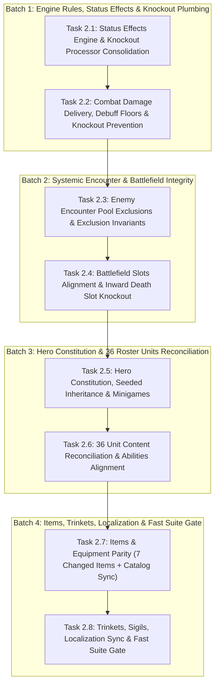

# Phase 2 Implementation Plan: Game Content Reconciliation & Foolproof Task Cards

**Master Roadmap:** [action_constitution_execution_roadmap.md](file:///Users/danhh/Desktop/Flashcard%20Heroes/docs/action_constitution_execution_roadmap.md)  
**Constitutional Specifications:** [Phase_2_Implementation_Specification.md](file:///Users/danhh/Desktop/Flashcard%20Heroes/docs/Phase_2_Implementation_Specification.md), [Game_Terminology_Glossary.md](file:///Users/danhh/Desktop/Flashcard%20Heroes/docs/Game_Terminology_Glossary.md), [GameContentDocument.md](file:///Users/danhh/Desktop/Flashcard%20Heroes/docs/GameContentDocument.md)  
**Assigned Execution Models:** `Gemini 3.8 Flash (High)` or `Luna 6 Extra High`  

---

## 1. Executive Summary & Architectural Invariants

This document establishes the exhaustive, foolproof, step-by-step implementation plan for **Phase 2: Game Content Reconciliation**. It bridges every disparity between the source of truth ([`GameContentDocument.md`](file:///Users/danhh/Desktop/Flashcard%20Heroes/docs/GameContentDocument.md)), canonical engine vocabulary ([`Game_Terminology_Glossary.md`](file:///Users/danhh/Desktop/Flashcard%20Heroes/docs/Game_Terminology_Glossary.md)), and the executable GDScript codebase.

### Mandatory Rules for Executing Models (Do Not Violate)
1. **Fail-Fast Law (Zero Defensive Code):**
   - NEVER add duck-typing checks or defensive guards (`has_method()`, `has_signal()`, `is_instance_valid(self)`, `is_instance_valid(ActionQueue)`).
   - Use strict static typing (`var x: Type = ...`), typed arrays (`Array[Type]`), and explicit `assert()` invariants.
   - Broken internal contracts must fail immediately with actionable stack traces so bugs are fixed at their structural root.
2. **No Symptom Patching:**
   - NEVER patch bugs with ad-hoc metadata flags (`set_meta`), string matching on localized text, or timer delays.
   - Diagnose root causes before editing.
3. **Strict Data ↔ Presentation Decoupling:**
   - Simulation and Data domains (`BattleManager`, `BattleState`, `KnockoutProcessor`, `GachaBallInstance`, `EffectDefinition`) must NEVER depend on UI or Presentation nodes (`Control`, `BattleAnimator`, `WindowManager`, shaders, `Audio`).
   - Presentation reacts strictly to immutable event sequences (`CombatEvent`, `GameAction`).
4. **Mechanics & Visuals Lock:**
   - NEVER modify balance numbers, unit abilities, trinket/item stats, or visual aesthetics without explicit authority from [`GameContentDocument.md`](file:///Users/danhh/Desktop/Flashcard%20Heroes/docs/GameContentDocument.md).
5. **Temporary Utility Scripts & Scratch Hygiene:**
   - ALL temporary migration/fix scripts (Python, Godot CLI) MUST reside in `scratch/` and MUST be deleted before completing the task. Never leave temporary scripts in the root or `docs/`.
6. **Execution Protocol:**
   - Execute **one Task Card per chat turn**. At the end of each card, run the mandatory headless verification command (`run_headless.sh res://tests/run_fast_suite.tscn`). It must exit `0` with 0 errors.

---

## 2. Master Entity Traceability Matrix

| GCD Section | Total Source Entities | Implementation Status | Primary Files & Resources | Key Content Reconciliation Required |
| :--- | :---: | :---: | :--- | :--- |
| **§1. Roster Units** | 36 (25 Base + 11 Bounty Pack) | 26 Parity / 10 Gaps | `resources/units/*.tres`, `resources/abilities/*.tres` | 10 units require ability overhaul (`ASpeFodToy`, `?ASpeMerFodToy`, `EASpeFodToy`, `F?FigMerMecApp`, `W?SupMerAniCos`, `EEFASpeFodCos`, `EEWAFigFodAniCos`, `EFAASupToy`, `EFWASupFodToy` [Bubblegum Slime], `EWWATnkMecApp`). |
| **§2. Heroes** | 6 Complete Records | 4 Parity / 2 Gaps | `resources/units/Hero*.tres`, `scripts/RunState.gd` | `HeroBastion.tres` stats (12/1) & Reinforce ability; `HeroTimekeeper.tres` stats (10/1) & aura (+1/+1); seeded soul/trait/Sigil constitution for all 6 Heroes. |
| **§3. Enemies & Bosses** | 11 (5 Bosses, 1 Hero, 6 Dust) | Complete | `resources/units/Boss*.tres`, `Tier*Dust*.tres` | Roster presence confirmed; tier growth, summon routing, and tags verified. |
| **§4. Items & Equipment** | 26 Master Items | 19 Parity / 7 Gaps | `resources/items/ItemTier*.tres`, `resources/abilities/*.tres` | 7 items require mechanical alignment: Wakizashi (`item_t1_b`), Scythe (`item_t2_b`), Anvil (`item_t2_c`), Slime Cell (`item_t2_d`), HardCandy (`item_t3_b`), Rubber Ball (`item_t3_d`), Slingshot (`item_t3_g`). |
| **§5. Trinkets & Sigils** | 58 Trinkets + 16 Sigils | 53 Parity / 5 Gaps | `resources/trinkets/*.tres`, `resources/abilities/*.tres` | Polished Plate (Pre-Battle Reinforce), Rusty Ring (+1/+1 when unequipped), Aegis Charm (non-heal 1 HP floor), Purifying Pendant (triple-bug fix), Recruiting Charm ($1 hire). |
| **§6. Pool Exclusions** | 32 Excluded Definitions | Critical Gap | `scripts/EncounterGenerator.gd`, 32 `.tres` resources | `EncounterGenerator._create_resource_pools` omits Item exclusion; 11 Mercenary Units, 7 Items, and 4 Trinkets lack `is_player_exclusive = true`. |
| **§7. Core Stats & Combat** | Attributes & Mitigation | 2 Gaps | `scripts/BattleManager.gd`, `scripts/GachaBallInstance.gd` | In-battle HP debuff minimum 1 HP floor; PWR debuff minimum 0 PWR floor; Melee/Ranged Spikes reflection vs bypass. |
| **§8. Status Effects** | 6 Canonical Statuses | Critical Gap | `resources/status_effects/*.tres`, `scripts/BattleManager.gd` | Missing `reinforce.tres`; `armor.tres` must be `START_OF_TURN`; `bounty.tres` must decay by 1; Armor clears at turn start unless Reinforce > 0; Knockout awards all Bounty stacks. |
| **§9. Battlefield Slots** | 3 Slot Types (Burn, Lightning, Death) | 2 Gaps | `scripts/EncounterGenerator.gd`, `scripts/BattleManager.gd` | Burn slot cost (3g), Lightning slot cost (2g); Turn 10+ Death Slots advance inward from backline slots and route through `KnockoutProcessor`. |
| **§10. Traits & Synergies** | 16 Traits (4 Elem, 5 Class, 7 Them) | Parity | `resources/trinkets/trinket_trait_*.tres` | Mercenary is 5th Class Trait; 16 canonical Trait Sigils; distribution matrices aligned. |

---

## 3. Dependency Graph & Batch Execution Strategy

To eliminate context drift and allow lower-parameter models to execute without failure, Phase 2 is decomposed into **8 sequential, atomic Task Cards**:



| Task Card | Focus | Target Files | Key Deliverable |
| :--- | :--- | :--- | :--- |
| **Task 2.1** | Status Effects Engine & Knockout | `resources/status_effects/`, `BattleManager.gd`, `KnockoutProcessor.gd` | Reinforce status, Armor turn-start decay, Bounty gold scaling & trigger, Burn/Slot death routing. |
| **Task 2.2** | Debuff Floors & Knockout Prevention | `BattleManager.gd`, `GachaBallInstance.gd`, `EffectPreventLethal.gd`, Purifying Pendant | HP debuff 1 floor, PWR 0 floor, pure state Prevent Knockout (no heal), Purifying Pendant triple bug fix. |
| **Task 2.3** | Pool Exclusions & Parity | `EncounterGenerator.gd`, 32 `.tres` definitions | Filter items in pools, set `is_player_exclusive = true` on 32 definitions, exclusion regression test. |
| **Task 2.4** | Battlefield Slots Alignment | `EncounterGenerator.gd`, `BattleManager.gd` | Burn (3g) & Lightning (2g) costs, Turn 10+ inward Death Slot progression and knockout routing. |
| **Task 2.5** | Hero Constitution & Seeded Inheritance | `Hero*.tres`, `RunState.gd`, Minigame scripts | 6 Hero stat/ability records, uniform 3-soul/archetype/bonus loadout, Dan/Deko minigame handlers. |
| **Task 2.6** | 36 Unit Content Reconciliation | `resources/units/`, `resources/abilities/` | Overhaul the 10 changed units (`ASpeFodToy`, Bubblegum Slime, etc.) and audit 26 base units. |
| **Task 2.7** | Items & Equipment Parity | `resources/items/ItemTier*.tres`, abilities | Reconcile 7 changed items (Wakizashi, Scythe, Anvil, Slime Cell, HardCandy, Rubber Ball, Slingshot). |
| **Task 2.8** | Trinkets, Sigils & Localization Gate | `resources/trinkets/`, `game.csv`, `run_fast_suite.gd` | Polished Plate, Rusty Ring, 16 Trait Sigils, translation sync, fast suite regression suite. |

---

## Task 2.1 — Status Effects Engine & Knockout Processor Consolidation
**Assigned Model:** `Gemini 3.8 Flash (High)` or `Luna 6 Extra High`

### Objective
1. Create `resources/status_effects/reinforce.tres`.
2. Configure `resources/status_effects/armor.tres` to process at `START_OF_TURN`.
3. Configure `resources/status_effects/bounty.tres` to decay by `1` at `START_OF_TURN`.
4. In [BattleManager.gd](file:///Users/danhh/Desktop/Flashcard%20Heroes/scripts/BattleManager.gd), refactor Armor turn-start clearing so it checks for `reinforce` stacks > 0: if present, Armor is preserved; Reinforce decays by 1. Remove hardcoded `trinket_polished_plate` and `hero_bastion` special cases!
5. In [KnockoutProcessor.gd](file:///Users/danhh/Desktop/Flashcard%20Heroes/scripts/battle/KnockoutProcessor.gd), fix `_process_bounty_death` to award `bounty_stacks` Gold and fire `C.TRIGGER_ON_BOUNTY_CLAIMED`. Update `process_registered_knockout` so Burn deaths and Death Slot deaths execute Bounty, Static collateral damage, Toy detonation, Mecha buffs, and Food passing.

### Pre-Verified Safety Facts (Do Not Re-Guess)
- `StatusEffectRegistry.gd:40` sorts status files alphabetically. `armor.tres` processes before `reinforce.tres` during `START_OF_TURN`.
- `KnockoutProcessor._process_bounty_death` currently has `bm.earn_gold(1, unit.ball_uuid)` (hardcoded 1 instead of `bounty_stacks`) and omits `AbilityResolver.process_trigger(C.TRIGGER_ON_BOUNTY_CLAIMED, ...)`.
- `KnockoutProcessor.process_registered_knockout` is called by `BattleManager._process_registered_death` for Burn ticks and Death Slots, but lacks calls to `_process_bounty_death`, `_process_static_collateral_damage`, `_process_toy_death_detonation`, `_process_mecha_ally_death`, and `_process_food_death_pass`.
- `StatusEffectDefinition.gd` requires: `@export var id: StringName`, `@export var is_negative: bool`, `@export var turn_phase: String`, `@export var turn_effect: String`, `@export var decay_mode: String`, `@export var decay_amount: int`, `@export var color: Color`.

### Exact Steps

1. **Create `resources/status_effects/reinforce.tres`**:
   Write the file with exact content:
   ```text
   [gd_resource type="Resource" script_class="StatusEffectDefinition" format=3]

   [ext_resource type="Script" path="res://scripts/StatusEffectDefinition.gd" id="1_script"]

   [resource]
   script = ExtResource("1_script")
   id = &"reinforce"
   display_name_key = "status_reinforce.name"
   description_key = "status_reinforce.desc"
   is_negative = false
   turn_phase = "START_OF_TURN"
   turn_effect = "NONE"
   turn_effect_multiplier = 0.0
   decay_mode = "DECREMENT"
   decay_amount = 1
   color = Color(0, 0.9, 1, 1)
   ```

2. **Update `resources/status_effects/armor.tres`**:
   Change `turn_phase` from `"END_OF_TURN"` to `"START_OF_TURN"`. Keep `decay_mode = "CLEAR"`.

3. **Update `resources/status_effects/bounty.tres`**:
   Change `decay_mode = "DECREMENT"` and set `decay_amount = 1` (was `"CLEAR"`). Verify `turn_phase = "START_OF_TURN"`.

4. **Refactor Armor Clearing in [BattleManager.gd](file:///Users/danhh/Desktop/Flashcard%20Heroes/scripts/BattleManager.gd#L3358-L3380)**:
   In `_process_status_turn_effect()`, locate the `CLEAR` match arm:
   ```gdscript
   // REPLACE THIS:
   				"CLEAR":
   					# Armor Decay Exception: Polished Plate Trinket or Hero Bastion
   					if status_def.id == &"armor":
   						var is_player_unit = _is_player_unit(unit)
   						if _has_team_trinket(is_player_unit, &"trinket_polished_plate"):
   							new_stacks = stacks
   							armor_decay_prevented_by_polished = true
   						elif unit.definition_id == &"hero_bastion":
   							new_stacks = stacks
   						else:
   							new_stacks = 0
   					else:
   						new_stacks = 0

   // WITH THIS DECOUPLED IMPLEMENTATION:
   				"CLEAR":
   					if status_def.id == &"armor":
   						var reinforce_stacks: int = unit.get_status_effect_amount(&"reinforce")
   						if reinforce_stacks > 0:
   							# Preserved by Reinforce!
   							new_stacks = stacks
   						else:
   							new_stacks = 0
   					else:
   						new_stacks = 0
   ```
   Remove `armor_decay_prevented_by_polished` and the associated hardcoded block on lines 3371–3379.

5. **Update [KnockoutProcessor.gd](file:///Users/danhh/Desktop/Flashcard%20Heroes/scripts/battle/KnockoutProcessor.gd)**:
   In `_process_bounty_death(bm: Node, unit: GachaBallInstance)` (around line 695):
   ```gdscript
   static func _process_bounty_death(bm: Node, unit: GachaBallInstance) -> void:
   	if not is_instance_valid(unit):
   		return
   	var bounty_stacks: int = unit.get_status_effect_amount(&"bounty")
   	if bounty_stacks <= 0:
   		return
   	unit.clear_status_effect(&"bounty")
   	bm.earn_gold(bounty_stacks, unit.ball_uuid)
   	
   	var bounty_ctx := TriggerContext.new()
   	bounty_ctx.unit_uuid = unit.ball_uuid
   	bounty_ctx.triggering_uuid = unit.ball_uuid
   	bounty_ctx.amount = bounty_stacks
   	bounty_ctx.bounty_stacks = bounty_stacks
   	AbilityResolver.process_trigger(C.TRIGGER_ON_BOUNTY_CLAIMED, bounty_ctx)
   ```
   In `process_registered_knockout(...)` (around line 610), add the environmental and passive death calls before `AbilityResolver.process_trigger`:
   ```gdscript
   	var death_location = bm.get_location_for_uuid(unit.ball_uuid)
   	var death_container_tag: StringName = death_location.container if is_instance_valid(death_location) else &""
   	var is_player: bool = (knockout_team == "PLAYER")

   	# Environmental and trait consequences for status/slot knockouts:
   	_process_food_death_pass(bm, unit, death_location, knockout_team, all_events)
   	_process_static_collateral_damage(bm, unit, death_location, knockout_team, all_events)
   	_process_toy_death_detonation(bm, unit, knockout_team, all_events)
   	_process_mecha_ally_death(bm, unit, knockout_team, all_events)
   	_process_bounty_death(bm, unit)
   ```

### Mandatory Verification Command
```bash
./.agents/skills/verify-headless/scripts/run_headless.sh res://tests/run_fast_suite.tscn
```
*Expected Result:* Exits 0, 5/5 test suites pass.

### Ready-to-Run Prompt for Gemini 3.8 Flash / Luna 6 Extra High
```text
Task 2.1: Execute Task Card 2.1 from docs/Phase_2_Content_Reconciliation_Plan.md.
Create resources/status_effects/reinforce.tres with the exact schema.
Update resources/status_effects/armor.tres to turn_phase = "START_OF_TURN".
Update resources/status_effects/bounty.tres to decay_mode = "DECREMENT" and decay_amount = 1.
Refactor BattleManager.gd lines 3358-3380 to decouple Armor preservation via reinforce stacks > 0, removing the hardcoded polished plate and hero bastion cases.
Update KnockoutProcessor.gd to scale Bounty gold by bounty_stacks, emit TRIGGER_ON_BOUNTY_CLAIMED, and wire death passives into process_registered_knockout.
Follow all Architectural Laws: zero defensive code (no has_method, no has_signal), strict static typing.
Verify with ./.agents/skills/verify-headless/scripts/run_headless.sh res://tests/run_fast_suite.tscn.
```

---

## Task 2.2 — Combat Damage Delivery, Debuff Floors & Knockout Prevention
**Assigned Model:** `Gemini 3.8 Flash (High)` or `Luna 6 Extra High`

### Objective
1. In [BattleManager.gd](file:///Users/danhh/Desktop/Flashcard%20Heroes/scripts/BattleManager.gd#L2433-L2454), enforce the GCD §7 rule that in-battle HP debuffs cannot reduce HP below 1.
2. In [GachaBallInstance.gd](file:///Users/danhh/Desktop/Flashcard%20Heroes/scripts/GachaBallInstance.gd#L574), fix the PWR debuff floor from `1` to `0` (`max_drop = max(0, current_pwr)`).
3. In [EffectPreventLethal.gd](file:///Users/danhh/Desktop/Flashcard%20Heroes/scripts/EffectPreventLethal.gd), eliminate `ACTION_HEAL` and `battle_heal` component creation. Set `victim.current_hp = 1` directly and emit `CombatEvent.Type.PREVENT_KNOCKOUT` without triggering `when_healed`.
4. Fix the triple bug in Purifying Pendant:
   - Fix [ability_trinket_purifying_pendant.tres](file:///Users/danhh/Desktop/Flashcard%20Heroes/resources/abilities/ability_trinket_purifying_pendant.tres#L13) from `effect = SubResource(...)` to `effects = Array[Resource]([SubResource(...)])`.
   - In [BattleManager.gd](file:///Users/danhh/Desktop/Flashcard%20Heroes/scripts/BattleManager.gd#L3260-L3290), call `trigger_on_hurt` when status damage occurs and drain status reactions before decaying stacks.

### Pre-Verified Safety Facts (Do Not Re-Guess)
- `BattleManager.apply_stat_delta` lines 2433–2454 applies `new_hp = instance.current_hp + delta` without a lower clamp, allowing HP debuffs to reduce HP to 0 or negative.
- `GachaBallInstance.apply_pwr_delta` line 574 has `var max_drop = max(0, current_pwr - 1)`, which mistakenly stops PWR debuffs at 1 instead of 0.
- `EffectPreventLethal.gd:80` calls `apply_stat_delta(victim, "hp", heal_amount, _source_uuid, C.ACTION_HEAL)`, triggering Plant L4 Spikes and `TRIGGER_WHEN_HEALED`.
- `AbilityDefinition.gd:18` defines `@export var effects: Array[EffectDefinition]`. Any `.tres` using singular `effect =` is ignored by Godot's resource loader.

### Exact Steps

1. **HP Debuff Floor in [BattleManager.gd](file:///Users/danhh/Desktop/Flashcard%20Heroes/scripts/BattleManager.gd#L2433-L2454)**:
   ```gdscript
   // In match stat_type -> "hp" -> delta < 0:
   			else:
   				# delta < 0: HP debuff (GCD §7: Debuffs cannot drop HP below 1)
   				assert(action_type == C.ACTION_DEBUFF, "apply_stat_delta: negative HP delta requires ACTION_DEBUFF, got '%s'. Direct damage must use apply_damage()!" % action_type)
   				var current_val: int = instance.current_hp
   				var clamped_new_hp: int = maxi(1, current_val + delta)
   				var actual_delta: int = clamped_new_hp - current_val
   				
   				if actual_delta != 0:
   					var comp := StatComponent.new()
   					comp.id = &"battle_debuff_hp"
   					comp.category = &"COMBAT_STATE"
   					comp.modifiers = {"hp": actual_delta}
   					instance.battle_components.append(comp)
   					instance.set_current_hp_silent(clamped_new_hp)
   					
   					var hp_dec_ctx := TriggerContext.new()
   					hp_dec_ctx.unit_uuid = instance.ball_uuid
   					hp_dec_ctx.triggering_uuid = instance.ball_uuid
   					hp_dec_ctx.source_uuid = source_uuid
   					hp_dec_ctx.stat = "hp"
   					hp_dec_ctx.amount = abs(actual_delta)
   					hp_dec_ctx.is_stackable = is_stackable
   					AbilityResolver.process_trigger(C.TRIGGER_ON_STAT_DECREASED, hp_dec_ctx)
   				
   				return clamped_new_hp
   ```

2. **PWR Debuff Floor in [GachaBallInstance.gd](file:///Users/danhh/Desktop/Flashcard%20Heroes/scripts/GachaBallInstance.gd#L574)**:
   Change line 574:
   ```gdscript
   // REPLACE:
   		var max_drop = max(0, current_pwr - 1)
   // WITH (GCD §7: PWR can drop to 0 via debuffs):
   		var max_drop = max(0, current_pwr)
   ```

3. **Pure State Floor in [EffectPreventLethal.gd](file:///Users/danhh/Desktop/Flashcard%20Heroes/scripts/EffectPreventLethal.gd)**:
   Replace lines 70–108:
   ```gdscript
   	# 5. Set HP directly to 1 (GCD §5 & Glossary: Prevent Knockout is NOT a heal)
   	battle_manager._turn_metadata[aegis_flag_key] = true
   	
   	var victim = battle_manager.get_instance_by_uuid(damaged_unit_uuid)
   	if not is_instance_valid(victim):
   		return EffectResult.empty()
   		
   	victim.set_current_hp_silent(1)
   	
   	if not is_simulation:
   		var non_sim_result := EffectResult.new()
   		non_sim_result.state_applied = true
   		return non_sim_result
   		
   	var result := EffectResult.new()
   	var victim_name: String = BattleHelpers.get_instance_display_name(victim)
   	result.add_event(CombatEvent.new(CombatEvent.Type.LOG_MESSAGE, {
   		"text": "Aegis Charm saves %s from lethal damage!" % victim_name
   	}))
   	
   	var save_payload := CombatPayload.new()
   	save_payload.saved_uuid = damaged_unit_uuid
   	save_payload.heal_amount = heal_amount
   	result.add_event(CombatEvent.new(CombatEvent.Type.PREVENT_KNOCKOUT, {
   		"source_uuid": _source_uuid,
   		"target_uuids": [damaged_unit_uuid],
   		"ability_id": (context.ability_id if context.ability_id != &"" else &"aegis_charm"),
   		"action_type": C.TRIGGER_PREVENT_KNOCKOUT,
   		"visual_payload": save_payload
   	}))
   	
   	result.state_applied = true
   	return result
   ```

4. **Purifying Pendant Ability Definition & Status Hurt Trigger**:
   - In [resources/abilities/ability_trinket_purifying_pendant.tres](file:///Users/danhh/Desktop/Flashcard%20Heroes/resources/abilities/ability_trinket_purifying_pendant.tres#L13):
     ```text
     // REPLACE:
     effect = SubResource("Resource_effect")
     // WITH:
     effects = Array[Resource]([SubResource("Resource_effect")])
     ```
   - In [BattleManager.gd](file:///Users/danhh/Desktop/Flashcard%20Heroes/scripts/BattleManager.gd#L3260-L3335) (`_process_status_turn_effect`), when `status_def.turn_effect == "DAMAGE"` and `damage > 0`:
     Call `trigger_on_hurt(unit.ball_uuid, damage, "", C.CAUSE_STATUS_EFFECT, status_def.id)`.
     Drain any pending status reactions (`_combat.process_reaction_queue(self, death_tracking)`) before applying decay so Purifying Pendant purges remaining negative stacks before halving.

### Mandatory Verification Command
```bash
./.agents/skills/verify-headless/scripts/run_headless.sh res://tests/run_fast_suite.tscn
```
*Expected Result:* Exits 0, 5/5 test suites pass.

### Ready-to-Run Prompt for Gemini 3.8 Flash / Luna 6 Extra High
```text
Task 2.2: Execute Task Card 2.2 from docs/Phase_2_Content_Reconciliation_Plan.md.
1. In BattleManager.gd, clamp HP debuffs (delta < 0) to minimum 1 HP floor per GCD §7.
2. In GachaBallInstance.gd:574, fix PWR debuff max_drop to max(0, current_pwr) so PWR can reach 0.
3. In EffectPreventLethal.gd, eliminate ACTION_HEAL. Set victim HP to 1 directly without triggering heal events or Plant L4 Spikes.
4. In resources/abilities/ability_trinket_purifying_pendant.tres, fix singular "effect =" to "effects = Array[Resource]([SubResource("Resource_effect")])".
5. In BattleManager.gd _process_status_turn_effect, call trigger_on_hurt with C.CAUSE_STATUS_EFFECT and drain reaction queue before decay.
Verify with ./.agents/skills/verify-headless/scripts/run_headless.sh res://tests/run_fast_suite.tscn.
```

---

## Task 2.3 — Enemy Encounter Pool Exclusions & Exclusion Invariants
**Assigned Model:** `Gemini 3.8 Flash (High)` or `Luna 6 Extra High`

### Objective
1. In [EncounterGenerator.gd](file:///Users/danhh/Desktop/Flashcard%20Heroes/scripts/EncounterGenerator.gd#L294-L299), filter `Database.items.values()` by `is_player_exclusive` so player-only items never enter enemy pools.
2. Audit all 32 GCD §6 player-only definitions (13 Units, 7 Items, 12 Trinkets) and ensure every resource sets `is_player_exclusive = true`.
3. Add a regression test verifying that 0 excluded definitions ever appear in `EncounterGenerator` resource pools.

### Pre-Verified Safety Facts (Do Not Re-Guess)
- `EncounterGenerator._create_resource_pools` filters units (`d.is_player_exclusive`) and trinkets (`trinket.is_player_exclusive`), but lines 294–299 loop over `Database.items.values()` and ONLY check `if d.category == &"CONSUMABLE": continue`.
- The 32 GCD §6 Player-Only Resources:
  - **13 Units:** 11 Mercenary pack units (`MerSpe.tres`, `ASpeMerFodToy.tres`, `ETnkMerPlaToy.tres`, `FFigMerMecApp.tres`, `WSupMerAniCos.tres`, `EATnkSpeMerFodPlaToy.tres`, `EFTnkFigMerMecPlaToyApp.tres`, `EWTnkSupMerAniPlaToyCos.tres`, `FAFigSpeMerFodMecToyApp.tres`, `FWFigSupMerAniMecAppCos.tres`, `WASupSpeMerFodAniToyCos.tres`) plus `EWAASpePlaApp.tres` and `FWAASupToy.tres`.
  - **7 Items:** `consumable_potion_plunder.tres`, `item_claim_ticket.tres`, `item_golden_seal.tres`, `item_interest_ledger.tres`, `item_loaded_contract.tres`, `item_mercenary_emblem.tres`, `ItemTier2D.tres` (Slime Cell).
  - **12 Trinkets:** `trinket_bargain_charm.tres`, `trinket_beginners_charm.tres`, `trinket_recruiting_charm.tres`, `trinket_time_sprint_charm.tres`, `trinket_token_return_charm.tres`, `trinket_wanted_poster.tres`, `trinket_trait_mercenary.tres`, `trinket_trait_specialist.tres`, `trinket_trinity_charm.tres`, `trinket_twin_charm.tres`, `trinket_hero_catalyst.tres`, `trinket_merge_damage_charm.tres`.

### Exact Steps

1. **Update [EncounterGenerator.gd](file:///Users/danhh/Desktop/Flashcard%20Heroes/scripts/EncounterGenerator.gd#L294-L299)**:
   ```gdscript
   	for d in Database.items.values():
   		# Filter out consumables and player-exclusive items (GCD §6)
   		if d.category == &"CONSUMABLE":
   			continue
   		if d.is_player_exclusive:
   			continue
   		available_items.append(d)
   ```
   Also replace duck-typing `if d.get("is_player_exclusive") == true:` in unit loop with strict `if d.is_player_exclusive: continue`.

2. **Set `is_player_exclusive = true` on all 32 Resources**:
   Create a temporary Python utility script `scratch/apply_player_exclusive.py`:
   ```python
   import pathlib

   TARGET_FILES = [
       # 13 Units
       "resources/units/MerSpe.tres",
       "resources/units/ASpeMerFodToy.tres",
       "resources/units/ETnkMerPlaToy.tres",
       "resources/units/FFigMerMecApp.tres",
       "resources/units/WSupMerAniCos.tres",
       "resources/units/EATnkSpeMerFodPlaToy.tres",
       "resources/units/EFTnkFigMerMecPlaToyApp.tres",
       "resources/units/EWTnkSupMerAniPlaToyCos.tres",
       "resources/units/FAFigSpeMerFodMecToyApp.tres",
       "resources/units/FWFigSupMerAniMecAppCos.tres",
       "resources/units/WASupSpeMerFodAniToyCos.tres",
       "resources/units/EWAASpePlaApp.tres",
       "resources/units/FWAASupToy.tres",
       # 7 Items
       "resources/items/consumable_potion_plunder.tres",
       "resources/items/item_claim_ticket.tres",
       "resources/items/item_golden_seal.tres",
       "resources/items/item_interest_ledger.tres",
       "resources/items/item_loaded_contract.tres",
       "resources/items/item_mercenary_emblem.tres",
       "resources/items/ItemTier2D.tres",
       # 12 Trinkets
       "resources/trinkets/trinket_bargain_charm.tres",
       "resources/trinkets/trinket_beginners_charm.tres",
       "resources/trinkets/trinket_recruiting_charm.tres",
       "resources/trinkets/trinket_time_sprint_charm.tres",
       "resources/trinkets/trinket_token_return_charm.tres",
       "resources/trinkets/trinket_wanted_poster.tres",
       "resources/trinkets/trinket_trait_mercenary.tres",
       "resources/trinkets/trinket_trait_specialist.tres",
       "resources/trinkets/trinket_trinity_charm.tres",
       "resources/trinkets/trinket_twin_charm.tres",
       "resources/trinkets/trinket_hero_catalyst.tres",
       "resources/trinkets/trinket_merge_damage_charm.tres",
   ]

   for path_str in TARGET_FILES:
       p = pathlib.Path(path_str)
       if not p.exists():
           print(f"ERROR: Not found: {p}")
           continue
       txt = p.read_text(encoding="utf-8")
       if "is_player_exclusive = true" not in txt:
           if "is_player_exclusive = false" in txt:
               txt = txt.replace("is_player_exclusive = false", "is_player_exclusive = true")
           else:
               txt = txt.strip() + "\nis_player_exclusive = true\n"
           p.write_text(txt, encoding="utf-8")
           print(f"Updated: {p}")
   ```
   Execute the script and immediately delete it:
   ```bash
   python3 scratch/apply_player_exclusive.py && rm scratch/apply_player_exclusive.py
   ```

3. **Add Headless Regression Assertion in [tests/run_fast_suite.gd](file:///Users/danhh/Desktop/Flashcard%20Heroes/tests/run_fast_suite.gd)**:
   In `_run_suite_1_database()`, assert that `EncounterGenerator._create_resource_pools(true)` contains 0 items, units, or trinkets marked `is_player_exclusive = true`.

### Mandatory Verification Command
```bash
./.agents/skills/verify-headless/scripts/run_headless.sh res://tests/run_fast_suite.tscn
```
*Expected Result:* Exits 0, 5/5 test suites pass.

### Ready-to-Run Prompt for Gemini 3.8 Flash / Luna 6 Extra High
```text
Task 2.3: Execute Task Card 2.3 from docs/Phase_2_Content_Reconciliation_Plan.md.
1. In EncounterGenerator.gd _create_resource_pools, filter items by d.is_player_exclusive and use strict typing for units.
2. Set is_player_exclusive = true across all 32 GCD §6 resources (13 units, 7 items, 12 trinkets) using a temporary scratch script that is deleted after running.
3. Add regression assertion in tests/run_fast_suite.gd ensuring 0 player-exclusive resources enter enemy encounter pools.
Follow all Architectural Laws: clean scratch hygiene, zero defensive code.
Verify with ./.agents/skills/verify-headless/scripts/run_headless.sh res://tests/run_fast_suite.tscn.
```

---

## Task 2.4 — Battlefield Slots Alignment & Inward Death Slot Knockout
**Assigned Model:** `Gemini 3.8 Flash (High)` or `Luna 6 Extra High`

### Objective
1. Verify [EncounterGenerator.gd](file:///Users/danhh/Desktop/Flashcard%20Heroes/scripts/EncounterGenerator.gd#L501-L528) generation costs: Burn slot = 3 Gold, Lightning slot = 2 Gold.
2. In [BattleManager.gd](file:///Users/danhh/Desktop/Flashcard%20Heroes/scripts/BattleManager.gd#L2972-L2994), fix Turn 10+ Death Slot inward advancement: progress inward starting from the outer backline slots (player Slot 0, enemy Slot 4) toward the frontline clash line.
3. Ensure Death Slot knockouts at turn end route cleanly through `KnockoutProcessor.process_registered_knockout`.

### Pre-Verified Safety Facts (Do Not Re-Guess)
- Existing board layout convention:
  - Player lineup: Slot 0 = Backline, Slot 4 = Frontline (clash edge).
  - Enemy lineup: Slot 0 = Frontline (clash edge), Slot 4 = Backline.
- `BattleManager._advance_team_death_slots` currently does:
  `var slot_index := (LINEUP_SLOT_COUNT - 1 - offset) if is_player_team else offset`
  For player: `offset = 0` produces `slot_index = 4` (the frontline!).
  For enemy: `offset = 0` produces `slot_index = 0` (the frontline!).
  This swallowed the frontline first on Turn 10, killing the clash units! GCD §9 specifies advancing inward from the backline.

### Exact Steps

1. **Fix Inward Death Slot Advancement in [BattleManager.gd](file:///Users/danhh/Desktop/Flashcard%20Heroes/scripts/BattleManager.gd#L2972-L2994)**:
   ```gdscript
   func _advance_team_death_slots(slot_effects: Array[StringName], active_death_slots: int, is_player_team: bool) -> Array[CombatEvent]:
   	var events: Array[CombatEvent] = []
   	for offset in range(active_death_slots):
   		# GCD §9: Death Slots advance inward from the outer backline toward the frontline.
   		# Player backline = Slot 0, progressing toward Slot 4.
   		# Enemy backline = Slot 4, progressing toward Slot 0.
   		var slot_index: int = offset if is_player_team else (LINEUP_SLOT_COUNT - 1 - offset)
   		if slot_index < 0 or slot_index >= slot_effects.size():
   			continue
   		
   		var previous_effect: StringName = slot_effects[slot_index]
   		if previous_effect == DEATH_SLOT_EFFECT:
   			continue
   		
   		slot_effects[slot_index] = DEATH_SLOT_EFFECT
   		var container_tag: StringName = C.BATTLE_CONTAINER_TAGS.PLAYER_LINEUP if is_player_team else C.BATTLE_CONTAINER_TAGS.ENEMY_LINEUP
   		var slot_payload := CombatPayload.new()
   		slot_payload.container_tag = container_tag
   		slot_payload.slot_index = slot_index
   		slot_payload.from_effect = previous_effect
   		slot_payload.to_effect = DEATH_SLOT_EFFECT
   		events.append(CombatEvent.new(CombatEvent.Type.SLOT_EFFECT_CHANGE, {"visual_payload": slot_payload}))
   	return events
   ```

2. **Verify Slot Generation Costs in [EncounterGenerator.gd](file:///Users/danhh/Desktop/Flashcard%20Heroes/scripts/EncounterGenerator.gd#L501)**:
   Confirm `var cost = b * 3 + l * 2` is strictly preserved for Burn (3g) and Lightning (2g).

### Mandatory Verification Command
```bash
./.agents/skills/verify-headless/scripts/run_headless.sh res://tests/run_fast_suite.tscn
```
*Expected Result:* Exits 0, 5/5 test suites pass.

### Ready-to-Run Prompt for Gemini 3.8 Flash / Luna 6 Extra High
```text
Task 2.4: Execute Task Card 2.4 from docs/Phase_2_Content_Reconciliation_Plan.md.
In BattleManager.gd _advance_team_death_slots, correct Death Slot advancement to progress inward from outer backline slots (player Slot 0 inward; enemy Slot 4 inward) per GCD §9.
Verify EncounterGenerator.gd slot budgets match 3g Burn and 2g Lightning.
Verify with ./.agents/skills/verify-headless/scripts/run_headless.sh res://tests/run_fast_suite.tscn.
```

---

## Task 2.5 — Hero Constitution, Seeded Inheritance & Minigames
**Assigned Model:** `Gemini 3.8 Flash (High)` or `Luna 6 Extra High`

### Objective
1. Align Hero base resources:
   - [HeroBastion.tres](file:///Users/danhh/Desktop/Flashcard%20Heroes/resources/units/HeroBastion.tres): 12 HP / 1 PWR (fix from 10/2). Pre-Battle grants 1 Reinforce to all allies; Knockout blow grants 1 Armor and 1 Spikes.
   - [HeroTimekeeper.tres](file:///Users/danhh/Desktop/Flashcard%20Heroes/resources/units/HeroTimekeeper.tres): 10 HP / 1 PWR (fix from 50/2). Turn start aura grants +1 HP directly in front and +1 PWR directly behind (fix from +2). Remove the 1000 gold debug override in `RunState.gd:1186`.
2. Refactor [RunState.gd](file:///Users/danhh/Desktop/Flashcard%20Heroes/scripts/RunState.gd#L1152-L1195) to uniformly endow ALL 6 Heroes at run start with 3 same-element souls (rolled deterministically from `RNGManager.map_rng` if variable), their fixed archetype trait, 1 bonus trait, and their designated starter Sigil.
3. Implement Dan (`hero_starter`) token floor (`maxi(3, tokens_earned)`) and Deko (`hero_timekeeper`) minigame time deltas (+1.0s correct / -0.5s incorrect).

### Pre-Verified Safety Facts (Do Not Re-Guess)
- `HeroBastion.tres` currently has `base_hp = 10, base_pwr = 2`. GCD §2 requires `base_hp = 12, base_pwr = 1`.
- `HeroTimekeeper.tres` currently has `base_hp = 50, base_pwr = 2`. GCD §2 requires `base_hp = 10, base_pwr = 1`.
- `RunState.gd:1166-1184` only configures trait components for `hero_bounty_hunter`.
- Starter Sigils per GCD §2:
  - Han (`hero_avenger`): Ninja Sigil (`trinket_trait_specialist`)
  - Kon (`hero_bastion`): Bastion Sigil (`trinket_trait_tank`)
  - Shiken (`hero_bounty_hunter`): Mercenary Sigil (`trinket_trait_mercenary`)
  - Hiko (`hero_pyro`): Fire Sigil (`trinket_trait_fire`)
  - Dan (`hero_starter`): Novice Sigil (`trinket_beginners_charm`)
  - Deko (`hero_timekeeper`): Monk Sigil (`trinket_trait_support`)

### Exact Steps

1. **Update Hero Definitions**:
   - In `resources/units/HeroBastion.tres`: set `base_hp = 12, base_pwr = 1`.
   - In `resources/units/HeroTimekeeper.tres`: set `base_hp = 10, base_pwr = 1`.
   - In `resources/abilities/ability_hero_timekeeper.tres` (or the aura effect): ensure buff delta is `1` HP and `1` PWR.

2. **Universal Hero Run Initialization in [RunState.gd](file:///Users/danhh/Desktop/Flashcard%20Heroes/scripts/RunState.gd#L1160-L1190)**:
   ```gdscript
   		var elemental_souls: Array[StringName] = [&"SOUL_FIRE", &"SOUL_EARTH", &"SOUL_WATER", &"SOUL_AIR"]
   		var thematic_traits: Array[StringName] = [&"Food", &"Mecha", &"Animal", &"Plant", &"Toy", &"Appliance", &"Costume"]
   		var class_traits: Array[StringName] = [&"Tank", &"Fighter", &"Support", &"Specialist", &"Mercenary"]
   		
   		var chosen_element: StringName = elemental_souls[RNGManager.map_rng.randi() % elemental_souls.size()]
   		var bonus_tags: Array[StringName] = []
   		
   		match hero_def_id:
   			&"hero_avenger":
   				bonus_tags = [chosen_element, chosen_element, chosen_element, thematic_traits[RNGManager.map_rng.randi() % thematic_traits.size()]]
   			&"hero_bastion":
   				bonus_tags = [chosen_element, chosen_element, chosen_element, thematic_traits[RNGManager.map_rng.randi() % thematic_traits.size()]]
   			&"hero_bounty_hunter", &"hero":
   				var b_pool = class_traits + thematic_traits
   				bonus_tags = [chosen_element, chosen_element, chosen_element, b_pool[RNGManager.map_rng.randi() % b_pool.size()]]
   				_adapt_hero_pack(hero_def_id, chosen_element)
   			&"hero_pyro":
   				# Hiko has 3 Fire souls, 1 Class trait, and 1 Thematic trait
   				chosen_element = &"SOUL_FIRE"
   				bonus_tags = [chosen_element, chosen_element, chosen_element, class_traits[RNGManager.map_rng.randi() % class_traits.size()], thematic_traits[RNGManager.map_rng.randi() % thematic_traits.size()]]
   			&"hero_starter":
   				var s_pool = class_traits + thematic_traits
   				bonus_tags = [chosen_element, chosen_element, chosen_element, s_pool[RNGManager.map_rng.randi() % s_pool.size()]]
   			&"hero_timekeeper":
   				bonus_tags = [chosen_element, chosen_element, chosen_element, thematic_traits[RNGManager.map_rng.randi() % thematic_traits.size()]]
   				
   		var hero_tags_comp := TagComponent.new()
   		hero_tags_comp.id = &"hero_run_traits"
   		hero_tags_comp.category = &"TAG"
   		hero_tags_comp.source_type = &"RUN_STATE"
   		hero_tags_comp.is_persistent = true
   		hero_tags_comp.tags_to_add = bonus_tags
   		self.hero_instance.components.append(hero_tags_comp)
   ```
   Remove `if hero_def_id == &"hero_timekeeper": gold = 1000`.

3. **Starter Sigils in `RunState._get_starters_for_hero`**:
   Return the designated starter Sigil for each hero per GCD §2.

### Mandatory Verification Command
```bash
./.agents/skills/verify-headless/scripts/run_headless.sh res://tests/run_fast_suite.tscn
```
*Expected Result:* Exits 0, 5/5 test suites pass.

### Ready-to-Run Prompt for Gemini 3.8 Flash / Luna 6 Extra High
```text
Task 2.5: Execute Task Card 2.5 from docs/Phase_2_Content_Reconciliation_Plan.md.
1. Update HeroBastion.tres base stats to 12 HP / 1 PWR.
2. Update HeroTimekeeper.tres base stats to 10 HP / 1 PWR and aura to +1/+1. Remove 1000 gold debug override in RunState.gd.
3. In RunState.gd initialize_run, implement uniform constitution for all 6 Heroes (3 souls, archetype, bonus trait, starter Sigil).
Verify with ./.agents/skills/verify-headless/scripts/run_headless.sh res://tests/run_fast_suite.tscn.
```

---

## Task 2.6 — 36 Unit Content Reconciliation & Abilities Alignment
**Assigned Model:** `Gemini 3.8 Flash (High)` or `Luna 6 Extra High`

### Objective
Reconcile the 10 changed units and verify all 36 active roster units against [`GameContentDocument.md`](file:///Users/danhh/Desktop/Flashcard%20Heroes/docs/GameContentDocument.md) §1:
1. `ASpeFodToy`: On knockout, grant current PWR behind; L2: +50% to 2nd ally behind; L3: +25% to 3rd ally behind.
2. `?ASpeMerFodToy`: When Bounty claimed, apply level-scaled Static to all living enemies with Bounty (remove legacy Pre-Combat Gold/PWR).
3. `EASpeFodToy`: On knockout, summon random T1 unit at holder's level (remove legacy Gold-to-PWR).
4. `F?FigMerMecApp`: On attack, apply Bounty stacks (L1: target; L2: target + 1 adjacent; L3: target + all adjacent). Stacks cumulatively.
5. `W?SupMerAniCos`: On gold earned, heal allied unit directly in front (change from random ally).
6. `EEFASpeFodCos`: Mirror transformation copies exact Level 1/2/3 unit at corresponding level with specified no-mirror fallback.
7. `EEWAFigFodAniCos`: While in active lineup, deal level-scaled Ranged Attack damage whenever any unit enters active lineup (movement, summon, merge spawn, transformation).
8. `EFAASupToy`: Summon `EASpeFodToy` at holder's level (change from random T2).
9. `EFWASupFodToy`: Player-facing name **Bubblegum Slime**; scale PWR from other Bubblegum Slimes in lineup; preserve knockout copy.
10. `EWWATnkMecApp`: Intercept lethal damage to allies and gain 0/1/2 Armor by level.

### Pre-Verified Safety Facts (Do Not Re-Guess)
- Roster resource paths on disk (note stripped `?` in filenames):
  - `?MerSpe` -> `resources/units/MerSpe.tres`
  - `?ASpeMerFodToy` -> `resources/units/ASpeMerFodToy.tres`
  - `E?TnkMerPlaToy` -> `resources/units/ETnkMerPlaToy.tres`
  - `F?FigMerMecApp` -> `resources/units/FFigMerMecApp.tres`
  - `W?SupMerAniCos` -> `resources/units/WSupMerAniCos.tres`
  - `E??ATnkSpeMerFodPlaToy` -> `resources/units/EATnkSpeMerFodPlaToy.tres`
  - `EF??TnkFigMerMecPlaToyApp` -> `resources/units/EFTnkFigMerMecPlaToyApp.tres`
  - `EW??TnkSupMerAniPlaToyCos` -> `resources/units/EWTnkSupMerAniPlaToyCos.tres`
  - `F??AFigSpeMerFodMecToyApp` -> `resources/units/FAFigSpeMerFodMecToyApp.tres`
  - `FW??FigSupMerAniMecAppCos` -> `resources/units/FWFigSupMerAniMecAppCos.tres`
  - `W??ASupSpeMerFodAniToyCos` -> `resources/units/WASupSpeMerFodAniToyCos.tres`
- Attack taxonomy: Distinguish Melee vs Ranged attacks strictly. Ranged attacks bypass Spikes reflection.

### Exact Steps
1. Update each of the 10 changed unit definitions and their ability resources in `resources/abilities/` to execute their exact GCD §1 behavior.
2. In `EEWAFigFodAniCos.tres`, wire trigger to `C.TRIGGER_ON_BOARD_STATE_CHANGED` or lineup entry with Ranged Attack delivery.
3. In `EFWASupFodToy.tres`, ensure localization key is `unit_slime.name` and translates to "Bubblegum Slime" in EN.
4. Run full roster verification across all 36 units.

### Mandatory Verification Command
```bash
./.agents/skills/verify-headless/scripts/run_headless.sh res://tests/run_fast_suite.tscn
```
*Expected Result:* Exits 0, 5/5 test suites pass.

### Ready-to-Run Prompt for Gemini 3.8 Flash / Luna 6 Extra High
```text
Task 2.6: Execute Task Card 2.6 from docs/Phase_2_Content_Reconciliation_Plan.md.
Update the 10 changed units (ASpeFodToy cascade, ?ASpeMerFodToy static on bounty, EASpeFodToy T1 summon, F?FigMerMecApp bounty on attack, W?SupMerAniCos heal in front, EEFASpeFodCos level copy, EEWAFigFodAniCos lineup entry ranged attack, EFAASupToy EASpeFodToy summon, EFWASupFodToy Bubblegum Slime, EWWATnkMecApp intercept + armor) to match GCD §1 exactly.
Verify with ./.agents/skills/verify-headless/scripts/run_headless.sh res://tests/run_fast_suite.tscn.
```

---

## Task 2.7 — Items & Equipment Parity (7 Changed Items + Catalog Sync)
**Assigned Model:** `Gemini 3.8 Flash (High)` or `Luna 6 Extra High`

### Objective
Reconcile the 7 changed items and verify all 26 items in `Database.items` against [`GameContentDocument.md`](file:///Users/danhh/Desktop/Flashcard%20Heroes/docs/GameContentDocument.md) §4:
1. `item_t1_b` / **Wakizashi**: Extra Attack when target has more HP (preserve turn-action restriction).
2. `item_t2_b` / **Scythe**: Grant Extra Action on knockout blow, once per turn.
3. `item_t2_c` / **Anvil**: When hurt by an attack, heal 1 HP and gain 1 PWR.
4. `item_t2_d` / **Slime Cell**: +1 PWR per Slime Cell in battle, spawn Slime Cell on knockout (remove legacy Echoing Orb).
5. `item_t3_b` / **HardCandy**: On attack, grant holder Armor and Spikes equal to half damage dealt.
6. `item_t3_d` / **Rubber Ball**: When hurt by attack, deal received damage as Ranged Attack to random enemy.
7. `item_t3_g` / **Slingshot**: Convert Melee Attacks to Ranged Attacks aimed at Mirror Slot.

### Pre-Verified Safety Facts (Do Not Re-Guess)
- Item resources on disk:
  - `resources/items/ItemTier1B.tres` (id = `item_t1_b`)
  - `resources/items/ItemTier2B.tres` (id = `item_t2_b`)
  - `resources/items/ItemTier2C.tres` (id = `item_t2_c`)
  - `resources/items/ItemTier2D.tres` (id = `item_t2_d`)
  - `resources/items/ItemTier3B.tres` (id = `item_t3_b`)
  - `resources/items/ItemTier3D.tres` (id = `item_t3_d`)
  - `resources/items/ItemTier3G.tres` (id = `item_t3_g`)
- GCD approved player-facing names: Plunder, Gold Coin, Battery, Cactus Juice, Apple, Candy, Wakizashi, Scythe, Anvil, Slime Cell, Ramune, HardCandy, Leech Gumi, Rubber Ball, Sour Candy, Popcorn, Slingshot.

### Exact Steps
1. Update each of the 7 item resources and their abilities in `resources/abilities/` to execute their exact GCD §4 behavior.
2. In `resources/items/ItemTier2D.tres`, replace Echoing Orb ability with Slime Cell scaling and knockout summon.
3. In `resources/items/ItemTier3G.tres`, wire Slingshot attack override to target mirror slot via Ranged delivery.

### Mandatory Verification Command
```bash
./.agents/skills/verify-headless/scripts/run_headless.sh res://tests/run_fast_suite.tscn
```
*Expected Result:* Exits 0, 5/5 test suites pass.

### Ready-to-Run Prompt for Gemini 3.8 Flash / Luna 6 Extra High
```text
Task 2.7: Execute Task Card 2.7 from docs/Phase_2_Content_Reconciliation_Plan.md.
Update the 7 changed items (Wakizashi extra attack, Scythe extra action on KO, Anvil heal+pwr on hurt, Slime Cell scaling+summon, HardCandy armor+spikes on attack, Rubber Ball retaliate received damage, Slingshot mirror ranged attack) per GCD §4.
Verify all 26 item names and definitions.
Verify with ./.agents/skills/verify-headless/scripts/run_headless.sh res://tests/run_fast_suite.tscn.
```

---

## Task 2.8 — Trinkets, Sigils, Localization Sync & Fast Suite Integration
**Assigned Model:** `Gemini 3.8 Flash (High)` or `Luna 6 Extra High`

### Objective
1. Reconcile Trinket mechanics:
   - `PolishedPlate.tres`: Pre-Battle, grant 1 Reinforce stack to all allies.
   - `trinket_rusty_ring.tres`: +1 HP / +1 PWR while unequipped, removed when an Item is equipped.
   - `trinket_aegis.tres`: Once-per-turn team lethal save at 1 HP.
   - `trinket_recruiting_charm.tres`: Spend 1 Gold at turn start to hire L1 `?MerSpe` when bench slot open.
2. Verify all 16 Trait Sigils and Insignias across Elemental (3/6/12/20/32), Class (2/3/4/5), and Thematic (2/3/4/5) thresholds.
3. Update [localization/game.csv](file:///Users/danhh/Desktop/Flashcard%20Heroes/localization/game.csv) for all renamed entities (Bubblegum Slime, approved item names), style triggers with approved `#ffd166` markup, and compile translations via `python scripts/utils/sync_translations.py`.
4. Update [tests/run_fast_suite.gd](file:///Users/danhh/Desktop/Flashcard%20Heroes/tests/run_fast_suite.gd) with dedicated Phase 2 content regression assertions.

### Pre-Verified Safety Facts (Do Not Re-Guess)
- Editing `localization/game.csv` automatically runs `post_write_sync.py` to compile `.po` files.
- `PolishedPlate.tres` currently has no ability definition because Armor preservation was previously hardcoded in BattleManager. Now it uses `Pre-Battle` Reinforce grant!

### Exact Steps
1. Add ability to `resources/trinkets/PolishedPlate.tres` that triggers `C.TRIGGER_PRE_COMBAT` and applies 1 Reinforce stack to all allies.
2. Synchronize all EN and PT-BR strings in `localization/game.csv` using the approved terminology (Pre-Battle, Melee Attack, Ranged Attack, Extra Attack, Extra Action, Knockout).
3. Run `python scripts/utils/sync_translations.py`.
4. Add comprehensive Phase 2 verification checks in `tests/run_fast_suite.gd` covering all 6 statuses, player-only encounter exclusions, and changed entity rules.

### Mandatory Verification Command
```bash
./.agents/skills/verify-headless/scripts/run_headless.sh res://tests/run_fast_suite.tscn
```
*Expected Result:* Exits 0, all test suites pass in < 4 seconds with 0 errors.

### Ready-to-Run Prompt for Gemini 3.8 Flash / Luna 6 Extra High
```text
Task 2.8: Execute Task Card 2.8 from docs/Phase_2_Content_Reconciliation_Plan.md.
1. Reconcile Polished Plate (Pre-Battle Reinforce), Rusty Ring, Aegis Charm, and Recruiting Charm.
2. Verify all 16 Trait Sigils and Insignias against GCD §5 and §10.
3. Update localization/game.csv for Bubblegum Slime, items, and approved glossary terminology, compiling via scripts/utils/sync_translations.py.
4. Add Phase 2 regression assertions to tests/run_fast_suite.gd.
Verify with ./.agents/skills/verify-headless/scripts/run_headless.sh res://tests/run_fast_suite.tscn.
```

---

## 4. Acceptance Criteria & Phase Completion Gate

Phase 2 is officially complete when and only when:
1. Every row in [`GameContentDocument.md`](file:///Users/danhh/Desktop/Flashcard%20Heroes/docs/GameContentDocument.md) has been audited, mapped, and behaviorally verified.
2. Zero player-exclusive definitions appear in generated enemy encounter pools.
3. Headless regression suite (`tests/run_fast_suite.tscn`) passes 100% cleanly in < 4 seconds.
4. No temporary scripts remain in `scratch/` or repository root.
5. Zero defensive code (`has_method`, `has_signal`, `is_instance_valid(self)`) has been introduced.
