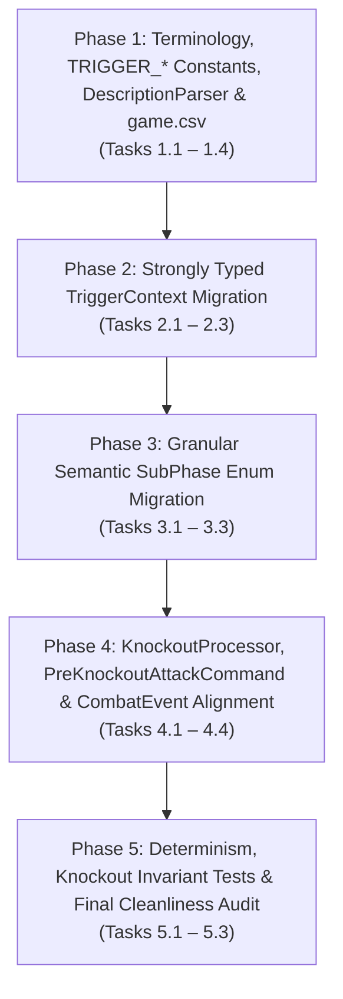

# Action Constitution v1.0 — Master Execution Roadmap

## Purpose & Target Model

This roadmap decomposes [Action_Constitution_v1_Flashcard_Heroes.md](file:///Users/danhh/Desktop/Flashcard%20Heroes/docs/Action_Constitution_v1_Flashcard_Heroes.md) into **5 sequential Phase Plans** (`17` atomic Task Cards total) engineered specifically so **Gemini 3.8 Flash (High)** can execute every step deterministically:

1. **100% Zero Gameplay, Balance, or Replay Drift**: Every trigger rename, `TriggerContext` field replacement, `SubPhase` enum mapping, and `KnockoutProcessor` consolidation is a **strictly bijective structural refactor**. Unit stats, RNG call sequences, tie-breaking rules, animation timings, and `.mcr` replay state digests remain 100% identical.
2. **Hook-Safe Atomic Task Cards**: The repository enforces automated hooks on every turn via [hooks.json](file:///Users/danhh/Desktop/Flashcard%20Heroes/.agents/hooks.json):
   - **`PreToolUse` ([pre_write_guard.py](file:///Users/danhh/Desktop/Flashcard%20Heroes/.agents/scripts/pre_write_guard.py))**: Blocks any edit to `.gd` files (outside `tests/`) that adds `.has_method(`, `.has_signal(`, `is_instance_valid(self)`, or `is_instance_valid(ActionQueue)`; blocks `SignalBus.`, `WindowManager.`, `Audio.`, `get_tree()`, or `await ` inside `scripts/battle/`; blocks `get_instance_id(` / `instance_from_id(` inside `scripts/engine/actions/`.
   - **`PostToolUse` ([post_write_sync.py](file:///Users/danhh/Desktop/Flashcard%20Heroes/.agents/scripts/post_write_sync.py))**: Auto-runs [generate_content_docs.py](file:///Users/danhh/Desktop/Flashcard%20Heroes/scripts/generate_content_docs.py) whenever `localization/game.csv` or `resources/**/*.tres` changes.
   - **`Stop` ([stop_verify_gate.py](file:///Users/danhh/Desktop/Flashcard%20Heroes/.agents/scripts/stop_verify_gate.py))**: Automatically runs [run_headless.sh](file:///Users/danhh/Desktop/Flashcard%20Heroes/.agents/skills/verify-headless/scripts/run_headless.sh) against `res://tests/run_fast_suite.tscn` at the end of **every** turn that modifies `scripts/`, `scenes/`, `resources/`, or [project.godot](file:///Users/danhh/Desktop/Flashcard%20Heroes/project.godot).
3. **Never Split a Breaking Signature Across Turns**: Because `stop_verify_gate.py` compiles and runs `run_fast_suite.tscn` at the end of every turn, **every single Task Card leaves the project 100% compiling and green**.

---

## Non-Negotiable Architectural & Parity Invariants

> [!IMPORTANT]
> Every model executing a Task Card from this roadmap must obey all rules in [AGENTS.md](file:///Users/danhh/Desktop/Flashcard%20Heroes/AGENTS.md) and [scripts/battle/AGENTS.md](file:///Users/danhh/Desktop/Flashcard%20Heroes/scripts/battle/AGENTS.md), plus these confirmed project-specific parity locks:

1. **Zero Defensive Code**: Never write `has_method`, `has_signal`, `is Dictionary` duck-typing bridges, or untyped `Variant` context parameters to "ease" migration. Follow the exact typed migration sequence in each Task Card.
2. **Preserve Distinct Encounter vs. Round Triggers**:
   - `TRIGGER_AT_BATTLE_START = &"at_battle_start"` (formerly `&"on_battle_start"`) fires **once per encounter** when units enter at encounter setup.
   - `TRIGGER_PRE_COMBAT = &"pre_combat"` (formerly `&"on_pre_combat"`) fires **every round** when pressing the Battle button before combat simulation starts.
   - **Never merge these two triggers.**
3. **Preserve Exact Mechanics & Ordering**:
   - **Aegis Charm** (`resources/trinkets/trinket_aegis.tres`) stays on `TRIGGER_WHEN_TAKING_DAMAGE` at `SubPhase.PREVENT_KNOCKOUT_CHECK` (`15`, formerly `priority = 250`), healing a fatal hit back to `1 HP` inside the damage reaction chain before standard hurt reactions and before `TRIGGER_ON_KNOCKOUT_BLOW` / `KnockoutProcessor` checks. Keep `TRIGGER_PREVENT_KNOCKOUT = &"prevent_knockout"` defined in [Constants.gd](file:///Users/danhh/Desktop/Flashcard%20Heroes/scripts/Constants.gd) and wired in [AbilityResolver.gd](file:///Users/danhh/Desktop/Flashcard%20Heroes/scripts/AbilityResolver.gd) for dedicated knockout-prevention abilities without altering Aegis Charm's runtime trigger timing.
   - **Death's Bargain** (`resources/items/ItemTier3E_DeathDamage.tres`) stays on `TRIGGER_WHEN_KNOCKED_OUT` at `SubPhase.PRE_KNOCKOUT` (`25`, formerly `priority = 215`), resolving **after** `Empathic Link` (`SubPhase.KNOCKOUT_STAT_PASS = 12`, formerly `300`) and `Item Transfer` (`SubPhase.ITEM_TRANSFER = 20`, formerly `220`), and **before** summons (`30` / `35` / `40`).
   - **Inert Legacy Dust Elite Typo Preserved**: Do **not** alter `trigger = &"turn_start"` inside `ability_dust_elite1_spawn_turn.tres`, `ability_dust_elite2_spawn_turn.tres`, or `ability_dust_elite_spawn_turn.tres`. Fixing that typo would activate previously dormant enemy abilities and violate 100% gameplay parity.
4. **Both `[Before Being Knocked Out]` Mechanisms Exist**:
   - `AbilityDefinition.execute_before_knockout: bool` (renamed from `execute_on_lethal`) allows a `TRIGGER_WHEN_TAKING_DAMAGE` ability to execute even when the hit reduced the unit to `<= 0 HP`.
   - `Constants.TRIGGER_BEFORE_BEING_KNOCKED_OUT = &"before_being_knocked_out"` is a first-class fatal-only trigger fired in `KnockoutProcessor` immediately before knockout removal.
5. **Zero Sub-Tooltips for Trigger Phrases**:
   - [UnitInspectionWindow.gd](file:///Users/danhh/Desktop/Flashcard%20Heroes/scripts/UnitInspectionWindow.gd), [ItemInspectionWindow.gd](file:///Users/danhh/Desktop/Flashcard%20Heroes/scripts/ItemInspectionWindow.gd), and [TraitInspectionWindow.gd](file:///Users/danhh/Desktop/Flashcard%20Heroes/scripts/TraitInspectionWindow.gd) spawn `EffectInspection` sub-tooltip cards for every entry in `DescriptionParser.KEYWORDS` / `DescriptionParser.find_keywords()`.
   - Therefore, inline BBCode highlighting for natural-prose trigger phrases (`"When knocked out"`, `"Quando nocauteado"`, etc.) **must** live in a separate `DescriptionParser.TRIGGER_PHRASES` dictionary applied only inside `DescriptionParser.parse()` — **never** inside `KEYWORDS`.
6. **Scratch Script Hygiene**:
   - Any temporary Python bulk-migration script **must** be created inside `scratch/` and **deleted (`rm scratch/...`) before ending the Task Card**.

---

## Execution Dependency Flow



> [!TIP]
> **Recommended Workflow for Gemini 3.8 Flash (High)**:
> Execute **one Task Card per chat turn** (or run `/compact` between phases). Paste the **Ready-to-Run Prompt** at the bottom of the current Task Card, let `stop_verify_gate.py` confirm `ALL TESTS PASSED`, mark the Task Card `Complete`, and move to the next card.

---

## Master Phase & Task Card Index

| Phase | Document | Task Cards | Assigned Model | Core Deliverable | Status |
| :---: | :--- | :---: | :--- | :--- | :---: |
| **Phase 1** | [action_constitution_phase_1_terminology.md](file:///Users/danhh/Desktop/Flashcard%20Heroes/docs/action_constitution_phase_1_terminology.md) | `1.1` – `1.4` | `Gemini 3.8 Flash (High)` | Canonical `TRIGGER_*` / `CAUSE_*` / `COND_*` constants, `execute_before_knockout`, `.gd` + `.tres` trigger sync, zero-tooltip `DescriptionParser` styling, EN + PT-BR `game.csv` prose | `Complete` |
| **Phase 2** | [action_constitution_phase_2_trigger_context.md](file:///Users/danhh/Desktop/Flashcard%20Heroes/docs/action_constitution_phase_2_trigger_context.md) | `2.1` – `2.3` | `Gemini 3.8 Flash (High)` | `TriggerContext` `RefCounted` class replacing untyped `Dictionary` across resolvers, commands, `EffectRequest`, `StatScaling`, and all 76 `EffectDefinition` subclasses | `Complete` |
| **Phase 3** | [action_constitution_phase_3_subphases.md](file:///Users/danhh/Desktop/Flashcard%20Heroes/docs/action_constitution_phase_3_subphases.md) | `3.1` – `3.3` | `Gemini 3.8 Flash (High)` | `Constants.SubPhase` enum replacing raw integer `priority` across `AbilityDefinition`, `EffectRequest`, `CausalReactionResolver`, and all 289 `.tres` resources | `Complete` |
| **Phase 4** | [action_constitution_phase_4_knockout_processor.md](file:///Users/danhh/Desktop/Flashcard%20Heroes/docs/action_constitution_phase_4_knockout_processor.md) | `4.1` – `4.4` | `Gemini 3.8 Flash (High)` | Typed deferred-KO fields on `BattleState` (removing `set_meta`), `CombatEvent.Type.KNOCKOUT` / `PREVENT_KNOCKOUT` / `PRE_KNOCKOUT_ATTACK`, `PreKnockoutAttackCommand`, `KnockoutProcessor` + `_process_registered_death` consolidation | `Complete` |
| **Phase 5** | [action_constitution_phase_5_verification.md](file:///Users/danhh/Desktop/Flashcard%20Heroes/docs/action_constitution_phase_5_verification.md) | `5.1` – `5.3` | `Gemini 3.8 Flash (High)` | Constitutional unit/integration tests in `run_fast_suite.gd`, multi-seed `ReplayStateDigest` parity stress test, `.mcr` replay check, and final `grep` cleanliness gate | `Complete` |

---

## Standard Headless Verification Command

Every Task Card uses the sandbox-safe headless runner from [SKILL.md](file:///Users/danhh/Desktop/Flashcard%20Heroes/.agents/skills/verify-headless/SKILL.md):

```zsh
.agents/skills/verify-headless/scripts/run_headless.sh res://tests/run_fast_suite.tscn
```

When `.gd` files are renamed/deleted or `localization/game.csv` is updated, first refresh Godot's import/UID cache before running the fast suite:

```zsh
.agents/skills/verify-headless/scripts/run_headless.sh --import --quit && \
.agents/skills/verify-headless/scripts/run_headless.sh res://tests/run_fast_suite.tscn
```

