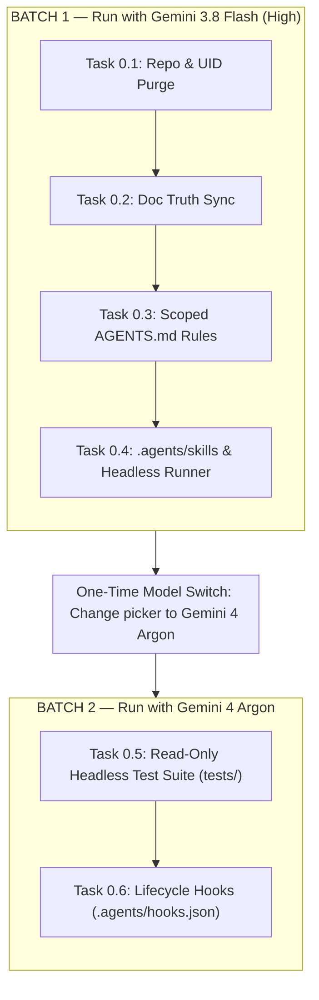

# Phase 0 Implementation Plan: AI-Safe Foundation, Guardrails & Headless Baseline

## Why Start Here (And Why It Cannot Break the Game)

Out of all five modernization phases, **Phase 0 is the mandatory first move**:

1. **100% Zero Gameplay or Visual Change**: Not a single active runtime `.gd` script, `.tscn` gameplay scene, `.tres` resource, shader, or `.po` translation entry used by [project.godot](file:///Users/danhh/Desktop/Flashcard%20Heroes/project.godot) has its logic altered. The game will play identically frame-for-frame.
2. **Eliminates the Root Causes of AI Mistakes First**: Right now, **Gemini 3.8 Flash (High)** is exposed to `9.62 MB` of stale monolithic code dumps (`Code/*.md`), 3 competing copies of documentation (`docs/`, `localization/docs/`, `scenes/Docs backup/`), a syntax-corrupted dead [AbilitiesRegistry.gd](file:///Users/danhh/Desktop/Flashcard%20Heroes/scripts/AbilitiesRegistry.gd), docs instructing it to call deleted functions (`play_async_chain()`, `InventoryOperations.move_item()`), and zero automated verification gates.
3. **Permanent Force Multiplier**: Once Phase 0 is complete, **Gemini 3.8 Flash (High)** will automatically load directory-scoped rules, on-demand skills, deterministic `PreToolUse` / `PostToolUse` / `Stop` hooks, and a `<3.5s` headless Godot regression runner on every future task.

---

## Model Division Strategy: Two Clean Batches (No Switching Back & Forth)

To make execution completely seamless, Phase 0 is grouped into **two consecutive batches**:
1. **Batch 1 (Gemini 3.8 Flash High)**: Run Tasks `0.1` through `0.4` all in one go. You keep your model set to Gemini 3.8 Flash.
2. **Batch 2 (Gemini 4 Argon)**: Run Tasks `0.5` and `0.6` together. You switch the model picker to Gemini 4 Argon (either in the same session or a fresh session).



| Task | Batch | Assigned Model | Focus | Status |
| :--- | :---: | :--- | :--- | :---: |
| **0.1** | **Batch 1** | **Gemini 3.8 Flash (High)** | Repository Context Purge & `.gitignore` Hardening | `Complete` |
| **0.2** | **Batch 1** | **Gemini 3.8 Flash (High)** | Documentation Truth Alignment (Fix stale API docs) | `Complete` |
| **0.3** | **Batch 1** | **Gemini 3.8 Flash (High)** | Hierarchical Directory-Scoped `AGENTS.md` Rules | `Complete` |
| **0.4** | **Batch 1** | **Gemini 3.8 Flash (High)** | Antigravity 2.0 `.agents/skills/` & Headless Runner | `Complete` |
| **0.5** | **Batch 2** | **Gemini 4 Argon** | Read-Only Headless Verification Suite (`tests/`) | `Complete` |
| **0.6** | **Batch 2** | **Gemini 4 Argon** | Deterministic Lifecycle Hooks (`.agents/hooks.json`) | `Complete` |

> [!TIP]
> **How to Execute Without Context Drift**: Run **one Task Card per chat turn** (or use `/compact` between tasks). Simply switch the model picker to the badge shown on the Task Card and paste the **Ready-to-Run Prompt** at the bottom of that card. Update this document's Status column as tasks complete.

---

## Task 0.1 — Repository Context Purge & `.gitignore` Hardening
**Assigned Model:** `Gemini 3.8 Flash (High)`

### Objective
Eliminate all verified dead dumps, duplicate doc folders, Godot 3 leftovers, empty ghost directories, and orphaned `.uid` files that poison AI search results, while preserving any unique historical docs in `docs/archive of old already used documentation/`.

### Pre-Verified Safety Facts (Do Not Re-Guess)
- `AbilitiesRegistry` has **0** runtime callers across `project.godot`, `scripts/`, `scenes/`, and `resources/` (only a comment in [CombatSimulator.gd](file:///Users/danhh/Desktop/Flashcard%20Heroes/scripts/battle/CombatSimulator.gd#L408) mentions its name—do **not** touch `CombatSimulator.gd`).
- `localization/docs/` contains 3 historical markdown files not currently in `docs/archive of old already used documentation/`: `GameplayDocument.md`, `MechanicalSpecification.md`, and `Refactor Plan.md`. Archive those 3 files first before deleting `localization/docs/`.

### Exact Steps
1. **Archive the 3 unique historical docs from `localization/docs/`**:
   - Move `localization/docs/GameplayDocument.md`, `localization/docs/MechanicalSpecification.md`, and `localization/docs/Refactor Plan.md` into `docs/archive of old already used documentation/`.
2. **Delete duplicate doc trees, monolithic AI dumps, and legacy clutter**:
   - Delete directory `Code/` (contains `9.62 MB` of stale `AllProjectFiles*.md` / `ai_project_context*.md` dumps and dump scripts).
   - Delete directory `localization/docs/`.
   - Delete directory `scenes/Docs backup/`.
   - Delete directory `tools_and_archive/`.
   - Delete empty directory `res:/` (the literal folder named `res:` in project root).
   - Delete file `project.gdns` (Godot 3 leftover).
   - Delete dead syntax-broken file [AbilitiesRegistry.gd](file:///Users/danhh/Desktop/Flashcard%20Heroes/scripts/AbilitiesRegistry.gd) and `scripts/AbilitiesRegistry.gd.uid`.
   - Delete directory `scripts/__pycache__/`.
3. **Update [generate_content_docs.py](file:///Users/danhh/Desktop/Flashcard%20Heroes/scripts/generate_content_docs.py#L461-L469)**:
   - Remove lines `461–469` (the `# 4. Sync to localization/docs if present` block) so `docs/` is the sole documentation target. Keep `# 5. Sync game.csv to en.po, pt_BR.po, and game.pot` intact.
4. **Delete the 5 empty ghost directories in `scripts/`**:
   - `scripts/actions/commands`
   - `scripts/actions`
   - `scripts/recorder`
   - `scripts/replay`
   - `scripts/engine/actions/meta`
5. **Delete the exact 12 orphaned `.uid` files in `scripts/`** (whose `.gd` files no longer exist):
   - `scripts/EffectBossAllyDeathGrowth.gd.uid`
   - `scripts/EffectBossDrawDrain.gd.uid`
   - `scripts/EffectBossTokenDrain.gd.uid`
   - `scripts/EffectGrantPWRAsHP.gd.uid`
   - `scripts/EffectHealTwoRandomAllies.gd.uid`
   - `scripts/EffectLifesteal.gd.uid`
   - `scripts/EffectMirrorSlotAttack.gd.uid`
   - `scripts/EffectStealPower.gd.uid`
   - `scripts/NewFlashcardPopup.gd.uid`
   - `scripts/RewardPool.gd.uid`
   - `scripts/effects/EffectUpdatePwrToTokens.gd.uid`
   - `scripts/utils/DamageCalculator.gd.uid`
6. **Harden [.gitignore](file:///Users/danhh/Desktop/Flashcard%20Heroes/.gitignore) and untrack `log.txt`**:
   - Append these entries to [.gitignore](file:///Users/danhh/Desktop/Flashcard%20Heroes/.gitignore):
     ```gitignore
     # AI workspace, temp scratchpad & runtime logs
     scratch/
     log.txt
     .gemini/
     __pycache__/
     *.pyc
     ```
   - Run `git rm --cached log.txt` (if tracked) and delete `log.txt`. *(Leave `scratch/` on disk until Task 0.5 migrates [verify_atomic_state.gd](file:///Users/danhh/Desktop/Flashcard%20Heroes/scratch/verify_atomic_state.gd) into `tests/`.)*

### Mandatory Verification Command
```zsh
mkdir -p "/tmp/fch_t01/Library/Application Support/Godot/app_userdata/Flashcard Heroes" && \
HOME=/tmp/fch_t01 /Applications/Godot.app/Contents/MacOS/Godot --headless --quit-after 2 && \
rm -rf /tmp/fch_t01 && \
python3 scripts/generate_content_docs.py && \
find scripts -type d -empty && \
find scripts -name "*.uid" | while read u; do base="${u%.uid}"; [ ! -e "$base" ] && echo "ORPHAN_UID: $u"; done
```
- **Pass Criteria**: Godot exits `0`, `generate_content_docs.py` prints success, and `find` outputs **zero** empty directories and **zero** `ORPHAN_UID` lines.

### Ready-to-Run Prompt (`Gemini 3.8 Flash (High)`)
> Execute **Task 0.1** from `docs/phase_0_foundation_plan.md` step-by-step. Do not touch any files outside the explicit list in Task 0.1, and run the Mandatory Verification Command at the end to confirm zero regressions. When finished, mark Task 0.1 Status as Complete in `docs/phase_0_foundation_plan.md`.

---

## Task 0.2 — Documentation Truth Alignment
**Assigned Model:** `Gemini 3.8 Flash (High)`

### Objective
Fix the exact 5 stale/deleted API instructions in `docs/` that currently trick AI models into calling nonexistent functions or using unseeded RNG.

### Exact Edits (Markdown-Only)
1. **[CODE_GUIDELINES.md](file:///Users/danhh/Desktop/Flashcard%20Heroes/docs/CODE_GUIDELINES.md#L21-L26)** (Line ~23):
   - Replace `*   **Correct:** using InventoryOperations.move_item(uuid, from_loc, to_loc).`
   - With: `*   **Correct:** using atomic container APIs: RunState.move_instance(from_loc, to_loc) (outside battle) or BattleManager.bm_move_instance(from_loc, to_loc) / InventoryOperations.move_instance(state, from_loc, to_loc) (in battle).`
2. **[CODE_GUIDELINES.md](file:///Users/danhh/Desktop/Flashcard%20Heroes/docs/CODE_GUIDELINES.md#L90-L103)** (Lines ~92 & ~100):
   - Replace `animator.play_async_chain()` with `BattleAnimator.play_turn_sequence(initial_snapshot, events)` (noting playback is strictly linear/serialized, never parallel `play_async_chain`).
   - Replace `_visual_snapshot[id]` example with reading `CombatPayload` event fields and `GachaBallView` puppet state (`set_visual_state(...)`).
3. **[UIInteraction.md](file:///Users/danhh/Desktop/Flashcard%20Heroes/docs/UIInteraction.md#L150-L155)** (Line ~152):
   - Replace `BattleAnimator.play_async_chain()` with `BattleAnimator.play_turn_sequence(initial_snapshot, events)`.
4. **[Flashcard Heroes TDD (Technichal Design Document) V9.0.md](file:///Users/danhh/Desktop/Flashcard%20Heroes/docs/Flashcard%20Heroes%20TDD%20(Technichal%20Design%20Document)%20V9.0.md#L20-L25)** (Line ~22):
   - Replace `SessionRecorder` with `GameplayRecorder` (`res://scripts/engine/recorder/GameplayRecorder.gd`).
5. **[01_Global_Architecture.md](file:///Users/danhh/Desktop/Flashcard%20Heroes/docs/_Learning_Material/01_Global_Architecture.md#L150-L170)** (Line ~158):
   - Replace the raw `randomize()` / `randi()` snippet with deterministic `RNGManager` usage (`RNGManager.combat_rng.randi_range(...)` / `RNGManager.loot_rng`), adding a bold note that global `randomize()` and `randi()` are strictly forbidden in gameplay scripts.

### Mandatory Verification Command
```zsh
grep -rn "play_async_chain\|InventoryOperations\.move_item\|SessionRecorder" docs/*.md docs/_Learning_Material/*.md || echo "PASS: Zero stale API references"
```
- **Pass Criteria**: Prints `PASS: Zero stale API references` (except any historical note explicitly saying `play_async_chain` was eliminated in `CombatSystem.md`).

### Ready-to-Run Prompt (`Gemini 3.8 Flash (High)`)
> Execute **Task 0.2** from `docs/phase_0_foundation_plan.md`. Read the target lines in each of the 4 Markdown files first, apply only the exact documentation updates specified, and run the Mandatory Verification Command. When finished, mark Task 0.2 Status as Complete in `docs/phase_0_foundation_plan.md`.

---

## Task 0.3 — Hierarchical Directory-Scoped `AGENTS.md` Rules
**Assigned Model:** `Gemini 3.8 Flash (High)`

### Objective
Set up Antigravity 2.0's hierarchical directory rules so **Gemini 3.8 Flash (High)** automatically receives compact, domain-specific constraints *only* for the folder it is editing—saving context window tokens while enforcing clean boundaries.

> [!IMPORTANT]
> Per Antigravity 2.0's rules specification, standalone `AGENTS.md` files **must NOT contain YAML frontmatter** (`---`) and must stay concise (`< 4 KB` each).

### Exact Files to Create / Update
1. **Root `/Users/danhh/Desktop/Flashcard Heroes/AGENTS.md`** (consolidating [.agent/AGENTS.md](file:///Users/danhh/Desktop/Flashcard%20Heroes/.agent/AGENTS.md)):
   - **Fail-Fast Law**: Never write defensive masks (`if has_method(...)`, `if SignalBus.has_signal(...)`, `if is_instance_valid(self)`, `if is_instance_valid(ActionQueue)`). Use static types (`var x: Type = ...`) and `assert()` invariants so broken contracts fail immediately with a stack trace.
   - **No Symptom Patching**: Never patch bugs locally with metadata flags (`set_meta`), string comparisons on localized UI text, or timer delays. Diagnose all theories first and fix root structural causes.
   - **Data ↔ Presentation Decoupling**: Simulation/Data (`RunState`, `BattleState`, `GachaBallInstance`, `EffectDefinition`) must never depend on UI Controls, `WindowManager`, `BattleAnimator`, shaders, or `Audio`.
   - **Mechanics & Visuals Lock**: Never change game mechanics, unit/item/trinket stats, abilities, or visual aesthetics without explicit user permission.
   - **Scratch Hygiene**: Temporary scripts go exclusively in `scratch/` and must be deleted once finished.
2. **`/Users/danhh/Desktop/Flashcard Heroes/scripts/battle/AGENTS.md`**:
   - Enforces the pure Simulation zone: no new `SceneTree` queries (`get_tree()`, `find_child()`), no `await`, no `Audio.*`, no `WindowManager`, no `.gdshader` loads.
   - Every gameplay random roll must use `RNGManager` (`combat_rng`, `gacha_rng`, `loot_rng`).
   - Every combat state mutation (HP, PWR, status stacks, slot move, summon, death, currency) **must** emit a corresponding `CombatEvent` with a typed `CombatPayload` so Puppet UI never desyncs.
   - All container mutations must preserve `BattleState.assert_state_consistency()`.
3. **`/Users/danhh/Desktop/Flashcard Heroes/scripts/engine/actions/AGENTS.md`**:
   - `GameAction` payloads must contain **only** JSON-serializable primitives (`int`, `float`, `bool`, `String`, `StringName`, `Array`, `Dictionary`, `LocationIdentifier`).
   - **Strictly forbidden** in `GameAction`: `Vector2`, `Node`/`Control`/`Resource` pointers, or `Object.get_instance_id()` / `instance_from_id()`.
   - `execute()` must behave identically in live UI and headless replay modes.
4. **`/Users/danhh/Desktop/Flashcard Heroes/scripts/animations/AGENTS.md`**:
   - Always bind Tweens to the node being animated (`node.create_tween()`, never unbound `get_tree().create_tween()`).
   - Scale durations with `AnimationConstants.scaled(duration)` **exactly once** (never pre-scale a delay passed to a VFX helper that scales internally).
   - Never capture a mid-animation `rotation`/`scale` as a rest pose; tween back to constant rest values (`0.0`, `Vector2.ONE`).
   - Route combat event visuals through `AnimationRegistry` rather than adding inline branches to `BattleAnimator.gd`.
5. **`/Users/danhh/Desktop/Flashcard Heroes/resources/AGENTS.md`**:
   - Always read the backing `.gd` `Resource` script (`GachaBallDefinition.gd`, `AbilityDefinition.gd`, `EffectDefinition.gd`, `MergeRecipe.gd`) before creating or editing any `.tres` file.
   - Always use `MergeRecipe.gd` (never legacy `RecipeDefinition`).
   - Whenever `localization/game.csv` is modified, always run `python3 scripts/generate_content_docs.py` so `localization/en.po` and `localization/pt_BR.po` are recompiled.

### Mandatory Verification Command
```zsh
for f in AGENTS.md scripts/battle/AGENTS.md scripts/engine/actions/AGENTS.md scripts/animations/AGENTS.md resources/AGENTS.md; do
  [ -f "$f" ] || { echo "MISSING: $f"; exit 1; }
  head -n 1 "$f" | grep -q "^---" && { echo "INVALID FRONTMATTER IN: $f"; exit 1; }
done && echo "PASS: All 5 scoped AGENTS.md files valid"
```

### Ready-to-Run Prompt (`Gemini 3.8 Flash (High)`)
> Execute **Task 0.3** from `docs/phase_0_foundation_plan.md`. Create the 5 `AGENTS.md` files at the exact paths listed (with no YAML frontmatter), then run the Mandatory Verification Command. When finished, mark Task 0.3 Status as Complete in `docs/phase_0_foundation_plan.md`.

---

## Task 0.4 — Antigravity 2.0 `.agents/skills/` & Sandboxed Headless Wrapper
**Assigned Model:** `Gemini 3.8 Flash (High)`

### Objective
Replace the broken legacy `.agent/workflows/implement_new_content.md` and `.windsurf/` folders with modern progressive-disclosure Antigravity 2.0 skills in `.agents/skills/`, including a reusable sandbox-safe Godot headless runner script.

### Exact Files to Create
1. **`.agents/skills/verify-headless/scripts/run_headless.sh`** (`chmod +x`):
   ```zsh
   #!/bin/zsh
   set -euo pipefail
   SCRIPT_DIR="${0:A:h}"
   REPO_ROOT="${SCRIPT_DIR:h:h:h}"
   SCENE_OR_ARGS=("$@")

   TMP_HOME="$(mktemp -d /tmp/fch_headless.XXXXXX)"
   trap 'rm -rf "$TMP_HOME"' EXIT
   mkdir -p "$TMP_HOME/Library/Application Support/Godot/app_userdata/Flashcard Heroes"

   cd "$REPO_ROOT"
   if [ ${#SCENE_OR_ARGS[@]} -eq 0 ]; then
     HOME="$TMP_HOME" /Applications/Godot.app/Contents/MacOS/Godot --headless --quit-after 2
   else
     HOME="$TMP_HOME" /Applications/Godot.app/Contents/MacOS/Godot --headless "${SCENE_OR_ARGS[@]}"
   fi
   ```
2. **`.agents/skills/verify-headless/SKILL.md`** (with required `name: verify-headless` and third-person `description` YAML frontmatter):
   - Explains how to run `run_headless.sh` inside the standard sandbox (`BypassSandbox: false`) to check GDScript compilation and execute `res://tests/run_fast_suite.tscn`, plus how to use the `godot` MCP tools (`update_project_uids`, `run_project`, `get_debug_output`) when visual inspection is needed.
3. **`.agents/skills/implement-content/SKILL.md`** (migrating & fixing [.agent/workflows/implement_new_content.md](file:///Users/danhh/Desktop/Flashcard%20Heroes/.agent/workflows/implement_new_content.md)):
   - Removes broken `AbilityImplementationGuide.md` reference; points to real schemas ([GachaBallDefinition.gd](file:///Users/danhh/Desktop/Flashcard%20Heroes/scripts/GachaBallDefinition.gd), [AbilityDefinition.gd](file:///Users/danhh/Desktop/Flashcard%20Heroes/scripts/AbilityDefinition.gd), [EffectDefinition.gd](file:///Users/danhh/Desktop/Flashcard%20Heroes/scripts/EffectDefinition.gd), [MergeRecipe.gd](file:///Users/danhh/Desktop/Flashcard%20Heroes/scripts/MergeRecipe.gd), [CombatSystem.md](file:///Users/danhh/Desktop/Flashcard%20Heroes/docs/CombatSystem.md)).
   - Lists the mandatory atomic checklist: Effect script -> `.tres` definitions -> `MergeRecipe` -> `localization/game.csv` -> `python3 scripts/generate_content_docs.py` (compiles `.po` files!) -> headless verification via `run_headless.sh`.
4. **`.agents/skills/create-ui-vfx/SKILL.md`**:
   - Step-by-step checklist for adding UI animations, shaders, projectiles, and `BattleAnimation` subclasses: node-bound `create_tween()`, single `AnimationConstants.scaled()`, zero `Object.get_instance_id()` in actions, zero live `GachaBallInstance` reads during VCR playback, and `aseprite` / `godot` MCP usage.
5. **Remove legacy customization folders**:
   - Delete `.agent/` and `.windsurf/` after confirming their rules and workflow are superseded by `AGENTS.md` and `.agents/skills/`.

### Mandatory Verification Command
```zsh
.agents/skills/verify-headless/scripts/run_headless.sh && \
[ ! -d .agent ] && [ ! -d .windsurf ] && \
echo "PASS: Skills installed and sandboxed Godot runner exited 0"
```

### Ready-to-Run Prompt (`Gemini 3.8 Flash (High)`)
> Execute **Task 0.4** from `docs/phase_0_foundation_plan.md`. Create `run_headless.sh` (make it executable with `chmod +x`) and the 3 `SKILL.md` files with valid YAML frontmatter, delete `.agent/` and `.windsurf/`, and run the Mandatory Verification Command. When finished, mark Task 0.4 Status as Complete in `docs/phase_0_foundation_plan.md`.

---

## Task 0.5 — Read-Only Headless Baseline Verification Suite (`tests/`)
**Assigned Model:** `Gemini 4 Argon` *(Switch model to Gemini 4 Argon for this task!)*

### Why Delegate This Task to `Gemini 4 Argon`
Writing the permanent baseline test suite requires coordinating [GameManager.gd](file:///Users/danhh/Desktop/Flashcard%20Heroes/scripts/GameManager.gd), [RunState.gd](file:///Users/danhh/Desktop/Flashcard%20Heroes/scripts/RunState.gd), [BattleManager.gd](file:///Users/danhh/Desktop/Flashcard%20Heroes/scripts/BattleManager.gd), [AnimationConstants.gd](file:///Users/danhh/Desktop/Flashcard%20Heroes/scripts/animations/AnimationConstants.gd), [Database.gd](file:///Users/danhh/Desktop/Flashcard%20Heroes/scripts/Database.gd), and [ReplayStateDigest.gd](file:///Users/danhh/Desktop/Flashcard%20Heroes/scripts/engine/replay/ReplayStateDigest.gd) **without modifying any production script**—including accelerating `AnimationConstants.speed_factor = 1000.0` so entrance timers in `BattleManager` finish in `<1ms` instead of stalling headless runs, and avoiding false failures on pre-existing baseline quirks.

### Objective & Strict Constraints
Create `tests/run_fast_suite.tscn` and `tests/run_fast_suite.gd` (touching **zero** existing production files!) that executes in **`< 4 seconds`** via `.agents/skills/verify-headless/scripts/run_headless.sh res://tests/run_fast_suite.tscn` and exits with code `1` on any failure or `0` when all suites pass:

1. **Test Suite 1 — `Database` & Localization Referential Integrity**:
   - Asserts `Database` loaded non-empty `units`, `items`, `trinkets`, and `recipes`.
   - Verifies every `MergeRecipe` references valid input and result definition IDs in `Database`.
   - Verifies every player-facing `GachaBallDefinition` and `TrinketDefinition` with a non-empty `display_name_key` / `name_key` resolves to a non-empty translation in `en` and `pt_BR` (`TranslationServer.translate(...) != key`).
2. **Test Suite 2 — Atomic Container & Hybrid Truth+Index Consistency**:
   - Port and clean up all 7 atomic `RunState` & `BattleState` invariant tests from [verify_atomic_state.gd](file:///Users/danhh/Desktop/Flashcard%20Heroes/scratch/verify_atomic_state.gd) (setting `AnimationConstants.is_in_battle = true` and `AnimationConstants.speed_factor = 1000.0` during headless battle setup so `execute_hero_entrance_sequence()` and `execute_enemy_entrance_sequence()` complete instantaneously!).
3. **Test Suite 3 — Deterministic Seed Parity (`Seed X == Seed X`)**:
   - Executes two independent seeded combat runs with the exact same seed (`start_run_with_seed` + 3 turns of combat resolution), captures `ReplayStateDigest` (or canonical board/instance state hash) after each run, and asserts **100% bit-for-bit equality**.
4. **Test Suite 4 — `RunState` Save/Load Roundtrip Consistency**:
   - Captures `var saved: Dictionary = rs.to_save_dict()`, reconstructs via `RunState.from_save_dict(saved)`, asserts `_validate_state_consistency()` on the restored `RunState`, and verifies container UUID parity (`PlayerLineup`, `PlayerBench`, `PlayerTrinkets`, `gold`, `gacha_tokens`). *(Note: test with a standard deterministic setup and do not alter `RunState.gd` in Phase 0.)*
5. **Clean Up `scratch/`**:
   - Once `tests/run_fast_suite.tscn` passes 100%, delete the old one-off debug files inside `scratch/` so `scratch/` is completely clean.

### Mandatory Verification Command
```zsh
time .agents/skills/verify-headless/scripts/run_headless.sh res://tests/run_fast_suite.tscn
```
- **Pass Criteria**: Prints `[PASS]` for all 4 suites, prints `=== ALL FAST SUITE TESTS PASSED ===`, exits with code `0`, and completes in `< 5 seconds`.

### Ready-to-Run Prompt (`Gemini 4 Argon`)
> Execute **Task 0.5** from `docs/phase_0_foundation_plan.md`. Read `scratch/verify_atomic_state.gd`, `scripts/Database.gd`, `scripts/RunState.gd`, and `scripts/engine/replay/ReplayStateDigest.gd` first. Build `tests/run_fast_suite.tscn` and `tests/run_fast_suite.gd` without modifying any production files, clean up `scratch/` once migrated, and verify `<5s` execution via `.agents/skills/verify-headless/scripts/run_headless.sh res://tests/run_fast_suite.tscn`. When finished, mark Task 0.5 Status as Complete in `docs/phase_0_foundation_plan.md`.

---

## Task 0.6 — Deterministic Antigravity Lifecycle Hooks (`.agents/hooks.json`)
**Assigned Model:** `Gemini 4 Argon` *(Run immediately following Task 0.5 in Batch 2)*

### Objective
Install three zero-LLM-token guardrails in `.agents/hooks.json` so **Gemini 3.8 Flash (High)** is deterministically prevented from writing banned defensive/coupled code, forgetting `.po` compilation, or finishing a coding turn with a broken build.

> [!WARNING]
> **Critical Antigravity 2.0 Hook Rules (Do Not Deviate)**:
> 1. Hook commands run with their working directory set to `.agents/` (the folder containing `hooks.json`), **not** the repo root! Always resolve `REPO_ROOT = Path(__file__).resolve().parents[2]`.
> 2. All stdin/stdout JSON keys are **camelCase** (`toolCall`, `terminationReason`, `workspacePaths`).
> 3. `PostToolUse` **must** output `{}` on stdout. `PreToolUse` **must** output `{"decision": "allow"}` or `{"decision": "deny", "reason": "..."}`. `Stop` **must** output `{"decision": "continue", "reason": "..."}` to block a broken build, or `{"decision": "allow"}` to allow completion.

### Exact Files to Create
1. **`.agents/scripts/pre_write_guard.py`** (`chmod +x`):
   - Reads JSON from `sys.stdin`. Extracts `tool_name = data.get("toolCall", {}).get("name", "")` and `args = data.get("toolCall", {}).get("args", {})`.
   - Gets `path = args.get("Path", "")` and new text `added = args.get("Replacement", "") if tool_name == "edit_file" else args.get("Content", "")` (and for `edit_file`, subtracts lines already present in `args.get("Target", "")` so editing neighbors of legacy code is **never** blocked!).
   - If `path.endswith(".gd")` and `"/tests/"` not in `path`:
     - Deny if newly added lines contain: `.has_method(`, `.has_signal(`, `is_instance_valid(self)`, or `is_instance_valid(ActionQueue)`.
     - If `"/scripts/battle/"` in `path`: deny if newly added lines contain `SignalBus.`, `WindowManager.`, `Audio.`, `get_tree()`, or `await `.
     - If `"/scripts/engine/actions/"` in `path`: deny if newly added lines contain `get_instance_id(` or `instance_from_id(`.
   - Prints `{"decision": "allow"}` if clean, or `{"decision": "deny", "reason": "<exact rule violated>"}` if violated.

2. **`.agents/scripts/post_write_sync.py`** (`chmod +x`):
   - Reads JSON from `sys.stdin`. If `args.get("Path", "").endswith("localization/game.csv")` and not `data.get("error")`:
     - Runs `subprocess.run(["python3", str(REPO_ROOT / "scripts/generate_content_docs.py")], cwd=REPO_ROOT, capture_output=True)`.
   - Always prints `{}` to `stdout`.

3. **`.agents/scripts/stop_verify_gate.py`** (`chmod +x`):
   - Reads JSON from `sys.stdin`.
   - Only runs verification when `data.get("terminationReason") == "NO_TOOL_CALL"` and `int(data.get("executionNum", 0)) < 3` (prevents infinite loops!).
   - Checks `git status --porcelain -- scripts/ scenes/ resources/ project.godot` in `REPO_ROOT`. If output is empty (e.g., pure chat, planning, or doc-only turn), immediately prints `{"decision": "allow"}` in `<15ms`.
   - Otherwise, runs `.agents/skills/verify-headless/scripts/run_headless.sh res://tests/run_fast_suite.tscn`.
     - If returncode == `0`: prints `{"decision": "allow"}`.
     - If returncode != `0`: prints `{"decision": "continue", "reason": "Headless fast suite failed! Fix these errors before finishing:\n" + tail_of_output}`.

4. **`.agents/hooks.json`**:
   ```json
   {
     "gdscript-clean-code-gate": {
       "PreToolUse": [
         {
           "matcher": "edit_file|write_file",
           "hooks": [
             {
               "type": "command",
               "command": "python3 ./scripts/pre_write_guard.py",
               "timeout": 5
             }
           ]
         }
       ]
     },
     "auto-sync-localization": {
       "PostToolUse": [
         {
           "matcher": "edit_file|write_file",
           "hooks": [
             {
               "type": "command",
               "command": "python3 ./scripts/post_write_sync.py",
               "timeout": 15
             }
           ]
         }
       ]
     },
     "headless-regression-gate": {
       "Stop": [
         {
           "type": "command",
           "command": "python3 ./scripts/stop_verify_gate.py",
           "timeout": 25
         }
       ]
     }
   }
   ```

### Mandatory Verification Command
```zsh
cd .agents && \
echo '{"toolCall":{"name":"write_file","args":{"Path":"/Users/danhh/Desktop/Flashcard Heroes/scripts/battle/Foo.gd","Content":"if obj.has_method(\"x\"):\n\tpass"}}}' | python3 ./scripts/pre_write_guard.py | grep -q '"deny"' && \
echo '{"toolCall":{"name":"write_file","args":{"Path":"/Users/danhh/Desktop/Flashcard Heroes/scripts/battle/Foo.gd","Content":"var hp: int = 10"}}}' | python3 ./scripts/pre_write_guard.py | grep -q '"allow"' && \
echo '{"terminationReason":"NO_TOOL_CALL","executionNum":1}' | python3 ./scripts/stop_verify_gate.py | grep -q '"allow"' && \
echo "PASS: All 3 lifecycle hooks verified"
```

### Ready-to-Run Prompt (`Gemini 4 Argon`)
> Execute **Task 0.6** from `docs/phase_0_foundation_plan.md` to complete Batch 2. Create the 3 Python hook scripts in `.agents/scripts/` (`chmod +x`) and `.agents/hooks.json` adhering strictly to the stdin/stdout JSON contracts in Task 0.6, then run the Mandatory Verification Command from `.agents/`. When finished, mark Task 0.6 Status as Complete in `docs/phase_0_foundation_plan.md`.
