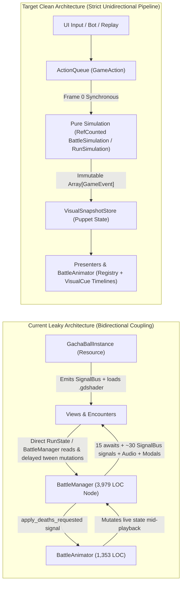
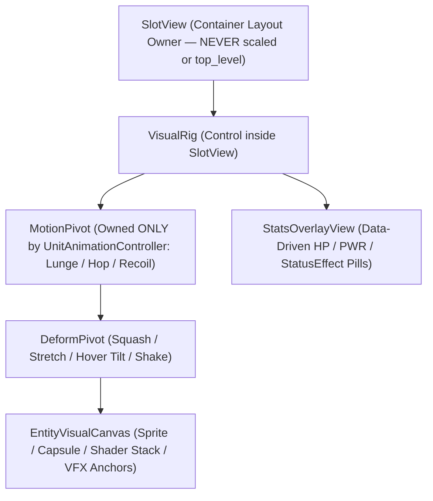

# Flashcard Heroes — Clean Code, Architecture & AI-First Engineering Evaluation

## 1. Executive Diagnosis: A "Dual-Era" Codebase

*Flashcard Heroes* is an ambitious tactical roguelike deckbuilder/auto-battler hybrid (inspired by *Super Auto Pets*, *Backpack Battles*, and *Cross Blitz* UI polish) built in **Godot 4.6**. After auditing all documentation, repository tooling, and **298 GDScript files (`60,791` LOC)**, one overarching truth stands out:

> [!IMPORTANT]
> **Your architectural vision is genuinely strong—several core subsystems are already designed at a professional tactical-engine level.** Velocity and stability are hitting a wall *not* because the core architecture is wrong, but because **previous refactors stopped ~65% of the way through ("Dual-Era Drift")**, leaving massive legacy God-objects, hardcoded content checks, and thousands of defensive fallbacks alive right next to your clean new systems.

When an AI coding agent—especially a fast workhorse model like **Gemini 3.8 Flash**—enters a "Dual-Era" codebase, it pattern-matches whatever is closest in the file it opens. If half of a 3,900-line file mutates state directly and wraps calls in `if is_instance_valid(...)`, the model copies that anti-pattern into new features, compounding tech debt with every session.

### Quantitative Codebase Health Snapshot

| Metric | Measured Value | Clean-Code / AI-Ready Target |
| :--- | :--- | :--- |
| **Total GDScript Volume** | `60,791` LOC across `298` `.gd` files | Modular `<350` LOC single-responsibility scripts |
| **Top 12 "God Scripts" Share** | **`20,835` LOC (`34.3%` of entire codebase!)** | `<15%` in orchestrators; `0` files `>600` LOC |
| **Scripts in `scripts/` Root vs. Subfolders** | `162` files dumped in root vs. `136` in subfolders | Strict domain-folder hierarchy (`battle/`, `ui/`, `content/`) |
| **Global Autoload Singletons** | **`27` Autoloads** (`7` bidirectional circular dependency pairs) | `<= 8` unidirectional infrastructure services |
| **Static Typing Coverage (Local `var`)** | `44.2%` typed (`3,322`) / **`55.8%` untyped (`4,188`)** | `100%` typed locals, params, returns, and `Array[T]` / `Dictionary[K,V]` |
| **Typed Dictionaries (`Dictionary[K, V]`)** | **`1`** typed vs. **`963`** untyped `Dictionary` | Typed DTO `RefCounted` classes + `Dictionary[K, V]` |
| **GDScript Compiler Warning/Error Flags** | **`0` configured** in [project.godot](file:///Users/danhh/Desktop/Flashcard%20Heroes/project.godot) | Strict compile-time errors on untyped/unsafe access |
| **Defensive Guards vs. Fail-Fast Invariants** | **`2,915+` `is_instance_valid`**, **`393` `.has_method`**, **`85` `.has_signal`** vs. **`101` `assert()`** | `0` defensive masks on internal contracts; fail-fast `assert()` invariants |
| **Automated Headless Verification Tests** | **`0` CLI test suites** (only ad-hoc `scratch/` scripts) | `<2s` headless simulation, replay digest & puppet-parity suite |
| **AI Context Pollution in Repo** | **`9.62 MB`** stale dumps in `Code/*.md` + **3 diverging copies** of `docs/` | Single source of truth + progressive-disclosure `.agents/` skills |

---

### Architectural Gems You Must Preserve & Build Around

Do **not** throw away your core foundation. Four pillars in the codebase are extraordinarily well-conceived and should become the universal law of the project:

1. **Deterministic Command & Replay Infrastructure ([ActionQueue.gd](file:///Users/danhh/Desktop/Flashcard%20Heroes/scripts/engine/ActionQueue.gd), [GameAction.gd](file:///Users/danhh/Desktop/Flashcard%20Heroes/scripts/engine/actions/GameAction.gd), [GameplayRecorder.gd](file:///Users/danhh/Desktop/Flashcard%20Heroes/scripts/engine/recorder/GameplayRecorder.gd), [ReplayStateDigest.gd](file:///Users/danhh/Desktop/Flashcard%20Heroes/scripts/engine/replay/ReplayStateDigest.gd))**: Modeling every player decision as a serializable `GameAction` with `.mcr` JSONL recording and state digests is the gold standard for turn-based roguelikes (*Slay the Spire 2*, *Monster Train*).
2. **Two-Pass Hybrid Truth + Index Consistency Invariants ([BattleState.gd](file:///Users/danhh/Desktop/Flashcard%20Heroes/scripts/battle/BattleState.gd#L492-L552), [RunState.gd](file:///Users/danhh/Desktop/Flashcard%20Heroes/scripts/RunState.gd#L1066-L1120))**: Maintaining `instance.location` alongside O(1) slot arrays, backed by bidirectional `assert_state_consistency()` checks and pre-validated atomic `execute_transfer()` operations ([BattleState.gd](file:///Users/danhh/Desktop/Flashcard%20Heroes/scripts/battle/BattleState.gd#L172-L218)), is rock-solid fail-fast engineering.
3. **Pure Deterministic 5-Tuple Reaction Queue ([CausalReactionResolver.gd](file:///Users/danhh/Desktop/Flashcard%20Heroes/scripts/battle/CausalReactionResolver.gd#L48-L194))**: A pure `RefCounted` priority queue sorting reactions by `(priority DESC, category_rank, visual_mirror_slot, sub_index, ability_id)` with `begin_scope()` / `drain_scope()` causal nesting and zero SceneTree dependencies.
4. **100% Isolated Seeded PRNG Streams ([RNGManager.gd](file:///Users/danhh/Desktop/Flashcard%20Heroes/scripts/RNGManager.gd)) & Sparse Typed Payloads ([CombatPayload.gd](file:///Users/danhh/Desktop/Flashcard%20Heroes/scripts/battle/CombatPayload.gd))**: Every single random roll across `scripts/` routes through named `SeededRNG` streams (`"combat"`, `"gacha"`, `"loot"`, `"shrine"`), with zero stray global `randi()`/`randf()` calls.

---

## 2. Pillar 1: True Data ↔ Presentation Decoupling

Your top architectural rule is **complete decoupling of Data/Simulation from Presentation/UI, especially in combat**. Right now, the VCR ("Blind God" simulation + "Puppet" UI) architecture exists on paper in [CombatSystem.md](file:///Users/danhh/Desktop/Flashcard%20Heroes/docs/CombatSystem.md), but in code the boundary is punctured in both directions.

### 2.1 Why `BattleManager.gd` Is Still 3,979 Lines (And Violates "Blind God")
Even though helper modules were extracted into `scripts/battle/`, [BattleManager.gd](file:///Users/danhh/Desktop/Flashcard%20Heroes/scripts/BattleManager.gd) remains a **3,979-line `Node`** mixing **8 distinct domains**:
1. SceneTree lifecycle, group registration, and `BattleAnimator` resolution (`_ready` L80–98, `_get_animator` L3628–3636).
2. Async turn/phase state machine with **15 `await` suspension points** (`L524, 1712, 1714, 2981, 2983, 3074, 3086, 3240, 3541, 3543, 3616, 3675, 3741, 3744, 3750`).
3. Direct audio and UI modal orchestration (`Audio.play_music` L542, `Audio.play_sfx` L1292/1439, `FlashcardManager.start_session()` L1504/3515).
4. ~30 `SignalBus` connections and emissions—including emitting `battle_state_changed` **twice consecutively** at L537–538, emitting `results_acknowledged` **to itself** at L3526, and **mutating simulation state in response to UI/Animator signals** (`gacha_tokens_changed` at L588/1976 and `apply_deaths_requested` from `BattleAnimator` at L1885!).
5. Inline gacha machine pool rolling, Specialist discount metadata (`set_meta("specialist_gacha_discount_used", true)` at L1348), and Echoing Orb counter scaling.
6. Hardcoded trait combat hooks (`_apply_battle_start_traits` L2214, `_apply_turn_start_traits` L2500, `_apply_combat_end_traits` L2782).
7. Boss phase choreography, minion spawning, and dialogue payloads.
8. Furthermore, [AbilityResolver.gd](file:///Users/danhh/Desktop/Flashcard%20Heroes/scripts/AbilityResolver.gd#L325) calls `get_tree().get_first_node_in_group("battle_manager")` on every single ability trigger instead of accepting a pure `BattleSimulation` reference!

**Clean Redesign**: Split [BattleManager.gd](file:///Users/danhh/Desktop/Flashcard%20Heroes/scripts/BattleManager.gd) into:
- **`BattleSimulation` (`extends RefCounted`, `<500` LOC)**: Zero `Node` inheritance, zero `SceneTree`, zero `SignalBus`, zero `Audio`, zero `await`. Takes `(state: BattleState, command: SimCommand, rng: SeededRNG)` and deterministically returns an immutable `SimStepResult` containing `Array[CombatEvent]`. Can execute 10,000 full battles per second in headless CLI tests.
- **`BattleSessionCoordinator` (`extends Node`, `<350` LOC)**: Thin presentation bridge that coordinates `FlashcardManager`, feeds `SimStepResult.events` to `BattleAnimator`, and awaits `BattleAnimator.playback_completed` before advancing phases.

---

### 2.2 Purifying the Data Layer: `GachaBallInstance`, `RunState` & Derived Auras

1. **`GachaBallInstance.gd` (`1,059` LOC) Emits UI Signals & Loads Shaders**:
   - Despite being a data `Resource`, [GachaBallInstance.gd](file:///Users/danhh/Desktop/Flashcard%20Heroes/scripts/GachaBallInstance.gd) directly emits `SignalBus` signals (`unit_stat_changed`, `status_effect_changed`, `unit_xp_changed`, `unit_leveled_up` at `L165, 193, 195, 262, 285, 567, 602`) and loads `.gdshader` resources inside `_ensure_prismatic_components()` (`L942`).
   - Because combat mutations shouldn't trigger live UI refreshes before VCR playback, the codebase invented parallel `*_silent` methods (`modify_hp_silent`, `add_status_effect_silent`, `remove_status_effect_silent`). **Trap**: `clear_status_effect()` ([GachaBallInstance.gd](file:///Users/danhh/Desktop/Flashcard%20Heroes/scripts/GachaBallInstance.gd#L279-L285)) has **no silent variant**, so clearing status effects during combat simulation fires `SignalBus.status_effect_changed` immediately, leaking future state to live UI! Meanwhile `recalculate_stats()` (`L210–234`) is a dead no-op stub.
   - **Clean Fix**: Data structs must be **100% signal-free**. Delete all `SignalBus` calls and `*_silent` duplicates from `GachaBallInstance`; state transitions emit events solely from the Command/Simulation boundary.

2. **Global Resource Pollution & Save/Load Bug in `RunState._adapt_hero_pack`**:
   - [RunState.gd](file:///Users/danhh/Desktop/Flashcard%20Heroes/scripts/RunState.gd#L1298-L1319) mutates `def.tags` directly on the **shared global `GachaBallDefinition` resources** inside `Database.units`! Worse, `RunState.from_save_dict()` ([RunState.gd](file:///Users/danhh/Desktop/Flashcard%20Heroes/scripts/RunState.gd#L1418-L1522)) restores `hero_loadout_data` without calling `_adapt_hero_pack()`, so dynamic elemental soul tags vanish after loading a saved game.
   - **Clean Fix**: Treat all `Database` `*Definition` `.tres` objects as **strictly immutable flyweights** (asserted read-only). Compute run-specific tag overlays via `RunState.get_effective_tags(def_id)` or instance-level tag layers.

3. **Replacing Imperative Aura/Merge Patch Spaghetti with a Derived Stat Engine**:
   - Currently, conditional trinket/trait auras (`Twin Charm`, `Doppleganger`, `Rusty Ring`, `Royal/Veteran Insignia`) mutate `current_pwr`/`max_hp` imperatively and track whether they are active by injecting fake status strings (`"twin_charm_scaling"`, `"insignia_royal_scaling"`) or fake unit tags (`"rusty_ring_buffed"`). Consequently, [MergeManager.gd](file:///Users/danhh/Desktop/Flashcard%20Heroes/scripts/MergeManager.gd#L79-L154) and `L424–619` contain **200+ lines of fragile trinket-specific compensation math** and `set_meta(&"pending_expired_insignia", ...)` patches so temporary aura stats don't accidentally bake permanently into merged units!
   - **Clean Fix**: Separate **Permanent Base + Buff Deltas** (`base_pwr + permanent_pwr_delta + turn_pwr_delta`) from **Continuous Derived Auras** (`AuraEvaluator.compute_bonus(unit, board_state)`). When two units merge, you merge only their permanent state, and `AuraEvaluator` automatically recomputes active trinket/trait bonuses cleanly from the resulting board—eliminating 100% of fake tags, fake status keys, and merge-compensation bugs!

4. **Unifying Run vs. Battle Container & Consumable Operations**:
   - Currently, ~500 LOC of slot/equip/merge/consumable rules are split between [InventoryManager.gd](file:///Users/danhh/Desktop/Flashcard%20Heroes/scripts/InventoryManager.gd) + [RunState.gd](file:///Users/danhh/Desktop/Flashcard%20Heroes/scripts/RunState.gd) (outside battle) and [InventoryOperations.gd](file:///Users/danhh/Desktop/Flashcard%20Heroes/scripts/battle/InventoryOperations.gd) + [BattleManager.gd](file:///Users/danhh/Desktop/Flashcard%20Heroes/scripts/BattleManager.gd) (in battle). For example, `InventoryManager._use_consumable_simple` ([InventoryManager.gd](file:///Users/danhh/Desktop/Flashcard%20Heroes/scripts/InventoryManager.gd#L371-L404)) hardcodes `modify_hp`/`modify_pwr` and **completely bypasses `EffectDefinition.execute()`**, meaning any custom consumable effect works in battle but silently does nothing in camp/shop!
   - **Clean Fix**: Extract a single pure `ContainerTransactionEngine` shared by both `RunState` and `BattleState`.

---

### 2.3 Fixing Command Pipeline (`GameAction`) & Puppet Snapshot Leaks

Although [GameAction.gd](file:///Users/danhh/Desktop/Flashcard%20Heroes/scripts/engine/actions/GameAction.gd#L5-L25) specifies *"NEVER pass Vector2, Control pointers, or engine Resource object pointers"* and *"Executes identically in both live visual client and headless modes"*, our audit uncovered three systemic violations:

1. **Inverted UI-Callback Mutations in Live Mode**:
   - Seven actions—[DrawGachaAction.gd](file:///Users/danhh/Desktop/Flashcard%20Heroes/scripts/engine/actions/DrawGachaAction.gd#L22-L30), [DrawDiscardAction.gd](file:///Users/danhh/Desktop/Flashcard%20Heroes/scripts/engine/actions/DrawDiscardAction.gd#L17-L25), [TransformShrineAction.gd](file:///Users/danhh/Desktop/Flashcard%20Heroes/scripts/engine/actions/TransformShrineAction.gd#L27-L45), [RemoveShrineAction.gd](file:///Users/danhh/Desktop/Flashcard%20Heroes/scripts/engine/actions/RemoveShrineAction.gd#L27-L36), [CollectRewardAction.gd](file:///Users/danhh/Desktop/Flashcard%20Heroes/scripts/engine/actions/CollectRewardAction.gd#L22-L31), [UpgradeRestSiteAction.gd](file:///Users/danhh/Desktop/Flashcard%20Heroes/scripts/engine/actions/UpgradeRestSiteAction.gd#L15-L20), and [LeaveRestSiteAction.gd](file:///Users/danhh/Desktop/Flashcard%20Heroes/scripts/engine/actions/LeaveRestSiteAction.gd#L12-L20)—do **zero backend state mutation in `execute()` when running with UI**! Instead, they walk the SceneTree (`root.find_child(...)`) to call a UI animation method that mutates `RunState`/`BattleManager` **0.5 seconds later inside a coin/token tween callback**.
   - This already caused live-vs-headless divergence bugs (e.g., [LeaveRewardAction.gd](file:///Users/danhh/Desktop/Flashcard%20Heroes/scripts/engine/actions/LeaveRewardAction.gd#L12-L32) vs [RewardElite.gd](file:///Users/danhh/Desktop/Flashcard%20Heroes/scripts/RewardElite.gd#L471-L479) token resets, and [Reward.gd](file:///Users/danhh/Desktop/Flashcard%20Heroes/scripts/Reward.gd#L495-L496) emitting `reward_chosen` **twice** when collecting a trinket).
   - **Clean Fix**: **Every `GameAction.execute()` must mutate authoritative state synchronously on Frame 0** (just like [BuyShopAction.gd](file:///Users/danhh/Desktop/Flashcard%20Heroes/scripts/engine/actions/BuyShopAction.gd#L51) already does!) and emit a typed `ActionCommitted(action, transaction_events)` signal. Presenters play the coin/arc choreography from `transaction_events` and call `action.finish_visuals()` when done. Also delete all dead `if is_instance_valid(ActionQueue): ... else:` shadow branches across UI scripts.

2. **Ephemeral `Object.get_instance_id()` Serialized into `.mcr` Replays**:
   - [InspectEntityAction.gd](file:///Users/danhh/Desktop/Flashcard%20Heroes/scripts/engine/actions/InspectEntityAction.gd#L50-L53) and [CancelDragAction.gd](file:///Users/danhh/Desktop/Flashcard%20Heroes/scripts/engine/actions/CancelDragAction.gd#L33-L36) serialize Godot runtime `Control.get_instance_id()` integers into replay JSON and call `instance_from_id()` on playback—which either fails or collides with an arbitrary object in a replay session! Replace with logical `LocationIdentifier` lookups via an O(1) `ViewRegistry`.

3. **Mid-Combat Inspection & Draw Snapshot Leaks**:
   - Clicking a unit during combat VCR playback routes through `WindowManager._derive_window_payload` ([WindowManager.gd](file:///Users/danhh/Desktop/Flashcard%20Heroes/scripts/WindowManager.gd#L1011-L1025)), which fetches `GameManager.get_instance_by_uuid(uuid)`—**the live post-turn `GachaBallInstance`**, spoiling end-of-turn HP/PWR/death state while the turn animation is only halfway through! Similarly, `BattleView._on_gacha_draw_animated` ([BattleView.gd](file:///Users/danhh/Desktop/Flashcard%20Heroes/scripts/BattleView.gd#L905-L908)) reads live `battle_manager.get_instance(...)` instead of `payload.new_unit_snapshot`.
   - **Clean Fix**: Maintain an explicit `VisualSnapshotStore` updated solely as `BattleAnimator` steps through `CombatEvent`s. When VCR playback is active, `WindowManager` and `BattleView` read **exclusively** from `VisualSnapshotStore` (enforced via `assert(not BattleSession.is_playback_active())` on live state getters for UI).

---

## 3. Pillar 2: Frictionless Content Architecture (Scaling Hero Packs 10x)

Your goal is to add many more Heroes, packs, units, items, trinkets, and traits without breaking existing behavior. Right now, **content is leaked across core engine files**, violating the Open/Closed Principle.

### 3.1 The High Cost & Bug Surface of Adding Content Today
Adding a single Hero Pack (like *Bounty Hunter* or *Apprentice*) currently forces an AI agent to edit **8+ core engine/UI scripts** (`Constants.gd`, `BattleView.gd` duplicate `TRAIT_SORT_ORDER`, `UnitInspectionWindow.gd` `TRAIT_COLORS`, `BattleManager.gd`, `AbilityResolver.gd`, `DeathProcessor.gd`, `RunState.gd`, `BasicAttackEffect.gd`) plus write **~13 bespoke `Effect*.gd` scripts** and **~30 `.tres` files** (duplicating L1, L2, L3 resources for tiered effects).

During our audit, we found **active gameplay bugs directly caused by this content leakage**:

| Active Bug Uncovered | Exact Location | Architectural Root Cause |
| :--- | :--- | :--- |
| **6 Silent VCR Trait Desyncs** (`TANK>=3`, `MECHA>=3`, `PLANT>=5`, `APPLIANCE`, `TANK>=5`, `FIGHTER>=5` mutate stats/statuses with **zero `CombatEvent`s**!) | [BattleManager.gd](file:///Users/danhh/Desktop/Flashcard%20Heroes/scripts/BattleManager.gd#L2223-L2234), `L2387`, `L2505`, `L2529`, `L2787` | Traits were hardcoded as imperative loops in `BattleManager` instead of running through the event-emitting `Effect` pipeline. |
| **`SPECIALIST >= 4` Bypasses `ON_GOLD_EARNED`** | [BattleManager.gd](file:///Users/danhh/Desktop/Flashcard%20Heroes/scripts/BattleManager.gd#L2798) | Mutates `run_state.gold += 3` directly instead of dispatching `GrantCurrency` / `earn_gold()`. |
| **Fire Trait Tier-3 Threshold Mismatch (`9` vs `20`)** | [EffectHandlers.gd](file:///Users/danhh/Desktop/Flashcard%20Heroes/scripts/battle/EffectHandlers.gd#L258-L289) vs [Constants.gd](file:///Users/danhh/Desktop/Flashcard%20Heroes/scripts/Constants.gd#L242) | Trait thresholds checked via magic numbers in multiple engine files instead of `TraitDefinition` resources. |
| **Specialist Discount Never Resets Each Turn** | [BattleManager.gd](file:///Users/danhh/Desktop/Flashcard%20Heroes/scripts/BattleManager.gd#L1348) | Stored via `Node.set_meta("specialist_gacha_discount_used", true)` instead of `BattleState` turn state; never cleared in `_change_phase()`. |
| **`EffectCascadeAOE` Prematurely Drains Unrelated Reactions & Drops Visuals** | [EffectCascadeAOE.gd](file:///Users/danhh/Desktop/Flashcard%20Heroes/scripts/effects/EffectCascadeAOE.gd#L103) | Calls `drain_pending_reactions_inline(0)` (draining root depth `0` instead of a scoped depth) and discards returned `CombatEvent`s. |
| **`EffectEmpathicLink` Null-Pointer Crash Risk** | [EffectEmpathicLink.gd](file:///Users/danhh/Desktop/Flashcard%20Heroes/scripts/effects/EffectEmpathicLink.gd#L22-L51) | Reads `context.get("battle_manager")` (which is `null` in `CombatSimulator` contexts that only pass `"simulator"`!). |
| **`AbilitiesRegistry.gd` (`916` LOC) Has Fatal Syntax Corruption** | [AbilitiesRegistry.gd](file:///Users/danhh/Desktop/Flashcard%20Heroes/scripts/AbilitiesRegistry.gd#L476-L916) | Dead file claiming `"Central source of truth for all abilities"`, with 419 lines of orphan dictionary keys pasted outside any `var`/`func`! |
| **Unknown Triggers Default to `return true`!** | [AbilityResolver.gd](file:///Users/danhh/Desktop/Flashcard%20Heroes/scripts/AbilityResolver.gd#L186), `L251`, `L298` | Defensive default causes a typo'd trigger name to fire an ability on **every** unit/item/trinket! |

---

### 3.2 Target Data-Driven Content Architecture (Zero Core Edits per Pack)

To make Gemini 3.8 Flash crank out new packs reliably without ever touching `BattleSimulation` or `BattleView`:

1. **`HeroPackDefinition` & `TraitDefinition` `.tres` Resources**:
   - Create `TraitDefinition` (`id`, `display_name_key`, `icon`, `badge_color`, `sort_priority`, `tier_thresholds: PackedInt32Array`, `tier_abilities: Array[AbilityDefinition]`).
   - Traits become standard board-level `AbilityDefinition` listeners evaluated by the exact same `AbilityResolver` + `CombatEvent` pipeline as Trinkets. **Result**: Zero hardcoded trait checks in `BattleManager`, `BasicAttackEffect`, or `EffectHandlers`, and zero silent VCR desyncs.
2. **Composable Atomic `Effect` Primitives + `ValueProvider`s + Tiered Arrays**:
   - Today you have **75 `Effect*.gd` scripts** (27 scattered in `scripts/` root, 48 in `scripts/effects/`), most of which re-implement "count X on board, multiply by Y, deal damage / buff stat / apply status" alongside 4 conflicting idioms for a vestigial `is_simulation` flag (which is now `true` 100% of the time!).
   - Replace bespoke scripts with **~15 rock-solid, unit-tested atomic `EffectDefinition` subclasses** (`ModifyStatEffect`, `DealDamageEffect`, `HealEffect`, `ApplyStatusEffect`, `SpawnEntityEffect`, `TransformEntityEffect`, `GrantCurrencyEffect`, `ConditionalEffect`, `RepeatEffect`) parameterized by:
     - **Tiered Value Arrays**: `@export var amounts_by_level: PackedInt32Array = [3, 6, 12]` (cuts `.tres` file count by 60%+!).
     - **Composable `ValueProvider` Resources**: `FlatValue`, `StatFractionValue`, `BoardTagCountValue`, `StatusStackCountValue`, `CombatCounterValue`.
     - **Declarative `TargetSelector` Resources**: `SelfTarget`, `AdjacentAlliesTarget`, `RandomEnemiesTarget`, `LowestHpAllyTarget`, `TriggerSourceTarget`.
3. **Typed `SimContext` & Polymorphic `Array[CombatCommand]`**:
   - Delete the dead `is_simulation` boolean, delete untyped `context: Dictionary` string keys, and replace `EffectResult`'s ability-specific fields (`cascade_request`, `kamikaze_request`, `transform_request` in [EffectResult.gd](file:///Users/danhh/Desktop/Flashcard%20Heroes/scripts/battle/EffectResult.gd#L37-L44)) with `var follow_up_commands: Array[CombatCommand]`.
4. **100% Unified `status_effects` Pipeline**:
   - Finish migrating `burn_stacks`, `armor_stacks`, and `spikes_stacks` into `StatusEffectDefinition` hooks (`on_before_damage_taken`, `on_after_hit_received`, `on_turn_end`) and generic data-driven status pills on cards.

---

## 4. Pillar 3: UI, Animation & VFX Architecture for Safe "Cross Blitz" Polish

Adding rich animations, shaders, screen transitions, and tactile card physics is currently fragile because **layout, input, state mutation, and tween choreography are tangled inside 5 massive UI scripts** (`8,804` LOC combined).

### 4.1 Why UI & VFX Additions Currently Break Things (Concrete Audit Findings)

1. **Four Uncoordinated Systems Mutate `GachaBallView` Transforms Simultaneously**:
   - A single [GachaBallView.gd](file:///Users/danhh/Desktop/Flashcard%20Heroes/scripts/GachaBallView.gd) (`2,439` LOC!) is animated by: (a) legacy `unit_flash_effect`, (b) composable `unit_color_flash` / `unit_deform` / `unit_move` in [UnitAnimationController.gd](file:///Users/danhh/Desktop/Flashcard%20Heroes/scripts/animations/UnitAnimationController.gd), (c) inline tween methods inside `GachaBallView` (`animate_leap_to`, `play_landing_bounce`, `play_trinket_activation_bounce`), and (d) external scripts reaching directly into `ball_view.icon_rect` and `ball_view.scale` (`BattleView`, `RestSite`, `UnitTrainingGround`, `SummonAnimation`).
   - Worse, `UnitAnimationController` sets `_view.top_level = true` during lunges/recoils (`L325, 582, 945`), detaching the node from its parent `SlotView` container!
2. **Silent Timeout Cutoffs in `AnimationCompletionTracker.gd` (Proving Your Anti-Defensive Rule!)**:
   - [AnimationCompletionTracker.gd](file:///Users/danhh/Desktop/Flashcard%20Heroes/scripts/animations/AnimationCompletionTracker.gd#L23-L33) hardcodes `TIMEOUTS[AnimationType.LETHAL_SAVE] = 0.8` and `DEATH_FADE = 0.8` and *"times out gracefully"* (`L62–80`).
   - Meanwhile, [AnimationConstants.gd](file:///Users/danhh/Desktop/Flashcard%20Heroes/scripts/animations/AnimationConstants.gd#L85-L87) sets `LETHAL_SAVE` duration to `0.5 + 0.3 + 0.6 = 1.4s` and `DEATH_DURATION = 1.0s` (`L60`)! Because the tracker swallows timeouts silently instead of asserting, **Aegis Charm's `LethalSaveAnimation` gets cut off at 0.8s while the unit is still floating mid-air**, snapping HP to 1 and starting the next attack early!
3. **Bypassed `AnimationRegistry` & Dead Animation Classes**:
   - [AnimationRegistry.gd](file:///Users/danhh/Desktop/Flashcard%20Heroes/scripts/animations/AnimationRegistry.gd#L15-L52) registers 12 `BattleAnimation` classes, yet [BattleAnimator.gd](file:///Users/danhh/Desktop/Flashcard%20Heroes/scripts/BattleAnimator.gd) bypasses 4 of them (`DeathAnimation`, `SummonAnimation`, `ProjectileAnimation`, `ItemActivationAnimation` are **100% dead code**!) in favor of hundreds of lines of inline tweens (`L363–558`).
4. **Fragile Localization-String Gameplay Logic in `Main.gd`**:
   - [Main.gd](file:///Users/danhh/Desktop/Flashcard%20Heroes/scripts/Main.gd#L1315) (`1,907` LOC) contains 725 lines of procedural drop-zone UI builders and determines whether the active scene is `UnitTrainingGround` vs `Shrine` by checking `if _action_zone_1_text == tr("ui.utg_drop_hp"):` (`L1315, 1369, 1401`)! Editing a translation string silently alters drop-target validation.
5. **Timing Hacks, 8-Frame Async Window Parking, Per-Node Reflection & VFX Bugs**:
   - [GlobalInteractionRouter.gd](file:///Users/danhh/Desktop/Flashcard%20Heroes/scripts/GlobalInteractionRouter.gd#L323) (`1,232` LOC) suppresses race-condition clicks using wall-clock `Time.get_ticks_msec() + 240` (`L323, 725, 736, 942, 1106`), which breaks under frame hitches or `Engine.time_scale`.
   - [WindowManager.gd](file:///Users/danhh/Desktop/Flashcard%20Heroes/scripts/WindowManager.gd#L674-L835) (`1,873` LOC) parks tooltips at `Vector2(-2000, -2000)` and awaits **8 sequential `process_frame`s** to measure sizes, plus walks the entire `get_tree().root` via BFS in `find_view_for_location` (`L937–950`).
   - [ArtStyleManager.gd](file:///Users/danhh/Desktop/Flashcard%20Heroes/scripts/ArtStyleManager.gd#L28-L135) hooks `tree.node_added` and runs `node.get_property_list()` reflection on **every single node spawned in the game** (including particles/projectiles) while mutating shared `StyleBoxTexture` sub-resources in-place!
   - **Active VFX Bugs**: [CurrencyAnimator.gd](file:///Users/danhh/Desktop/Flashcard%20Heroes/scripts/CurrencyAnimator.gd#L176-L196) + [TokenSpendVFX.gd](file:///Users/danhh/Desktop/Flashcard%20Heroes/scripts/vfx/TokenSpendVFX.gd#L70) double-scales delay by `speed_factor²` (9x speed at 3x combat speed); [RejectionFeedback.gd](file:///Users/danhh/Desktop/Flashcard%20Heroes/scripts/vfx/RejectionFeedback.gd#L24-L45) uses an unbound `tree.create_tween()` (crash risk + permanent rotation tilt on rapid clicks; note `log.txt` already shows 10 leaked `CanvasItem` RIDs on exit!); [BuffNumberProjectile.gd](file:///Users/danhh/Desktop/Flashcard%20Heroes/scripts/vfx/BuffNumberProjectile.gd#L34-L44) lacks a `"gold"` color branch for `RestSite` Gambling Den.

---

### 4.2 Target Presentation, Animation & VFX Architecture

1. **The `VisualRig` Transform Contract (Zero Layout Stomping)**:
   - Never set `top_level = true` or tween `scale`/`rotation` on a root `Control` managed by a Godot `Container`. Use the layered `VisualRig` hierarchy above: `SlotView` owns layout; `MotionPivot` owns world-space offsets; `DeformPivot` owns elastic squash/stretch around a fixed bottom/center pivot; `RestPose` is constant `(Vector2.ZERO, Vector2.ONE, 0.0)` so interrupting a tween can **never** leave a card tilted or shrunk.
   - Bind **100% of Tweens** to the node they animate (`create_tween()`, never `get_tree().create_tween()`), eliminating freed-instance crashes and shutdown RID leaks.
2. **Decompose the 5 UI Monoliths into Focused `<300` LOC Components**:
   - **`GachaBallView` (`2,439` LOC)** -> Separate `.tscn` compositions (`BattleUnitCardView.tscn`, `CapsuleItemView.tscn`, `TrinketBadgeView.tscn`) sharing reusable child components: `RubberDragController`, `StatusPillStrip`, `OutlinePriorityController`, and `VisualRig`. Delete all parent-name substring heuristics (`"Shop" in p.name`).
   - **`Main.gd` (`1,907` LOC)** -> `AppSceneRouter` + `HudTopBarPresenter` + `GachaMachineView` + declarative `.tscn` `EncounterDropZoneBar` (configured by typed `DropZoneDescriptor` structs supplied by each Encounter, never translated strings!).
   - **`WindowManager.gd` (`1,873` LOC)** -> `ModalStackController` + `DrawerPresenter` (anchor-driven slide transitions) + `TooltipPositioner` (synchronous `get_combined_minimum_size()` math—0 frame delays!) + `LocationViewRegistry` (O(1) dictionary registration in `SlotView._enter_tree`/`_exit_tree`).
   - **Shared `EncounterBase` + `ArcTossAnimator`**: Consolidate the **10+ copy-pasted quadratic Bezier ball-toss cloners**, the **5 `_process` drawer pollers** (use signal subscription!), and duplicated `Reward` / `RewardElite` / `Shop` / `InspectionWindow` code into clean shared components.
   - **Theme-Driven Styling Instead of `ArtStyleManager` Reflection**: Use Godot `.theme` variations + node groups (`"art_retexture"`) instead of running `get_property_list()` on every spawned node.
3. **Data-Driven `VisualCueSequence` Resources for Effortless New VFX**:
   - Route **100% of `CombatEvent` types** through `AnimationRegistry` (eliminating inline `SUMMON`, `DEATH`, `DRAW`, `ITEM_TRANSFER` blocks in `BattleAnimator.gd`).
   - Replace `AnimationCompletionTracker`'s silent timeout polling with direct `await cue_player.play(...)` backed by a debug-only watchdog `assert()` if an animation hangs `>5s`.
   - Allow any `AbilityDefinition`, `Item`, or `StatusEffectDefinition` to reference an optional `VisualCueSequence` `.tres` (`caster_cue`: hop/glow/SFX -> `delivery_cue`: `ProjectileVFX` / `BeamVFX` / `ScreenFlash` -> `impact_cue`: hitstop / particles / shader tint / recoil). Adding 50 flashy custom ability animations then requires **zero edits to `CombatEvent.gd`, `BattleAnimator.gd`, or `DamageAnimation.gd`**!

---

## 5. Pillar 4: Engineering Specifically for Gemini 3.8 Flash & Google Antigravity 2.0

Because **you have no human programmer** and rely primarily on **Gemini 3.8 Flash** (reserving heavier models for high-complexity tasks), your repository *is* your prompt context. Industry research across 2025–2026 on LLM coding agents highlights four failure modes—every single one of which is currently triggered by this repo's layout:

| Widely Reported AI Agent Pitfall | How This Repo Triggers It Today | Architectural Antidote |
| :--- | :--- | :--- |
| **1. Context Poisoning & Conflicting Priors** | **9.62 MB** of stale monolithic dumps in `Code/*.md`; **3 competing doc folders** (`docs/`, `localization/docs/`, `scenes/Docs backup/`); dead [AbilitiesRegistry.gd](file:///Users/danhh/Desktop/Flashcard%20Heroes/scripts/AbilitiesRegistry.gd); [CODE_GUIDELINES.md](file:///Users/danhh/Desktop/Flashcard%20Heroes/docs/CODE_GUIDELINES.md) & [UIInteraction.md](file:///Users/danhh/Desktop/Flashcard%20Heroes/docs/UIInteraction.md) instructing agents to call **deleted APIs** (`play_async_chain()`, `_visual_snapshot[id]`, `InventoryOperations.move_item()`). | Purge `Code/*.md` & duplicate doc trees; auto-verify doc symbol references via script; progressive-disclosure `.agents/skills/`. |
| **2. "Lost-in-the-Middle" Local Patching** | Opening a 2,400–3,980 LOC file floods Flash 3.8's working context, causing it to patch local symptoms (`set_meta`, `has_method`, string checks) while missing invariants 2,000 lines away. | Enforce `<350` LOC single-purpose scripts organized in domain folders (`scripts/battle/`, `scripts/ui/`, `scripts/content/`). |
| **3. Defensive Hallucination & Godot 3/4 Drift** | With `0` compiler type warnings in `project.godot` and `2,915` existing `is_instance_valid` calls, Flash 3.8 defaults to untyped `var x = dict.get(...)`, `has_method()`, and defensive silent returns. | Turn on strict GDScript compiler **Errors** in `project.godot` + `PostToolUse` hook rejecting defensive patterns. |
| **4. Open-Loop "False-Positive Done"** | Agents edit `localization/game.csv` without knowing `scripts/generate_content_docs.py` compiles `.po` files; or ship silent VCR desyncs because no headless test runs before finishing. | Antigravity `.agents/hooks.json` auto-compiling `.po` files and running a `<2s` headless Godot verification suite on `Stop`. |

---

### 5.1 Upgrading Your Google Antigravity 2.0 Workspace (`.agents/`)

Right now, you use a legacy `.agent/` folder (singular) containing `.agent/AGENTS.md` and `.agent/workflows/implement_new_content.md` (which references nonexistent `docs/AbilityImplementationGuide.md` and is invisible to Antigravity 2.0's `<skills>` loader!). Upgrade to Antigravity 2.0's modern **Inverted-Pyramid Customization System**:

1. **Strict GDScript Compiler Guardrails in [project.godot](file:///Users/danhh/Desktop/Flashcard%20Heroes/project.godot)**:
   Turn Godot 4.6's analyzer into Gemini 3.8 Flash's instant pair-reviewer under `[debug] gdscript/warnings/`:
   - `untyped_declaration = 2` (Error — forces explicit types on every `var`, param, and return!)
   - `unsafe_property_access = 2`, `unsafe_method_access = 2`, `unsafe_call_argument = 2` (Error — bans duck-typing and untyped Variant calls!)
   - `return_value_discarded = 1`, `shadowed_variable = 2`
   *(Enable as Warnings `1` during cleanup per folder, then lock to Errors `2` so regressions can never compile.)*

2. **Directory-Scoped `AGENTS.md` Files (Zero Context Bloat)**:
   - Keep root `.agents/rules/core-architecture.md` ultra-concise (`<80` lines: fail-fast `assert()` law, zero defensive code, unidirectional `GameAction -> Simulation -> Event -> Snapshot -> View` law, folder map).
   - Add scoped `AGENTS.md` files that load **only** when the agent works in that directory:
     - `scripts/battle/AGENTS.md`: *"Pure `RefCounted` simulation zone. Forbidden tokens: `Node`, `SceneTree`, `get_tree`, `await`, `SignalBus`, `Audio`, `WindowManager`, `load(*.gdshader)`."*
     - `scripts/ui/AGENTS.md`: *"Puppet presentation zone. Forbidden: mutating `RunState`/`BattleState`/`GachaBallInstance` directly (must dispatch `GameAction`); reading live instances during VCR playback (must read `VisualSnapshotStore`); unbound `tree.create_tween()`; `top_level = true` on container children."*
     - `resources/AGENTS.md`: *"Schema rules, UID update command, localization `.csv` -> `.po` compilation pipeline."*

3. **Progressive-Disclosure Antigravity Skills (`.agents/skills/`)**:
   Migrate `.agent/workflows/` into modular skills that Flash 3.8 loads on-demand only when relevant:
   - `.agents/skills/implement-content/SKILL.md`: Step-by-step recipe + golden templates for adding a Hero Pack, Unit, Item, Trinket, or Trait using atomic `Effect` resources, updating `game.csv`, regenerating `.po` & UIDs, and running headless combat tests.
   - `.agents/skills/create-vfx-animation/SKILL.md`: Exact `VisualRig` rules, `VisualCueSequence` authoring, `AnimationConstants.scaled()` single-scaling rule, and bound Tween lifecycle checklist.
   - `.agents/skills/verify-simulation/SKILL.md`: How to run headless `.mcr` replays, puppet-parity checks, and deterministic seed tests via CLI and the **Godot MCP** (`run_project`, `get_debug_output`, `update_project_uids`) + **Aseprite MCP** for sprite/tag pipelines.

4. **Deterministic Lifecycle Hooks (`.agents/hooks.json`)**:
   Hooks execute with **zero LLM token cost** and enforce rules 100% deterministically:
   - **`PostToolUse` (`edit_file` / `write_file` on `*.gd`)**: Fast Python/shell architectural linter (<100ms) that fails immediately with an actionable message if an edit introduces:
     - Forbidden UI/Autoload symbols inside `scripts/battle/`
     - Banned defensive anti-patterns (`has_method(`, `has_signal(`, `is_instance_valid(self)`, `if is_instance_valid(ActionQueue):`)
     - File length exceeding threshold on newly created scripts (`>400` LOC)
   - **`PostToolUse` (on `localization/game.csv`)**: Automatically runs `python3 scripts/generate_content_docs.py` so `en.po` and `pt_BR.po` never fall out of sync!
   - **`Stop` Hook (Automated Verification Gate)**: Runs `/Applications/Godot.app/Contents/MacOS/Godot --headless --script res://tests/run_fast_suite.gd` (`<2s`). If there is any parse error, type error, failed `assert()`, or simulation↔puppet snapshot mismatch, the hook feeds the exact stack trace back to the agent before it finishes!

---

### 5.2 The `<2 Second` Headless Verification Harness (`tests/`)

You already have Godot 4.6.1 at `/Applications/Godot.app/Contents/MacOS/Godot`, [verify_atomic_state.gd](file:///Users/danhh/Desktop/Flashcard%20Heroes/scratch/verify_atomic_state.gd), [TestModeHelpers.gd](file:///Users/danhh/Desktop/Flashcard%20Heroes/scripts/battle/TestModeHelpers.gd), and [ReplayStateDigest.gd](file:///Users/danhh/Desktop/Flashcard%20Heroes/scripts/engine/replay/ReplayStateDigest.gd). Combine them into `tests/run_fast_suite.gd` covering 4 high-leverage invariants:
1. **Database & Resource Integrity Test**: Loads every `.tres` in `resources/`, asserts every `AbilityDefinition`, `EffectDefinition`, `TraitDefinition`, texture, and localization key resolves with zero nulls or missing keys.
2. **Determinism & Save/Load Roundtrip Test**: Simulates 20 seeded combat & shop/shrine/merge scenarios twice (`Seed A == Seed A` digest match) and asserts `RunState.from_save_dict(state.to_save_dict())` produces an identical `ReplayStateDigest`.
3. **Puppet-Parity Invariant Test (Kills Silent VCR Desyncs Forever!)**: Runs `BattleSimulation`, steps a headless `VisualSnapshotStore` through every emitted `CombatEvent`, and **asserts that the resulting Puppet Snapshot (`hp`, `pwr`, `statuses`, `slot`, `equipped_items`, `gold`, `tokens`) equals the authoritative `BattleState` bit-for-bit**! Any effect or trait that mutates state without emitting a `CombatEvent` fails instantly.
4. **Golden `.mcr` Replay Regression Suite**: Replays curated `.mcr` sessions headlessly in `<1s` and verifies final state digests.

---

### 5.3 Model Routing Playbook: Maximizing Gemini 3.8 Flash vs. Top-Tier Models

| Task Category | Recommended Model | Antigravity Workflow |
| :--- | :--- | :--- |
| **New Units, Items, Trinkets, Hero Packs** (using composable `Effect` & `VisualCue` resources) | **Gemini 3.8 Flash** | Trigger `implement-content` skill; auto-verified by `Stop` hook headless suite. |
| **New VFX, Shaders, UI Polish & Screen Juice** (inside isolated `<300` LOC views / `VisualRig`) | **Gemini 3.8 Flash** | Trigger `create-vfx-animation` skill; verify via Godot MCP `run_project` + `get_debug_output`. |
| **Bug Investigation & Root-Cause Reproduction** | **Top-Tier Pro/Argon** (to diagnose all theories) -> **Flash 3.8** (to implement test + clean fix) | Write failing test in `tests/` first; never patch symptoms. |
| **Decomposing a God Class or Changing Core Interfaces** (`BattleSimulation`, `AuraEvaluator`, `VisualRig`) | **Top-Tier Pro/Argon** | Use `/grill-me` or `/plan` first to lock contracts; execute one vertical slice at a time with headless digest parity. |
| **Persisting New Architectural Lessons** | **Any** | Use `/learn` whenever you establish a new convention so Antigravity codifies it into `.agents/`. |

---

## 6. Phased, Non-Breaking Modernization Roadmap

> [!TIP]
> **Never freeze your game for a multi-week "big-bang rewrite."** Execute these 5 vertical phases incrementally; after Phase 0, every subsequent refactor is guarded by automated headless tests and compiler checks.

### Phase 0: Repo Hygiene, Context Purge & Verification Harness *(1–2 Sessions, Zero Gameplay Risk)*
- Purge AI context traps: untrack/delete `Code/*.md` (9.62 MB), `scenes/Docs backup/`, diverged `localization/docs/`, dead [AbilitiesRegistry.gd](file:///Users/danhh/Desktop/Flashcard%20Heroes/scripts/AbilitiesRegistry.gd), `res:/`, `project.gdns`, `tools_and_archive/*.bak.gd`, and empty ghost directories; add `scratch/` and `log.txt` to `.gitignore`.
- Update [CODE_GUIDELINES.md](file:///Users/danhh/Desktop/Flashcard%20Heroes/docs/CODE_GUIDELINES.md) and [UIInteraction.md](file:///Users/danhh/Desktop/Flashcard%20Heroes/docs/UIInteraction.md) to match reality (removing hallucinated/deleted method names).
- Set up `.agents/` rules, directory-scoped `AGENTS.md`, `implement-content` / `create-vfx-animation` skills, `.agents/hooks.json`, and the `<2s` headless `tests/run_fast_suite.gd` runner (Database + Determinism + Puppet-Parity).

### Phase 1: Command Pipeline Integrity, Snapshot Isolation & Fail-Fast Cleanup
- Make all `GameAction.execute()` implementations synchronous on Frame 0 (fixing `DrawGacha`, `Shrine`, `Reward`, `RestSite` delayed-callback mutations and deleting dead `else:` fallbacks).
- Remove `Object.get_instance_id()` from `InspectEntityAction` / `CancelDragAction` and introduce `VisualSnapshotStore` so mid-combat inspection and `DRAW` events never read post-turn live instances.
- Fix the uncovered active bugs (`AnimationCompletionTracker` silent cutoffs, `TokenSpendVFX` double speed-scaling, `RejectionFeedback` unbound tween, `_adapt_hero_pack` global `Database` mutation + save/load bug, `specialist_gacha_discount_used` turn reset, `AbilityResolver` `return true` default).
- Turn on GDScript static typing warnings -> errors module-by-module in `project.godot`, replacing defensive `has_method` / `has_signal` / `is_instance_valid` masks with strict types and `assert()`s.

### Phase 2: Data-Driven Content & Derived Aura Engine *(Unlocks Rapid Content Scaling)*
- Introduce `TraitDefinition` & `HeroPackDefinition` `.tres` resources (eliminating hardcoded traits in `BattleManager`, `BasicAttackEffect`, `EffectHandlers`, `BattleView`, `UnitInspectionWindow` and fixing all 6 silent VCR trait desyncs + `FIRE` threshold mismatch).
- Implement `AuraEvaluator` (derived continuous stats for conditional trinkets/traits), deleting the 200+ lines of fake-tag/fake-status merge patches in [MergeManager.gd](file:///Users/danhh/Desktop/Flashcard%20Heroes/scripts/MergeManager.gd).
- Consolidate the 75 `Effect*.gd` files into `scripts/content/effects/`, retire `is_simulation`, introduce typed `SimContext` + `Array[CombatCommand]`, build atomic `Effect` + `ValueProvider` + tiered `[L1, L2, L3]` support, and finish 100% `status_effects` unification.

### Phase 3: Pure `BattleSimulation` & Unified Container Engine
- Extract pure `RefCounted` `BattleSimulation` (`0` signals, `0` `await`s, `0` `Node` references) from [BattleManager.gd](file:///Users/danhh/Desktop/Flashcard%20Heroes/scripts/BattleManager.gd), leaving a thin `<350` LOC `BattleSessionCoordinator`.
- Strip `SignalBus` and `.gdshader` loading out of [GachaBallInstance.gd](file:///Users/danhh/Desktop/Flashcard%20Heroes/scripts/GachaBallInstance.gd).
- Unify Run (`InventoryManager`) and Battle (`InventoryOperations`) slot/merge/consumable transactions into one pure `ContainerTransactionEngine`.

### Phase 4: Presentation Decomposition & `VisualCue` Juice Pipeline *(Unlocks Rapid UI/VFX Scaling)*
- Introduce the `VisualRig` hierarchy and decompose [GachaBallView.gd](file:///Users/danhh/Desktop/Flashcard%20Heroes/scripts/GachaBallView.gd) into clean card scenes + focused controllers (`<300` LOC each).
- Decompose [Main.gd](file:///Users/danhh/Desktop/Flashcard%20Heroes/scripts/Main.gd), [WindowManager.gd](file:///Users/danhh/Desktop/Flashcard%20Heroes/scripts/WindowManager.gd), and [GlobalInteractionRouter.gd](file:///Users/danhh/Desktop/Flashcard%20Heroes/scripts/GlobalInteractionRouter.gd) (eliminating localized-string scene detection, wall-clock click suppression, and 8-frame offscreen tooltip parking).
- Route 100% of combat visuals through `AnimationRegistry` + declarative `VisualCueSequence` `.tres` assets, shared `ArcTossAnimator`, and `EncounterBase`, replacing `ArtStyleManager`'s per-node reflection with Godot Theme variations.
