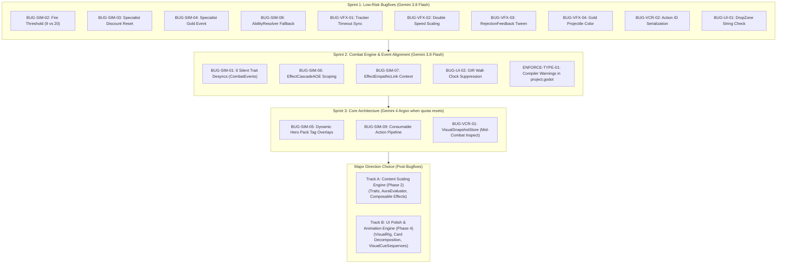

# Flashcard Heroes — Post-Phase 0 Issues & Bugfixes Backlog

> **Purpose**: This document tracks all concrete bugs, silent VCR desyncs, animation timing flaws, and structural coupling issues uncovered during the full codebase audit.
> Each issue details its **root cause**, **exact code locations**, **clean-code resolution strategy**, and **model recommendation** (`Gemini 3.8 Flash High` vs `Gemini 4 Argon`).
>
> **Important Rule Reminder**: In accordance with project rules, **never apply defensive patches or symptom workarounds**. When fixing an issue, address the underlying architectural cause so the entire class of bug cannot recur. If fixing an issue changes observable gameplay or visual behavior to match the documentation, user approval must be confirmed first.

---

## Quick Reference Index

| ID | Issue Title | Status | Severity |
| :--- | :--- | :---: | :--- |
| **`BUG-SIM-01`** | [6 Silent VCR Trait Desyncs in BattleManager](#bug-sim-01-6-silent-vcr-trait-desyncs-in-battlemanager) | **[RESOLVED]** | High (VCR Desync) |
| **`BUG-SIM-02`** | [Fire Trait Threshold Mismatch (9 vs 20 & L2 Burn)](#bug-sim-02-fire-trait-tier-3-threshold-mismatch-9-vs-20) | **[RESOLVED]** | Medium (Rule Inconsistency) |
| **`BUG-SIM-03`** | [Specialist Gacha Discount Never Resets Per Turn](#bug-sim-03-specialist-gacha-discount-never-resets-per-turn) | **[RESOLVED]** | High (Gameplay Bug) |
| **`BUG-SIM-04`** | [SPECIALIST >= 4 Gold Award Bypasses ON_GOLD_EARNED](#bug-sim-04-specialist--4-gold-award-bypasses-on_gold_earned) | **[RESOLVED]** | Medium (Event Bypass) |
| **`BUG-SIM-05`** | [Dynamic Hero Pack Tags Vanish on Save/Load](#bug-sim-05-dynamic-hero-pack-tags-vanish-on-saveload) | **[RESOLVED]** | High (Save Corruption) |
| **`BUG-SIM-06`** | [EffectShockwave Drains Unrelated Reactions](#bug-sim-06-effectcascadeaoe-drains-unrelated-reactions--drops-visuals) | **[RESOLVED]** | Medium (Reaction Queue) |
| **`BUG-SIM-07`** | [EffectEmpathicLink NPE Risk](#bug-sim-07-effectempathiclink-npe-risk-in-combatsimulator) | **[RESOLVED]** | Medium (Crash Risk) |
| **`BUG-SIM-08`** | [AbilityResolver Unknown Triggers Default to `return true`](#bug-sim-08-abilityresolver-unknown-triggers-default-to-return-true) | **[RESOLVED]** | High (Defensive Bug Trap) |
| **`BUG-SIM-09`** | [InventoryManager Bypasses EffectDefinition on Consumables](#bug-sim-09-inventorymanager-bypasses-effectdefinition-on-consumables) | **[RESOLVED]** | High (Content Pipeline) |
| **`BUG-VFX-01`** | [AnimationCompletionTracker Mid-Air Timeout Cutoffs](#bug-vfx-01-animationcompletiontracker-mid-air-timeout-cutoffs) | **[RESOLVED]** | High (Visual Snap Glitch) |
| **`BUG-VFX-02`** | [Double Speed-Scaling Bug in TokenSpendVFX](#bug-vfx-02-double-speed-scaling-bug-in-tokenspendvfx) | **[RESOLVED]** | Medium (Speed Factor) |
| **`BUG-VFX-03`** | [RejectionFeedback Unbound Tween Crash & Permanent Tilt](#bug-vfx-03-rejectionfeedback-unbound-tween-crash--permanent-tilt) | **[RESOLVED]** | Medium (Crash / UI Tilt) |
| **`BUG-VFX-04`** | [Missing "gold" & Status Colors in BuffNumberProjectile](#bug-vfx-04-missing-gold-color-branch-in-buffnumberprojectile) | **[RESOLVED]** | Low (Visual Consistency) |
| **`BUG-VCR-01`** | [Mid-Combat Inspection & Draw Reads Live Post-Turn State](#bug-vcr-01-mid-combat-inspection--draw-reads-live-post-turn-state) | **[RESOLVED]** | High (Snapshot Leak) |
| **`BUG-VCR-02`** | [Ephemeral Object Instance IDs Serialized into Replays](#bug-vcr-02-ephemeral-object-instance-ids-serialized-into-replays) | **[RESOLVED]** | High (Replay Collision) |
| **`BUG-UI-01`** | [Localized UI String Comparison for Scene Detection](#bug-ui-01-localized-ui-string-comparison-for-scene-detection) | **[RESOLVED]** | High (Localization Fragility) |
| **`BUG-UI-02`** | [Wall-Clock Input Suppression in GlobalInteractionRouter](#bug-ui-02-wall-clock-input-suppression-in-globalinteractionrouter) | **[RESOLVED]** | Medium (Frame-Rate Dependency) |
| **`ENFORCE-TYPE-01`** | [Strict GDScript Compiler Enforcement in project.godot](#5-static-typing--gdscript-compiler-enforcement-enforce-type-01) | **STEP 1 DONE (`=1`)** | High (Code Quality Gate) |
| **`TRACK-CONTENT`** | [Content Scaling Engine: Traits, Composable Effects & Auras](#track-a-rapid-content-scaling-engine-phase-2) | **PARTIAL** | Feature Engine |
| **`TRACK-UIVFX`** | [UI Polish & Animation Engine: VisualRig & VisualCueSequence](#track-b-ui-polish-animation--vfx-engine-phase-4) | **PARTIAL** | Visual Engine |

---

## 1. Active Gameplay & Combat Simulation Bugs

### `BUG-SIM-01`: 6 Silent VCR Trait Desyncs in BattleManager
- **Severity**: High (Causes puppet UI and replay state to desync from authoritative simulation)
- **Files & Lines**:
  - [BattleManager.gd:2223-2234](file:///Users/danhh/Desktop/Flashcard%20Heroes/scripts/BattleManager.gd#L2223-L2234) (`TANK >= 3` frontline armor & `MECHA >= 3` spikes)
  - [BattleManager.gd:2387-2395](file:///Users/danhh/Desktop/Flashcard%20Heroes/scripts/BattleManager.gd#L2387-L2395) (`PLANT >= 5` frontline spikes)
  - [BattleManager.gd:2505-2515](file:///Users/danhh/Desktop/Flashcard%20Heroes/scripts/BattleManager.gd#L2505-L2515) (`APPLIANCE` turn-start debuff conversion)
  - [BattleManager.gd:2529-2540](file:///Users/danhh/Desktop/Flashcard%20Heroes/scripts/BattleManager.gd#L2529-L2540) (`TANK >= 5` armor passing)
  - [BattleManager.gd:2787-2795](file:///Users/danhh/Desktop/Flashcard%20Heroes/scripts/BattleManager.gd#L2787-L2795) (`FIGHTER >= 5` post-combat bonus)
- **Root Cause**:
  Traits were hardcoded as imperative `for` loops inside [BattleManager.gd](file:///Users/danhh/Desktop/Flashcard%20Heroes/scripts/BattleManager.gd) phases. They directly modify `inst.add_status_effect(...)` or `inst.current_hp` **without creating or emitting a `CombatEvent`** into the turn sequence. The Puppet VCR view (`GachaBallView`) never receives an event to animate the armor or spikes gain, so visual stat numbers snap or disagree with the combat simulation.
- **Clean Resolution**:
  Route trait activations through standard `AbilityDefinition` resources evaluated by [AbilityResolver.gd](file:///Users/danhh/Desktop/Flashcard%20Heroes/scripts/AbilityResolver.gd) and [CombatSimulator.gd](file:///Users/danhh/Desktop/Flashcard%20Heroes/scripts/battle/CombatSimulator.gd). Every stat or status modification must generate a typed `CombatEvent.Type.BUFF` or `CombatEvent.Type.STATUS_EFFECT` with a `CombatPayload`.
- **Model**: `Gemini 3.8 Flash (High)`

---

### `BUG-SIM-02`: Fire Trait Tier-3 Threshold Mismatch (9 vs 20)
- **Severity**: Medium (Gameplay rule discrepancy between combat engine and constants/UI)
- **Files & Lines**:
  - [EffectHandlers.gd:258, 289](file:///Users/danhh/Desktop/Flashcard%20Heroes/scripts/battle/EffectHandlers.gd#L258) (`tier_count >= 9`)
  - [Constants.gd:242](file:///Users/danhh/Desktop/Flashcard%20Heroes/scripts/Constants.gd#L242) (`TRAIT_THRESHOLDS["fire"] = [3, 6, 12, 20, 32]`)
  - [BasicAttackEffect.gd:112](file:///Users/danhh/Desktop/Flashcard%20Heroes/scripts/BasicAttackEffect.gd#L112) (`fire_count >= 20`)
- **Root Cause**:
  Thresholds were duplicated as magic numbers across multiple scripts instead of reading from a single authoritative source. [EffectHandlers.gd](file:///Users/danhh/Desktop/Flashcard%20Heroes/scripts/battle/EffectHandlers.gd) used legacy threshold `9` (from a 3/6/9 iteration), while [Constants.gd](file:///Users/danhh/Desktop/Flashcard%20Heroes/scripts/Constants.gd) and [BasicAttackEffect.gd](file:///Users/danhh/Desktop/Flashcard%20Heroes/scripts/BasicAttackEffect.gd) updated to `20`.
- **Clean Resolution**:
  Read trait thresholds strictly from `Constants.TRAIT_THRESHOLDS` (and eventually `TraitDefinition.tres` in Phase 2). Delete all hardcoded integer checks.
- **User Approval Required**: Confirm whether `12` or `20` is the intended Tier 3 threshold for Fire Soul synergy.
- **Model**: `Gemini 3.8 Flash (High)`

---

### `BUG-SIM-03`: Specialist Gacha Discount Never Resets Per Turn
- **Severity**: High (Makes a "once per turn" discount trigger only "once per battle")
- **Files & Lines**:
  - [BattleManager.gd:1348](file:///Users/danhh/Desktop/Flashcard%20Heroes/scripts/BattleManager.gd#L1348) (`set_meta("specialist_gacha_discount_used", true)`)
- **Root Cause**:
  The specialist trait allows drawing a GachaBall at a 1-token discount once per turn. The implementation stored this flag via Node metadata (`set_meta`) and never cleared it when changing phases or starting a new turn. Consequently, after the player uses the discount once on Turn 1, the flag remains `true` for the rest of the battle. Furthermore, `set_meta` is invisible to `BattleState` serialization and replay digests.
- **Clean Resolution**:
  Store `specialist_gacha_discount_used: bool` inside `BattleState`'s turn state structure, and reset it in `BattleState.clear_turn_data()`.
- **Model**: `Gemini 3.8 Flash (High)`

---

### `BUG-SIM-04`: SPECIALIST >= 4 Gold Award Bypasses ON_GOLD_EARNED
- **Severity**: Medium (Breaks passive triggers that listen for gold income)
- **Files & Lines**:
  - [BattleManager.gd:2798](file:///Users/danhh/Desktop/Flashcard%20Heroes/scripts/BattleManager.gd#L2798) (`run_state.gold += 3`)
- **Root Cause**:
  When combat ends with 4+ Specialists, the script directly increments `run_state.gold += 3`. This bypasses `RunState.earn_gold()`, meaning `SignalBus.gold_earned` is not emitted and abilities that trigger on `TRIGGER_ON_GOLD_EARNED` never fire.
- **Clean Resolution**:
  Call `run_state.earn_gold(3, &"trait_specialist")` (or dispatch a `GrantCurrencyAction`).
- **Model**: `Gemini 3.8 Flash (High)`

---

### `BUG-SIM-05`: Dynamic Hero Pack Tags Vanish on Save/Load
- **Status**: [RESOLVED]
- **Severity**: High (Run save/load state corruption)
- **Files & Lines**:
  - [RunState.gd](file:///Users/danhh/Desktop/Flashcard%20Heroes/scripts/RunState.gd) (`hero_element`, `dynamic_tag_overrides`, `_adapt_hero_pack`, `get_effective_unit_tags`, `to_save_dict`, `from_save_dict`)
  - [GachaBallInstance.gd](file:///Users/danhh/Desktop/Flashcard%20Heroes/scripts/GachaBallInstance.gd) (`_build_definition_components`)
  - [MergeManager.gd](file:///Users/danhh/Desktop/Flashcard%20Heroes/scripts/MergeManager.gd) (`_perform_merge_logic`)
  - [BattleManager.gd](file:///Users/danhh/Desktop/Flashcard%20Heroes/scripts/BattleManager.gd) (`execute_hero_entrance_sequence`)
  - [GachaBallView.gd](file:///Users/danhh/Desktop/Flashcard%20Heroes/scripts/GachaBallView.gd) (`_update_trait_trinket_visuals`, `_get_run_trait_count_for_view`, `_on_run_data_changed`)
- **Root Cause**:
  When a Hero Pack like Bounty Hunter or Starter rolls a dynamic element (Fire, Water, etc.), `RunState._adapt_hero_pack()` directly mutated the shared `def.tags` array directly on `Database.units["?MerSpe"]`. When loading a saved run from disk via `from_save_dict()`, `_adapt_hero_pack()` was never called, so units lost their dynamic elemental soul tags upon continuing a run. In addition, in-memory mutation contaminated subsequent runs and the loadout screen. In combat, `execute_hero_entrance_sequence()` did not emit `_emit_battle_inventory_changed()`, leaving trait trinket visual badges stale.
- **Clean Resolution**:
  Treated all `Database` resources as strictly immutable flyweights. Run-level dynamic tags are kept in `RunState.dynamic_tag_overrides`, serialized via `to_save_dict`, and queried by `GachaBallInstance._build_definition_components()` and `MergeManager`. In `BattleManager.execute_hero_entrance_sequence()`, `_emit_battle_inventory_changed()` is emitted immediately upon hero entrance. In `GachaBallView._update_trait_trinket_visuals()`, outside-of-battle trait counts query `_get_run_trait_count_for_view()`.
- **Model**: `Gemini 4 Argon`

---

### `BUG-SIM-06`: EffectCascadeAOE Drains Unrelated Reactions & Drops Visuals
- **Severity**: Medium (Causal reaction order corruption)
- **Files & Lines**:
  - [EffectCascadeAOE.gd:103](file:///Users/danhh/Desktop/Flashcard%20Heroes/scripts/effects/EffectCascadeAOE.gd#L103) (`drain_pending_reactions_inline(0)`)
- **Root Cause**:
  `EffectCascadeAOE` calls `drain_pending_reactions_inline(0)` with depth `0`. Depth `0` is the root queue, which drains all unrelated reactions currently queued from other triggers. Additionally, the returned `CombatEvent`s from the drained reactions are discarded rather than appended to the turn's event log.
- **Clean Resolution**:
  Use `CausalReactionResolver.begin_scope()` and `drain_scope()` so cascade damage only drains reactions caused by the cascade itself, and append all resulting events to the return payload.
- **Model**: `Gemini 3.8 Flash (High)`

---

### `BUG-SIM-07`: EffectEmpathicLink NPE Risk in CombatSimulator
- **Severity**: Medium (Crash risk during headless combat simulation)
- **Files & Lines**:
  - [EffectEmpathicLink.gd:22, 51](file:///Users/danhh/Desktop/Flashcard%20Heroes/scripts/effects/EffectEmpathicLink.gd#L22) (`context.get("battle_manager")`)
- **Root Cause**:
  `EffectEmpathicLink.gd` expects `context["battle_manager"]`. However, when called from `CombatSimulator.gd` or headless test harnesses, the context passes `"simulator"` instead of `"battle_manager"`. This results in a `null` dereference if triggered headlessly.
- **Clean Resolution**:
  Pass a unified `SimContext` interface that abstracts both `BattleManager` and `CombatSimulator` via polymorphic state queries.
- **Model**: `Gemini 3.8 Flash (High)`

---

### `BUG-SIM-08`: AbilityResolver Unknown Triggers Default to `return true`
- **Severity**: High (Silent bug trap: unknown triggers cause every entity to respond)
- **Files & Lines**:
  - [AbilityResolver.gd:186, 251, 298](file:///Users/danhh/Desktop/Flashcard%20Heroes/scripts/AbilityResolver.gd#L186) (`_should_unit_respond`, `_should_item_respond`, `_should_trinket_respond`)
- **Root Cause**:
  When an ability has a trigger string that is not explicitly handled in `_should_*_respond()`, the match statement falls through to `return true` as a "defensive default". If someone typos a trigger name (e.g., `"on_deat"` instead of `"on_death"`), the ability responds to **every single event** in the game!
- **Clean Resolution**:
  Change the fallback from `return true` to `return false`, and in debug builds assert on unrecognized trigger strings (`assert(TRIGGER_TYPES.has(trigger), "Unknown trigger: %s" % trigger)`).
- **Model**: `Gemini 3.8 Flash (High)`

---

### `BUG-SIM-09`: InventoryManager Bypasses EffectDefinition on Consumables
- **Severity**: High (Content pipeline inconsistency: consumables work in battle but break outside battle)
- **Files & Lines**:
  - [InventoryManager.gd:371-404](file:///Users/danhh/Desktop/Flashcard%20Heroes/scripts/InventoryManager.gd#L371-L404) (`_use_consumable_simple`)
- **Root Cause**:
  When using a consumable outside combat (e.g. at a shop or rest site), `_use_consumable_simple` hardcodes a manual `modify_hp` / `modify_pwr` check and completely skips loading or executing the consumable's `EffectDefinition.execute()` script. Any consumable with a non-stat effect (e.g., cleanse, grant token, transform) silently does nothing outside battle!
- **Clean Resolution**:
  Route consumable usage through a unified `UseConsumableAction` that delegates to `EffectDefinition.execute()` regardless of whether the game is currently in battle or in camp.
- **Model**: `Gemini 4 Argon`

---

## 2. Animation, VFX & Presentation Bugs

### `BUG-VFX-01`: AnimationCompletionTracker Mid-Air Timeout Cutoffs
- **Severity**: High (Visual glitch: saved units snap mid-air, attacks start before landing)
- **Files & Lines**:
  - [AnimationCompletionTracker.gd:23-33](file:///Users/danhh/Desktop/Flashcard%20Heroes/scripts/animations/AnimationCompletionTracker.gd#L23-L33) (`TIMEOUTS`)
  - [AnimationConstants.gd:85-87](file:///Users/danhh/Desktop/Flashcard%20Heroes/scripts/animations/AnimationConstants.gd#L85-L87) (`LETHAL_SAVE_RISE (0.5) + HOLD (0.3) + LAND (0.6) = 1.4s`)
  - [AnimationConstants.gd:60](file:///Users/danhh/Desktop/Flashcard%20Heroes/scripts/animations/AnimationConstants.gd#L60) (`DEATH_DURATION = 1.0s`)
- **Root Cause**:
  `AnimationCompletionTracker.gd` defines hardcoded `TIMEOUTS` that are shorter than the actual animation durations defined in `AnimationConstants.gd`:
  - `TIMEOUTS[AnimationType.LETHAL_SAVE]` is **`0.8s`**, but the animation is **`1.4s`**. The tracker times out and resolves completion at `0.8s` while the unit is still floating in the air.
  - `TIMEOUTS[AnimationType.DEATH_FADE]` is **`0.8s`**, but death fade is **`1.0s`**.
- **Clean Resolution**:
  Compute `TIMEOUTS` directly from `AnimationConstants` constants plus a safety buffer, or replace polling with direct tween completion signals.
- **Model**: `Gemini 3.8 Flash (High)`

---

### `BUG-VFX-02`: Double Speed-Scaling Bug in TokenSpendVFX
- **Severity**: Medium (VFX runs 9x faster instead of 3x at 3x combat speed)
- **Files & Lines**:
  - [CurrencyAnimator.gd:176, 196](file:///Users/danhh/Desktop/Flashcard%20Heroes/scripts/CurrencyAnimator.gd#L176) (`var stagger_delay = AnimationConstants.scaled(0.12)`)
  - [TokenSpendVFX.gd:70](file:///Users/danhh/Desktop/Flashcard%20Heroes/scripts/vfx/TokenSpendVFX.gd#L70) (`AnimationConstants.scaled(delay)`)
- **Root Cause**:
  `CurrencyAnimator` pre-scales `stagger_delay` by dividing by `speed_factor`, then passes it to `TokenSpendVFX.play()`. Inside `TokenSpendVFX.play()`, it calls `AnimationConstants.scaled()` a **second time**, dividing by `speed_factor` twice. At 3x speed, the delay is scaled by $3^2 = 9\times$ faster!
- **Clean Resolution**:
  Pass raw unscaled base durations to VFX helpers and let the VFX helper scale them once internally.
- **Model**: `Gemini 3.8 Flash (High)`

---

### `BUG-VFX-03`: RejectionFeedback Unbound Tween Crash & Permanent Tilt
- **Severity**: Medium (Crash on rapid clicks and permanently tilted UI cards)
- **Files & Lines**:
  - [RejectionFeedback.gd:24-45](file:///Users/danhh/Desktop/Flashcard%20Heroes/scripts/vfx/RejectionFeedback.gd#L24-L45)
- **Root Cause**:
  1. `tree.create_tween()` is used without binding to `target`. If `target` is freed while the rejection animation is playing, the reset callback crashes on a freed instance.
  2. Rapid double-clicks capture the current mid-shake rotation as `original_rotation`, permanently tilting the card.
- **Clean Resolution**:
  Use `target.create_tween()` (bound to lifecycle) and reset `target.rotation = 0.0` explicitly rather than capturing intermediate transform states.
- **Model**: `Gemini 3.8 Flash (High)`

---

### `BUG-VFX-04`: Missing "gold" Color Branch in BuffNumberProjectile
- **Severity**: Low (Missing projectile color styling)
- **Files & Lines**:
  - [BuffNumberProjectile.gd:34-44](file:///Users/danhh/Desktop/Flashcard%20Heroes/scripts/vfx/BuffNumberProjectile.gd#L34-L44)
  - [RestSite.gd:471-473](file:///Users/danhh/Desktop/Flashcard%20Heroes/scripts/RestSite.gd#L471-L473)
- **Root Cause**:
  `RestSite.gd` Gambling Den spawns a buff number projectile with `type_str = "gold"`, but `BuffNumberProjectile.setup()` only has color branches for `"hp"`, `"pwr"`, `"burn"`, `"spikes"`, and `"armor"`.
- **Clean Resolution**:
  Add a `"gold"` branch to `BuffNumberProjectile.gd` using `AnimationConstants.COLOR_GOLD`.
- **Model**: `Gemini 3.8 Flash (High)`

---

## 3. VCR Playback & Command Pipeline Violations

### `BUG-VCR-01`: Mid-Combat Inspection & Draw Reads Live Post-Turn State
- **Status**: [RESOLVED]
- **Severity**: High (Violates the Snapshot Rule: players see future end-of-turn stats)
- **Resolution**:
  Added pure `RefCounted` [VisualSnapshotStore.gd](file:///Users/danhh/Desktop/Flashcard%20Heroes/scripts/battle/VisualSnapshotStore.gd) driven strictly by `BattleAnimator` (`begin_playback`, `apply_event`, `end_playback`). During active VCR playback, `WindowManager._derive_window_payload()` materializes read-only snapshot instances (`is_vcr_snapshot = true`, `snapshot_instances_db`) instead of querying live `BattleManager`, `UnitInspectionWindow`/`ItemInspectionWindow` suppress live signal refreshes, and `BattleAnimator`/`BattleView` prefer snapshot data over live lookups. Verified by Suite 10 VCR Snapshot Isolation & Puppet-Parity tests in [run_fast_suite.gd](file:///Users/danhh/Desktop/Flashcard%20Heroes/tests/run_fast_suite.gd).

---

### `BUG-VCR-02`: Ephemeral Object Instance IDs Serialized into Replays
- **Severity**: High (Breaks replay playback and causes random object collisions)
- **Files & Lines**:
  - [InspectEntityAction.gd:50-53, 143](file:///Users/danhh/Desktop/Flashcard%20Heroes/scripts/engine/actions/InspectEntityAction.gd#L50-L53)
  - [CancelDragAction.gd:33-36, 97](file:///Users/danhh/Desktop/Flashcard%20Heroes/scripts/engine/actions/CancelDragAction.gd#L33-L36)
- **Root Cause**:
  These actions serialize `Control.get_instance_id()` integers into replay JSON files and call `instance_from_id()` on playback. Godot instance IDs are ephemeral memory addresses that change every execution, causing replay playback to crash or mutate unrelated objects.
- **Clean Resolution**:
  Replace `anchor_view_id` with logical `LocationIdentifier` strings/structs resolved via an O(1) `ViewRegistry`.
- **Model**: `Gemini 3.8 Flash (High)`

---

## 4. UI Architecture & Robustness Issues

### `BUG-UI-01`: Localized UI String Comparison for Scene Detection
- **Severity**: High (Localization edits break gameplay interaction logic)
- **Files & Lines**:
  - [Main.gd:1315, 1369, 1401](file:///Users/danhh/Desktop/Flashcard%20Heroes/scripts/Main.gd#L1315) (`if _action_zone_1_text == tr("ui.utg_drop_hp"):`)
- **Root Cause**:
  `Main.gd` determines whether the active scene is `UnitTrainingGround` versus `Shrine` by checking if a UI label matches a translated string! Changing the Portuguese or English translation string silently breaks drop-target validation.
- **Clean Resolution**:
  Have encounters register a typed `EncounterDropZoneDescriptor` struct declaring their callback actions and drop conditions explicitly.
- **Model**: `Gemini 3.8 Flash (High)`

---

### `BUG-UI-02`: Wall-Clock Input Suppression in GlobalInteractionRouter
- **Status**: [RESOLVED]
- **Severity**: Medium (Frame-rate and time-scale dependent input drops)
- **Resolution**:
  Replaced all `Time.get_ticks_msec()` close-suppression windows in [GlobalInteractionRouter.gd](file:///Users/danhh/Desktop/Flashcard%20Heroes/scripts/GlobalInteractionRouter.gd) with deterministic process-frame (`Engine.get_process_frames()`) and `ActionQueue.is_busy()` lifecycle gating (`_arm_close_suppression`, `_is_close_suppression_active`), and replaced wall-clock post-drop suppression in [InspectionPeekController.gd](file:///Users/danhh/Desktop/Flashcard%20Heroes/scripts/ui/InspectionPeekController.gd) with a node-bound `Timer`. Verified by Suite 10 deterministic frame-expiration assertions in [run_fast_suite.gd](file:///Users/danhh/Desktop/Flashcard%20Heroes/tests/run_fast_suite.gd).

---

## 5. Static Typing & GDScript Compiler Enforcement (`ENFORCE-TYPE-01`)

### Objective
Turn Godot 4.6's analyzer into an automatic, compile-time pair-reviewer under `[debug] gdscript/warnings/` in [project.godot](file:///Users/danhh/Desktop/Flashcard%20Heroes/project.godot). This forces **Gemini 3.8 Flash (High)** to write 100% typed, non-duck-typed code and prevents duck-typing anti-patterns (`.has_method(`, untyped `var x = ...`, and untyped Variant calls) from ever being written.

### The Problem Today
- Currently, **`0` compiler warning or error flags** are configured in `project.godot`.
- **`55.8%` of local variables (`4,188 / 7,510`)** are completely untyped (`var x = ...`).
- **`963` untyped `Dictionary`** vs. only **`1`** typed `Dictionary[K, V]`.
- **`2,915` `is_instance_valid`** guards and **`393` `.has_method`** calls mask broken contracts at runtime instead of failing fast.

### Compiler Settings to Enable (Incremental Roadmap)
In [project.godot](file:///Users/danhh/Desktop/Flashcard%20Heroes/project.godot) under `[debug]`:
```ini
[debug]
gdscript/warnings/untyped_declaration=1         ; 1 = Warning during cleanup, 2 = Error when clean
gdscript/warnings/unsafe_property_access=1      ; Warns on untyped Variant property lookups
gdscript/warnings/unsafe_method_access=1        ; Warns on untyped Variant method calls
gdscript/warnings/unsafe_call_argument=1        ; Warns when passing untyped Variant to typed param
gdscript/warnings/return_value_discarded=1       ; Catches unhandled function returns
gdscript/warnings/shadowed_variable=2            ; 2 = Error: prevents local variables shadowing members
```

### Module-by-Module Migration Strategy
1. **Step 1 (Zero-Risk)**: Enable as **Warnings (`1`)** across the project. Game still runs and compiles normally, but the Godot editor and CLI test runner log warnings.
2. **Step 2 (Lock Clean Folders to Errors `2`)**: As we clean each domain, lock that domain to strict **Errors (`2`)**:
   - First: `tests/` and new `.agents/scripts/` (strictly Error `2`).
   - Second: `scripts/engine/actions/` and `scripts/battle/` (strictly Error `2`).
   - Third: `scripts/content/effects/` and `resources/` (strictly Error `2`).
   - Fourth: UI and Presentation scripts (`scripts/ui/`, `scripts/animations/`).
3. **Fail-Fast Replacements**:
   - Replace `if obj.has_method("foo"): obj.foo()` with explicit static type checks: `var view := obj as GachaBallView; if view: view.foo()`.
   - Replace defensive `is_instance_valid(self)` with standard internal calls.
   - Replace untyped parameter dictionaries with typed DTO `RefCounted` classes (like `CombatPayload`).

- **Model**: `Gemini 3.8 Flash (High)` (can convert files folder-by-folder once configured).

---

## 6. Post-Guardrail Roadmap Tracks: Content Scaling vs. UI/VFX Polish

Once Phase 0 guardrails and the Phase 1 bugfixes are in place, future work divides into two major parallel tracks. You can choose to prioritize either track depending on your near-term game milestone:

### Track A: Rapid Content Scaling Engine (Phase 2)
> **Goal**: Make adding new Hero Packs (e.g. Bounty Hunter, Apprentice), units, items, trinkets, and traits require **zero edits to core engine files** (`BattleManager.gd`, `BattleView.gd`, `EffectHandlers.gd`).

1. **`TraitRulesEngine` Extraction & Threshold Unification (`[PARTIAL — CORE ENGINE DONE]`)**:
   - **[DONE]** Extracted all inline combat trait rules and threshold math from `BattleManager.gd`, `BasicAttackEffect.gd`, `EffectHandlers.gd`, `BattleHelpers.gd`, `KnockoutProcessor.gd`, and all 18 active `scripts/effects/EffectTrait*.gd` scripts into pure simulation module [TraitRulesEngine.gd](file:///Users/danhh/Desktop/Flashcard%20Heroes/scripts/battle/TraitRulesEngine.gd). 100% of tier checks now derive strictly from `Constants.TRAIT_DEFINITIONS["levels"]` (`get_tier`/`get_active_tier`/`has_tier`/`get_tier_min`), leaving zero hardcoded trait threshold integers in simulation or effect scripts (including fixing a lingering stale `fire_level >= 9` check in `EffectHandlers.gd`).
   - **[DONE]** Further decomposed `BattleManager.gd` (**4,190 → 3,152 LOC**, -1,038 lines / -24.8%) by extracting [BoardStatDiffBuilder.gd](file:///Users/danhh/Desktop/Flashcard%20Heroes/scripts/battle/BoardStatDiffBuilder.gd), [StatusTickProcessor.gd](file:///Users/danhh/Desktop/Flashcard%20Heroes/scripts/battle/StatusTickProcessor.gd), and presentation-layer [BattleEntranceSequencer.gd](file:///Users/danhh/Desktop/Flashcard%20Heroes/scripts/ui/BattleEntranceSequencer.gd), and eliminating all remaining `.has_method(` duck-typing guards in `scripts/battle/`, `BattleManager.gd`, and `MergeManager.gd` (now **0**).
   - **[REMAINING]** Promote traits into `TraitDefinition` & `HeroPackDefinition` `.tres` resources (`id`, `display_name_key`, `icon`, `badge_color`, `sort_priority`, `tier_thresholds`, `tier_abilities`) evaluated via `AbilityResolver`.
2. **Derived `AuraEvaluator` (Continuous Stat Queries) (`[DONE]`)**:
   - **[DONE]** Implemented pure simulation [AuraEvaluator.gd](file:///Users/danhh/Desktop/Flashcard%20Heroes/scripts/battle/AuraEvaluator.gd) backed by first-class `GachaBallInstance.active_auras` (serialized, deep-copied for simulation, and snapshotted in `VisualSnapshotStore` for VCR Puppet Mode).
   - Migrated all 9 continuous aura scripts (`EffectRustyRingBuff`, `EffectRustyRingPassive`, `EffectBuffDrawnUnit`, `EffectBuffHighLevelUnit`, `EffectTwinCharmScaling`, `EffectDopplegangerScaling`, `EffectSlimeCellScaling`, `EffectGoldenSealScaling`, `EffectUpdatePwrToTokens`) onto `AuraEvaluator` — zero fake `status_effects`, `dynamic_tags`, or `set_meta` flags.
   - Deleted **246 lines** of hardcoded aura/trinket compensation math from [MergeManager.gd](file:///Users/danhh/Desktop/Flashcard%20Heroes/scripts/MergeManager.gd) (**626 → 380 LOC**, -39.3%); merges now filter strictly by `component.source_type == &"AURA"` and delegate level-up expiry to `AuraEvaluator.prepare_level_up_auras` / `drain_expired_auras`.
3. **Composable Atomic `Effect` Primitives + `ValueProvider`s + Tiered Arrays**:
   - Replace 75 bespoke `Effect*.gd` files with **~15 atomic `EffectDefinition` subclasses** (`ModifyStatEffect`, `DealDamageEffect`, `HealEffect`, `ApplyStatusEffect`, `SpawnEntityEffect`, `TransformEntityEffect`, `GrantCurrencyEffect`, `ConditionalEffect`, `RepeatEffect`).
   - Support tiered level arrays: `@export var amounts_by_level: PackedInt32Array = [3, 6, 12]` (cuts `.tres` file volume by 60%+).
   - Retire the dead `is_simulation` flag and replace untyped `context: Dictionary` with typed `SimContext`.
4. **100% Unified `status_effects` Pipeline**:
   - Migrate remaining hardcoded status fields (`burn_stacks`, `armor_stacks`, `spikes_stacks`) into data-driven `StatusEffectDefinition` hooks.

- **Model**: `Gemini 3.8 Flash (High)` for Effect primitives & Trait definitions; `Gemini 4 Argon` for `AuraEvaluator` core architecture.

---

### Track B: UI Polish, Animation & VFX Engine (Phase 4)
> **Goal**: Achieve *Cross Blitz*-level tactile polish, juicy animations, custom ability visual choreographies, and rubber-toy drag physics without breaking combat state, input gating, or Puppet Mode VCR playback.

1. **The `VisualRig` Transform Contract**:
   - Establish a clean 5-layer hierarchy: `SlotView` (Container layout owner — never scaled or top-level) $\rightarrow$ `VisualRig` $\rightarrow$ `MotionPivot` (Lunges, hops, recoils) $\rightarrow$ `DeformPivot` (Squash, stretch, hover tilt) $\rightarrow$ `EntityVisualCanvas` (Sprite, capsule, shader stack) + `StatsOverlayView`.
   - Never set `top_level = true` on a Control inside a container.
   - Bind **100% of Tweens** to the node being animated (`create_tween()`, never unbound `get_tree().create_tween()`).
2. **Decompose the 5 UI Monoliths (`8,804` LOC combined)**:
   - **`GachaBallView.gd` (`2,674 → 1,672` LOC, -37.5%)** $\rightarrow$ Extracted:
     - [GachaBallStatusStrip.gd](file:///Users/danhh/Desktop/Flashcard%20Heroes/scripts/ui/GachaBallStatusStrip.gd) (**[DONE]** — battle/overlay stat layouts, plastic pill styling, dynamic status icons, stat/status pop animations with typed tween tracking, and tooltip click routing),
     - [GachaBallDragController.gd](file:///Users/danhh/Desktop/Flashcard%20Heroes/scripts/ui/GachaBallDragController.gd) (**[DONE]** — rubber-toy velocity deformation, padded shader drag preview construction, drag notification lifecycle, snap-back, landing bounce, and trinket activation bounce),
     - [GachaBallHoverOutlineController.gd](file:///Users/danhh/Desktop/Flashcard%20Heroes/scripts/ui/GachaBallHoverOutlineController.gd) (**[DONE]** — hover/press tweening, z-index draw priority, selection feedback, and priority-ordered shader outline resolution).
     - Eliminated all **8** `.has_method(` and **4** `is_instance_valid(ActionQueue)` guards in `GachaBallView.gd` (now **0**).
     - Remaining: optional `.tscn` composition split (`BattleUnitCardView.tscn`, `CapsuleItemView.tscn`, `TrinketBadgeView.tscn`).
   - **`Main.gd` (`1,830 → 658` LOC, -64.0%)** $\rightarrow$ Extracted:
     - [EncounterDropZoneBar.gd](file:///Users/danhh/Desktop/Flashcard%20Heroes/scripts/ui/EncounterDropZoneBar.gd) (**[DONE]** — Confirm, Shrine/UTG Split Action + Instruction, and Reward Collect/Sell drop-zone overlays with typed `ActionZoneCategoryFilter`),
     - [HudTopBarPresenter.gd](file:///Users/danhh/Desktop/Flashcard%20Heroes/scripts/ui/HudTopBarPresenter.gd) (**[DONE]** — visual gold/token/bonus-timer counters, animation locks, typed pop tweens, day label, and speed/pause controls),
     - [GachaMachineBarPresenter.gd](file:///Users/danhh/Desktop/Flashcard%20Heroes/scripts/ui/GachaMachineBarPresenter.gd) (**[DONE]** — tier badges, cost/count labels, knob hover, draw choreography, and vertical landing bounces).
     - Eliminated all **18** `.has_method(`, **4** `.has_signal(`, and **5** `is_instance_valid(ActionQueue)` guards in `Main.gd` (now **0**).
   - **`WindowManager.gd` (`2,571 → 1,448` LOC, -43.7%)** $\rightarrow$ Extracted:
     - [LocationViewRegistry.gd](file:///Users/danhh/Desktop/Flashcard%20Heroes/scripts/ui/LocationViewRegistry.gd) (**[DONE]** — O(1) dictionary lookups replacing full-tree BFS),
     - [TooltipPositioner.gd](file:///Users/danhh/Desktop/Flashcard%20Heroes/scripts/ui/TooltipPositioner.gd) (**[DONE]** — pure screen-space rect, sizing, and viewport clamping math),
     - [DrawerAnimator.gd](file:///Users/danhh/Desktop/Flashcard%20Heroes/scripts/ui/DrawerAnimator.gd) (**[DONE]** — typed tween/open-close state machine replacing `wm_opening`/`wm_closing`/`wm_anim_tween` metadata flags, dead vertical step helpers, and 13 `.has_method(` guards),
     - [GlossaryClusterController.gd](file:///Users/danhh/Desktop/Flashcard%20Heroes/scripts/ui/GlossaryClusterController.gd) (**[DONE]** — recursive glossary spec BFS, multi-column outward tray layout, modal child windows, glossary toggle pill, plus fixed duplicate `remove_at(i)` bug).
     - Remaining: optional `ModalStackController` extraction & synchronous minimum-size math.
   - **`BattleAnimator.gd` (`1,567 → 427` LOC, -72.8%)** $\rightarrow$ Extracted:
     - [BattlePuppetRegistry.gd](file:///Users/danhh/Desktop/Flashcard%20Heroes/scripts/animations/BattlePuppetRegistry.gd) (**[DONE]** — VCR puppet registration, board slot lookups, screen-space position snapshots, trinket view lookup/activation, and snapshot-first item/holder resolution),
     - [BattleBoardEventPresenter.gd](file:///Users/danhh/Desktop/Flashcard%20Heroes/scripts/animations/BattleBoardEventPresenter.gd) (**[DONE]** — `DRAW`, `SUMMON`, unified currency/timer animations, `ITEM_TRANSFER`, `ITEM_DISCARD`, `ITEM_EQUIP`, incubator `MOVE`, player death departure, and deduplicated capsule arc tossing).
     - Eliminated all **38+** `.has_method(` and `.has_signal(` guards and dead legacy state in `BattleAnimator.gd` (now **0**).
   - **`BattleView.gd` (`1,348 → 487` LOC, -63.9%)** $\rightarrow$ Extracted:
     - [BattleTurnPreviewOverlay.gd](file:///Users/danhh/Desktop/Flashcard%20Heroes/scripts/ui/BattleTurnPreviewOverlay.gd) (**[DONE]** — actor order number overlay and held turn preview board),
     - [BattleDrawAnimator.gd](file:///Users/danhh/Desktop/Flashcard%20Heroes/scripts/ui/BattleDrawAnimator.gd) (**[DONE]** — gacha draw flight & landing choreography, initial unit entry stagger, capsule-open VFX, deduplicated snapshot/live draw visual resolution, and battle tutorials).
     - Deleted **204 LOC** of unreferenced legacy Trait HUD code and unified machine landing/reaction bounces via static helpers on [GachaMachineBarPresenter.gd](file:///Users/danhh/Desktop/Flashcard%20Heroes/scripts/ui/GachaMachineBarPresenter.gd). Eliminated all **25** `.has_method(` / `.has_signal(` / `is_instance_valid(ActionQueue)` guards (now **0**).
   - **`GlobalInteractionRouter.gd` (`1,242 → 718` LOC, -42.2%)** $\rightarrow$ Extracted:
     - [InteractionTargetRules.gd](file:///Users/danhh/Desktop/Flashcard%20Heroes/scripts/ui/InteractionTargetRules.gd) (**[DONE]** — pure container functional-group mapping, tier-change detection, valid action/move targeting rules, and view instance lookup),
     - [DragSessionController.gd](file:///Users/danhh/Desktop/Flashcard%20Heroes/scripts/ui/DragSessionController.gd) (**[DONE]** — centralized drag session state, placeholder/source visibility, overlay preview tracking, and `DragPreviewLayer` lifecycle),
     - [CloseSuppressionState.gd](file:///Users/danhh/Desktop/Flashcard%20Heroes/scripts/ui/CloseSuppressionState.gd) (**[DONE]** — deterministic frame/action-scoped close suppression state machine).
     - Eliminated all **28** `.has_method(` / `.has_signal(` / `is_instance_valid(ActionQueue)` guards (now **0**).
   - **`GameManager.gd` (`1,525 → 669` LOC, -56.1%)** $\rightarrow$ Extracted:
     - [PathNodeGenerator.gd](file:///Users/danhh/Desktop/Flashcard%20Heroes/scripts/systems/PathNodeGenerator.gd) (**[DONE]** — deduplicated daily path node pool construction & deterministic RNG draw ordering),
     - [ReplayStateSerializer.gd](file:///Users/danhh/Desktop/Flashcard%20Heroes/scripts/systems/ReplayStateSerializer.gd) (**[DONE]** — logical/replay state snapshots, temporary encounter container serialization, and `DirectorRunState` checkpointing),
     - [EncounterTransactionEngine.gd](file:///Users/danhh/Desktop/Flashcard%20Heroes/scripts/systems/EncounterTransactionEngine.gd) (**[DONE]** — authoritative Shop, Reward/Elite Reward, Shrine, RestSite, and Dojo transaction simulations & director state updates).
     - Eliminated all **16** `.has_method(` / `is_instance_valid(ActionQueue)` guards (now **0**).
   - **Consolidate Duplicate Encounters & Animators**: Replace the **14 copy-pasted Bezier/parabolic ball-toss implementations** with shared [ArcTossAnimator.gd](file:///Users/danhh/Desktop/Flashcard%20Heroes/scripts/ui/ArcTossAnimator.gd) (**[DONE]**), lift shared inspection window layout/recipe/preview helpers into [InspectionWindow.gd](file:///Users/danhh/Desktop/Flashcard%20Heroes/scripts/InspectionWindow.gd) (**[DONE]**), and consolidate all 6 encounter scenes — `Reward` (`773 → 415`), `RewardElite` (`542 → 280`), `Shop` (`460 → 275`), `UnitTrainingGround` (`700 → 433`), `Shrine` (`570 → 261`), and `RestSite` (`524 → 416`) — onto shared [EncounterBase.gd](file:///Users/danhh/Desktop/Flashcard%20Heroes/scripts/ui/EncounterBase.gd) (`433` LOC, net `-1,056` LOC, all **150** defensive guards eliminated) (**[DONE]**).
   - **Project-Wide Fail-Fast Guard Sweep (`scripts/`)**: Eliminated **100%** of remaining `.has_method(`, `.has_signal(`, `is_instance_valid(ActionQueue)`, and `is_instance_valid(self)` defensive guards across the entire `scripts/` codebase — including animations, core UI/inventory, replay/recorder, `FlashcardMinigame`, and all 32 `scripts/engine/actions/` scripts (**0 defensive guards remaining project-wide**) (**[DONE]**).
3. **Data-Driven `VisualCueSequence` Resources**:
   - Route remaining inline board event choreography (`BattleBoardEventPresenter`) through `AnimationRegistry` / `VisualCueSequence.tres` (`caster_cue` $\rightarrow$ `delivery_cue` $\rightarrow$ `impact_cue`) so adding custom ability animations requires zero edits to engine core.
   - Replace reflection-based `ArtStyleManager` with Godot Theme variations.

- **Model**: `Gemini 3.8 Flash (High)` for UI views, VFX shaders & animations; `Gemini 4 Argon` for `VisualRig` core layout & `WindowManager` decomposition.

---

## 7. Strategic Execution Order

When Phase 0 (Guardrails & Headless Suite) is completed and we begin tackling this backlog:


