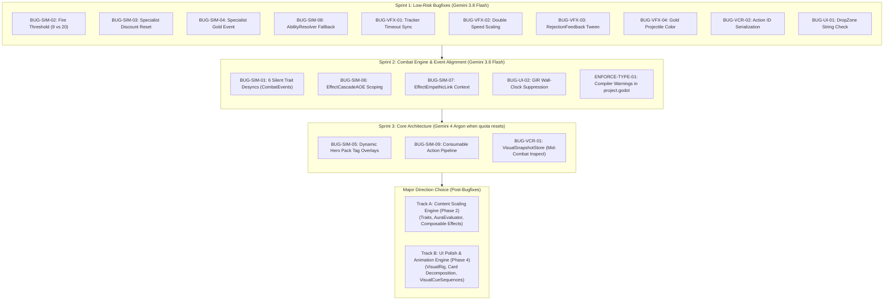

# Flashcard Heroes — Post-Phase 0 Issues & Bugfixes Backlog

> **Purpose**: This document tracks all concrete bugs, silent VCR desyncs, animation timing flaws, and structural coupling issues uncovered during the full codebase audit.
> Each issue details its **root cause**, **exact code locations**, **clean-code resolution strategy**, and **model recommendation** (`Gemini 3.8 Flash High` vs `Gemini 4 Argon`).
>
> **Important Rule Reminder**: In accordance with project rules, **never apply defensive patches or symptom workarounds**. When fixing an issue, address the underlying architectural cause so the entire class of bug cannot recur. If fixing an issue changes observable gameplay or visual behavior to match the documentation, user approval must be confirmed first.

---

## Quick Reference Index

| ID | Issue Title | Severity | Recommended Model | User Approval Required? |
| :--- | :--- | :--- | :--- | :---: |
| **`BUG-SIM-01`** | [6 Silent VCR Trait Desyncs in BattleManager](#bug-sim-01-6-silent-vcr-trait-desyncs-in-battlemanager) | **High (VCR Desync)** | Gemini 3.8 Flash | Yes (Aligns combat visuals) |
| **`BUG-SIM-02`** | [Fire Trait Tier-3 Threshold Mismatch (9 vs 20)](#bug-sim-02-fire-trait-tier-3-threshold-mismatch-9-vs-20) | **Medium (Rule Inconsistency)** | Gemini 3.8 Flash | Yes (Confirms intended threshold) |
| **`BUG-SIM-03`** | [Specialist Gacha Discount Never Resets Per Turn](#bug-sim-03-specialist-gacha-discount-never-resets-per-turn) | **High (Gameplay Bug)** | Gemini 3.8 Flash | Yes (Restores per-turn discount) |
| **`BUG-SIM-04`** | [SPECIALIST >= 4 Gold Award Bypasses ON_GOLD_EARNED](#bug-sim-04-specialist--4-gold-award-bypasses-on_gold_earned) | **Medium (Event Bypass)** | Gemini 3.8 Flash | No (Fixes event pipeline) |
| **`BUG-SIM-05`** | [Dynamic Hero Pack Tags Vanish on Save/Load](#bug-sim-05-dynamic-hero-pack-tags-vanish-on-saveload) | **High (Save Corruption)** | Gemini 4 Argon | No (Fixes save persistence) |
| **`BUG-SIM-06`** | [EffectCascadeAOE Drains Unrelated Reactions & Drops Visuals](#bug-sim-06-effectcascadeaoe-drains-unrelated-reactions--drops-visuals) | **Medium (Reaction Queue)** | Gemini 3.8 Flash | No (Fixes reaction scoping) |
| **`BUG-SIM-07`** | [EffectEmpathicLink NPE Risk in CombatSimulator](#bug-sim-07-effectempathiclink-npe-risk-in-combatsimulator) | **Medium (Crash Risk)** | Gemini 3.8 Flash | No (Fixes context routing) |
| **`BUG-SIM-08`** | [AbilityResolver Unknown Triggers Default to `return true`](#bug-sim-08-abilityresolver-unknown-triggers-default-to-return-true) | **High (Defensive Bug Trap)** | Gemini 3.8 Flash | No (Enforces fail-fast) |
| **`BUG-SIM-09`** | [InventoryManager Bypasses EffectDefinition on Consumables](#bug-sim-09-inventorymanager-bypasses-effectdefinition-on-consumables) | **High (Content Pipeline)** | Gemini 4 Argon | Yes (Enables consumable effects outside battle) |
| **`BUG-VFX-01`** | [AnimationCompletionTracker Mid-Air Timeout Cutoffs](#bug-vfx-01-animationcompletiontracker-mid-air-timeout-cutoffs) | **High (Visual Snap Glitch)** | Gemini 3.8 Flash | No (Fixes animation sync) |
| **`BUG-VFX-02`** | [Double Speed-Scaling Bug in TokenSpendVFX](#bug-vfx-02-double-speed-scaling-bug-in-tokenspendvfx) | **Medium (Speed Factor)** | Gemini 3.8 Flash | No (Fixes visual pacing) |
| **`BUG-VFX-03`** | [RejectionFeedback Unbound Tween Crash & Permanent Tilt](#bug-vfx-03-rejectionfeedback-unbound-tween-crash--permanent-tilt) | **Medium (Crash / UI Tilt)** | Gemini 3.8 Flash | No (Fixes tween lifecycle) |
| **`BUG-VFX-04`** | [Missing "gold" Color Branch in BuffNumberProjectile](#bug-vfx-04-missing-gold-color-branch-in-buffnumberprojectile) | **Low (Visual Consistency)** | Gemini 3.8 Flash | No (Adds missing color) |
| **`BUG-VCR-01`** | [Mid-Combat Inspection & Draw Reads Live Post-Turn State](#bug-vcr-01-mid-combat-inspection--draw-reads-live-post-turn-state) | **High (Snapshot Leak)** | Gemini 4 Argon | No (Enforces Puppet snapshot rule) |
| **`BUG-VCR-02`** | [Ephemeral Object Instance IDs Serialized into Replays](#bug-vcr-02-ephemeral-object-instance-ids-serialized-into-replays) | **High (Replay Collision)** | Gemini 3.8 Flash | No (Replaces with LocationIdentifier) |
| **`BUG-UI-01`** | [Localized UI String Comparison for Scene Detection](#bug-ui-01-localized-ui-string-comparison-for-scene-detection) | **High (Localization Fragility)** | Gemini 3.8 Flash | No (Replaces with explicit descriptors) |
| **`BUG-UI-02`** | [Wall-Clock Input Suppression in GlobalInteractionRouter](#bug-ui-02-wall-clock-input-suppression-in-globalinteractionrouter) | **Medium (Frame-Rate Dependency)**| Gemini 3.8 Flash | No (Replaces with state gating) |
| **`ENFORCE-TYPE-01`** | [Strict GDScript Compiler Enforcement in project.godot](#5-static-typing--gdscript-compiler-enforcement-enforce-type-01) | **High (Code Quality Gate)** | Gemini 3.8 Flash | Yes (Enables compile-time type errors) |
| **`TRACK-CONTENT`** | [Content Scaling Engine: Traits, Composable Effects & Auras](#track-a-rapid-content-scaling-engine-phase-2) | **Feature Engine** | Flash / Argon | Yes (Decouples content from engine) |
| **`TRACK-UIVFX`** | [UI Polish & Animation Engine: VisualRig & VisualCueSequence](#track-b-ui-polish-animation--vfx-engine-phase-4) | **Visual Engine** | Flash / Argon | Yes (Enables juice without breaking VCR) |

---

## 1. Active Gameplay & Combat Simulation Bugs

### `BUG-SIM-01`: 6 Silent VCR Trait Desyncs in BattleManager
- **Severity**: High (Causes puppet UI and replay state to desync from authoritative simulation)
- **Files & Lines**:
  - [BattleManager.gd:2223-2234](file:///Users/danhh/Desktop/Flashcard%20Heroes/scripts/BattleManager.gd#L2223-L2234) (`TANK >= 3` frontline armor & `MECHA >= 3` spikes)
  - [BattleManager.gd:2387-2395](file:///Users/danhh/Desktop/Flashcard%20Heroes/scripts/BattleManager.gd#L2387-L2395) (`PLANT >= 5` frontline spikes)
  - [BattleManager.gd:2505-2515](file:///Users/danhh/Desktop/Flashcard%20Heroes/scripts/BattleManager.gd#L2505-L2515) (`APPLIANCE` turn-start debuff conversion)
  - [BattleManager.gd:2529-2540](file:///Users/danhh/Desktop/Flashcard%20Heroes/scripts/BattleManager.gd#L2529-L2540) (`TANK >= 5` armor passing)
  - [BattleManager.gd:2787-2795](file:///Users/danhh/Desktop/Flashcard%20Heroes/scripts/BattleManager.gd#L2787-L2795) (`FIGHTER >= 5` post-combat bonus)
- **Root Cause**:
  Traits were hardcoded as imperative `for` loops inside [BattleManager.gd](file:///Users/danhh/Desktop/Flashcard%20Heroes/scripts/BattleManager.gd) phases. They directly modify `inst.add_status_effect(...)` or `inst.current_hp` **without creating or emitting a `CombatEvent`** into the turn sequence. The Puppet VCR view (`GachaBallView`) never receives an event to animate the armor or spikes gain, so visual stat numbers snap or disagree with the combat simulation.
- **Clean Resolution**:
  Route trait activations through standard `AbilityDefinition` resources evaluated by [AbilityResolver.gd](file:///Users/danhh/Desktop/Flashcard%20Heroes/scripts/AbilityResolver.gd) and [CombatSimulator.gd](file:///Users/danhh/Desktop/Flashcard%20Heroes/scripts/battle/CombatSimulator.gd). Every stat or status modification must generate a typed `CombatEvent.Type.BUFF` or `CombatEvent.Type.STATUS_EFFECT` with a `CombatPayload`.
- **Model**: `Gemini 3.8 Flash (High)`

---

### `BUG-SIM-02`: Fire Trait Tier-3 Threshold Mismatch (9 vs 20)
- **Severity**: Medium (Gameplay rule discrepancy between combat engine and constants/UI)
- **Files & Lines**:
  - [EffectHandlers.gd:258, 289](file:///Users/danhh/Desktop/Flashcard%20Heroes/scripts/battle/EffectHandlers.gd#L258) (`tier_count >= 9`)
  - [Constants.gd:242](file:///Users/danhh/Desktop/Flashcard%20Heroes/scripts/Constants.gd#L242) (`TRAIT_THRESHOLDS["fire"] = [3, 6, 12, 20, 32]`)
  - [BasicAttackEffect.gd:112](file:///Users/danhh/Desktop/Flashcard%20Heroes/scripts/BasicAttackEffect.gd#L112) (`fire_count >= 20`)
- **Root Cause**:
  Thresholds were duplicated as magic numbers across multiple scripts instead of reading from a single authoritative source. [EffectHandlers.gd](file:///Users/danhh/Desktop/Flashcard%20Heroes/scripts/battle/EffectHandlers.gd) used legacy threshold `9` (from a 3/6/9 iteration), while [Constants.gd](file:///Users/danhh/Desktop/Flashcard%20Heroes/scripts/Constants.gd) and [BasicAttackEffect.gd](file:///Users/danhh/Desktop/Flashcard%20Heroes/scripts/BasicAttackEffect.gd) updated to `20`.
- **Clean Resolution**:
  Read trait thresholds strictly from `Constants.TRAIT_THRESHOLDS` (and eventually `TraitDefinition.tres` in Phase 2). Delete all hardcoded integer checks.
- **User Approval Required**: Confirm whether `12` or `20` is the intended Tier 3 threshold for Fire Soul synergy.
- **Model**: `Gemini 3.8 Flash (High)`

---

### `BUG-SIM-03`: Specialist Gacha Discount Never Resets Per Turn
- **Severity**: High (Makes a "once per turn" discount trigger only "once per battle")
- **Files & Lines**:
  - [BattleManager.gd:1348](file:///Users/danhh/Desktop/Flashcard%20Heroes/scripts/BattleManager.gd#L1348) (`set_meta("specialist_gacha_discount_used", true)`)
- **Root Cause**:
  The specialist trait allows drawing a GachaBall at a 1-token discount once per turn. The implementation stored this flag via Node metadata (`set_meta`) and never cleared it when changing phases or starting a new turn. Consequently, after the player uses the discount once on Turn 1, the flag remains `true` for the rest of the battle. Furthermore, `set_meta` is invisible to `BattleState` serialization and replay digests.
- **Clean Resolution**:
  Store `specialist_gacha_discount_used: bool` inside `BattleState`'s turn state structure, and reset it in `BattleState.clear_turn_data()`.
- **Model**: `Gemini 3.8 Flash (High)`

---

### `BUG-SIM-04`: SPECIALIST >= 4 Gold Award Bypasses ON_GOLD_EARNED
- **Severity**: Medium (Breaks passive triggers that listen for gold income)
- **Files & Lines**:
  - [BattleManager.gd:2798](file:///Users/danhh/Desktop/Flashcard%20Heroes/scripts/BattleManager.gd#L2798) (`run_state.gold += 3`)
- **Root Cause**:
  When combat ends with 4+ Specialists, the script directly increments `run_state.gold += 3`. This bypasses `RunState.earn_gold()`, meaning `SignalBus.gold_earned` is not emitted and abilities that trigger on `TRIGGER_ON_GOLD_EARNED` never fire.
- **Clean Resolution**:
  Call `run_state.earn_gold(3, &"trait_specialist")` (or dispatch a `GrantCurrencyAction`).
- **Model**: `Gemini 3.8 Flash (High)`

---

### `BUG-SIM-05`: Dynamic Hero Pack Tags Vanish on Save/Load
- **Severity**: High (Run save/load state corruption)
- **Files & Lines**:
  - [RunState.gd:1298-1319](file:///Users/danhh/Desktop/Flashcard%20Heroes/scripts/RunState.gd#L1298-L1319) (`_adapt_hero_pack`)
  - [RunState.gd:1418-1522](file:///Users/danhh/Desktop/Flashcard%20Heroes/scripts/RunState.gd#L1418-L1522) (`from_save_dict`)
- **Root Cause**:
  When a Hero Pack like Bounty Hunter rolls a dynamic element (e.g., Fire, Water), `RunState._adapt_hero_pack()` mutates the shared `def.tags` array directly on `Database.units["?MerSpe"]`. When loading a saved run from disk via `from_save_dict()`, `_adapt_hero_pack()` is **never called**, so the units revert to un-adapted tags. Furthermore, mutating shared `Resource` definitions globally leaks into subsequent runs!
- **Clean Resolution**:
  Treat all `Database` resources as strictly immutable flyweights. Store run-level dynamic tags in `RunState.dynamic_tag_overrides: Dictionary[StringName, Array[StringName]]`, serialize this dictionary into the save file, and query `RunState.get_effective_tags(definition_id)`.
- **Model**: `Gemini 4 Argon`

---

### `BUG-SIM-06`: EffectCascadeAOE Drains Unrelated Reactions & Drops Visuals
- **Severity**: Medium (Causal reaction order corruption)
- **Files & Lines**:
  - [EffectCascadeAOE.gd:103](file:///Users/danhh/Desktop/Flashcard%20Heroes/scripts/effects/EffectCascadeAOE.gd#L103) (`drain_pending_reactions_inline(0)`)
- **Root Cause**:
  `EffectCascadeAOE` calls `drain_pending_reactions_inline(0)` with depth `0`. Depth `0` is the root queue, which drains all unrelated reactions currently queued from other triggers. Additionally, the returned `CombatEvent`s from the drained reactions are discarded rather than appended to the turn's event log.
- **Clean Resolution**:
  Use `CausalReactionResolver.begin_scope()` and `drain_scope()` so cascade damage only drains reactions caused by the cascade itself, and append all resulting events to the return payload.
- **Model**: `Gemini 3.8 Flash (High)`

---

### `BUG-SIM-07`: EffectEmpathicLink NPE Risk in CombatSimulator
- **Severity**: Medium (Crash risk during headless combat simulation)
- **Files & Lines**:
  - [EffectEmpathicLink.gd:22, 51](file:///Users/danhh/Desktop/Flashcard%20Heroes/scripts/effects/EffectEmpathicLink.gd#L22) (`context.get("battle_manager")`)
- **Root Cause**:
  `EffectEmpathicLink.gd` expects `context["battle_manager"]`. However, when called from `CombatSimulator.gd` or headless test harnesses, the context passes `"simulator"` instead of `"battle_manager"`. This results in a `null` dereference if triggered headlessly.
- **Clean Resolution**:
  Pass a unified `SimContext` interface that abstracts both `BattleManager` and `CombatSimulator` via polymorphic state queries.
- **Model**: `Gemini 3.8 Flash (High)`

---

### `BUG-SIM-08`: AbilityResolver Unknown Triggers Default to `return true`
- **Severity**: High (Silent bug trap: unknown triggers cause every entity to respond)
- **Files & Lines**:
  - [AbilityResolver.gd:186, 251, 298](file:///Users/danhh/Desktop/Flashcard%20Heroes/scripts/AbilityResolver.gd#L186) (`_should_unit_respond`, `_should_item_respond`, `_should_trinket_respond`)
- **Root Cause**:
  When an ability has a trigger string that is not explicitly handled in `_should_*_respond()`, the match statement falls through to `return true` as a "defensive default". If someone typos a trigger name (e.g., `"on_deat"` instead of `"on_death"`), the ability responds to **every single event** in the game!
- **Clean Resolution**:
  Change the fallback from `return true` to `return false`, and in debug builds assert on unrecognized trigger strings (`assert(TRIGGER_TYPES.has(trigger), "Unknown trigger: %s" % trigger)`).
- **Model**: `Gemini 3.8 Flash (High)`

---

### `BUG-SIM-09`: InventoryManager Bypasses EffectDefinition on Consumables
- **Severity**: High (Content pipeline inconsistency: consumables work in battle but break outside battle)
- **Files & Lines**:
  - [InventoryManager.gd:371-404](file:///Users/danhh/Desktop/Flashcard%20Heroes/scripts/InventoryManager.gd#L371-L404) (`_use_consumable_simple`)
- **Root Cause**:
  When using a consumable outside combat (e.g. at a shop or rest site), `_use_consumable_simple` hardcodes a manual `modify_hp` / `modify_pwr` check and completely skips loading or executing the consumable's `EffectDefinition.execute()` script. Any consumable with a non-stat effect (e.g., cleanse, grant token, transform) silently does nothing outside battle!
- **Clean Resolution**:
  Route consumable usage through a unified `UseConsumableAction` that delegates to `EffectDefinition.execute()` regardless of whether the game is currently in battle or in camp.
- **Model**: `Gemini 4 Argon`

---

## 2. Animation, VFX & Presentation Bugs

### `BUG-VFX-01`: AnimationCompletionTracker Mid-Air Timeout Cutoffs
- **Severity**: High (Visual glitch: saved units snap mid-air, attacks start before landing)
- **Files & Lines**:
  - [AnimationCompletionTracker.gd:23-33](file:///Users/danhh/Desktop/Flashcard%20Heroes/scripts/animations/AnimationCompletionTracker.gd#L23-L33) (`TIMEOUTS`)
  - [AnimationConstants.gd:85-87](file:///Users/danhh/Desktop/Flashcard%20Heroes/scripts/animations/AnimationConstants.gd#L85-L87) (`LETHAL_SAVE_RISE (0.5) + HOLD (0.3) + LAND (0.6) = 1.4s`)
  - [AnimationConstants.gd:60](file:///Users/danhh/Desktop/Flashcard%20Heroes/scripts/animations/AnimationConstants.gd#L60) (`DEATH_DURATION = 1.0s`)
- **Root Cause**:
  `AnimationCompletionTracker.gd` defines hardcoded `TIMEOUTS` that are shorter than the actual animation durations defined in `AnimationConstants.gd`:
  - `TIMEOUTS[AnimationType.LETHAL_SAVE]` is **`0.8s`**, but the animation is **`1.4s`**. The tracker times out and resolves completion at `0.8s` while the unit is still floating in the air.
  - `TIMEOUTS[AnimationType.DEATH_FADE]` is **`0.8s`**, but death fade is **`1.0s`**.
- **Clean Resolution**:
  Compute `TIMEOUTS` directly from `AnimationConstants` constants plus a safety buffer, or replace polling with direct tween completion signals.
- **Model**: `Gemini 3.8 Flash (High)`

---

### `BUG-VFX-02`: Double Speed-Scaling Bug in TokenSpendVFX
- **Severity**: Medium (VFX runs 9x faster instead of 3x at 3x combat speed)
- **Files & Lines**:
  - [CurrencyAnimator.gd:176, 196](file:///Users/danhh/Desktop/Flashcard%20Heroes/scripts/CurrencyAnimator.gd#L176) (`var stagger_delay = AnimationConstants.scaled(0.12)`)
  - [TokenSpendVFX.gd:70](file:///Users/danhh/Desktop/Flashcard%20Heroes/scripts/vfx/TokenSpendVFX.gd#L70) (`AnimationConstants.scaled(delay)`)
- **Root Cause**:
  `CurrencyAnimator` pre-scales `stagger_delay` by dividing by `speed_factor`, then passes it to `TokenSpendVFX.play()`. Inside `TokenSpendVFX.play()`, it calls `AnimationConstants.scaled()` a **second time**, dividing by `speed_factor` twice. At 3x speed, the delay is scaled by $3^2 = 9\times$ faster!
- **Clean Resolution**:
  Pass raw unscaled base durations to VFX helpers and let the VFX helper scale them once internally.
- **Model**: `Gemini 3.8 Flash (High)`

---

### `BUG-VFX-03`: RejectionFeedback Unbound Tween Crash & Permanent Tilt
- **Severity**: Medium (Crash on rapid clicks and permanently tilted UI cards)
- **Files & Lines**:
  - [RejectionFeedback.gd:24-45](file:///Users/danhh/Desktop/Flashcard%20Heroes/scripts/vfx/RejectionFeedback.gd#L24-L45)
- **Root Cause**:
  1. `tree.create_tween()` is used without binding to `target`. If `target` is freed while the rejection animation is playing, the reset callback crashes on a freed instance.
  2. Rapid double-clicks capture the current mid-shake rotation as `original_rotation`, permanently tilting the card.
- **Clean Resolution**:
  Use `target.create_tween()` (bound to lifecycle) and reset `target.rotation = 0.0` explicitly rather than capturing intermediate transform states.
- **Model**: `Gemini 3.8 Flash (High)`

---

### `BUG-VFX-04`: Missing "gold" Color Branch in BuffNumberProjectile
- **Severity**: Low (Missing projectile color styling)
- **Files & Lines**:
  - [BuffNumberProjectile.gd:34-44](file:///Users/danhh/Desktop/Flashcard%20Heroes/scripts/vfx/BuffNumberProjectile.gd#L34-L44)
  - [RestSite.gd:471-473](file:///Users/danhh/Desktop/Flashcard%20Heroes/scripts/RestSite.gd#L471-L473)
- **Root Cause**:
  `RestSite.gd` Gambling Den spawns a buff number projectile with `type_str = "gold"`, but `BuffNumberProjectile.setup()` only has color branches for `"hp"`, `"pwr"`, `"burn"`, `"spikes"`, and `"armor"`.
- **Clean Resolution**:
  Add a `"gold"` branch to `BuffNumberProjectile.gd` using `AnimationConstants.COLOR_GOLD`.
- **Model**: `Gemini 3.8 Flash (High)`

---

## 3. VCR Playback & Command Pipeline Violations

### `BUG-VCR-01`: Mid-Combat Inspection & Draw Reads Live Post-Turn State
- **Severity**: High (Violates the Snapshot Rule: players see future end-of-turn stats)
- **Files & Lines**:
  - [WindowManager.gd:1011-1025](file:///Users/danhh/Desktop/Flashcard%20Heroes/scripts/WindowManager.gd#L1011-L1025) (`_derive_window_payload`)
  - [UnitInspectionWindow.gd:88, 200-239](file:///Users/danhh/Desktop/Flashcard%20Heroes/scripts/UnitInspectionWindow.gd#L88)
  - [BattleView.gd:905-908](file:///Users/danhh/Desktop/Flashcard%20Heroes/scripts/BattleView.gd#L905-L908) (`_on_gacha_draw_animated`)
  - [BattleAnimator.gd:742-768, 863-873](file:///Users/danhh/Desktop/Flashcard%20Heroes/scripts/BattleAnimator.gd#L742-L768)
- **Root Cause**:
  When a player clicks a unit to inspect it during combat VCR playback, `WindowManager` queries `GameManager.get_instance_by_uuid(uuid)`. Because the simulation has already finished calculating the turn in memory, this returns the **live, post-turn instance**—revealing future HP, PWR, or even death state before the animation has caught up!
- **Clean Resolution**:
  Implement an explicit `VisualSnapshotStore` updated solely as `BattleAnimator` advances through `CombatEvent`s. When VCR playback is active, inspection windows read exclusively from `VisualSnapshotStore`.
- **Model**: `Gemini 4 Argon`

---

### `BUG-VCR-02`: Ephemeral Object Instance IDs Serialized into Replays
- **Severity**: High (Breaks replay playback and causes random object collisions)
- **Files & Lines**:
  - [InspectEntityAction.gd:50-53, 143](file:///Users/danhh/Desktop/Flashcard%20Heroes/scripts/engine/actions/InspectEntityAction.gd#L50-L53)
  - [CancelDragAction.gd:33-36, 97](file:///Users/danhh/Desktop/Flashcard%20Heroes/scripts/engine/actions/CancelDragAction.gd#L33-L36)
- **Root Cause**:
  These actions serialize `Control.get_instance_id()` integers into replay JSON files and call `instance_from_id()` on playback. Godot instance IDs are ephemeral memory addresses that change every execution, causing replay playback to crash or mutate unrelated objects.
- **Clean Resolution**:
  Replace `anchor_view_id` with logical `LocationIdentifier` strings/structs resolved via an O(1) `ViewRegistry`.
- **Model**: `Gemini 3.8 Flash (High)`

---

## 4. UI Architecture & Robustness Issues

### `BUG-UI-01`: Localized UI String Comparison for Scene Detection
- **Severity**: High (Localization edits break gameplay interaction logic)
- **Files & Lines**:
  - [Main.gd:1315, 1369, 1401](file:///Users/danhh/Desktop/Flashcard%20Heroes/scripts/Main.gd#L1315) (`if _action_zone_1_text == tr("ui.utg_drop_hp"):`)
- **Root Cause**:
  `Main.gd` determines whether the active scene is `UnitTrainingGround` versus `Shrine` by checking if a UI label matches a translated string! Changing the Portuguese or English translation string silently breaks drop-target validation.
- **Clean Resolution**:
  Have encounters register a typed `EncounterDropZoneDescriptor` struct declaring their callback actions and drop conditions explicitly.
- **Model**: `Gemini 3.8 Flash (High)`

---

### `BUG-UI-02`: Wall-Clock Input Suppression in GlobalInteractionRouter
- **Severity**: Medium (Frame-rate and time-scale dependent input drops)
- **Files & Lines**:
  - [GlobalInteractionRouter.gd:323, 725, 736, 942, 1106](file:///Users/danhh/Desktop/Flashcard%20Heroes/scripts/GlobalInteractionRouter.gd#L323) (`Time.get_ticks_msec() + 240`)
- **Root Cause**:
  To prevent race conditions between clicking and dragging, `GlobalInteractionRouter` suppresses input by comparing `Time.get_ticks_msec()`. Under frame drops or speed changes (`Engine.time_scale`), this hardcoded millisecond window causes valid clicks to be dropped or clicks to register during animations.
- **Clean Resolution**:
  Use explicit state-machine transitions and signal/action awaiting rather than wall-clock timestamp offsets.
- **Model**: `Gemini 3.8 Flash (High)`

---

## 5. Static Typing & GDScript Compiler Enforcement (`ENFORCE-TYPE-01`)

### Objective
Turn Godot 4.6's analyzer into an automatic, compile-time pair-reviewer under `[debug] gdscript/warnings/` in [project.godot](file:///Users/danhh/Desktop/Flashcard%20Heroes/project.godot). This forces **Gemini 3.8 Flash (High)** to write 100% typed, non-duck-typed code and prevents duck-typing anti-patterns (`.has_method(`, untyped `var x = ...`, and untyped Variant calls) from ever being written.

### The Problem Today
- Currently, **`0` compiler warning or error flags** are configured in `project.godot`.
- **`55.8%` of local variables (`4,188 / 7,510`)** are completely untyped (`var x = ...`).
- **`963` untyped `Dictionary`** vs. only **`1`** typed `Dictionary[K, V]`.
- **`2,915` `is_instance_valid`** guards and **`393` `.has_method`** calls mask broken contracts at runtime instead of failing fast.

### Compiler Settings to Enable (Incremental Roadmap)
In [project.godot](file:///Users/danhh/Desktop/Flashcard%20Heroes/project.godot) under `[debug]`:
```ini
[debug]
gdscript/warnings/untyped_declaration=1         ; 1 = Warning during cleanup, 2 = Error when clean
gdscript/warnings/unsafe_property_access=1      ; Warns on untyped Variant property lookups
gdscript/warnings/unsafe_method_access=1        ; Warns on untyped Variant method calls
gdscript/warnings/unsafe_call_argument=1        ; Warns when passing untyped Variant to typed param
gdscript/warnings/return_value_discarded=1       ; Catches unhandled function returns
gdscript/warnings/shadowed_variable=2            ; 2 = Error: prevents local variables shadowing members
```

### Module-by-Module Migration Strategy
1. **Step 1 (Zero-Risk)**: Enable as **Warnings (`1`)** across the project. Game still runs and compiles normally, but the Godot editor and CLI test runner log warnings.
2. **Step 2 (Lock Clean Folders to Errors `2`)**: As we clean each domain, lock that domain to strict **Errors (`2`)**:
   - First: `tests/` and new `.agents/scripts/` (strictly Error `2`).
   - Second: `scripts/engine/actions/` and `scripts/battle/` (strictly Error `2`).
   - Third: `scripts/content/effects/` and `resources/` (strictly Error `2`).
   - Fourth: UI and Presentation scripts (`scripts/ui/`, `scripts/animations/`).
3. **Fail-Fast Replacements**:
   - Replace `if obj.has_method("foo"): obj.foo()` with explicit static type checks: `var view := obj as GachaBallView; if view: view.foo()`.
   - Replace defensive `is_instance_valid(self)` with standard internal calls.
   - Replace untyped parameter dictionaries with typed DTO `RefCounted` classes (like `CombatPayload`).

- **Model**: `Gemini 3.8 Flash (High)` (can convert files folder-by-folder once configured).

---

## 6. Post-Guardrail Roadmap Tracks: Content Scaling vs. UI/VFX Polish

Once Phase 0 guardrails and the Phase 1 bugfixes are in place, future work divides into two major parallel tracks. You can choose to prioritize either track depending on your near-term game milestone:

### Track A: Rapid Content Scaling Engine (Phase 2)
> **Goal**: Make adding new Hero Packs (e.g. Bounty Hunter, Apprentice), units, items, trinkets, and traits require **zero edits to core engine files** (`BattleManager.gd`, `BattleView.gd`, `EffectHandlers.gd`).

1. **`TraitDefinition` & `HeroPackDefinition` `.tres` Resources**:
   - Create `TraitDefinition` (`id`, `display_name_key`, `icon`, `badge_color`, `sort_priority`, `tier_thresholds: PackedInt32Array`, `tier_abilities: Array[AbilityDefinition]`).
   - Traits become standard board-level `AbilityDefinition` listeners evaluated by the exact same `AbilityResolver` + `CombatEvent` pipeline as Trinkets.
   - Eliminates hardcoded trait checks in `BattleManager.gd`, `BasicAttackEffect.gd`, `EffectHandlers.gd`, `BattleView.gd`, and `UnitInspectionWindow.gd`.
2. **Derived `AuraEvaluator` (Continuous Stat Queries)**:
   - Separate **Permanent Base + Buff Deltas** (`base_pwr + permanent_pwr_delta + turn_pwr_delta`) from **Continuous Derived Auras** (`AuraEvaluator.compute_bonus(unit, board_state)`).
   - Deletes **200+ lines of fake-tag and fake-status compensation math** in [MergeManager.gd](file:///Users/danhh/Desktop/Flashcard%20Heroes/scripts/MergeManager.gd#L79-L154). Merging two units only merges their permanent stats, and `AuraEvaluator` recomputes trinket/trait auras cleanly.
3. **Composable Atomic `Effect` Primitives + `ValueProvider`s + Tiered Arrays**:
   - Replace 75 bespoke `Effect*.gd` files with **~15 atomic `EffectDefinition` subclasses** (`ModifyStatEffect`, `DealDamageEffect`, `HealEffect`, `ApplyStatusEffect`, `SpawnEntityEffect`, `TransformEntityEffect`, `GrantCurrencyEffect`, `ConditionalEffect`, `RepeatEffect`).
   - Support tiered level arrays: `@export var amounts_by_level: PackedInt32Array = [3, 6, 12]` (cuts `.tres` file volume by 60%+).
   - Retire the dead `is_simulation` flag and replace untyped `context: Dictionary` with typed `SimContext`.
4. **100% Unified `status_effects` Pipeline**:
   - Migrate remaining hardcoded status fields (`burn_stacks`, `armor_stacks`, `spikes_stacks`) into data-driven `StatusEffectDefinition` hooks.

- **Model**: `Gemini 3.8 Flash (High)` for Effect primitives & Trait definitions; `Gemini 4 Argon` for `AuraEvaluator` core architecture.

---

### Track B: UI Polish, Animation & VFX Engine (Phase 4)
> **Goal**: Achieve *Cross Blitz*-level tactile polish, juicy animations, custom ability visual choreographies, and rubber-toy drag physics without breaking combat state, input gating, or Puppet Mode VCR playback.

1. **The `VisualRig` Transform Contract**:
   - Establish a clean 5-layer hierarchy: `SlotView` (Container layout owner — never scaled or top-level) $\rightarrow$ `VisualRig` $\rightarrow$ `MotionPivot` (Lunges, hops, recoils) $\rightarrow$ `DeformPivot` (Squash, stretch, hover tilt) $\rightarrow$ `EntityVisualCanvas` (Sprite, capsule, shader stack) + `StatsOverlayView`.
   - Never set `top_level = true` on a Control inside a container.
   - Bind **100% of Tweens** to the node being animated (`create_tween()`, never unbound `get_tree().create_tween()`).
2. **Decompose the 5 UI Monoliths (`8,804` LOC combined)**:
   - **`GachaBallView.gd` (2,439 LOC)** $\rightarrow$ Split into separate `.tscn` compositions (`BattleUnitCardView.tscn`, `CapsuleItemView.tscn`, `TrinketBadgeView.tscn`) sharing reusable child components (`RubberDragController`, `StatusPillStrip`, `OutlinePriorityController`).
   - **`Main.gd` (1,907 LOC)** $\rightarrow$ Extract `AppSceneRouter`, `HudTopBarPresenter`, `GachaMachineView`, and declarative `EncounterDropZoneBar`.
   - **`WindowManager.gd` (1,873 LOC)** $\rightarrow$ Extract `ModalStackController`, `DrawerPresenter`, `TooltipPositioner` (synchronous minimum-size math instead of 8-frame offscreen parking), and `LocationViewRegistry` (O(1) dictionary lookups instead of full-tree BFS).
   - **Consolidate Duplicate Encounters & Animators**: Replace the **10+ copy-pasted Bezier ball-toss implementations** with a shared `ArcTossAnimator`, and consolidate `Reward` vs `RewardElite` vs `Shop` into `EncounterBase`.
3. **Data-Driven `VisualCueSequence` Resources**:
   - Route **100% of `CombatEvent` types** through `AnimationRegistry` (eliminating inline `SUMMON`, `DEATH`, `DRAW`, `ITEM_TRANSFER` blocks in `BattleAnimator.gd`).
   - Allow any ability, item, or status effect to reference a `VisualCueSequence.tres` (`caster_cue` $\rightarrow$ `delivery_cue` $\rightarrow$ `impact_cue`). Adding custom ability animations requires zero edits to engine core.
   - Replace reflection-based `ArtStyleManager` with Godot Theme variations.

- **Model**: `Gemini 3.8 Flash (High)` for UI views, VFX shaders & animations; `Gemini 4 Argon` for `VisualRig` core layout & `WindowManager` decomposition.

---

## 7. Strategic Execution Order

When Phase 0 (Guardrails & Headless Suite) is completed and we begin tackling this backlog:


